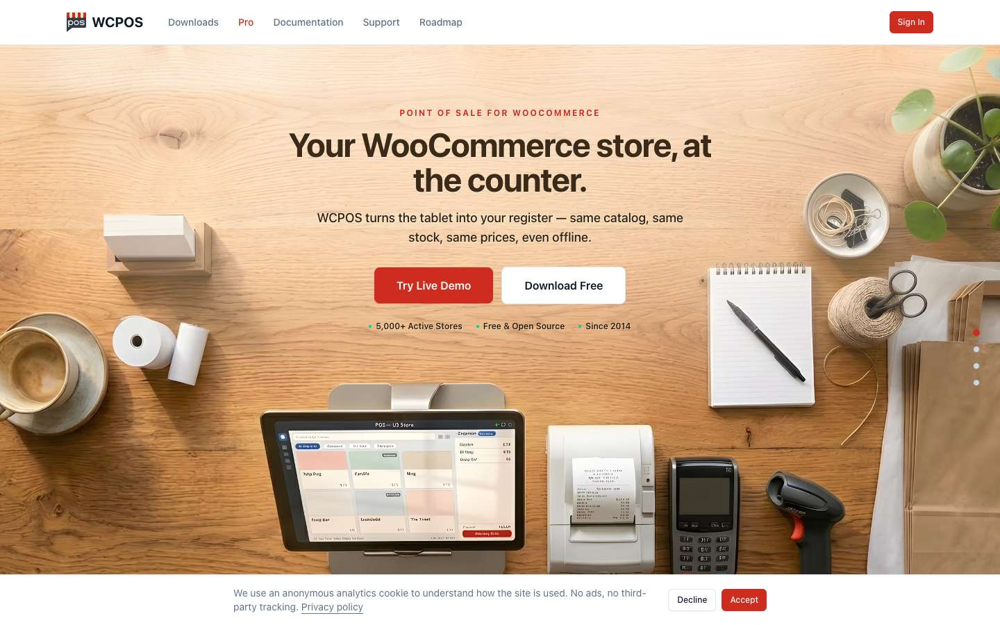
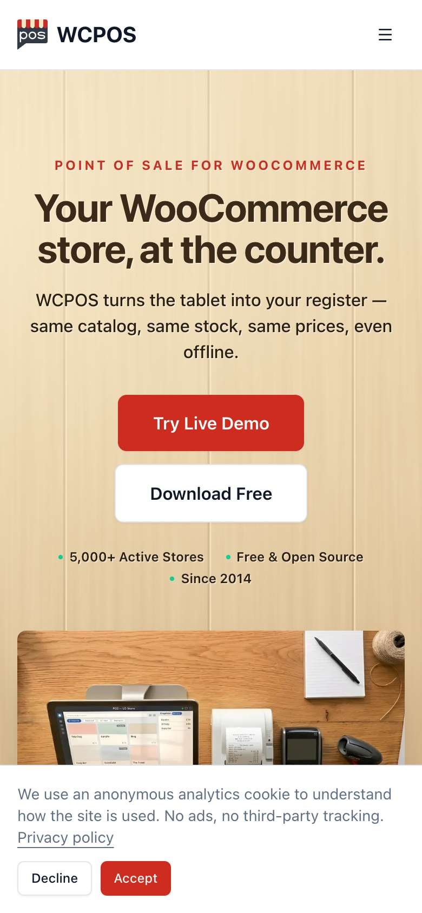
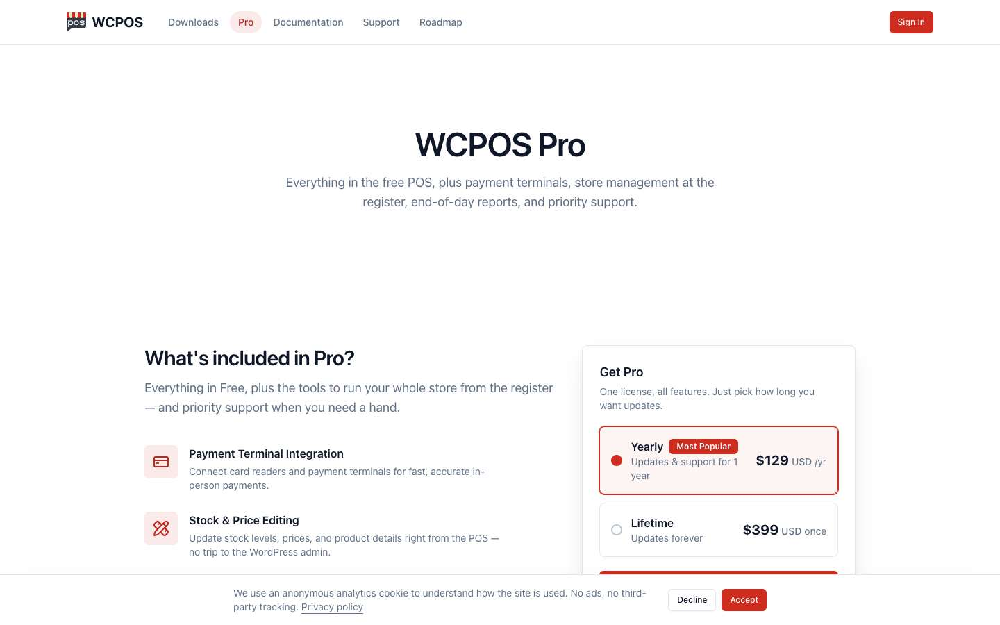
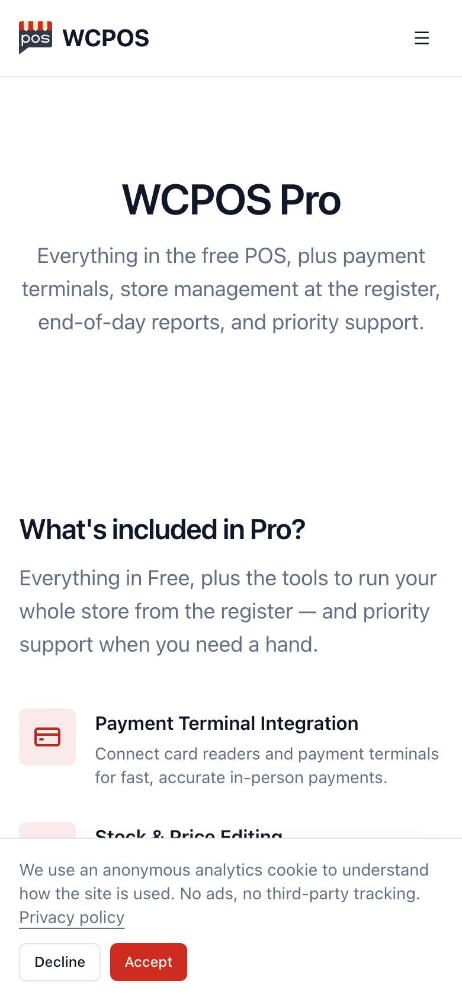
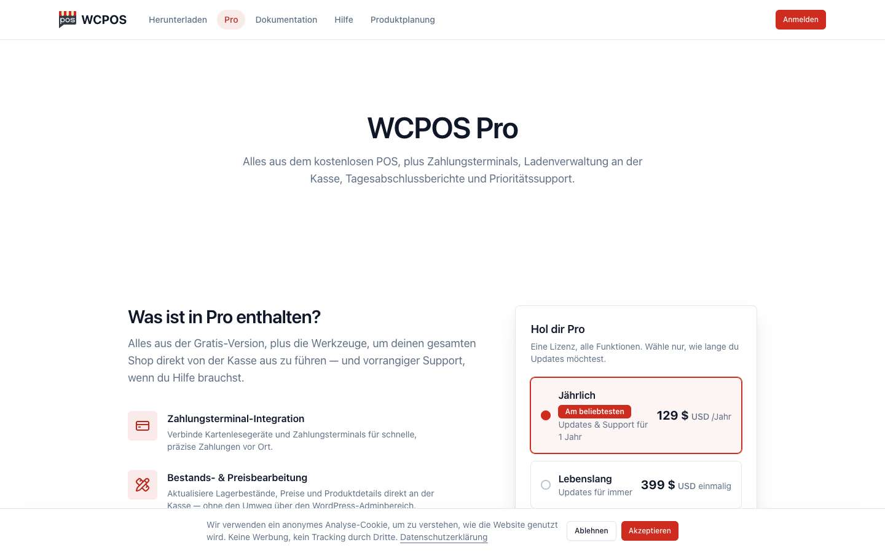
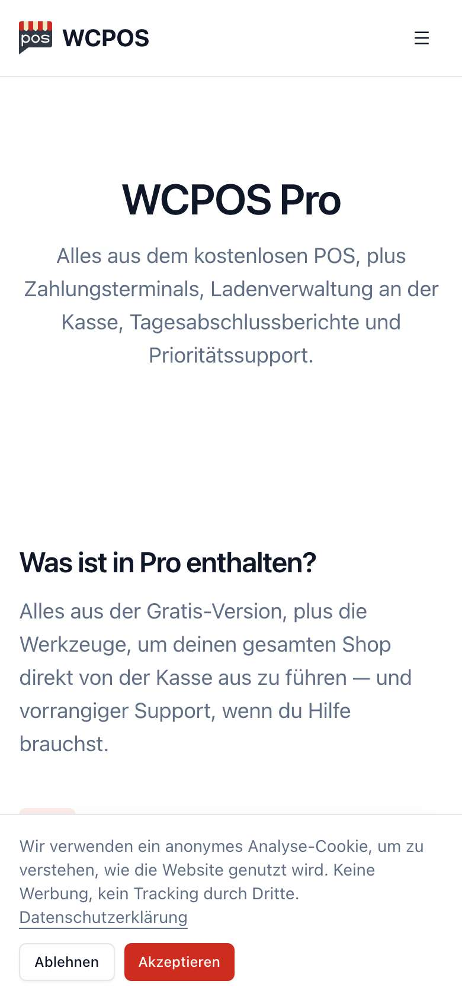

# wcpos.com hill climb — round 1 (2026-11-17)

Baseline judging of the live site (production at `b0dad055`, #705), and the
three fixes chosen from it.

- Captures: [`2026-11-17-round-1/shots/`](2026-11-17-round-1/shots/) (fold
  shots committed; full-page shots stay local), visible text in `text/`,
  page facts in `facts.json`, Lighthouse in `lighthouse.json`.
- Judges: [`2026-11-17-round-1/judges/`](2026-11-17-round-1/judges/). Four
  Opus 5.5 pool one-shots (shop owner, WooCommerce developer, designer, SEO
  specialist); the sceptic is Codex GPT-6 Astra (`codex exec -s read-only`).
- Brief and tools: [`tools/`](tools/).

| Page | Desktop | Phone |
|---|---|---|
| Home |  |  |
| Pro |  |  |
| de Pro |  |  |

## Scores

| Judge | Marketing | UI | SEO |
|---|---|---|---|
| shop-owner (Opus) | 6 | 7 | 8 |
| woo-dev (Opus) | 6 | 7 | 8 |
| designer (Opus) | 6 | 7 | 8 |
| seo (Opus) | 6 | 7 | 7 |
| sceptic (Astra) | 3 | 7 | 7 |
| **Mean** | **5.4** | **7.0** | **7.6** |

Overall mean 6.67.

The sceptic's Marketing 3 rested on a wrong premise: the brief said sales need
a connection. In fact 2.0 completes cash and Card-tender sales offline (wiki
`product/features/free-selling.md`, docs#533). That defect is discarded and the
brief is corrected. The score is kept as given, so round 2 is compared on the
same basis. Without the sceptic, the Marketing mean is 6.0.

## Lighthouse (live, light theme)

| Page | Mobile perf | Desktop perf | A11y / BP / SEO |
|---|---|---|---|
| / | 92 | 99 | 100 |
| /pro | 97 | 99 | 100 |
| /compare | 100 | 100 | 100 |
| /downloads | 94 | 87 (TBT 300 ms) | 100 |
| /de | 72 (TBT 850 ms, LCP 3.3 s) | 81 | 100 |

## Worst defects

**Marketing.** The home page never mentions 2.0, so "why version 2" goes
unanswered (shop-owner, woo-dev, designer, seo). The woo-dev judge also noted
that /pro does not show what Pro adds for several stores or registers.

**UI.** /pro has a blank band of about 190 px under the hero, so no price or
buy button shows on the first screen (all five judges). On phone, the buy box
sits after six feature blocks (shop-owner, sceptic).

**SEO.** The /pro title "Pro - Premium Features | WCPOS" has no WooCommerce,
POS or pricing words (shop-owner, designer, seo). The home page has duplicate
H1s, because both story variants are in the DOM (woo-dev). /de mobile
performance is weak (sceptic).

## Fixes this round (one spec each, Codex GPT-6 Astra)

1. **Marketing**: a "New in 2.0" line above the home hero kicker, in all ten
   locales. The copy only restates free 2.0 features the site already lists
   ("one register with an opening float … numbered closures, split payments,
   and the Reports screen for today").
2. **UI**: on /pro, cut the hero's bottom padding and the features section's
   top padding (a gap of about 190 px becomes about 80 px).
3. **SEO**: a new `pro.metadata.title` in all ten locales, e.g. "Pro Features
   & Pricing for WooCommerce POS | WCPOS".

## Deferred

- The duplicate home H1 and the "TAP TO PAY" label in the home device mockup
  (Tap to Pay is not in 2.0). Both are in files Paul's open PR #204 rewrites
  (`scroll-story.tsx`, `story-static.tsx`, `devices/*`); left until it lands.
- Pricing-adjacent items for the front desk: the home grid tags "Smooth
  checkout flow" and "End-of-day reports" as Pro, although today's reports are
  free in 2.0; "$129/year" sits beside "never auto-renews".
- Later-round candidates: the order of the phone buy box on /pro, the
  /downloads and /extensions titles and descriptions, the hero spacing on the
  /compare/* pages, /de mobile performance, and "the tablet" wording in the
  en/nl hero.
