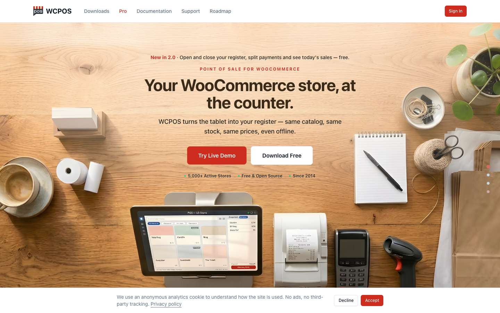
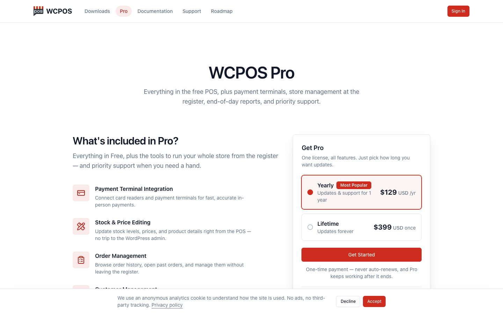
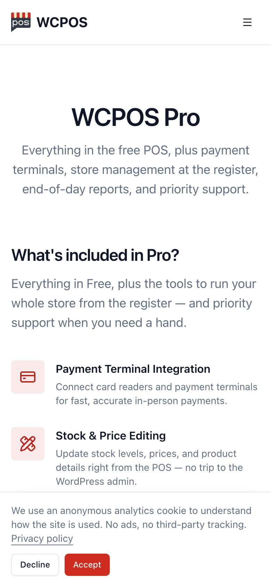
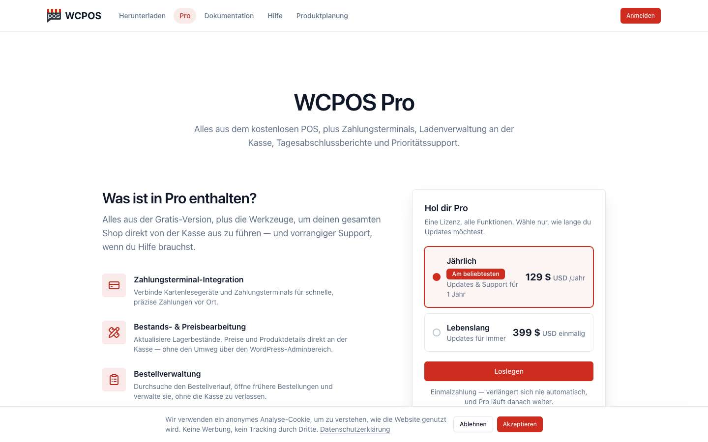
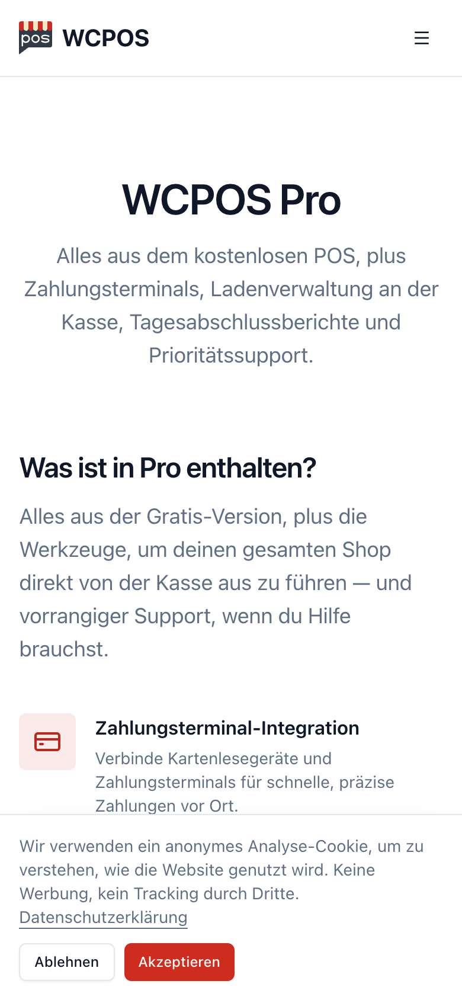
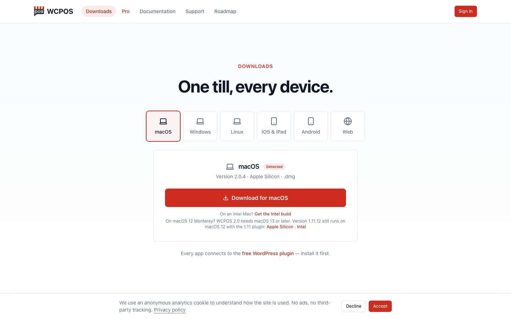
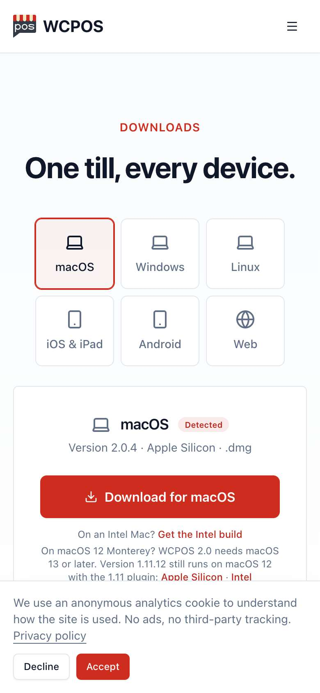

# wcpos.com hill climb — round 2 (2026-11-17)

Re-judging of the live site after round 1's three fixes (production at
`9a3197e1`, #711; #709, #710 and #711 are live), and the fixes chosen from it.

- Captures: [`2026-11-17-round-2/shots/`](2026-11-17-round-2/shots/) (fold
  shots committed; full-page shots stay local), visible text in `text/`,
  page facts in `facts.json`, Lighthouse in `lighthouse.json`.
- Judges: [`2026-11-17-round-2/judges/`](2026-11-17-round-2/judges/). Same
  five personas and brief as round 1: four Opus 5.5 pool one-shots and Codex
  GPT-6 Astra as the sceptic. The judges were not told what changed.

| Page | Desktop | Phone |
|---|---|---|
| Home |  |  |
| Pro |  |  |
| de Pro |  |  |
| Downloads |  |  |

These are also the "before" shots for the tier-copy fix below.

## Scores

| Judge | Marketing | UI | SEO |
|---|---|---|---|
| shop-owner (Opus) | 6 | 7 | 8 |
| woo-dev (Opus) | 6 | 7 | 8 |
| designer (Opus) | 7 | 7 | 8 |
| seo (Opus) | 7 | 7 | 7 |
| sceptic (Astra) | 6 | 7 | 9 |
| **Mean** | **6.4** | **7.0** | **8.0** |
| Round 1 | 5.4 | 7.0 | 7.6 |
| **Delta** | **+1.0** | **0.0** | **+0.4** |

Overall mean 7.13 (round 1: 6.67, +0.47). No track went down, so none of the
round-1 changes is reverted.

- The sceptic moved from 3 to 6 on Marketing once the corrected brief had the
  offline facts right. Without the sceptic, Marketing is 6.4 (round 1: 6.0,
  +0.4).
- UI held at 7 for every judge. The cost of the "New in 2.0" line on phone
  (the hero copy block moves down about 112 px) was not named by any judge.
  The designer's runner-up asks for the line in a neutral style instead of
  red, so there are not two red accents above the H1.

## Lighthouse (live, light theme)

| Page | Mobile perf | Desktop perf | A11y / BP / SEO | vs round 1 |
|---|---|---|---|---|
| / | 92 | 99 | 100 | = / = |
| /pro | 100 | 100 | 100 | +3 / +1 |
| /compare | 100 | 100 | 100 | = / = |
| /downloads | 98 | 100 | 100 | +4 / +13 |
| /de | 65 (TBT 1,020 ms, LCP 4.0 s) | 100 | 100 | −7 / +19 |

Lighthouse varies from run to run against a live CDN. The /de mobile score
has been the weak spot in both rounds.

## Worst defects

**Marketing.** The site contradicts itself on what is free. The home hero now
says closing the register and today's sales are free in 2.0, but the home
feature grid, the Free/Pro list, /pro and /downloads still tag "End-of-day
reports … cash up" as Pro, and the Free column reads like 1.x ("Basic
checkout") (shop-owner, designer, seo, sceptic). The woo-dev judge noted that
/pro never names multi-store or extra registers, although /compare does.

**UI.** On phone, the /pro buy box (price, Get Started) comes after all six
feature blocks, about 1,150 to 1,450 px down (shop-owner, woo-dev, designer,
seo). /de mobile performance is 65 (sceptic).

**SEO.** The /downloads title "Downloads | WCPOS" has no WooCommerce, POS or
platform words (woo-dev, designer, seo). The home meta description does not
say free, open source or 2.0 (shop-owner). The /extensions title and
description are weak (sceptic).

## Fixes this round (one spec each, Codex GPT-6 Astra)

1. **UI**: on /pro below `lg`, show the buy-box column first
   (`order-first lg:order-none`). The desktop layout does not change.
2. **SEO**: a new `downloads.meta.title` in all ten locales, e.g. "Download
   WooCommerce POS for Mac, Windows, Linux & Web | WCPOS". It names only the
   stable apps; iOS and Android are betas.
3. **Marketing** (search snippet): a new `home.meta.description` in all ten
   locales that says free, open source and what 2.0 made free. It restates
   facts the site already gives.
4. **Marketing** (tier copy): the front desk ruled, as a factual correction,
   that the Free/Pro lines may be corrected, on condition that every line is
   proven from the released 2.0.x plugin and the wiki (proof goes in the PR
   body). No price, licence term, plan name or table structure changes. The
   "after" shots of home, /pro and /downloads go in round 3's record.

## Deferred

- Unchanged from round 1: the duplicate home H1 and the "TAP TO PAY" mockup
  label wait on Paul's #204, and so does the sceptic's /de fix (mount the
  desktop scroller only on desktop), which is in `scroll-story.tsx`.
- `$129/year` reads like a subscription next to "never auto-renews"
  (shop-owner). Pricing copy is the front desk's call.
- /extensions title and description (sceptic); home phone CTAs of unequal
  width (designer); the 2.0 line in a neutral style (designer); /pro feature
  card for several stores and registers (woo-dev). These are candidates for
  round 3.
- /compare is linked only from the footer (shop-owner).
