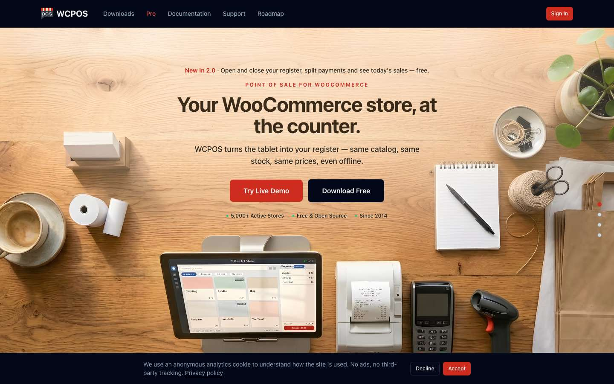
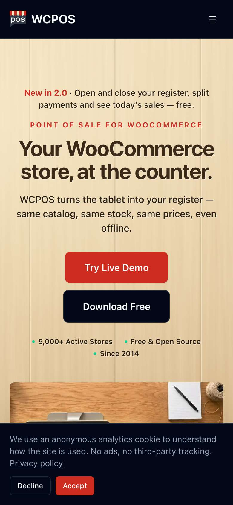
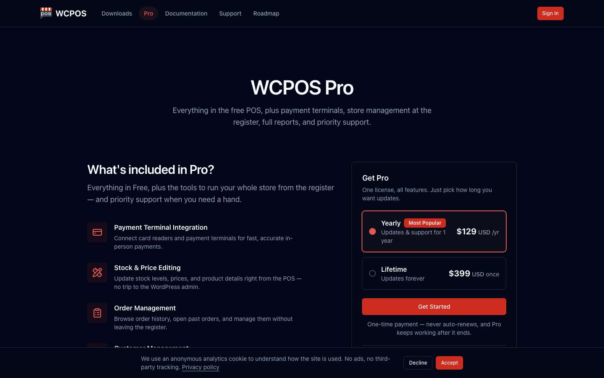
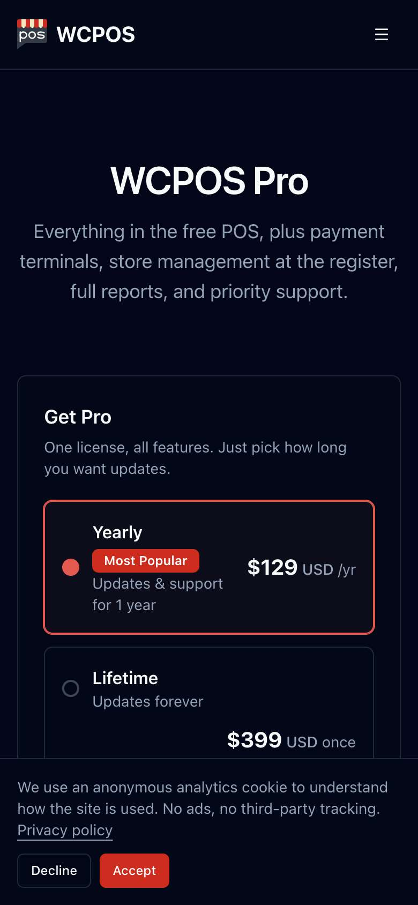
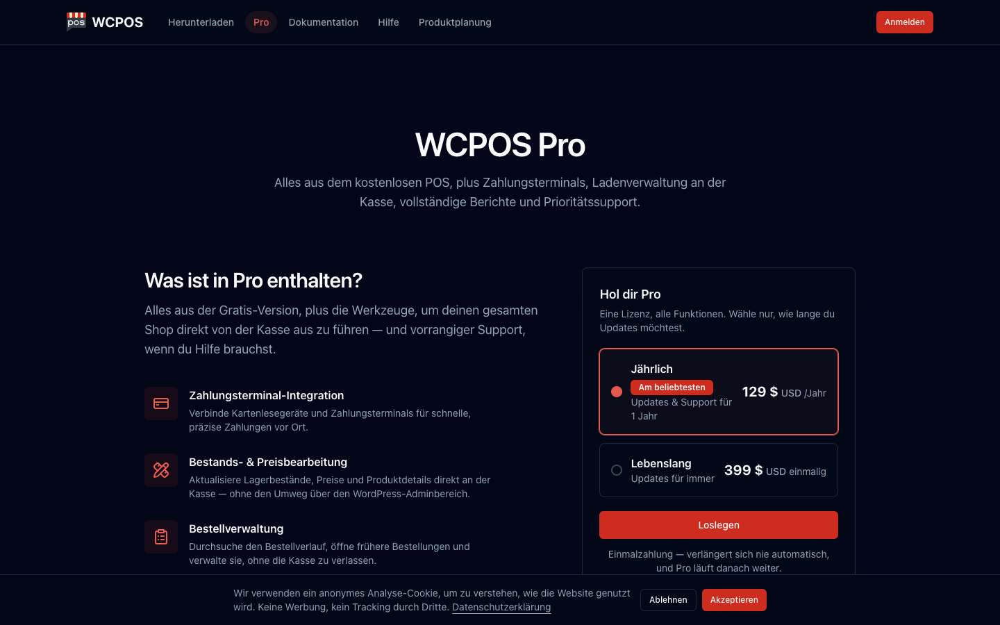
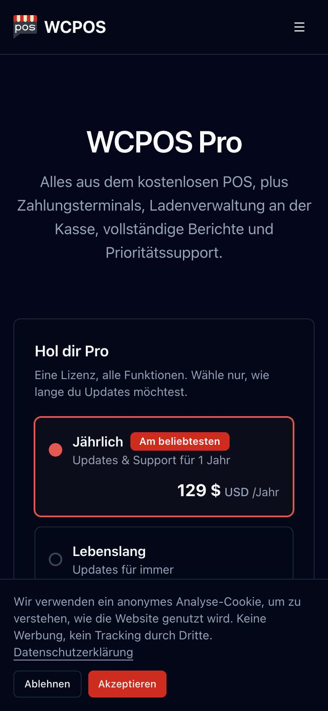
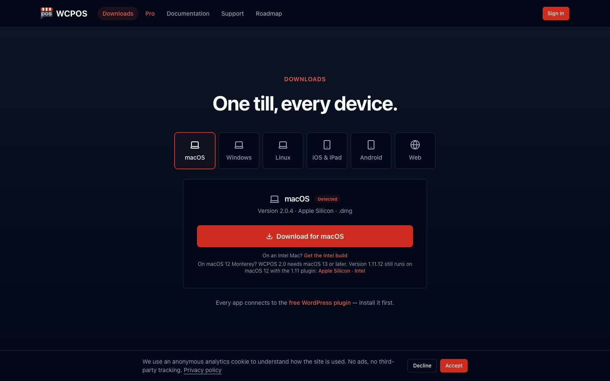
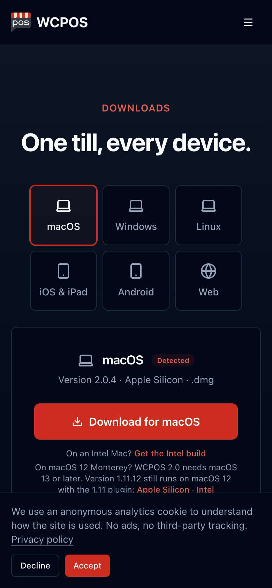

# wcpos.com hill climb — round 3 (2026-11-17)

Re-judging of the live site after round 2's four fixes (production at
`d2321576`, #716; #713, #714, #715 and #716 are live), and the fixes chosen
from it.

- Captures: [`2026-11-17-round-3/shots/`](2026-11-17-round-3/shots/) (fold
  shots committed; full-page shots stay local), visible text in `text/`,
  page facts in `facts.json`, Lighthouse in `lighthouse.json`.
- Judges: [`2026-11-17-round-3/judges/`](2026-11-17-round-3/judges/). Same
  five personas and brief as before: four Opus 5.5 pool one-shots and Codex
  GPT-6 Astra as the sceptic. The judges were not told what changed. Each
  brief gained a short "already known and blocked" list (items waiting on
  Paul's #204 and the pricing copy), so judges name a defect we can act on.

These are the "after" shots for round 2's tier-copy fix (#716), as the front
desk's ruling asked. The "before" shots are in round 2's record.

| Page | Desktop | Phone |
|---|---|---|
| Home |  |  |
| Pro |  |  |
| de Pro |  |  |
| Downloads |  |  |

## Scores

| Judge | Marketing | UI | SEO |
|---|---|---|---|
| shop-owner (Opus) | 7 | 7 | 8 |
| woo-dev (Opus) | 7 | 7 | 8 |
| designer (Opus) | 7 | 7 | 8 |
| seo (Opus) | 7 | 7 | 8 |
| sceptic (Astra) | 7 | 8 | 9 |
| **Mean** | **7.0** | **7.2** | **8.2** |
| Round 2 | 6.4 | 7.0 | 8.0 |
| **Delta** | **+0.6** | **+0.2** | **+0.2** |

The overall mean is 7.47, up 0.34 from round 2's 7.13. Every track rose, so
none of round 2's changes is reverted.

- Marketing gained the most. Every judge scored it 7, and the Free/Pro
  contradiction no longer appears as anyone's worst defect.
- On phone, /pro now shows its price and Get Started button at the fold.
  No judge named the buy-box position.

## Lighthouse (live, light theme)

| Page | Mobile perf | Desktop perf | A11y / BP / SEO | vs round 2 |
|---|---|---|---|---|
| / | 93 | 100 | 100 | +1 / +1 |
| /pro | 100 | 100 | 100 | = / = |
| /compare | 100 | 100 | 100 | = / = |
| /downloads | 99 | 100 | 100 | +1 / = |
| /de | 99 | 100 | 100 | +34 / = |

Lighthouse varies from run to run against a live CDN. The /de mobile jump
from 65 to 99 came without a /de change, so read it as noise, not a win.

## Worst defects

**Marketing.** The home feature grid still puts a Pro badge on "Smooth
checkout flow" and lists cash in that card. That contradicts the Free column
directly below it (shop-owner, designer, seo; the sceptic's runner-up). The
other judges' worst items:
- /pro never says "more stores and registers" (woo-dev).
- /downloads says "Offline-first, so the till never stops", which overstates
  it (sceptic).

**UI.** On a card whose title wraps, the Pro badge floats to the card's
right edge, centred between the two lines. This shows on most de and nl home
cards and on long /extensions names (designer, woo-dev). The other judges'
worst items:
- /compare has a gap of about 250 px on phone (seo).
- The home hero buttons have unequal widths on phone, worst on /de
  (shop-owner).
- The /pro hero spacing on phone (sceptic).

**SEO.** /extensions is titled "Extensions | WCPOS". Its description only
says the page lists extensions, and its H1 is "Extensions". None of these
names WooCommerce POS or the card terminals the page lists. All five judges
named it.

## Fixes this round (one spec each, Codex GPT-6 Astra)

1. **Marketing** (#717): the checkout card loses its Pro badge. Its copy now
   names the free part (cash or card on your own terminal, split a payment)
   and the Pro part (connected readers such as Stripe Terminal and SumUp),
   in all ten locales. Source: woocommerce-pos v2.0.4 readme.txt:19–21.
2. **UI** (#718): the Pro badge flows inline after the last word of a
   `FeatureCard` title and of an /extensions card title.
3. **SEO** (#719): the /extensions title, description and H1 in all ten
   locales, e.g. "WooCommerce POS Extensions & Card Terminals | WCPOS". The
   description names only extensions in the page's own catalog.

## Deferred

- These wait on Paul's #204: the duplicate home H1, the "TAP TO PAY" mockup
  label, and `scroll-story.tsx`.
- The front desk's call: pricing copy (`$129/year` beside "never
  auto-renews").
- Candidates for round 4:
  - /downloads has no `SoftwareApplication` JSON-LD.
  - The /pro FAQ has no `FAQPage` markup.
  - /compare is linked only from the footer.
  - /de/pro switches between du and Sie (`de.json:470-471`).
  - de and nl show "5,000+" rather than the locale's own number format.
  - /compare/square ends without a CTA.
  - The home hero buttons have unequal widths on phone.
  - The /compare gap on phone.
  - /pro does not name more stores and registers.
  - The /downloads "till never stops" wording.
  - iOS and Android appear next to the 2.0 pitch.
