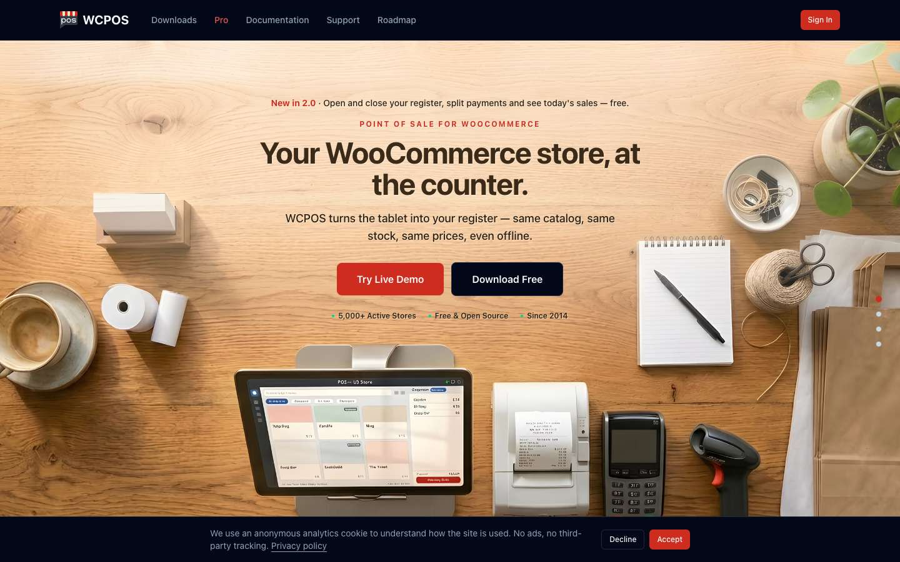
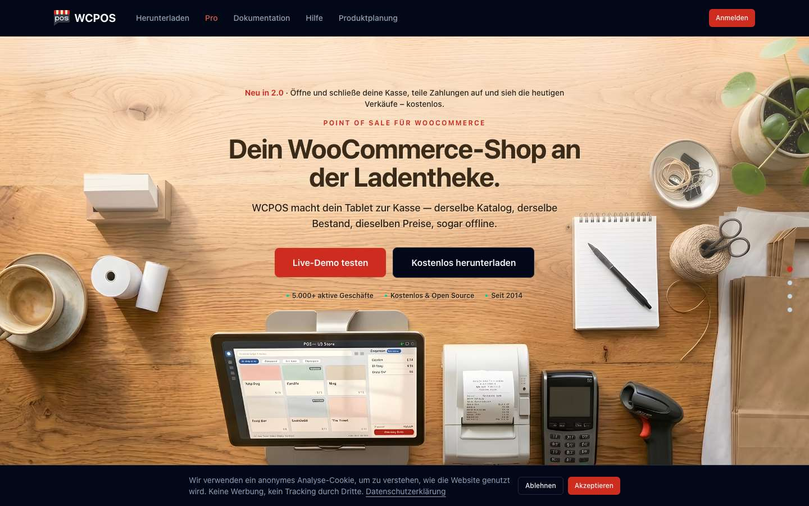
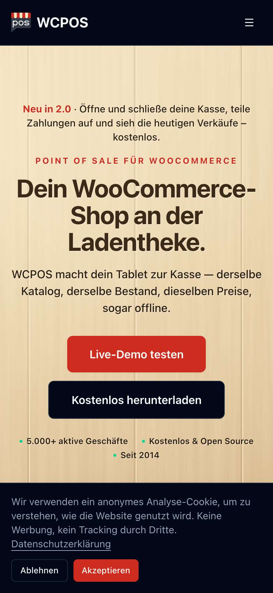
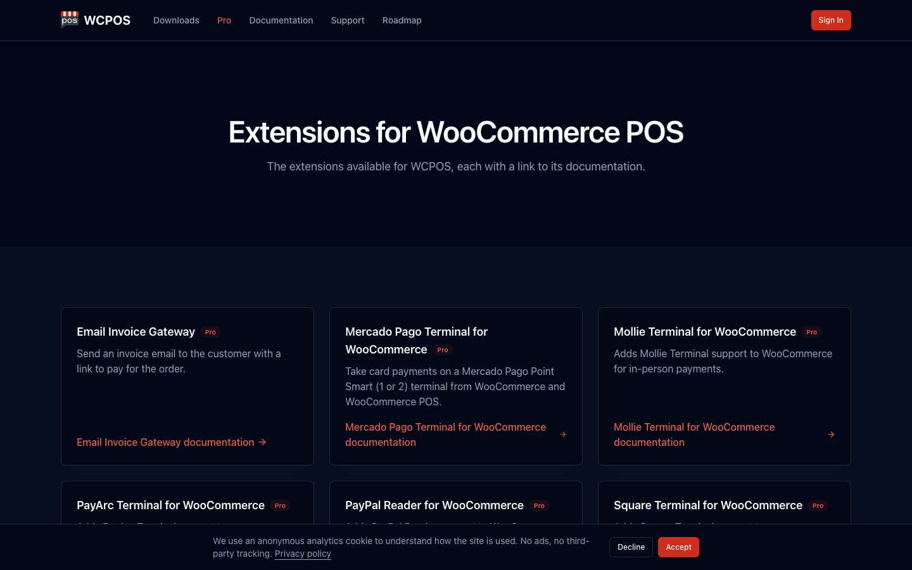
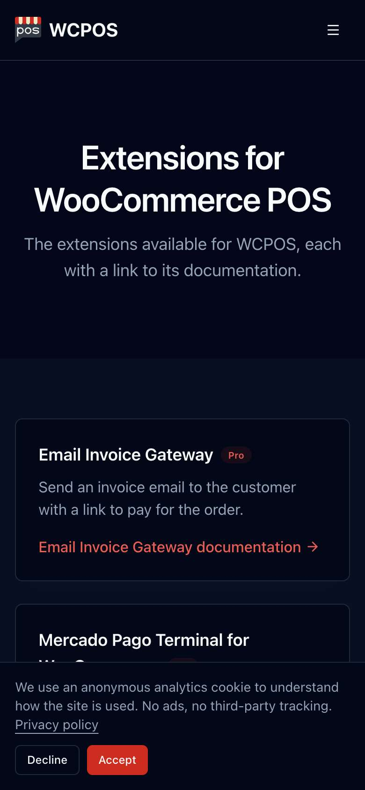
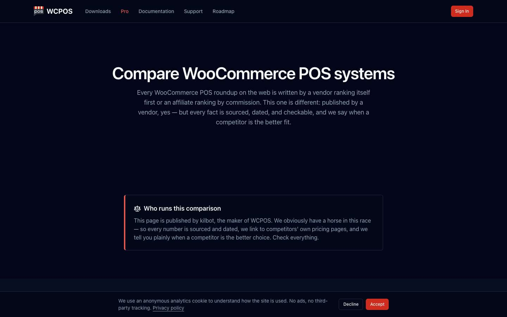
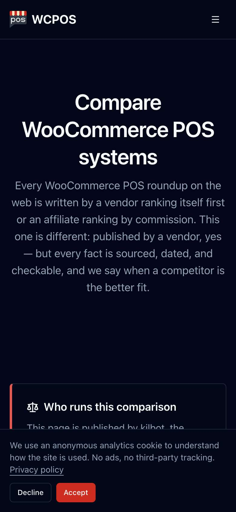
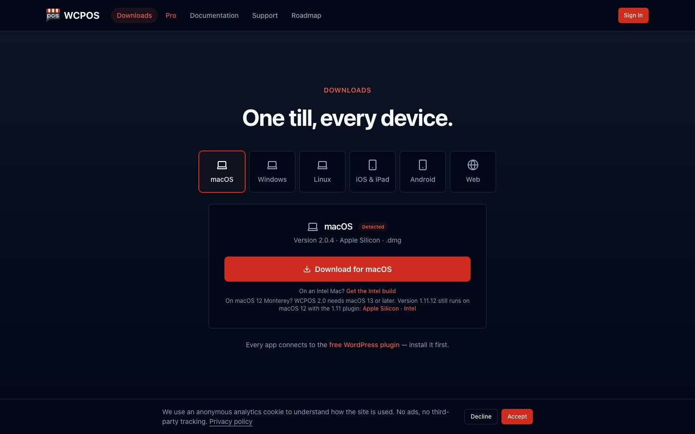
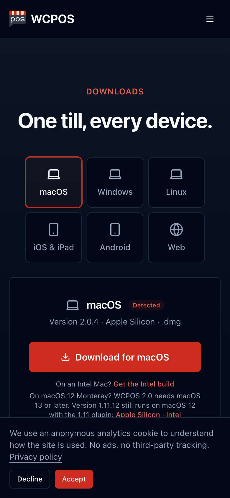

# wcpos.com hill climb — round 4 (2026-11-17)

This round re-judges the live site after round 3's three fixes and records
the fixes chosen from the result. Production is at `18831df2`, and #717, #718
and #719 are live.

- Captures: [`2026-11-17-round-4/shots/`](2026-11-17-round-4/shots/) holds
  the fold shots; the full-page shots stay local. Visible text is in `text/`,
  page facts in `facts.json` and Lighthouse in `lighthouse.json`.
- Judges: [`2026-11-17-round-4/judges/`](2026-11-17-round-4/judges/), with
  the same five personas and brief: four Opus 5.5 pool one-shots, plus Codex
  GPT-6 Astra as the sceptic. The judges were not told what changed.

The table below holds the "after" shots for round 3's fixes. The home grid
covers #717 and #718, and /extensions covers #718 and #719.

| Page | Desktop | Phone |
|---|---|---|
| Home |  |  |
| de home |  |  |
| Extensions |  |  |
| Compare |  |  |
| Downloads |  |  |

## Scores

| Judge | Marketing | UI | SEO |
|---|---|---|---|
| shop-owner (Opus) | 7 | 7 | 7 |
| woo-dev (Opus) | 7 | 7 | 8 |
| designer (Opus) | 7 | 7 | 8 |
| seo (Opus) | 7 | 7 | 8 |
| sceptic (Astra) | 7 | 8 | 9 |
| **Mean** | **7.0** | **7.2** | **8.0** |
| Round 3 | 7.0 | 7.2 | 8.2 |
| **Delta** | **0** | **0** | **−0.2** |

The overall mean is 7.40, down 0.07 from round 3's 7.47.

**Nothing is reverted.** The whole SEO drop comes from one judge, the shop
owner, whose score went from 8 to 7. Their SEO defect is on /compare, which
has no links in its body and no visible breadcrumb. No round-3 PR touched
/compare. No judge criticised round 3's /extensions changes (#719), and the
home grid fixes (#717, #718) no longer show up as anyone's worst defect.
Reverting any of those three would bring back a defect the judges did name,
and would not address the cause of the drop.

## Lighthouse (live, light theme)

| Page | Mobile perf | Desktop perf | A11y / BP / SEO | vs round 3 |
|---|---|---|---|---|
| / | 94 | 100 | 100 | +1 / = |
| /pro | 97 | 100 | 100 | −3 / = |
| /compare | 100 | 100 | 100 | = / = |
| /downloads | 100 | 100 | 100 | +1 / = |
| /de | 95 | 100 | 100 | −4 / = |

The /pro and /de mobile scores move within run-to-run noise against a live
CDN, and neither page changed in round 3.

## Worst defects

**Marketing.**
- The /downloads point "Offline-first, so the till never stops" overstates
  what 2.0 does (seo, sceptic). Connected card readers and online gateways
  need a connection.
- The /compare pages end without a call to action (shop-owner, designer).
- /pro never says "more stores and registers" (woo-dev).

**UI.**
- On phone, the /compare hub has an empty band of about 145 px between the
  hero and the disclosure card. The first comparison card falls on the
  second screen (shop-owner, designer).
- /nl/pro shows "US$ 129 USD" (seo).
- The /extensions doc links repeat the extension name, and Windcave's badge
  sits on a line of its own (woo-dev).
- The /downloads Web step offers only the demo (sceptic).

**SEO.**
- /downloads has no `SoftwareApplication` JSON-LD (designer).
- The /downloads H1, "One till, every device.", has no keyword (seo).
- /compare has no links in its body (shop-owner).
- /extensions is linked only from the footer (woo-dev).
- The home meta description puts the 2.0 features next to "mobile apps",
  and the 2.0 store apps are not out yet (sceptic).

## Fixes this round

Each fix has its own spec. Opus 5.5 implemented them on the pool, because
the implementation route was `opus` this round.

1. **Marketing** (#721): in all ten locales, the /downloads offline
   point now says what works without a connection: browsing, carts, and cash
   or separate-terminal sales, which sync when the connection is back. It
   also says that connected readers and online gateways need a connection.
   The source is the 2.0 product facts in the judge brief (wiki
   `product/features/free-selling.md`, docs#533).
2. **UI** (#722): the /compare hub's hero and disclosure sections drop the
   doubled padding, which brings the first comparison card up on phone.
3. **SEO** (#723): /downloads emits the home page's
   `SoftwareApplication` object with a `downloadUrl`, from one shared
   builder. The home output is unchanged.

## Deferred

- The front desk's call: "US$ 129 USD" on /nl/pro. It is in the price
  display.
- Candidates for round 5:
  - a closing CTA on the /compare pages
  - the multi-store line on /pro
  - links in the /compare body and a visible breadcrumb
  - links to /extensions from inside the page body
  - a keyword in the /downloads H1
  - the mobile wording in the home meta description
  - the /extensions doc link text
  - the Web step on /downloads
  - `FAQPage` markup on /pro
  - the du/Sie mix on /de/pro
  - "5,000+" in de and nl
