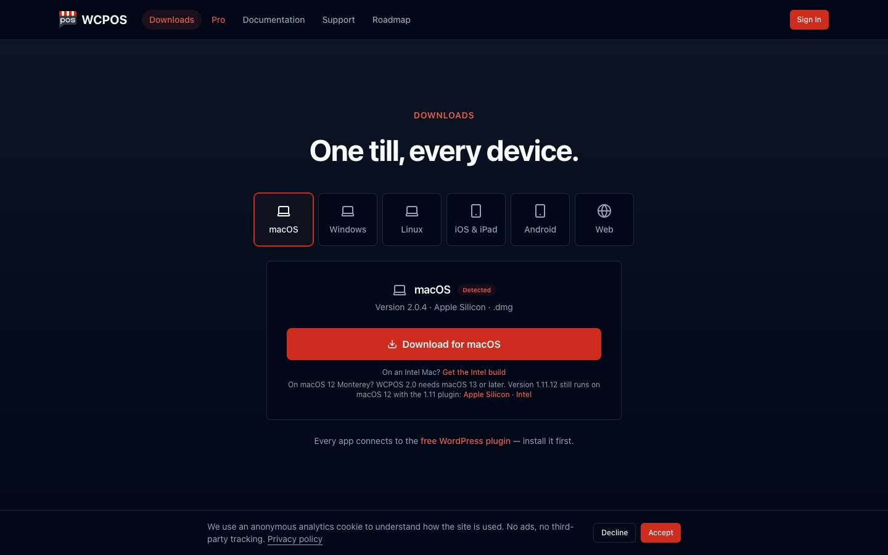
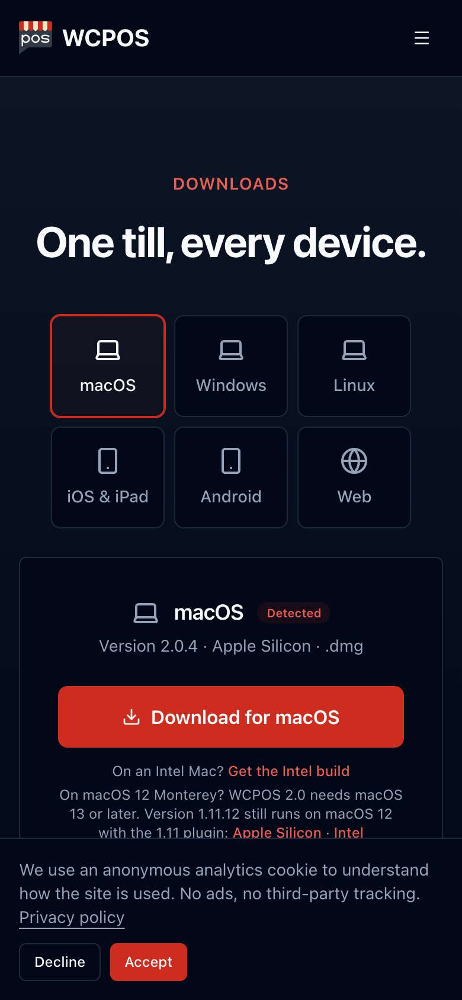
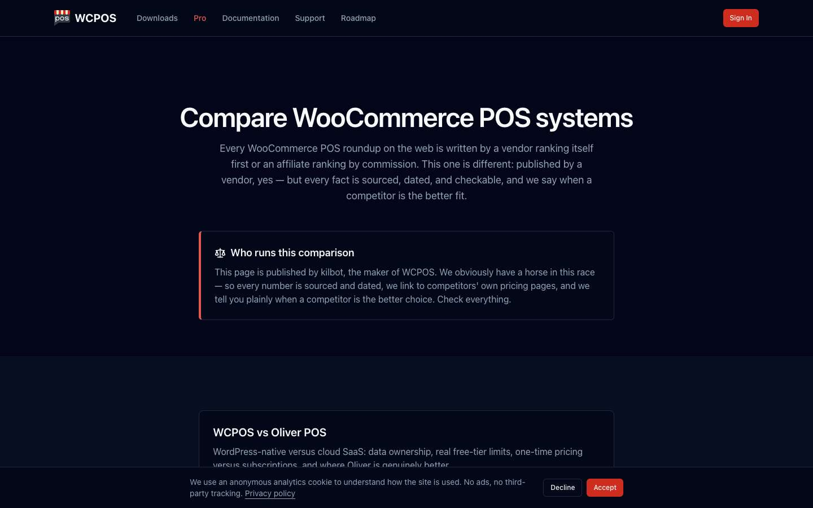
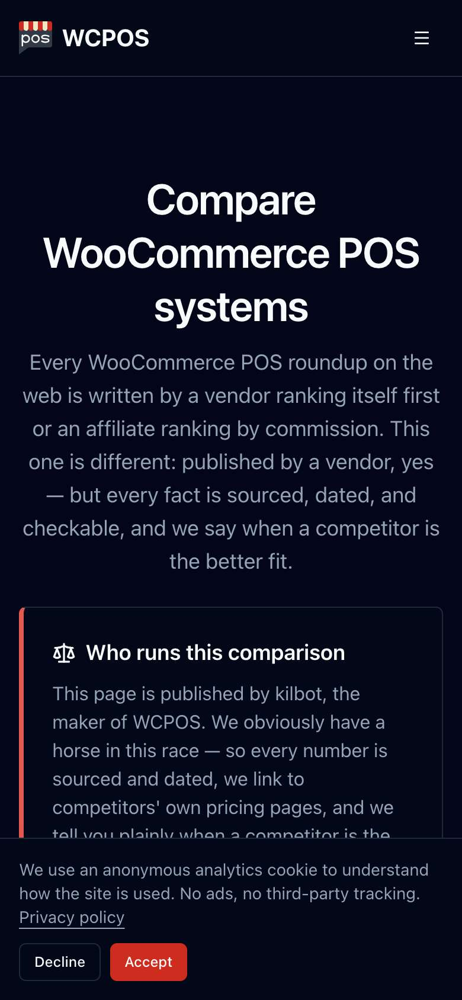
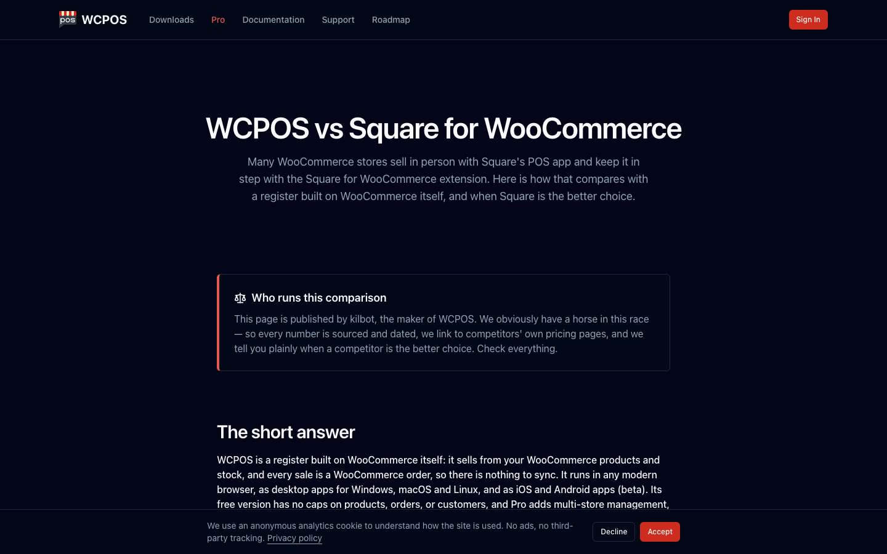
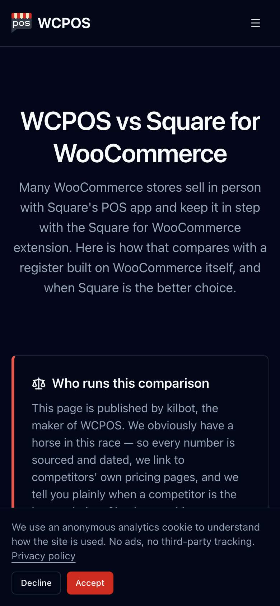
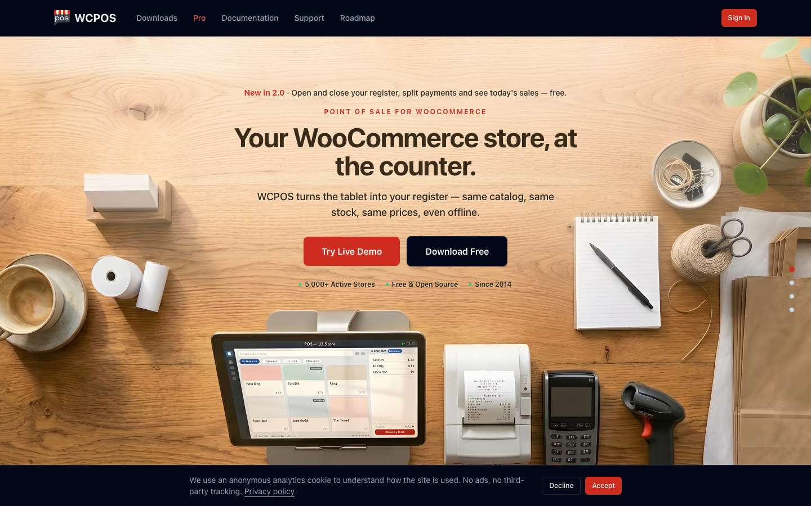

# wcpos.com hill climb — round 5 (2026-11-17)

This round re-judges the live site after round 4's three fixes and records
the fixes chosen from the result. Production is at `ce72713a`, and #721,
#722 and #723 are live.

- Captures: [`2026-11-17-round-5/shots/`](2026-11-17-round-5/shots/) holds
  the fold shots; the full-page shots stay local. Visible text is in `text/`,
  page facts in `facts.json` and Lighthouse in `lighthouse.json`.
- Judges: [`2026-11-17-round-5/judges/`](2026-11-17-round-5/judges/), with
  the same five personas and brief: four Opus 5.5 pool one-shots, plus Codex
  GPT-6 Astra as the sceptic. The judges were not told what changed. The
  brief's out-of-scope list now also names price formatting ("US$ 129 USD"),
  which is the front desk's call.

The table below holds the "after" shots for round 4's fixes: /downloads
covers #721 and #723, and the compare hub covers #722.

| Page | Desktop | Phone |
|---|---|---|
| Downloads |  |  |
| Compare |  |  |
| Compare: Square |  |  |
| Home |  |  |

Checked on the live site: /downloads shows "Keep ringing up sales when the
connection drops" (#721) and emits `Organization` and `SoftwareApplication`
JSON-LD (#723). On phone, the compare hub's disclosure card now sits
directly under the subtitle (#722).

## Scores

| Judge | Marketing | UI | SEO |
|---|---|---|---|
| shop-owner (Opus) | 7 | 7 | 7 |
| woo-dev (Opus) | 7 | 8 | 8 |
| designer (Opus) | 7 | 7 | 8 |
| seo (Opus) | 7 | 7 | 8 |
| sceptic (Astra) | 7 | 8 | 8 |
| **Mean** | **7.0** | **7.4** | **7.8** |
| Round 4 | 7.0 | 7.2 | 8.0 |
| **Delta** | **0** | **+0.2** | **−0.2** |

The overall mean is 7.40, the same as round 4.

**Nothing is reverted.** The overall mean did not drop. UI rose (woo-dev
went from 7 to 8), and the SEO drop comes from one judge: the sceptic went
from 9 to 8 over /compare/square, whose offline table row and FAQ answer
predate round 4 and say only "cash sales". Reverting #721, the one round-4
change on that subject, would bring back the /downloads overstatement that
the sceptic and the SEO judge flagged in round 4. This round's SEO fix
brings /compare in line with #721 instead.

## Lighthouse (live, light theme)

| Page | Mobile perf | Desktop perf | A11y / BP / SEO | vs round 4 |
|---|---|---|---|---|
| / | 94 | 100 | 100 | = / = |
| /pro | 97 | 100 | 100 | = / = |
| /compare | 100 | 100 | 100 | = / = |
| /downloads | 99 | 100 | 100 | −1 / = |
| /de | 91 | 100 | 100 | −4 / = |

/de mobile moves within run-to-run noise against a live CDN; it did not
change in round 4. Home mobile LCP is 3.1 s, and render-blocking CSS is the
largest opportunity (about 280 ms).

## Worst defects

**Marketing.**
- The seven /compare/<competitor> pages end without a call to action
  (shop-owner, seo, designer).
- /pro never names "more stores and registers" as a card (woo-dev).
- /compare/square's "nothing to sync" sits awkwardly next to /downloads'
  "they sync the moment you're back online" (sceptic).

**UI.**
- The compare detail pages keep the full hero padding that #722 removed on
  the hub (seo; designer as runner-up). The sceptic and the shop owner would
  also make the disclosure card less prominent.
- The nav's "Pro" link is always red, so it reads as the current page
  (designer).
- The /extensions doc links repeat the extension name (woo-dev).

**SEO.**
- /compare/square's offline row and FAQ answer, which feeds `FAQPage`
  JSON-LD, leave out sales on a separate card terminal (sceptic).
- /compare/square has no visible breadcrumb or links in its body
  (shop-owner).
- The /downloads H1, "One till, every device.", has no keyword (seo).
- /pro has no `FAQPage` JSON-LD (woo-dev).
- The compare meta descriptions run 188–229 characters (designer).

## Fixes this round

Each fix has its own spec. Opus 5.5 implemented them on the pool, because
the implementation route was `opus` this round.

1. **Marketing** (#726): the seven /compare/<competitor> pages now end
   with the site's existing closing band, the home `CtaSection` ("Try Live
   Demo", "Download Free"), just before the facts footer. No new copy.
2. **UI** (#727): the seven detail pages' hero Sections take the hub's
   `pb-6 md:pb-10 lg:pb-12` from #722, so the short answer comes up on
   phone.
3. **SEO** (#725): in all ten locales, the compare glance rows and FAQ
   offline answers, which feed `FAQPage` JSON-LD, now say what /downloads
   says (#721). Cash sales and sales on a separate card terminal complete
   offline and sync when the connection is back, and connected readers and
   online gateways need a connection. That is 14 keys in each locale.

I ran the mutation checks for #726 and #727 myself, and the failing output
is in each PR body.

## Deferred

- The front desk's calls:
  - "US$ 129 USD" on /nl/pro, which is in the price display.
  - "Is the free plugin limited? No." next to "one register in the free
    version".
- Candidates for round 6:
  - the multi-store and registers card on /pro
  - the nav "Pro" colour
  - a visible breadcrumb and links in the body of the compare pages
  - a keyword in the /downloads H1
  - `FAQPage` markup on /pro
  - compare meta description length
  - the mobile wording in the home meta description and hero
  - the /extensions doc link text
  - a shorter disclosure card on the compare pages
  - the du/Sie mix on /de/pro, and "5,000+" in de and nl
