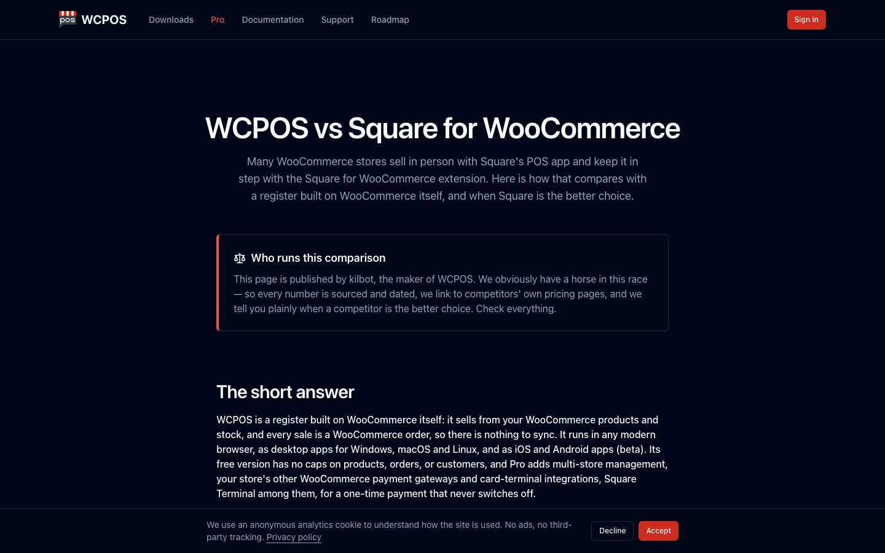
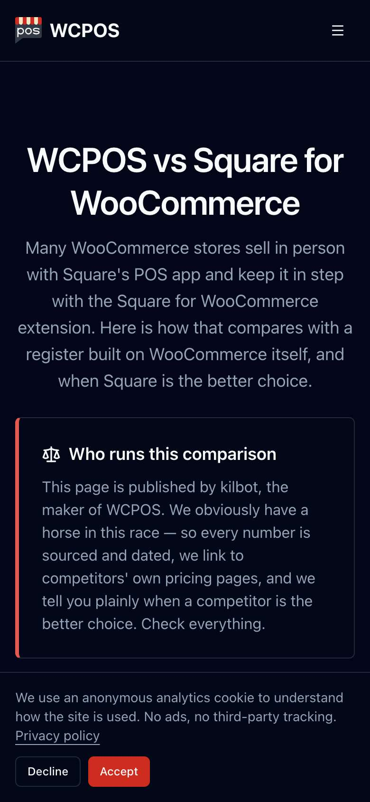
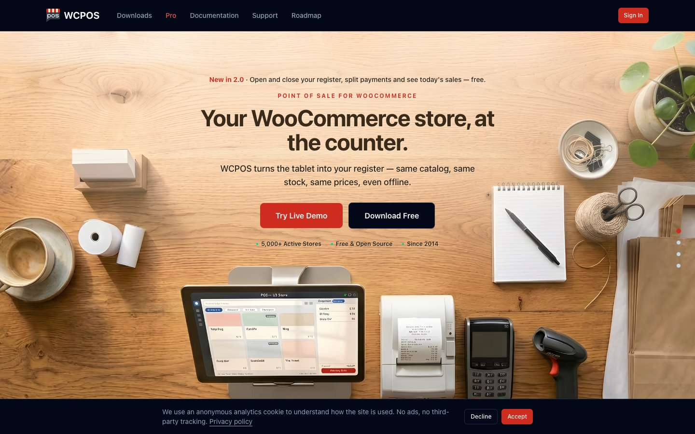
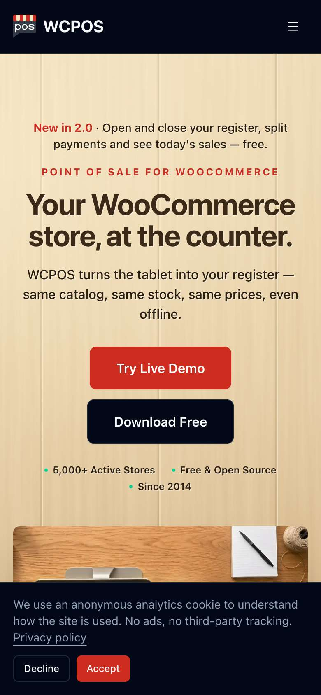

# wcpos.com hill climb — round 6 (2026-11-17)

This round re-judges the live site after round 5's three fixes and records
the fixes chosen from the result. Production is at `2db69ba5`, and #725,
#726 and #727 are live.

- Captures: [`2026-11-17-round-6/shots/`](2026-11-17-round-6/shots/) holds
  the fold shots; the full-page shots stay local. Visible text is in `text/`,
  page facts in `facts.json` and Lighthouse in `lighthouse.json`.
- Judges: [`2026-11-17-round-6/judges/`](2026-11-17-round-6/judges/), with
  the same five personas and brief: four Opus 5.5 pool one-shots, plus Codex
  GPT-6 Astra as the sceptic. The judges were not told what changed.

The table below holds the "after" shots for round 5's fixes: all three
landed on the /compare detail pages.

| Page | Desktop | Phone |
|---|---|---|
| Compare: Square |  |  |
| Home |  |  |

Checked on the live site: /compare/square says "separate card terminal" in
its offline row and FAQ (#725), ends with the "Try Live Demo / Download
Free" band before the footer (#726), and its hero carries
`pb-6 md:pb-10 lg:pb-12` (#727). On phone, the disclosure card now starts
within the first screen.

## Scores

| Judge | Marketing | UI | SEO |
|---|---|---|---|
| shop-owner (Opus) | 7 | 8 | 8 |
| woo-dev (Opus) | 7 | 8 | 8 |
| designer (Opus) | 7 | 7 | 8 |
| seo (Opus) | 7 | 7 | 8 |
| sceptic (Astra) | 7 | 8 | 9 |
| **Mean** | **7.0** | **7.6** | **8.2** |
| Round 5 | 7.0 | 7.4 | 7.8 |
| **Delta** | **0** | **+0.2** | **+0.4** |

The overall mean is 7.60, up from 7.40. **Nothing is reverted.** The
shop-owner moved from 7 to 8 on both UI and SEO, and the sceptic's SEO score
went back from 8 to 9 once the /compare/square offline copy matched
/downloads (#725).

Marketing has been at 7.0 from every judge for three rounds. Each judge's
marketing defect is a different, specific gap (multi-store on /pro, Compare
not in the header, beta status of the phone apps). No single copy fix moves
it, and the bigger levers (a Compare nav entry, new proof) are product or
navigation decisions; see Deferred.

## Lighthouse (live, light theme)

| Page | Mobile perf | Desktop perf | A11y / BP / SEO | vs round 5 (mobile) |
|---|---|---|---|---|
| / | 91 | 100 | 100 | −3 |
| /pro | 100 | 100 | 100 | +3 |
| /compare | 100 | 100 | 100 | = |
| /downloads | 91 | 100 | 100 | −8 |
| /de | 95 | 100 | 100 | +4 |

No round-5 change touched /, /pro, /downloads or /de, so the mobile
performance moves are run-to-run noise against a live CDN (/de swung −4 last
round and +4 this one). Home mobile LCP is 3.4 s; unused JavaScript (about
84 KiB) is the largest opportunity.

## Worst defects

**Marketing.**
- The home page lists "Web, desktop, iOS & Android" as five equal chips and
  the meta description says "mobile apps", while /downloads labels iOS and
  Android "Beta" (designer, sceptic).
- /pro has no multi-store and registers card, though /compare and /about
  say Pro adds them (woo-dev, seo).
- Compare is only in the footer, not in the header or home body
  (shop-owner).

**UI.**
- The nav "Pro" link is always red, so it reads as the current page, and on
  /support or /downloads two items look active (designer, seo; woo-dev as
  runner-up).
- /extensions doc links repeat the full product name (woo-dev).
- The "At a glance" table on /compare/* runs about three phone screens with
  no sticky column header (shop-owner).
- On /compare/square on phone, the disclosure card fills the first screen
  before the short answer (sceptic).

**SEO.**
- /compare/* meta descriptions run 188–229 characters and are cut off before
  "when X is the better choice" (designer, shop-owner; open since round 5).
- /pro's FAQ has no `FAQPage` JSON-LD (woo-dev).
- The /downloads H1 "One till, every device." has no download, POS or
  WooCommerce term (seo; open since round 5).
- The /compare hub's seven links all read "Read the comparison" (sceptic).

## Fixes this round

Three fixes from the judges' lowest defects. Two more came from front-desk
rulings that arrived during the round. Each PR got one review on its head by
this machine, with acceptance rerun and its mutations applied by the
reviewer.

| PR | Merge | Track | Fix |
|---|---|---|---|
| [#729](https://github.com/wcpos/wcpos-com/pull/729) | d53e6e5 | UI | The nav "Pro" link is no longer red unless /pro is the current page, so only the current page reads as active. |
| [#730](https://github.com/wcpos/wcpos-com/pull/730) | 2637044 | SEO | The /compare/* meta descriptions are rewritten to fit (en ≤155, de–pt ≤160, ja/ko/zh ≤100), leading with "when X is the better choice". |
| [#731](https://github.com/wcpos/wcpos-com/pull/731) | 93535ed | Marketing | The home iOS and Android chips carry the /downloads "Beta" label, and the home meta description says "iOS and Android apps in beta". |
| [#732](https://github.com/wcpos/wcpos-com/pull/732) | c369cec | Marketing (front desk 1) | The /pro buy box names the currency once in every locale ("$129 USD"); nl, fr, es, pt, ko and zh had doubled it ("US$ 129 USD"). |
| [#733](https://github.com/wcpos/wcpos-com/pull/733) | 227404e | Marketing (front desk 2) | The /pro FAQ and the home pricing card now say the free plugin runs one register, cited to `woocommerce-pos` `Option_Register_Repository.php:13` and `Registers_Controller.php:89-93`. They no longer say "No" or "No limits". |

Round 7's judging measures the effect of these fixes.

## Deferred

- The front desk's two calls were ruled during the round and shipped as #732 and #733.
- A Compare entry in the header nav is a navigation change. It is a
  candidate for the front desk, not a small fix.
- Candidates for round 7:
  - the multi-store and registers card on /pro
  - `FAQPage` markup on /pro
  - a keyword in the /downloads H1
  - destination-specific link text on the /compare hub
  - the /extensions doc link text
  - the order of the short answer and the disclosure card on /compare/* on phone
  - a sticky column header for the "At a glance" table on phone
  - the /support title
  - the du/Sie mix on /de/pro, and "5,000+" in de and nl
