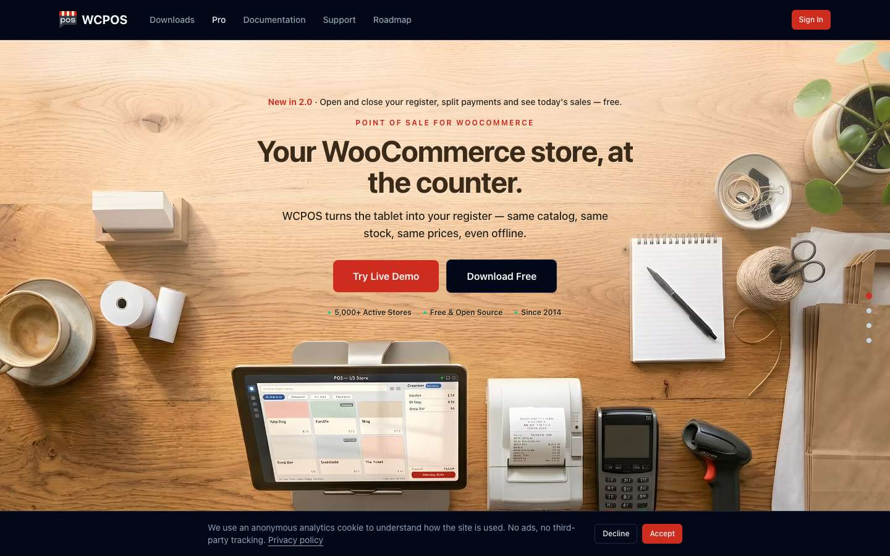
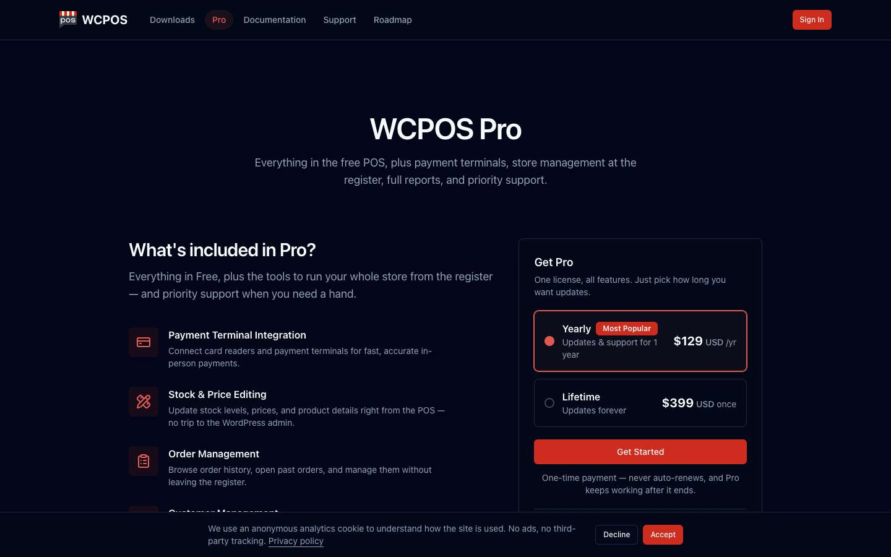
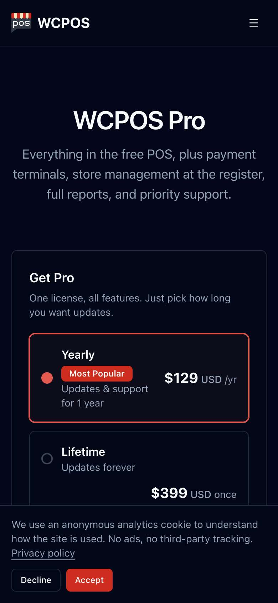

# wcpos.com hill climb — round 7 (2026-11-17)

This round re-judges the live site after round 6's five fixes and records the
fixes chosen from the result. Production is at `227404e5`, with #729 to #733
live.

- Captures: [`2026-11-17-round-7/shots/`](2026-11-17-round-7/shots/) holds
  the fold shots. The full-page shots stay local. Visible text is in `text/`,
  page facts in `facts.json` and Lighthouse in `lighthouse.json`.
- Judges: [`2026-11-17-round-7/judges/`](2026-11-17-round-7/judges/), with
  the same five personas and brief: four Opus 5.5 pool one-shots, plus Codex
  GPT-6 Astra as the sceptic. The judges were not told what changed. One
  edit to the brief: the blocked-list example "US$ 129 USD" was dropped,
  because #732 fixed it.

The shots below are the "after" views for round 6's fixes. On home: the beta
chips (#731) and the free card's "One register" (#733). On /pro: the currency
named once (#732) and the FAQ (#733). Both pages show the nav (#729).

| Page | Desktop | Phone |
|---|---|---|
| Home |  |  |
| Pro |  |  |

## Scores

| Judge | Marketing | UI | SEO |
|---|---|---|---|
| shop-owner (Opus) | 7 | 8 | 8 |
| woo-dev (Opus) | 7 | 7 | 8 |
| designer (Opus) | 7 | 7 | 8 |
| seo (Opus) | 7 | 8 | 8 |
| sceptic (Astra) | 8 | 8 | 9 |
| **Mean** | **7.2** | **7.6** | **8.2** |
| Round 6 | 7.0 | 7.6 | 8.2 |
| **Delta** | **+0.2** | **0** | **0** |

The overall mean is 7.67, up from 7.60. **Nothing is reverted.**

- Marketing moved off 7.0 for the first time in four rounds. The sceptic gave
  8 and named the free version's register, split payments and today's report
  as the reason for 2.0.
- UI held its mean while scores swapped: the seo judge went 7 → 8, and
  woo-dev went 8 → 7 over the buy-box price row on phone.
- No judge flagged the nav, the currency or the free-plugin wording again.

## Lighthouse (live, light theme)

| Page | Mobile perf | Desktop perf | A11y / BP / SEO | vs round 6 (mobile) |
|---|---|---|---|---|
| / | 94 | 100 | 100 | +3 |
| /pro | 100 | 100 | 100 | = |
| /compare | 100 | 100 | 100 | = |
| /downloads | 92 | 100 | 100 | +1 |
| /de | 92 | 100 | 100 | −3 |

Home mobile LCP is 3.0 s (3.4 s last round). Unused JavaScript (about
84 KiB) is still the largest opportunity. None of the round-6 changes touched
the scripts, so the moves are within the run-to-run noise seen before.

## Worst defects

**Marketing.**
- /pro and the home Pro list never say Pro adds more registers or multiple
  stores (woo-dev, seo; also round 6).
- Home "Download Free" lands on /downloads, where the macOS download comes
  before "install the free WordPress plugin first" (shop-owner).
- The home "New in 2.0" line has no link to /changelog (designer).
- /compare/square says "nothing to sync" three times, while the same page
  says offline sales sync when the connection returns (sceptic).

**UI.**
- On phone, /pro buy-box rows wrap differently by label length, so the price
  sits in a different place on each row (designer, woo-dev).
- On phone, /downloads shows the download button above the fold and the
  plugin prerequisite below it (sceptic).
- At 390 px the home scroll-story "orders → Woo" chip runs past the right
  edge (shop-owner). That component is in the owner's open PR, so it is
  left alone here.
- On phone, /pro puts the buy box before "What's included" (seo).

**SEO.**
- The home meta description runs en 188, nl 197, de 216 and fr 239
  characters (shop-owner, designer).
- The /downloads meta description lists the iOS and Android apps without the
  beta label (sceptic).
- The /pro meta description lacks "WooCommerce" and stores/registers
  (woo-dev).
- The /downloads H1 "One till, every device." carries no search term (seo;
  open for three rounds).

## Fixes this round

There are three fixes, one per track. Each comes from a defect two judges
named. Each PR got one review on its head by this machine, which reran
acceptance and applied the mutations itself.

| PR | Merge | Track | Fix |
|---|---|---|---|
| [#735](https://github.com/wcpos/wcpos-com/pull/735) | 1372f3b | SEO | The home and /downloads meta descriptions are rewritten to fit the /compare budgets (en ≤155, de–pt ≤160, ja/ko/zh ≤100). /downloads now says the iOS and Android apps are in beta. A test holds both. |
| [#736](https://github.com/wcpos/wcpos-com/pull/736) | 5322ddd | UI | On /downloads, "install the free WordPress plugin first" sits inside the hero card above the download button, not below the card. No copy change. |
| [#737](https://github.com/wcpos/wcpos-com/pull/737) | f702a33 | Marketing | /pro opens its feature list with "More Registers & Multiple Stores", and the home Pro list opens with "More registers & multiple stores". Both reuse the /compare wording. |

Round 8's judging measures the effect of these fixes.

## Deferred

- Candidates for round 8:
  - a consistent buy-box price row on phone
  - the /compare/square "nothing to sync" wording
  - a /changelog link on the home "New in 2.0" line
  - "WooCommerce" in the /pro meta description
  - a keyword in the /downloads H1
  - `FAQPage` markup on /pro
  - destination-specific link text on the /compare hub
  - the order of the short answer and the disclosure card on /compare/* on
    phone
- These touch the owner's open PR and wait for it: the scroll-story chip
  overflow at 390 px.
- A Compare entry in the header nav is still a front-desk candidate.
