# wcpos.com hill climb — round 10 (2026-11-18)

This round re-judges the live site after round 9's three fixes and records the
fixes chosen from the result. Production is at `871c85f`, with #743 to #745
live.

- Captures: [`2026-11-18-round-10/shots/`](2026-11-18-round-10/shots/) holds
  the fold shots. The full-page shots stay local. Visible text is in `text/`,
  page facts in `facts.json` and Lighthouse in `lighthouse.json`.
- Judges: [`2026-11-18-round-10/judges/`](2026-11-18-round-10/judges/). The
  personas and the brief are the same as round 9: four Opus 5.5 pool
  one-shots, with Codex GPT-6 Astra as the sceptic. The judges were not told
  what changed.

These shots are the "after" views for round 9's fixes. On /pro, the terminal
card names the processors and links to /extensions (#743). On /compare/square,
the short answer comes before the disclosure card (#744). The /downloads,
/compare/square and /extensions phone folds are the "before" views for this
round's fixes.

| Page | Desktop | Phone |
|---|---|---|
| Home | 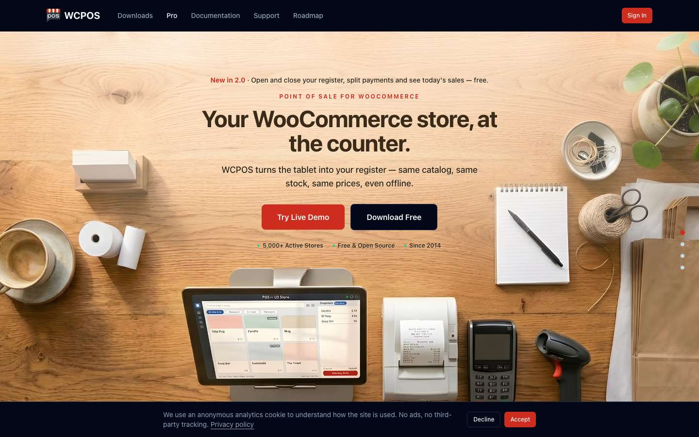 |  |
| Pro | 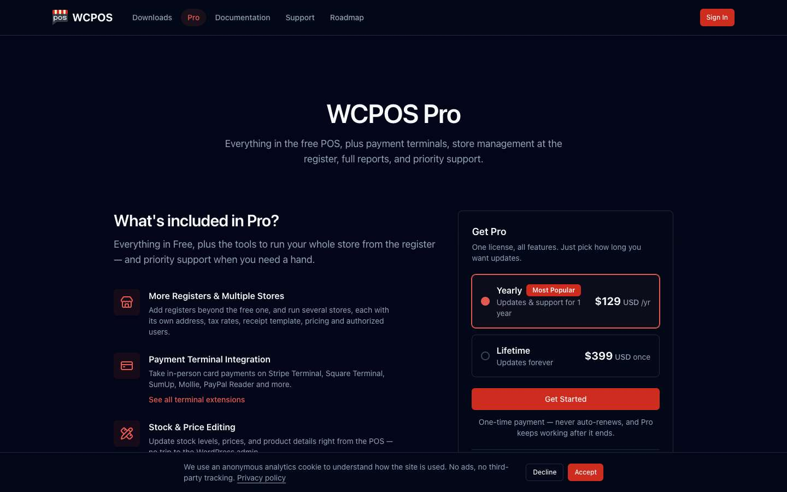 | 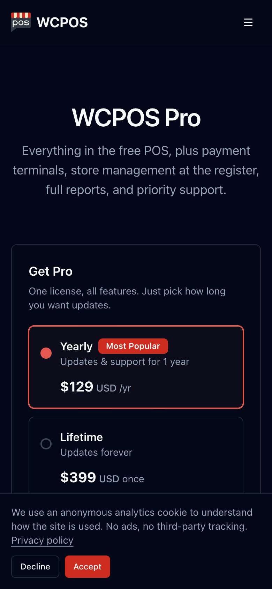 |
| /downloads | 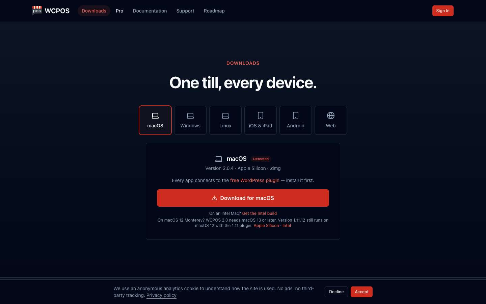 | 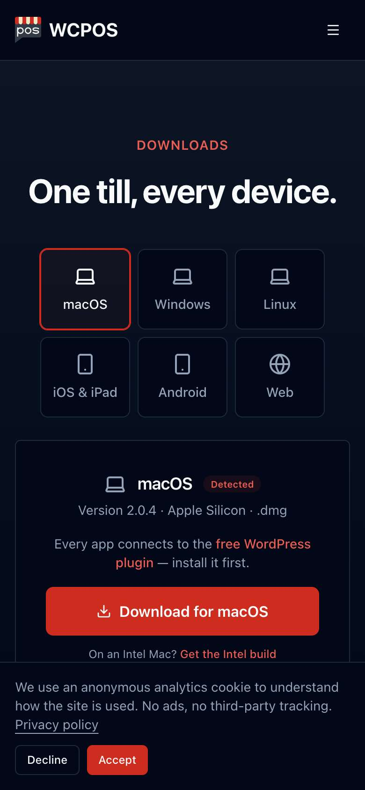 |
| /compare/square | — | 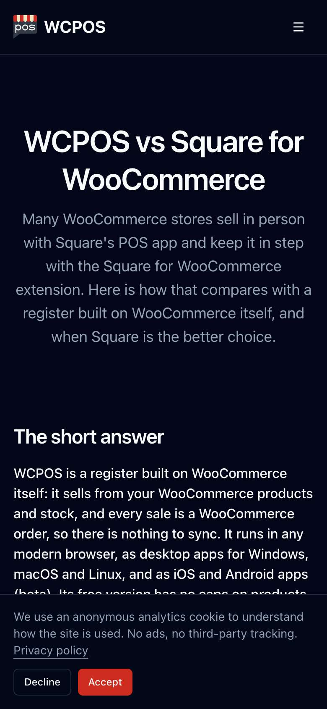 |
| /extensions | — | 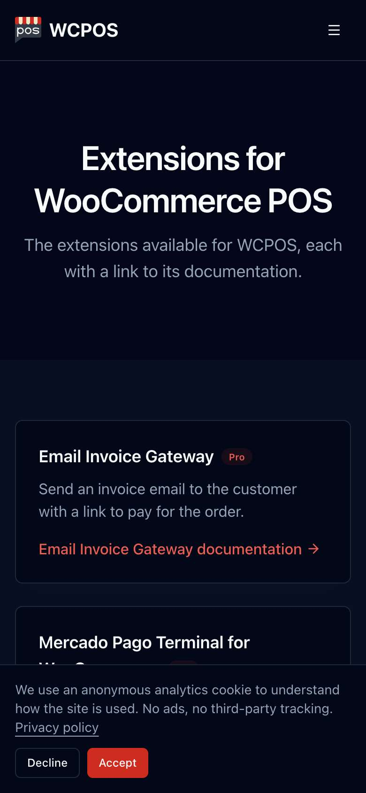 |

## Scores

| Judge | Marketing | UI | SEO |
|---|---|---|---|
| shop-owner (Opus) | 8 | 8 | 8 |
| woo-dev (Opus) | 7 | 8 | 8 |
| designer (Opus) | 7 | 7 | 8 |
| seo (Opus) | 8 | 8 | 8 |
| sceptic (Astra) | 7 | 7 | 9 |
| **Mean** | **7.4** | **7.6** | **8.2** |
| Round 9 | 7.2 | 7.8 | 8.2 |
| **Delta** | **+0.2** | **−0.2** | **0** |

The overall mean is 7.73, the same as round 9. **Nothing is reverted**: the
mean did not fall.

- Marketing rose 0.2: the shop-owner went 7 → 8. No judge repeated the /pro
  terminal card defect, which #743 fixed.
- UI fell 0.2: the sceptic went 8 → 7, over the /compare hub's phone fold,
  which opens with the intro and the disclosure card and shows no competitor
  link. Round 9 did not change the hub. No judge repeated the /compare/*
  disclosure-before-answer defect, which #744 fixed.
- SEO held at 8.2. No judge repeated the /support title, which #745 fixed.
  Four judges now name the /downloads H1.

## Lighthouse (live, light theme)

| Page | Mobile perf | Desktop perf | A11y / BP / SEO | vs round 9 (mobile) |
|---|---|---|---|---|
| / | 93 | 100 | 100 | −6 |
| /pro | 100 | 100 | 100 | +3 |
| /compare | 100 | 100 | 100 | = |
| /downloads | 98 | 100 | 100 | +5 |
| /de | 95 | 100 | 100 | +3 |

Mobile LCP: home 3.2 s (2.1 s last round), /pro 1.7 s, /downloads 2.3 s, /de
2.9 s. The swings sit within the run-to-run spread of earlier rounds; none of
round 9's fixes touched script weight or the home page.

## Worst defects

**Marketing.**
- /extensions, where the /pro terminal card now links, is one flat list of 15
  cards and never says "card terminals"; the eight terminals sit among WPML
  and Polylang (designer; woo-dev files it under UI).
- The home Free card's "Basic checkout" hides that the free plugin takes cash
  and own-terminal card payments (shop-owner).
- The /pro "More Registers & Multiple Stores" card does not say whether stock
  is shared between stores (woo-dev).
- /pro never mentions refunds, while /downloads and /compare sell refunds as
  Pro (seo).
- The home line "Internet drops? Keep selling" needs a qualifier, since
  connected card readers and online gateways need a connection (sceptic).

**UI.**
- On phone, the /compare/* "At a glance" tables squeeze three columns into
  390 px, so cells run 4–10 lines (shop-owner, designer; designer also in
  round 9).
- /extensions is about 10,000 px tall on phone with no grouping (woo-dev).
- On phone, /pro puts the buy box before "What's included" (seo; open since
  round 7).
- The /compare hub's phone fold shows no competitor link (sceptic).

**SEO.**
- The /downloads H1 "One till, every device." carries no search term
  (shop-owner, woo-dev, designer, seo; open since round 5).
- The /compare/square title is 68 characters and says WCPOS twice (sceptic).

## Fixes this round

There are three fixes, one per track. Each comes from a defect that at least
two judges named. Each PR got one review on its head by this machine, which
reran the acceptance commands and applied the mutations itself.

| Track | Defect | PR | Change |
|---|---|---|---|
| UI | Below 640 px, the three-column /compare/* tables squeeze to about 100 px per column, so labels and answers wrap word by word (designer, sceptic, shop-owner) | [#747](https://github.com/wcpos/wcpos-com/pull/747) | One shared `GlanceTable` for the seven vendor pages. On phone, each row stacks its label above a two-column answer grid, and the caption moves last at full width. Tests check the scopes, the stacking classes and the caption order. |
| SEO | The /downloads H1 is the slogan "One till, every device.", with no search term (four judges, open since round 5) | [#748](https://github.com/wcpos/wcpos-com/pull/748) | The H1 is each locale's "Download WooCommerce POS" wording, taken from its meta title. The slogan is kept as a tagline under it. A test checks that every locale's H1 names WooCommerce in at most 50 code points. |
| Marketing | /extensions, now linked from the /pro terminal card, is a flat list of 15 cards that never says "card terminals" (designer, woo-dev) | [#749](https://github.com/wcpos/wcpos-com/pull/749) | Three H2 groups in this order: card terminals and payments, stock and coupons, multilingual stores. The subtitle says what the extensions add. A test fails if a catalog category has no group. |

After views from a local build of each branch (phone, 390 px):

| Page | en | de |
|---|---|---|
| /compare/square table (#747) | 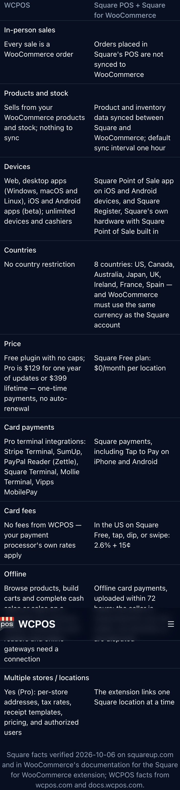 | 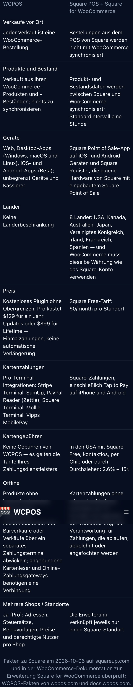 |
| /extensions fold (#749) | 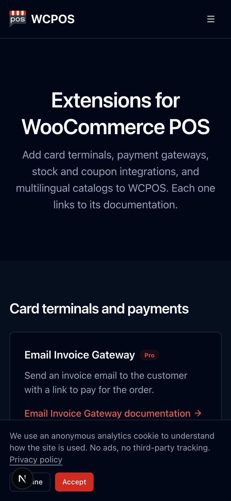 | 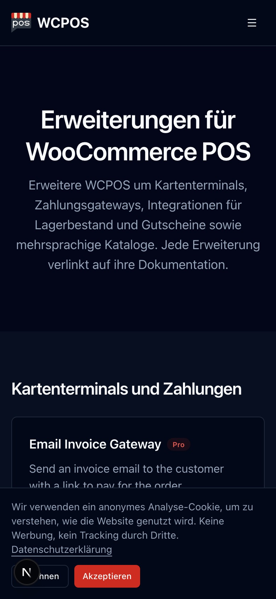 |

Round 11's judging measures the effect of these fixes.

## Deferred

- Candidates for round 11:
  - a qualifier on the home offline line (sceptic)
  - "Basic checkout" on the home Free card: say cash and own-terminal card
    (shop-owner)
  - refunds on the /pro Order Management card (seo)
  - the /compare hub phone fold: competitor links before the disclosure card
    (sceptic)
  - the /compare/square title length and the doubled WCPOS (sceptic)
  - stock sharing on the /pro multi-store card: needs a fact check against
    the plugin before any wording (woo-dev)
  - `FAQPage` markup on /pro, and `description` and `softwareVersion` in the
    SoftwareApplication JSON-LD; stale sitemap `lastmod` (seo)
- The /pro buy-box order on phone has been named in rounds 7 to 10. It moves
  the price below the feature list, which is a layout call for the front
  desk, not a climb fix.
- The scroll-story chip overflow at 390 px touches the owner's open PR, so it
  waits for that PR.
- A Compare entry in the header nav is still a front-desk candidate.
