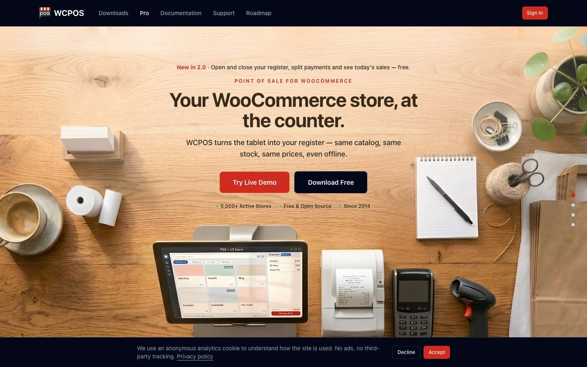
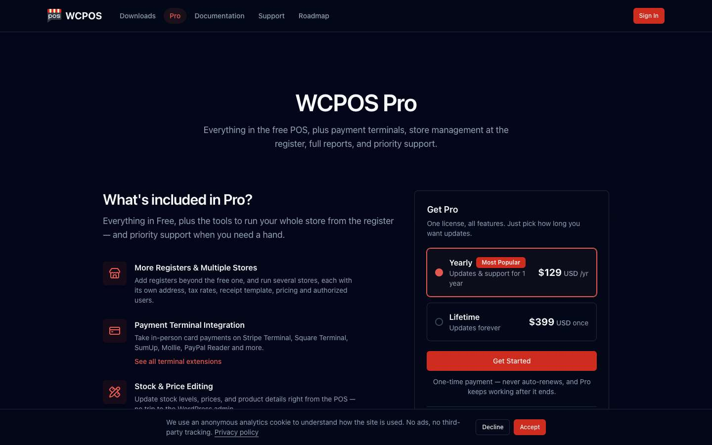
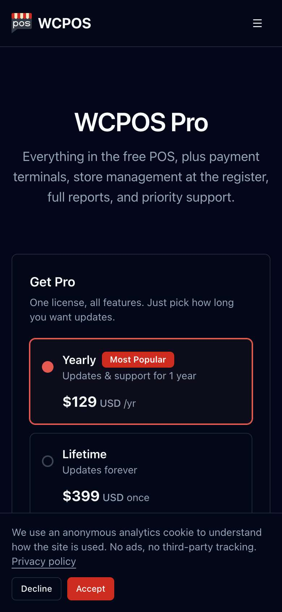
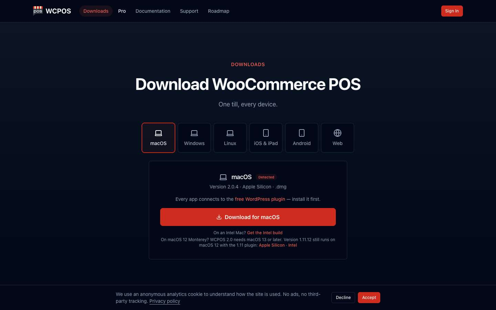
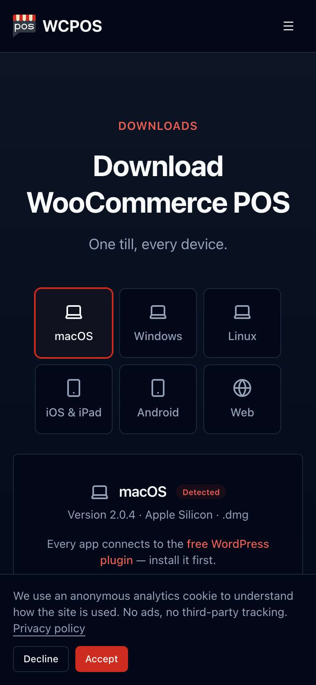
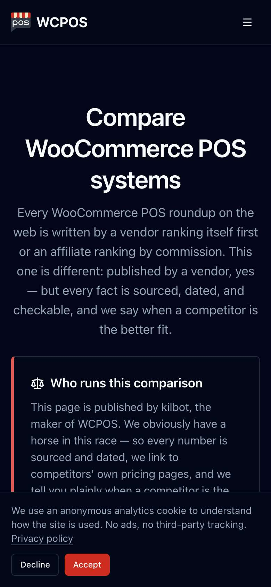
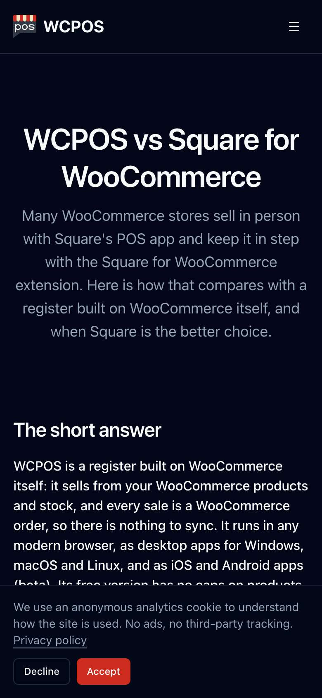
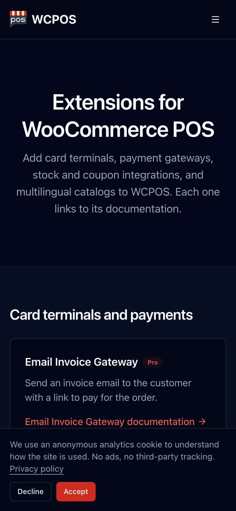

# wcpos.com hill climb — round 11 (2026-11-18)

This round re-judges the live site after round 10's three fixes and records the
fixes chosen from the result. Production is at `03557c5`, with #747 to #749
live.

- Captures: [`2026-11-18-round-11/shots/`](2026-11-18-round-11/shots/) holds
  the fold shots. The full-page shots stay local. Visible text is in `text/`,
  page facts in `facts.json` and Lighthouse in `lighthouse.json`.
- Judges: [`2026-11-18-round-11/judges/`](2026-11-18-round-11/judges/). The
  personas and the brief are the same as round 10: four Opus 5.5 pool
  one-shots, with Codex GPT-6 Astra as the sceptic. The judges were not told
  what changed.

These shots are the "after" views for round 10's fixes:

- /compare/square: the glance table stacks on phone (#747).
- /downloads: the H1 names WooCommerce POS (#748).
- /extensions: the cards are grouped, with card terminals first (#749).

The /compare and /pro phone folds are the "before" views for this round's
fixes.

| Page | Desktop | Phone |
|---|---|---|
| Home |  |  |
| Pro |  |  |
| /downloads |  |  |
| /compare | — |  |
| /compare/square | — |  |
| /extensions | — |  |

## Scores

| Judge | Marketing | UI | SEO |
|---|---|---|---|
| shop-owner (Opus) | 7 | 7 | 8 |
| woo-dev (Opus) | 7 | 8 | 8 |
| designer (Opus) | 7 | 8 | 8 |
| seo (Opus) | 8 | 8 | 8 |
| sceptic (Astra) | 7 | 8 | 9 |
| **Mean** | **7.2** | **7.8** | **8.2** |
| Round 10 | 7.4 | 7.6 | 8.2 |
| **Delta** | **−0.2** | **+0.2** | **0** |

The overall mean is 7.73, the same as round 10. **Nothing is reverted.** The
mean did not fall, and no judge faults a round-10 change. The designer checked
all three and found that they hold.

- **UI rose 0.2.** The designer and the sceptic went 7 → 8, and the
  shop-owner went 8 → 7 over the /compare hub's phone fold. No judge repeated
  the /compare/* table squeeze (#747) or the flat /extensions list (#749).
- **Marketing fell 0.2.** The shop-owner went 8 → 7, over how hard the
  comparisons are to find from the home page. That is a new defect, not one
  #749 caused. Two judges list "Email Invoice Gateway" opening the card
  terminals group on /extensions as a runner-up. It is first because the group
  keeps catalog order.
- **SEO held at 8.2.** No judge repeated the /downloads H1 (#748). Three now
  name the /pro H1 for the same gap.

## Lighthouse (live, light theme)

| Page | Mobile perf | Desktop perf | A11y / BP / SEO | Mobile LCP | vs round 10 (mobile) |
|---|---|---|---|---|---|
| / | 98 | 100 | 100 | 2.4 s | +5 |
| /pro | 97 | 100 | 100 | 2.6 s | −3 |
| /compare | 97 | 100 | 100 | 2.6 s | −3 |
| /downloads | 94 | 100 | 100 | 3.0 s | −4 |
| /de | 92 | 100 | 100 | 3.3 s | −3 |

The swings sit within the run-to-run spread of earlier rounds. The /downloads
hero gained one line of text (#748) and no script.

## Worst defects

**Marketing**

- On the /compare hub, the lead and the disclosure card make the same point
  twice and fill the phone's first screen (designer).
- The home page reaches the comparisons only through a small link below the
  final call to action, and the header has no Compare item (shop-owner).
- The /pro multi-store card does not say that stores share WooCommerce stock,
  or that separate stock per location needs an integration (woo-dev). This
  needs a fact check against the plugin before any wording.
- /pro never mentions refunds, while /downloads and /compare/* sell refunds
  at the register as Pro (seo, second round).
- The home line "Internet drops? Keep selling" needs a qualifier, since
  connected card readers and online gateways need a connection (sceptic,
  second round). It sits in the home scroll story, which the owner's open
  PRs are reworking.

**UI**

- The /compare hub's phone fold is the H1, a seven-line intro and the
  disclosure card, with no competitor named (shop-owner, seo, sceptic).
- On phone, /pro puts the buy box before "What's included in Pro?" (woo-dev;
  open since round 7).
- `FeatureCard`'s Pro badge wraps alone onto its own line on long titles (nl
  home, /extensions Windcave) (designer).

**SEO**

- The /pro H1 is "WCPOS Pro" alone, with no WooCommerce or POS term in any
  locale (shop-owner, designer; woo-dev runner-up).
- The home `<title>` is the layout default and lacks "WooCommerce POS" (seo).
  The home title is a brand choice, so it goes to the front desk rather than a
  spec.
- /pro has five FAQs but no `FAQPage` JSON-LD (woo-dev; seo runner-up).
- The home sitemap `lastmod` is still 2026-10-07 (sceptic; seo runner-up).

## Fixes this round

There are three fixes, one per track. Each comes from a defect that at least
two judges named, or that a judge named for two rounds. Each PR got one review
on its head by this machine, which reran the acceptance commands and applied
the mutations itself.

| Track | PR | Change | Mutation that fails its test |
|---|---|---|---|
| UI | [#752](https://github.com/wcpos/wcpos-com/pull/752) | /compare hub: the subtitle becomes one sentence naming Square, FooSales and Oliver POS, and the disclosure card moves after the list, ahead of the method section | disclosure moved back above the list; old en subtitle |
| SEO | [#751](https://github.com/wcpos/wcpos-com/pull/751) | /pro H1 "WCPOS Pro" becomes "WCPOS Pro for WooCommerce POS", with each locale's own POS term | en H1 set back to "WCPOS Pro" |
| Marketing | [#753](https://github.com/wcpos/wcpos-com/pull/753) | The /pro Order Management card names refunds in all ten locales; refunds are already sold as Pro on /compare and /downloads | old en description |

After-shots, taken from a local dev build of the #752 branch:

| View | Shot |
|---|---|
| /compare phone fold, en | [hub-after-en.jpg](2026-11-18-round-11/after/hub-after-en.jpg) |
| /compare phone fold, de | [hub-after-de.jpg](2026-11-18-round-11/after/hub-after-de.jpg) |
| Disclosure and method, desktop | [hub-tail-desktop.jpg](2026-11-18-round-11/after/hub-tail-desktop.jpg) |
| Disclosure and method, phone | [hub-tail-phone.jpg](2026-11-18-round-11/after/hub-tail-phone.jpg) |

On the de phone fold the first comparison card ("WCPOS vs. Oliver POS") now
shows. Before, the fold ended inside the disclosure card.

Round 12's judging measures the effect of these fixes.

## Deferred

- Candidates for round 12:
  - the card terminals group on /extensions opening with Email Invoice
    Gateway (woo-dev, seo runner-ups)
  - the orphaned Pro badge in `FeatureCard` (designer)
  - /pro on phone: the features before the buy box (woo-dev)
  - `FAQPage` JSON-LD on /pro (woo-dev, seo)
  - the home sitemap `lastmod` (sceptic, seo)
  - the German du/Sie mix: home and /pro use "du", while the /pro buy box and
    all of /compare use "Sie" (designer)
- For the front desk:
  - the home `<title>` (seo)
  - a Compare item in the header nav (shop-owner)
  - the home offline qualifier, which sits in the scroll story under the
    owner's open PRs (sceptic)
  - stock sharing on the /pro multi-store card, which needs a plugin fact
    check (woo-dev)
