# wcpos.com hill climb — round 12 (2026-11-18)

This round re-judges the live site after round 11's three fixes and records
the fixes chosen from the result. Production is at `5eb606e`, with #751 to
#753 live.

- Captures: [`2026-11-18-round-12/shots/`](2026-11-18-round-12/shots/) holds
  the fold shots. The full-page shots stay local. Visible text is in `text/`,
  page facts in `facts.json` and Lighthouse in `lighthouse.json`.
- Judges: [`2026-11-18-round-12/judges/`](2026-11-18-round-12/judges/). The
  personas and the brief are the same as round 11: four Opus 5.5 pool
  one-shots, with Codex GPT-6 Astra as the sceptic. The judges were not told
  what changed.

These shots are the "after" views for round 11's fixes:

- /pro: the H1 names WooCommerce POS (#751), and the Order Management card
  names refunds (#753).
- /compare: the comparisons come before the disclosure card (#752).

The /pro and /extensions phone folds are the "before" views for this round's
fixes. The "after" views are under [Fixes this round](#fixes-this-round).

| Page | Desktop | Phone |
|---|---|---|
| Home | 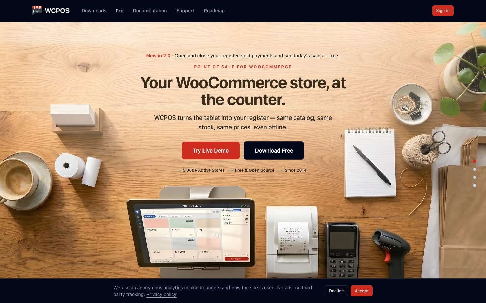 |  |
| Pro | 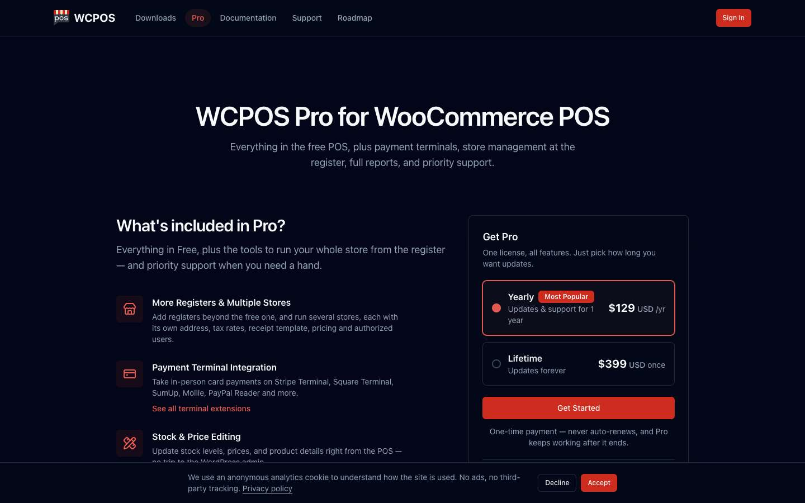 | 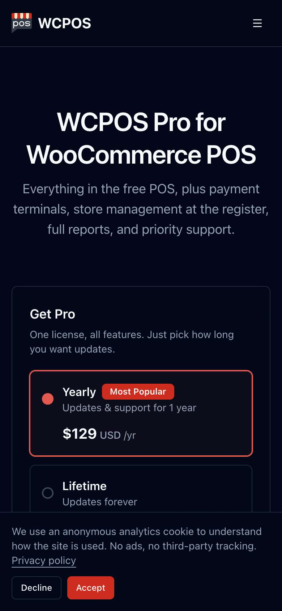 |
| /downloads | 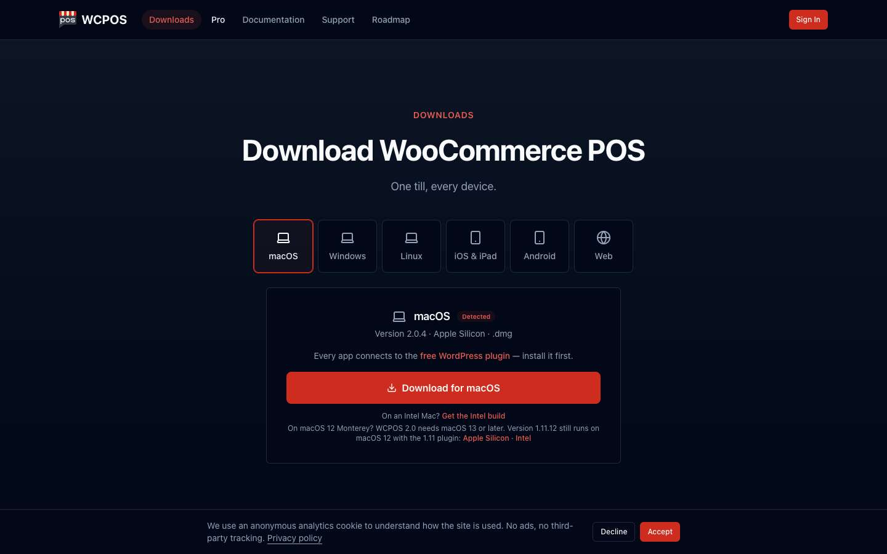 | 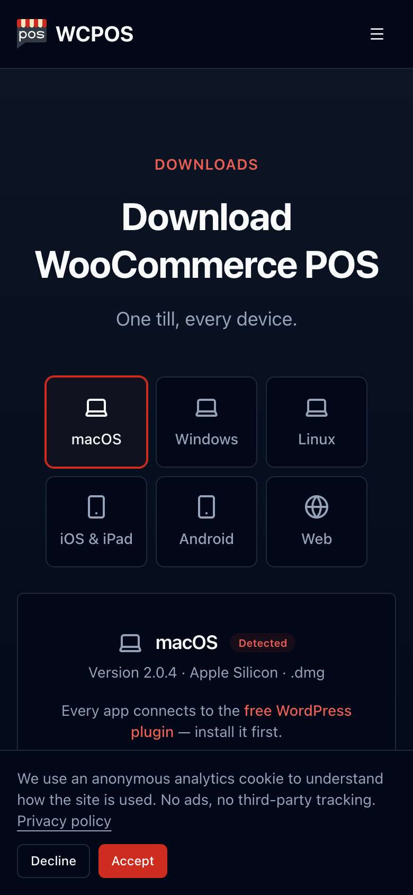 |
| /compare | — | 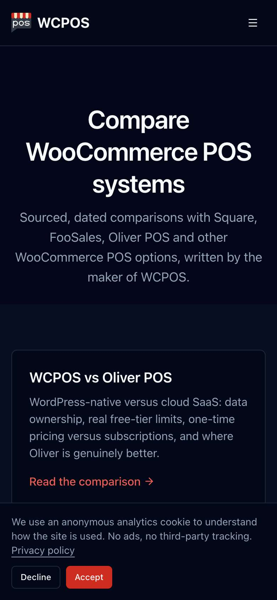 |
| /extensions | — | 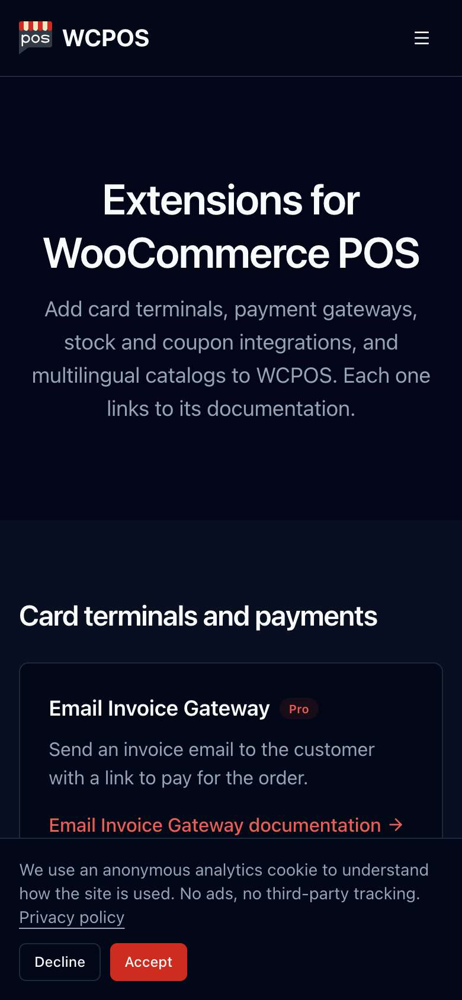 |

## Scores

| Judge | Marketing | UI | SEO |
|---|---|---|---|
| shop-owner (Opus) | 7 | 8 | 8 |
| woo-dev (Opus) | 7 | 8 | 8 |
| designer (Opus) | 7 | 7 | 8 |
| seo (Opus) | 8 | 8 | 8 |
| sceptic (Astra) | 8 | 8 | 9 |
| **Mean** | **7.4** | **7.8** | **8.2** |
| Round 11 | 7.2 | 7.8 | 8.2 |
| **Delta** | **+0.2** | **0** | **0** |

The overall mean is 7.80, up 0.07 from round 11. **Nothing is reverted.** The
mean rose, and no judge faults a round-11 change.

- **Marketing rose 0.2.** The sceptic went 7 → 8. No judge repeated /pro's
  missing refunds (#753) or the /compare hub's doubled lead (#752).
- **UI held at 7.8.** The shop-owner went 7 → 8 and no longer names the
  /compare hub's phone fold, which #752 changed. The designer went 8 → 7
  over a different defect, the /downloads sync diagram on phone.
- **SEO held at 8.2.** No judge repeated the /pro H1 (#751). Three now name
  /pro's missing `FAQPage` JSON-LD.

## Lighthouse (live, light theme)

| Page | Mobile perf | Desktop perf | A11y / BP / SEO | Mobile LCP | vs round 11 (mobile) |
|---|---|---|---|---|---|
| / | 92 | 100 | 100 | 3.3 s | −6 |
| /pro | 100 | 100 | 100 | 1.4 s | +3 |
| /compare | 100 | 100 | 100 | 1.7 s | +3 |
| /downloads | 99 | 100 | 100 | 1.8 s | +5 |
| /de | 92 | 100 | 100 | 3.3 s | 0 |

Home's −6 is within the run-to-run spread of earlier rounds, which ranged
from 92 to 98. No round-11 change touched the home page.

## Worst defects

**Marketing**

- /pro has seven feature cards and none mentions the customer-facing display,
  though every /compare/* "Pro adds" line sells it. The Coupons screen,
  store-specific pricing and the extension directory are missing too (woo-dev,
  seo).
- "Basic checkout" on the home Free card reads as if Free cannot take cards
  (shop-owner, named in rounds 10 and 12).
- In German, the line under the /pro buy box switches to "Sie" on a page that
  otherwise says "du" (designer, second round).
- /compare/square says "nothing to sync", while the home page says WCPOS syncs
  when it is back online (sceptic).

**UI**

- /extensions on phone opens "Card terminals and payments" with Email Invoice
  Gateway, so no terminal shows on the fold (woo-dev, seo; deferred in round
  11).
- On home at phone width, the Pro badge on long feature titles wraps onto a
  line of its own (shop-owner; designer runner-up, second round).
- The /downloads sync diagram on phone: the store hub covers the "Desktop"
  label, and the diagram renders above its own H2 (designer).
- The stacked /compare/square glance rows on phone do not repeat the vendor
  names (sceptic).

**SEO**

- /pro shows five FAQs but emits no `FAQPage` JSON-LD, while every /compare/*
  page does (shop-owner, woo-dev, designer; second round).
- No /compare/* page links to /pro or /extensions in its body (seo).
- The /compare hub's seven "Read the comparison" links share one anchor text,
  and the card headings are not links (sceptic).

## Fixes this round

There are three fixes, one per track. Each comes from a defect that at least
two judges named, or that a judge named for two rounds. Each PR got one review
on its head by this machine, which reran the acceptance commands and applied
the mutations itself.

| Track | Defect | Fix | PR |
|---|---|---|---|
| SEO | /pro has no `FAQPage` JSON-LD | A second ld+json script emits a `FAQPage` from the five translated `pro.faq` keys in page order. The `SoftwareApplication` script is unchanged. | #756 |
| UI | /extensions payments group opens with Email Invoice Gateway | `PAYMENTS_LAST` moves the two gateways that are not card terminals after the eight terminals. Lists otherwise keep catalog order. | #755 |
| Marketing | /pro has no customer-facing display card | An eighth Pro feature card after the terminal card, in ten locales. The title reuses each locale's /compare display label, and the description restates the published "open it in any browser and pair it to a till with a code". | #757 |

The first FAQ pass wrapped both schema objects in one array. That broke an
existing /pro test, which the spec had put out of scope. A follow-up spec
split them into two scripts. A one-line follow-up capitalised the German
imperative after the colon in the display card ("Öffne").

After-shots, from a local build of `9df040e` (the cookie banner and the dev
"Issues" badge appear only in that build):

| /extensions phone (en) | /extensions phone (de) |
|---|---|
| 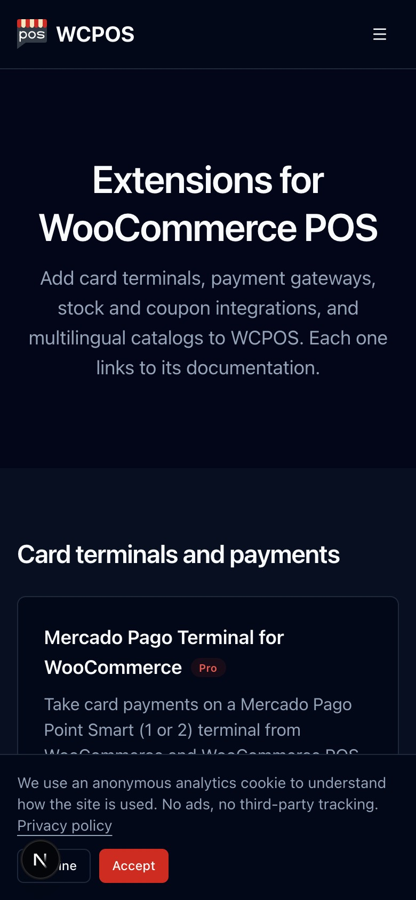 | 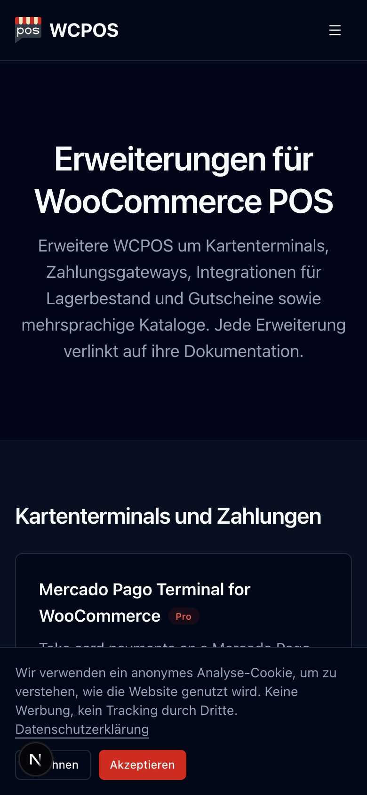 |

| /pro features, desktop | /pro features, phone |
|---|---|
| 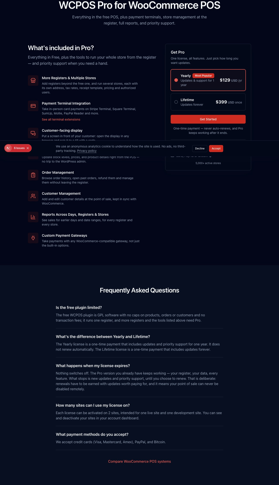 | 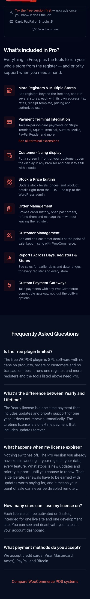 |

Round 13's judging measures the effect of these fixes.

## Deferred

- Candidates for round 13:
  - "Basic checkout" on the home Free card (shop-owner). The home page
    already says Free takes cash or card on your own terminal, so the fix can
    reuse that wording.
  - FooSales is the last of seven cards on the /compare hub, though the
    subtitle names it second (shop-owner runner-up).
  - the German du/Sie mix in the /pro buy box (designer)
  - the orphaned Pro badge in `FeatureCard` (shop-owner, designer)
  - body links from /compare/* to /pro and /extensions (seo)
  - "nothing to sync" on /compare/square (sceptic)
  - the /downloads sync diagram on phone (designer)
  - linked card headings on the /compare hub (sceptic)
  - the home sitemap `lastmod`, still 2026-10-07 (seo runner-up)
  - the en display card title "Customer-facing display" is in sentence case,
    while the other /pro card titles use Title Case (found in this round's
    review of #757)
- For the front desk, all carried over from round 11:
  - the home `<title>` (seo)
  - a Compare item in the header nav (shop-owner suggests a link under the
    home pricing card instead)
  - the home offline qualifier, which sits in the scroll story under the
    owner's open PRs
  - stock sharing on the /pro multi-store card, which needs a plugin fact
    check (woo-dev)
  - the price line in "Where Square is genuinely better" on /compare/square
    (shop-owner runner-up)
- Not picked again: features before the buy box on /pro phone. #713 put the
  buy box first on purpose in round 2 (seo, woo-dev).
