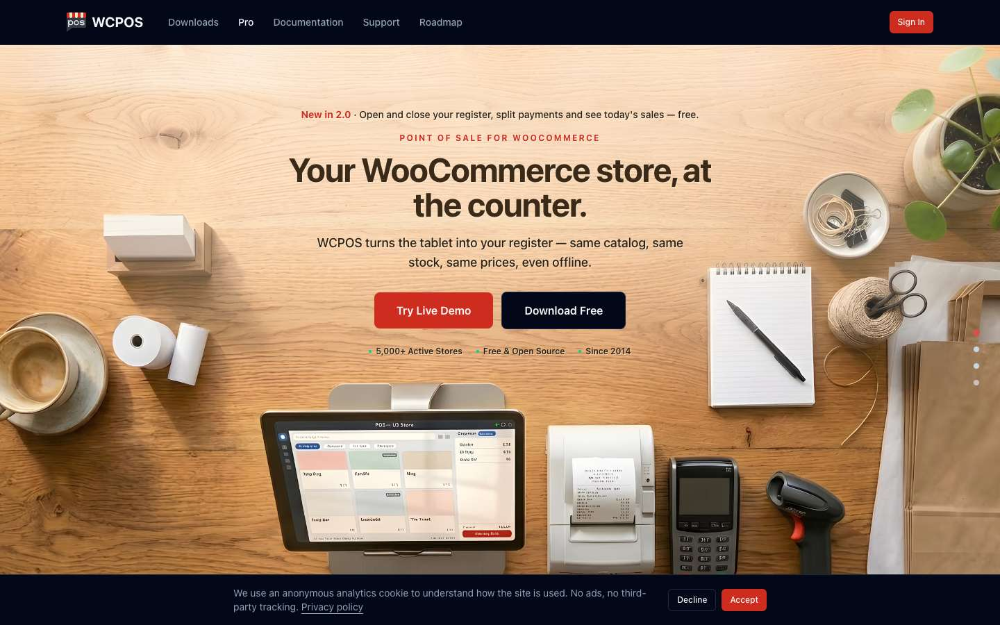
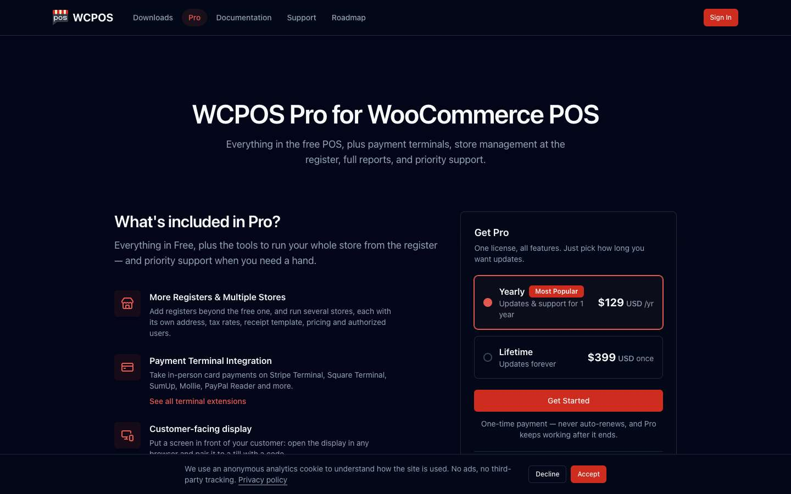
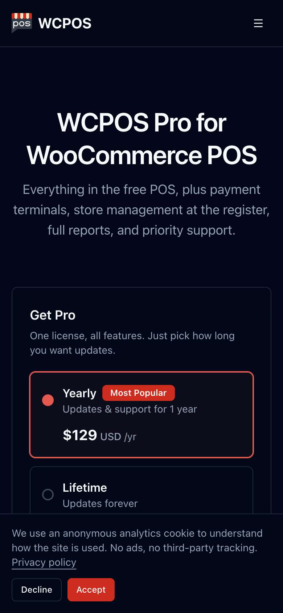
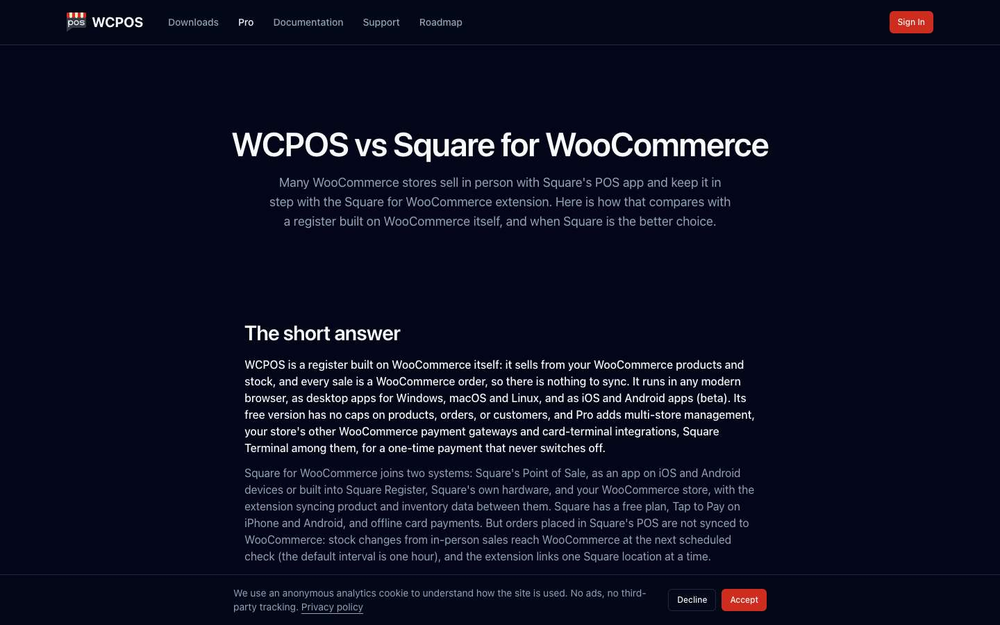
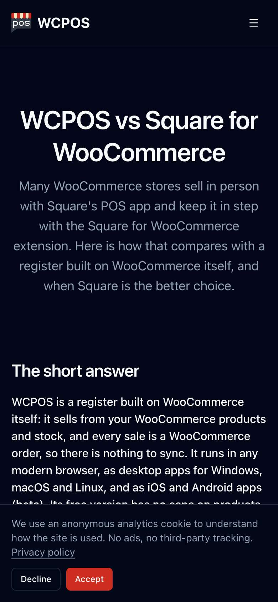
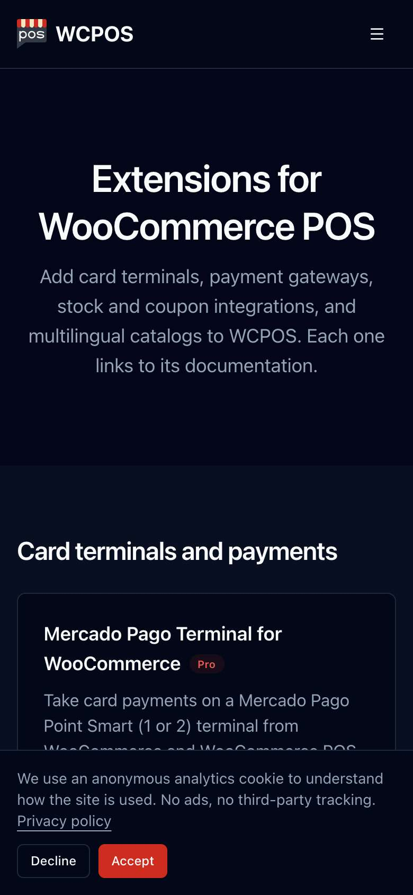
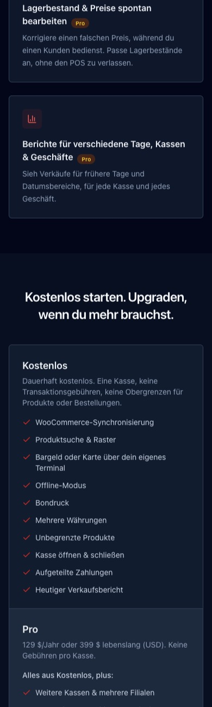
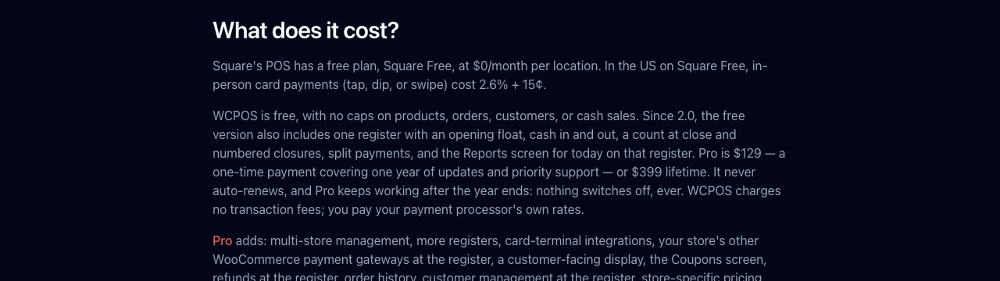
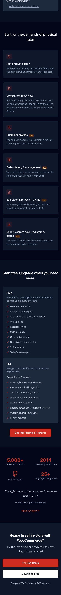
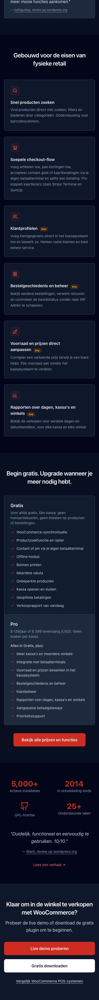

# wcpos.com hill climb — round 13 (2026-11-18)

This round re-judges the live site after round 12's three fixes and records
the fixes chosen from the result. Production is at `9df040e`, with #755 to
#757 live. The capture confirmed all three: /extensions lists the card
terminals first, /pro emits `FAQPage` JSON-LD in en, nl and de, and /pro
has the customer-facing display card.

- Captures: [`2026-11-18-round-13/shots/`](2026-11-18-round-13/shots/) holds
  the fold shots. The full-page shots stay local. Visible text is in `text/`,
  page facts in `facts.json` and Lighthouse in `lighthouse.json`.
- Judges: [`2026-11-18-round-13/judges/`](2026-11-18-round-13/judges/). The
  personas and the brief are the same as round 12: four Opus 5.5 pool
  one-shots, with Codex GPT-6 Astra as the sceptic. The judges were not told
  what changed.

| Page | Desktop | Phone |
|---|---|---|
| Home |  |  |
| Pro |  |  |
| /compare/square |  |  |
| /extensions | — |  |

## Scores

| Judge | Marketing | UI | SEO |
|---|---|---|---|
| shop-owner (Opus) | 7 | 8 | 8 |
| woo-dev (Opus) | 7 | 8 | 8 |
| designer (Opus) | 7 | 7 | 8 |
| seo (Opus) | 8 | 8 | 8 |
| sceptic (Astra) | 7 | 8 | 9 |
| **Mean** | **7.2** | **7.8** | **8.2** |
| Round 12 | 7.4 | 7.8 | 8.2 |
| **Delta** | **−0.2** | **0** | **0** |

The overall mean is 7.73, down 0.07 from round 12. **Nothing is reverted.**

- **Marketing fell 0.2.** Only one score moved: the sceptic went 8 → 7. Its
  worst defect is "nothing to sync" on /compare/square, which it also named
  in round 12 and which no round-12 change touched. Every other judge scored
  the same as round 12. No judge faults a round-12 change. The shop-owner's
  runner-up is a style nit on #757: the display card's en title is in
  sentence case among Title Case cards. That nit is a candidate below, not a
  reason to revert.
- **UI held at 7.8.** No judge repeated the /extensions payments order (#755).
- **SEO held at 8.2.** No judge repeated /pro's missing `FAQPage` (#756). The
  sceptic's 9 is unchanged.

## Lighthouse (live, light theme)

| Page | Mobile perf | Desktop perf | A11y / BP / SEO | Mobile LCP | vs round 12 (mobile) |
|---|---|---|---|---|---|
| / | 95 | 100 | 100 | 2.9 s | +3 |
| /pro | 100 | 100 | 100 | 1.2 s | 0 |
| /compare | 100 | 100 | 100 | 1.4 s | 0 |
| /downloads | 98 | 100 | 100 | 2.3 s | −1 |
| /de | 92 | 100 | 100 | 3.3 s | 0 |

## Worst defects

**Marketing**

- "Basic checkout" on the home Free card reads as if Free cannot take cards
  (shop-owner, third round; seo).
- In German, the line under the /pro buy box switches to "Sie" on a page that
  otherwise says "du" (designer, third round).
- The /pro multi-store card never says that stores are locations inside one
  WooCommerce site sharing its stock. Next to the "2 sites (live + dev)"
  licence FAQ, a two-shop owner could read it as needing two licences
  (woo-dev).
- /compare/square says "nothing to sync", while the home page says WCPOS syncs
  when it is back online (sceptic, second round).

**UI**

- On home at phone width, the Pro badge on long feature titles wraps onto a
  line of its own, worst in nl/de (shop-owner, third round; seo; designer
  runner-up).
- On /extensions, every card repeats its name as an accent-red
  "{name} documentation" link that usually wraps to two lines (woo-dev).
- The /downloads sync diagram on phone: the store hub covers the "Desktop"
  label, and the diagram renders above its own H2 (designer, second round).
- The stacked /compare/square glance rows on phone do not repeat the vendor
  names (sceptic, second round).

**SEO**

- The "Pro adds" paragraph on all seven /compare/* pages sells Pro and the
  extension directory but never links /pro or /extensions (shop-owner,
  designer; seo runner-up).
- The home features grid names Stripe Terminal and SumUp but has no links;
  /extensions gets only footer links from home (woo-dev).
- `sitemap.ts` `lastmod` dates are stale: /, /pro, /extensions and /compare
  say 2026-10-07, /compare/square says 2026-10-06, and /compare/foosales has
  none (seo, sceptic).

## Fixes this round

There are three fixes, one per track. Each comes from a defect that at least
two judges named this round. Each PR got one review on its head by this
machine, which reran the acceptance commands and applied the mutations itself.

| Track | Defect | Fix | PR |
|---|---|---|---|
| SEO | /compare/* "Pro adds" has no body links | The existing words "Pro" and "extension directory" link to /pro and /extensions through `t.rich` tags, in 70 strings (7 pages × 10 locales). A script confirmed that, with the tags stripped, every string equals the original. | #759 |
| Marketing | "Basic checkout" on the home Free card | The item now says "Cash or card on your own terminal", reusing each locale's wording from the home features grid. No terminal integration is implied. | #760 |
| UI | Orphaned Pro badge on phone | For a badged multi-word string title, `FeatureCard` keeps the last word and the badge in one `whitespace-nowrap` span. One-word, CJK, ReactNode and unbadged titles render as before. | #761 |

The badge implementer stopped at its scope line: two out-of-scope home tests
matched the split titles by exact text. A Sonnet follow-up changed those
tests to find the cards by heading role. The de and nl Free items run to 45
and 42 characters, over the spec's 40-character guide, because the spec's own
examples used those lengths. They wrap onto two lines like the Pro list's
longer items (below).

After-shots, from a local build of `f481326` (the cookie banner and the dev
"Issues" badge appear only in that build):

| de home phone: badges and Free card | /compare/square pricing, desktop |
|---|---|
|  |  |

| Home features + pricing, phone (en) | (nl) |
|---|---|
|  |  |

Round 14's judging measures the effect of these fixes.

## Deferred

- Candidates for round 14:
  - the stale sitemap `lastmod` dates and the missing /compare/foosales entry
    (seo, sceptic)
  - "nothing to sync" on /compare/square (sceptic, second round)
  - the German du/Sie mix in the /pro buy box (designer, third round)
  - the /extensions "{name} documentation" links (woo-dev)
  - home features grid links to /extensions (woo-dev)
  - the /downloads sync diagram on phone (designer, second round)
  - vendor labels in the stacked /compare/square glance rows on phone
    (sceptic, second round)
  - Title Case for the en display card title on /pro (shop-owner runner-up)
  - FooSales last on the /compare hub, and its seven identical "Read the
    comparison" anchors (shop-owner, designer, seo runner-ups)
- For the front desk, carried over:
  - the /pro multi-store card's stock sharing (woo-dev, now a worst defect).
    It needs a plugin fact check before any copy change.
  - the home `<title>`, a Compare item in the header nav, the home offline
    qualifier, and the Square price line on /compare/square (shop-owner
    runner-up this round: "WCPOS Pro costs $129 or more")
- Not picked again: features before the buy box on /pro phone. #713 put the
  buy box first on purpose in round 2.
