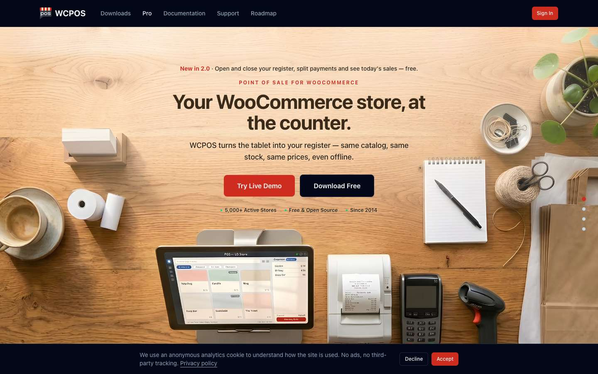
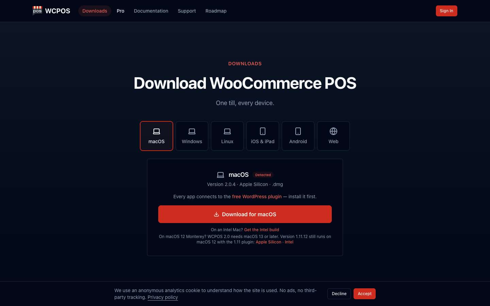
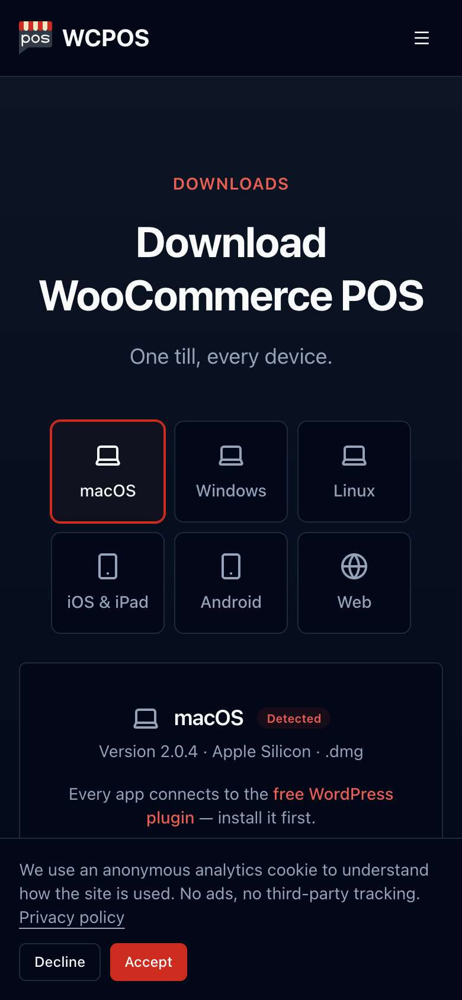
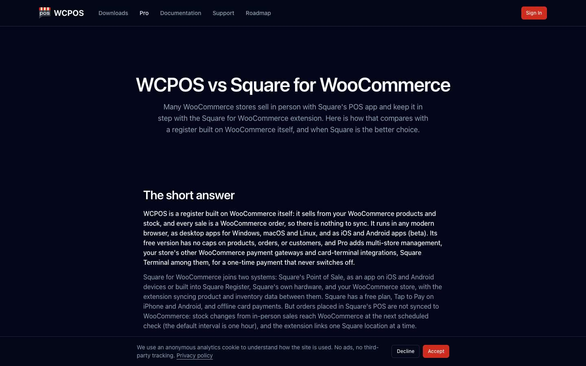
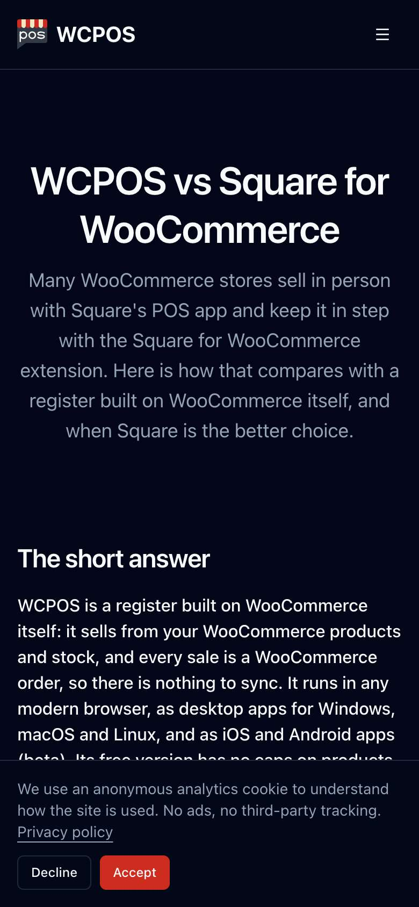
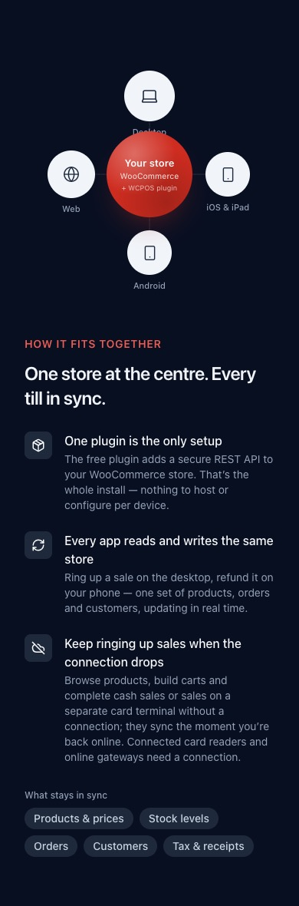
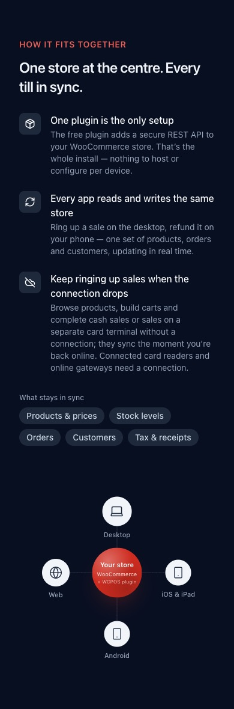
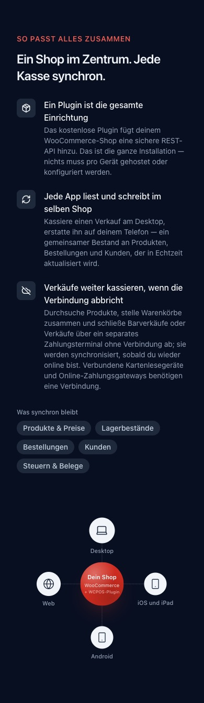
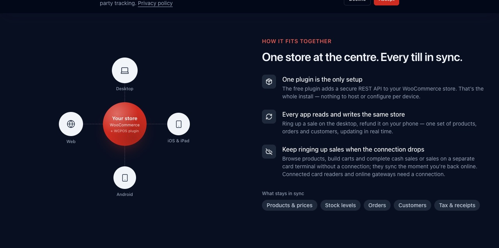

# wcpos.com hill climb — round 14 (2026-11-18)

This round re-judges the live site after round 13's three fixes (#759 to
#761, all live) and records the fixes chosen from the result.

- Captures: [`2026-11-18-round-14/shots/`](2026-11-18-round-14/shots/) holds
  the fold shots. The full-page shots stay local. Visible text is in `text/`,
  page facts in `facts.json` and Lighthouse in `lighthouse.json`.
- Judges: [`2026-11-18-round-14/judges/`](2026-11-18-round-14/judges/). The
  personas and the brief are the same as round 13: four Opus 5.5 pool
  one-shots, with Codex GPT-6 Astra as the sceptic. The judges were not told
  what changed.

| Page | Desktop | Phone |
|---|---|---|
| Home |  |  |
| /downloads |  |  |
| /compare/square |  |  |
| /extensions | — |  |

## Scores

| Judge | Marketing | UI | SEO |
|---|---|---|---|
| shop-owner (Opus) | 7 | 8 | 8 |
| woo-dev (Opus) | 7 | 8 | 8 |
| designer (Opus) | 7 | 7 | 8 |
| seo (Opus) | 8 | 8 | 8 |
| sceptic (Astra) | 7 | 8 | 9 |
| **Mean** | **7.2** | **7.8** | **8.2** |
| Round 13 | 7.2 | 7.8 | 8.2 |
| **Delta** | **0** | **0** | **0** |

The overall mean is 7.73, unchanged. **Nothing is reverted.** Every judge gave
the same scores as in round 13.

- No judge repeated any of the three defects that round 13 fixed: the
  "Basic checkout" Free item (#760), the orphaned Pro badge on phone (#761)
  and the unlinked "Pro adds" line (#759).
- The judges cite those fixes as recent content changes that the sitemap
  dates do not reflect (designer, seo). The woo-dev judge asks for the home
  features grid to reuse #759's `t.rich` link pattern. No judge faults a
  round-13 change.
- The flat scores mean the fixes removed defects without lifting a track
  score on their own. Each judge's next worst defect sits at the same level.

## Lighthouse (live, light theme)

| Page | Mobile perf | Desktop perf | A11y / BP / SEO | Mobile LCP | vs round 13 (mobile) |
|---|---|---|---|---|---|
| / | 95 | 100 | 100 | 2.9 s | 0 |
| /pro | 100 | 100 | 100 | 1.2 s | 0 |
| /compare | 100 | 100 | 100 | 1.4 s | 0 |
| /downloads | 98 | 100 | 100 | 2.3 s | 0 |
| /de | 92 | 100 | 100 | 3.3 s | 0 |

## Worst defects

**Marketing**

- The /downloads "How it fits together" sync example is "refund it on your
  phone". It sits in the Free install story, but refunds are Pro, as step 3
  on the same page, the home grid and /compare/square all say (shop-owner,
  woo-dev).
- In German, the line under the /pro buy box switches to "Sie" (designer,
  fourth round).
- /compare/square says "nothing to sync" (seo, third round overall).
- The home offline qualifier (sceptic). This is a front-desk item, so it is
  parked.

**UI**

- The /downloads sync diagram on phone: the store hub covers the "Desktop"
  label, and the diagram renders above its own H2 (shop-owner, designer,
  seo; the designer's third round).
- The /extensions "{name} documentation" links (woo-dev, second round).
- The /compare/square "short answer" prose is too long on phone (sceptic).

**SEO**

- The sitemap `lastmod` dates are stale. Most say 2026-10-07, which is before
  the 2.0 release the pages now sell, and /compare/foosales has none
  (shop-owner, designer, seo; the seo judge's fourth round).
- The home features grid names Stripe Terminal and SumUp but links neither
  to /extensions (woo-dev, second round).
- The /compare hub has seven identical "Read the comparison" anchors
  (sceptic).

## Fixes this round

There are three fixes, one per track. Each comes from a defect that at least
two judges named this round. Opus 5.5 pool one-shots implemented each one
from a written spec, as `route-implementation` said `opus`. Each PR got one
review on its head by this machine, which read the full diff, reran the
acceptance commands and applied the mutations itself.

| Track | Defect | Fix | PR |
|---|---|---|---|
| UI | /downloads diagram hub covers "Desktop" on phone; diagram above its H2 | The diagram root is a size container. The hub and spheres are sized in `cqw` (the same size at 440 px), and the hub text is a step smaller below `sm`. The diagram column is `order-last lg:order-first`. | #763 |
| SEO | Stale sitemap `lastmod` dates | Each route's date was read from the git history of its page, components and messages. All seven /compare/* pages, /, /pro, /extensions, /compare and /support are now `2026-11-18`. /compare/foosales gets its first entry, and /about-us stays `2026-10-06`. A new test requires a `lastmod` on every content route except /roadmap. | #764 |
| Marketing | "Refund it on your phone" in a Free context | The sentence is now "Ring up a sale on the desktop and your phone shows the new stock level — …" in all ten locales. Stock levels are already a Free "What stays in sync" chip, so no new claim is made. | #765 |

- The first diagram spec sized the hub in `%`. That cannot work, because
  the hub and spheres sit in shrink-to-fit absolute wrappers. The implementer
  measured a 3.6×24 px sphere in Chromium and stopped. The re-issued spec
  used container query units.
- The sitemap implementer went over the spec's 16-line non-test budget
  counted as added plus removed (13 + 12) but stayed under the 45-line
  total. The named edits needed those lines; the budget was set too tight.
- #765 merged `main` in after #763, because both added a test at the end of
  the same describe in `how-it-fits.test.tsx`. The merge was clean, and the
  downloads tests passed on the merged tree (30/30).

The diagram was checked in a local production build of #763's head, in
headless Chromium with reduced motion:

| | phone 390 | desktop 1280 |
|---|---|---|
| diagram | 326×326 | 440×440 |
| hub | 83×83 | 112×112 (unchanged) |
| desktop sphere | 49×49 | 66×66 (unchanged) |
| gap, "Desktop" label → hub | 13.8 px clear | 26.5 px |
| H2 above diagram | yes | side by side |

| Before (live), phone | After, phone (en) | After, phone (de) |
|---|---|---|
|  |  |  |

After, desktop (unchanged layout; the cookie banner appears only in the local
build):

Round 15's judging measures the effect of these fixes.

## Deferred

- Candidates for round 15:
  - "nothing to sync" on /compare/square (seo, sceptic in earlier rounds)
  - the German du/Sie mix in the /pro buy box (designer, fourth round)
  - the /extensions "{name} documentation" links (woo-dev, second round)
  - home features grid links to /extensions (woo-dev, second round)
  - the long /compare/square "short answer" on phone (sceptic)
  - seven identical "Read the comparison" anchors and FooSales last on the
    /compare hub (sceptic; earlier runner-ups)
  - runner-ups: the thin /support H1; the phone search placeholder cut to
    "receipt printe"; no `softwareVersion` in the JSON-LD; the home Free card
    has no button
- For the front desk, carried over:
  - the /pro multi-store card's stock sharing. It needs a plugin fact check
    before any copy change.
  - the home `<title>`, a Compare item in the header nav, the home offline
    qualifier (the sceptic's worst defect this round), and the Square price
    line on /compare/square
- Not picked again: features before the buy box on /pro phone. #713 put the
  buy box first on purpose in round 2.
