# wcpos.com hill climb — round 15 (2026-11-18)

This round re-judges the live site after round 14's three fixes (#763 to
#765, all live) and records the fixes chosen from the result.

- Captures: [`2026-11-18-round-15/shots/`](2026-11-18-round-15/shots/) holds
  the fold shots. The full-page shots stay local. Visible text is in `text/`,
  page facts in `facts.json` and Lighthouse in `lighthouse.json`.
- Judges: [`2026-11-18-round-15/judges/`](2026-11-18-round-15/judges/). The
  personas and the brief are the same as round 14: four Opus 5.5 pool
  one-shots, with Codex GPT-6 Astra as the sceptic. The judges were not told
  what changed.

| Page | Desktop | Phone |
|---|---|---|
| Home | 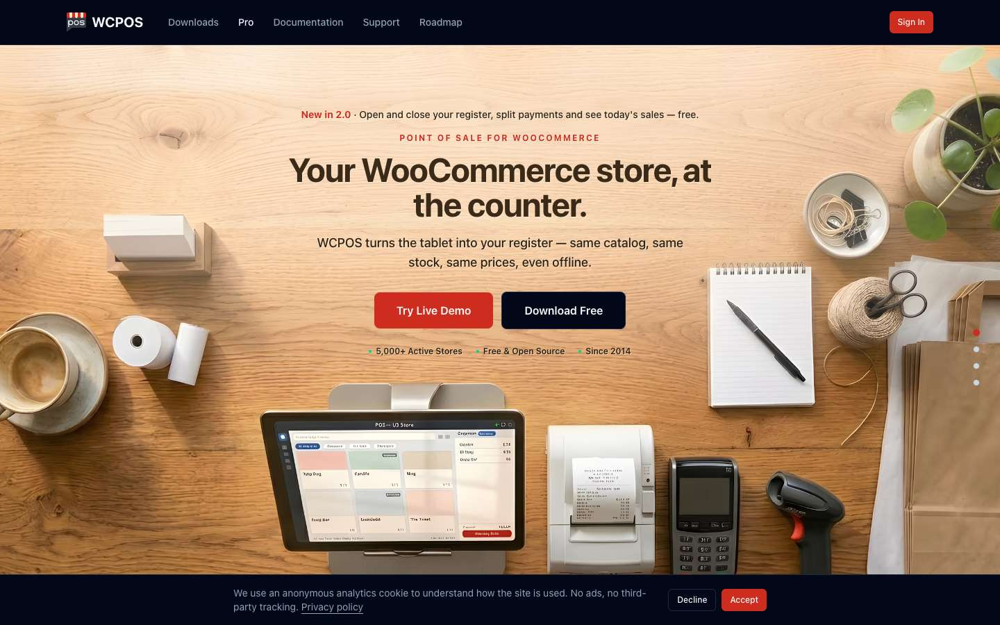 |  |
| /downloads | 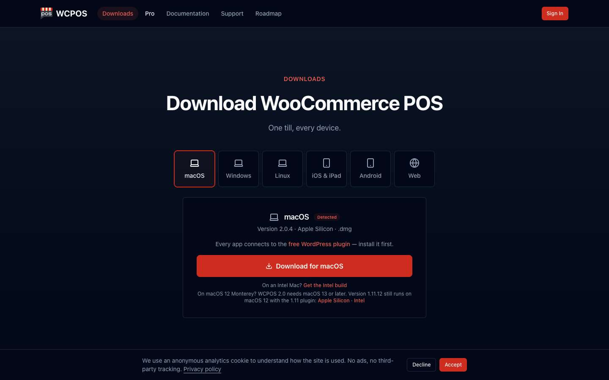 | 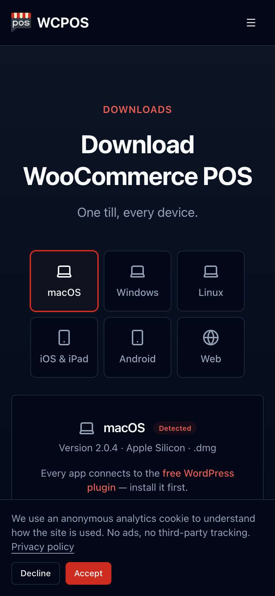 |
| /compare/square | 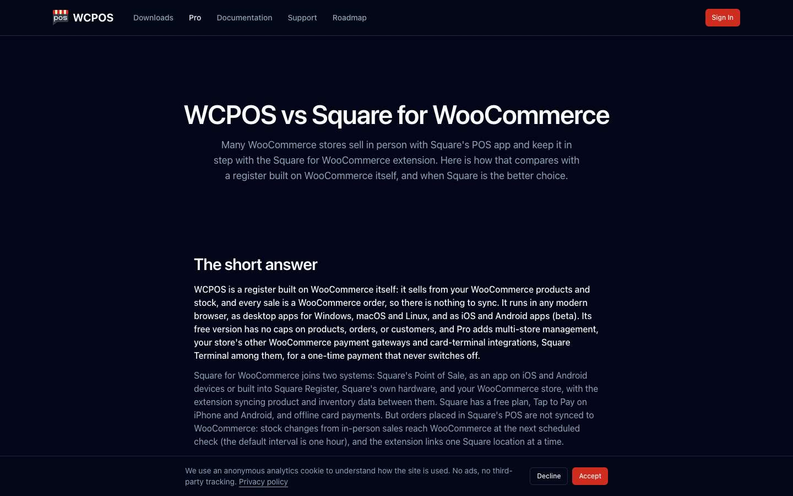 | 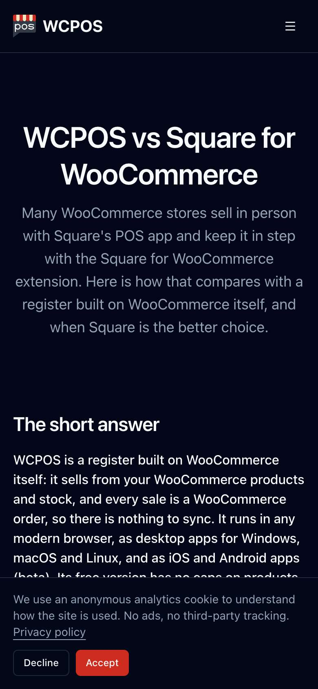 |
| /extensions | 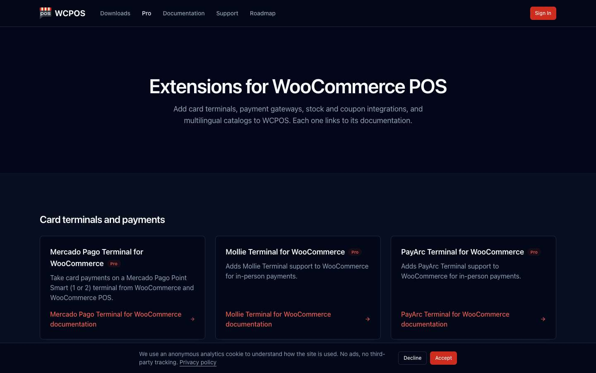 | 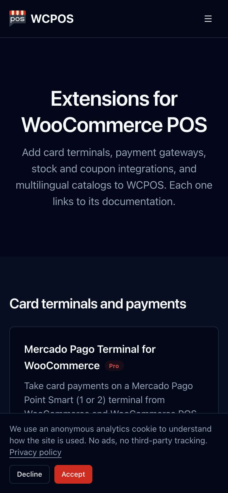 |

## Scores

| Judge | Marketing | UI | SEO |
|---|---|---|---|
| shop-owner (Opus) | 7 | 7 | 8 |
| woo-dev (Opus) | 7 | 8 | 8 |
| designer (Opus) | 7 | 7 | 8 |
| seo (Opus) | 8 | 8 | 8 |
| sceptic (Astra) | 8 | 8 | 9 |
| **Mean** | **7.4** | **7.6** | **8.2** |
| Round 14 | 7.2 | 7.8 | 8.2 |
| **Delta** | **+0.2** | **−0.2** | **0** |

The overall mean is 7.73, unchanged. **Nothing is reverted.**

- The Marketing rise is the sceptic, 7 → 8. Its round-14 complaint was the
  "refund on your phone" example in the Free story, which #765 replaced.
- The UI dip is the shop-owner, 8 → 7. Its worst UI defect is the /compare
  hub card order (FooSales seventh), a page no round-14 change touched.
- The designer calls the #763 diagram "live and clean on phone". No judge
  repeats any round-14 defect: the diagram overlap, the stale sitemap dates
  or the refund example.
- The sceptic's worst SEO defect is the /downloads mobile LCP. It infers
  that the diagram's `motion/react` import slows the page, and says so as
  inference, not measurement. The check below rejects that.

## Lighthouse (live, light theme)

| Page | Mobile perf | Desktop perf | A11y / BP / SEO | Mobile LCP | vs round 14 (mobile) |
|---|---|---|---|---|---|
| / | 93 | 100 | 100 | 3.2 s | −2 |
| /pro | 100 | 100 | 100 | 1.4 s | 0 |
| /compare | 100 | 100 | 100 | 1.2 s | 0 |
| /downloads | 94 | 100 | 100 | 3.0 s | −4 |
| /de | 91 | 100 | 100 | 3.3 s | −1 |

The /downloads dip was checked, because #763 changed that page. Five more
mobile runs scored 94, 94, 99, 100 and 100. LCP alternated between 3.0 s
and 1.7–1.8 s. The LCP element in every run is the hero `h1`, well above
the diagram section, and the home page (untouched) dipped too. This is run
noise, not #763.

## Worst defects

**Marketing**

- /compare/square says WCPOS has "nothing to sync", three times. The same
  page's FAQ and the home page say sales sync on reconnect (seo, sceptic;
  fourth round overall).
- The /downloads step-3 Pro card lists "Payments" as Pro (woo-dev). Card
  payments in general are not Pro-only; card-reader payments are.
- /extensions marks 12 of 15 cards Pro with no explanation or /pro link
  (designer).
- No Compare item in the header nav (shop-owner). This is a front-desk item,
  so it is parked.

**UI**

- The /extensions "{name} documentation" links wrap to two lines, leaving
  the arrow alone (woo-dev, third round; designer).
- The /compare hub card order puts FooSales seventh (shop-owner).
- On phone, the /downloads platform picker pushes the download button below
  the fold, under the cookie banner (seo).
- The "Web" platform leads only to the demo, with no web-register docs link
  (sceptic).

**SEO**

- /compare/* pages have BreadcrumbList JSON-LD but no visible breadcrumb,
  and no body link back to /compare (shop-owner; seo runner-up).
- The home features grid has no links (woo-dev, third round).
- The /compare hub card H2s are not links, and all seven anchors read "Read
  the comparison" (seo).
- A weak /support H1 and description (designer).
- /downloads mobile LCP (sceptic). Rejected as noise, see above.

## Fixes this round

There are three fixes, one per track. Each comes from a defect that two
judges named this round. Opus 5.5 pool one-shots implemented each one from
a written spec, as `route-implementation` said `opus`. Each PR got one
review on its head by this machine, which read the full diff, reran the
acceptance commands and applied the mutations itself.

| Track | Defect | Fix | PR |
|---|---|---|---|
| UI | /extensions "{name} documentation" links wrap | The visible text is a short localised "Documentation" kept on one line (`whitespace-nowrap`). The full "{name} documentation" stays the link's accessible name through `aria-label`. | #767 |
| Marketing | "Nothing to sync" on /compare/square | Each of the three values says what is true instead: there is "no second catalog to keep in sync". The clause is replaced in ten locales, and the rest of each string is unchanged. | #768 |
| SEO | No visible breadcrumb on /compare/* | A new `CompareBreadcrumb` sits above the H1 on all seven pages and mirrors the JSON-LD. It is a `nav` holding a /compare link, an `aria-hidden` chevron, and the current page with `aria-current="page"`. | #769 |

- #769 also changed one line in `foosales/page.test.tsx`: the "source
  links" filter now parses hrefs against a base URL. Before, it threw
  `Invalid URL` on the new relative `/compare` link. Its expected links are
  unchanged.
- The sync implementer counted its 30 changed message lines as 60 in
  numstat (added plus removed). The spec's 32-line budget meant modified
  lines, so it is within budget.
- The es/it/pt/ja/ko/zh wording in #768 is the implementer's own. The
  machine checked each clause's place in its sentence but not native
  quality.

Checked live after the 99b97e6 deploy, in headless Chromium with a fresh
browser context per page:

- All seven /compare/* pages render the breadcrumb above the H1. Each links
  to `/compare`, and its current item matches the H1.
- /compare/square has no "nothing to sync" left and four "no second
  catalog" matches.
- All 15 /extensions links are 24 px tall (one line) in en and de, and the
  first link's accessible name is "Mercado Pago Terminal for WooCommerce
  documentation".

| /compare/square, phone | /compare/square, desktop |
|---|---|
| 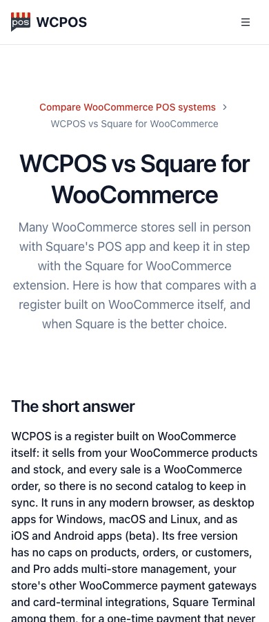 | 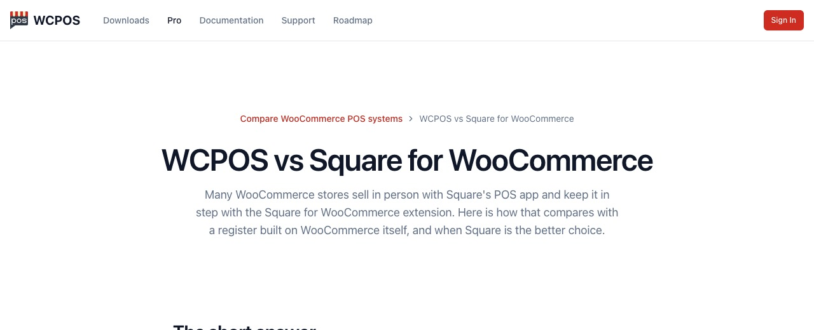 |

German /compare/foosales, desktop:

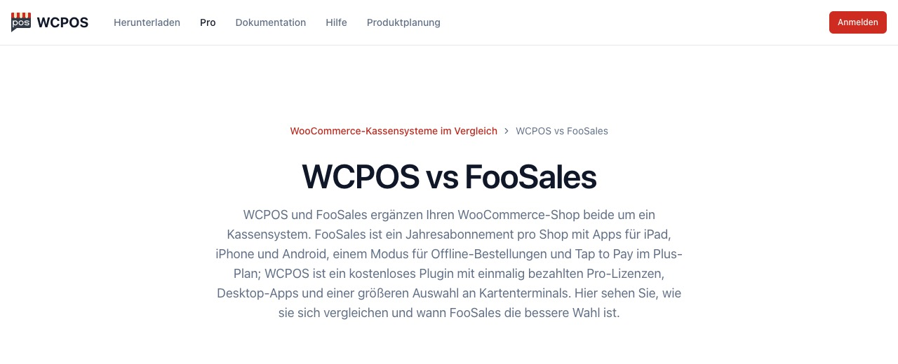

| /extensions before, phone | After, phone (en) | After, phone (de) |
|---|---|---|
|  | 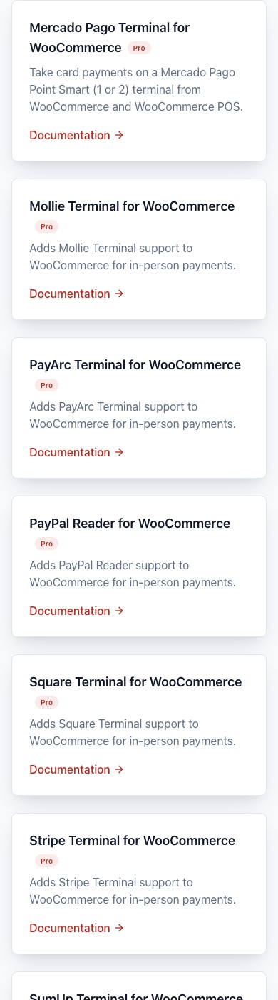 | 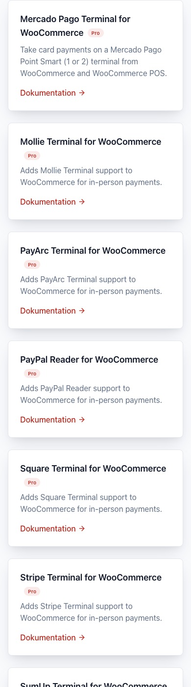 |

On phone the breadcrumb wraps to two lines, with the hub link on the first
and the current page under it. It stays readable, so it was left as is. The
"Pro" badge still drops to its own line under longer card titles on
/extensions; that was out of scope here.

Round 16's judging measures the effect of these fixes.

## Deferred

- Candidates for round 16:
  - "Payments" listed as Pro on the /downloads step-3 card (woo-dev); say
    "Card-reader payments"
  - /extensions: no explanation of the Pro badge, no /pro link (designer)
  - the /extensions "Pro" badge on its own line under long titles
  - the /compare hub card order, unlinked card H2s and the seven "Read the
    comparison" anchors (shop-owner, seo, earlier sceptic)
  - home features grid links to /extensions (woo-dev, third round)
  - the /downloads phone picker pushing the download button below the fold
    (seo)
  - runner-ups: the German du/Sie mix on /pro (fifth round); the /support
    H1 and search placeholder; mixed title case on /pro; no
    `softwareVersion` in the JSON-LD; the home subline "the tablet"; the Pro
    nav item looking active; /compare/square naming 6 terminals where
    /extensions lists 8
- For the front desk, carried over:
  - a Compare item in the header nav (shop-owner's worst Marketing defect
    this round), the home `<title>`, the home offline qualifier and the
    Square price line on /compare/square
  - the /pro multi-store card's stock sharing, which needs a plugin fact
    check before any copy change
