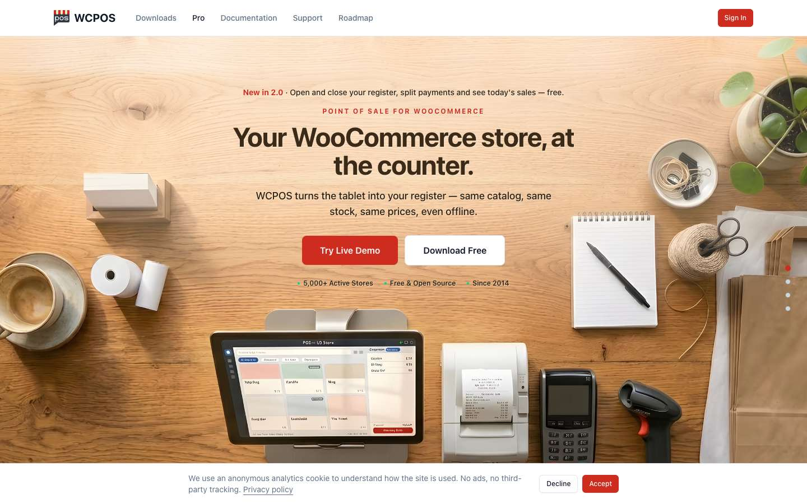
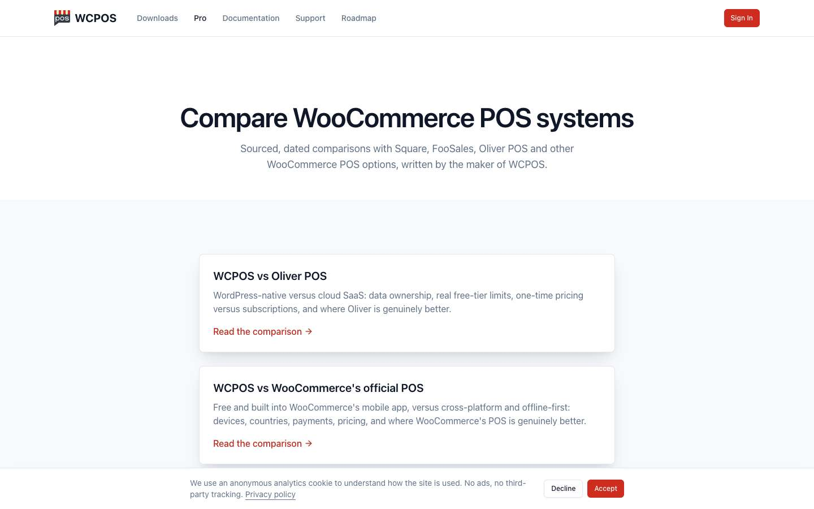
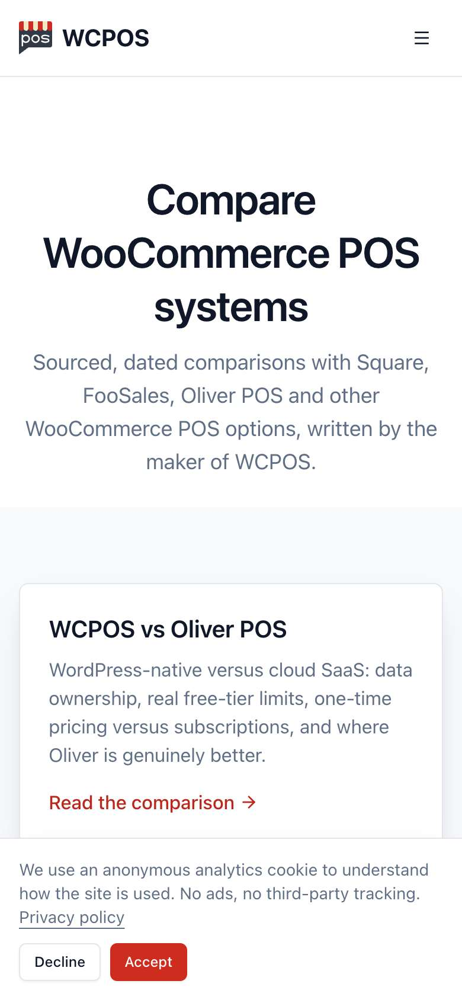
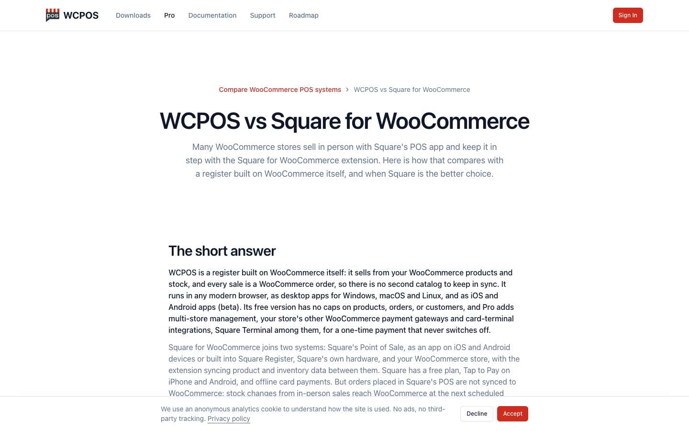
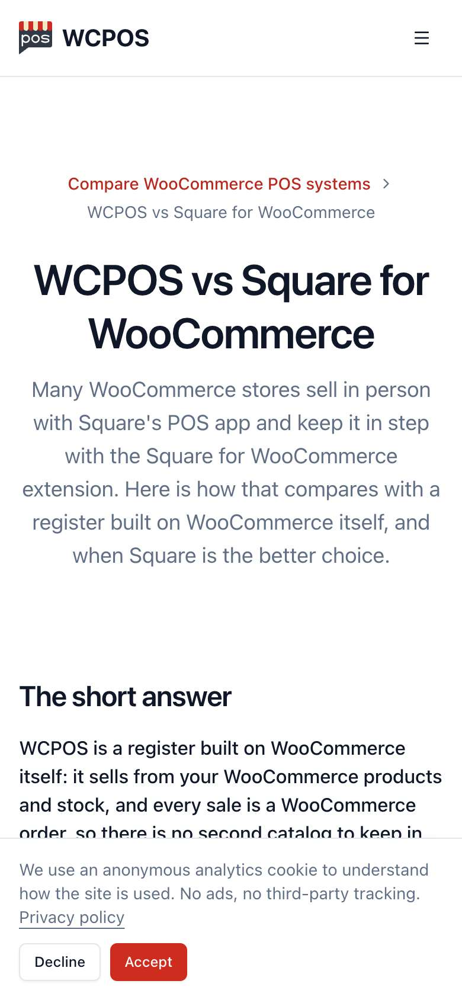
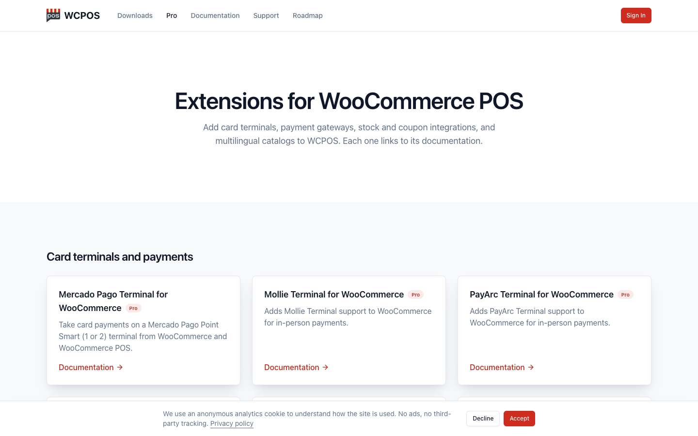
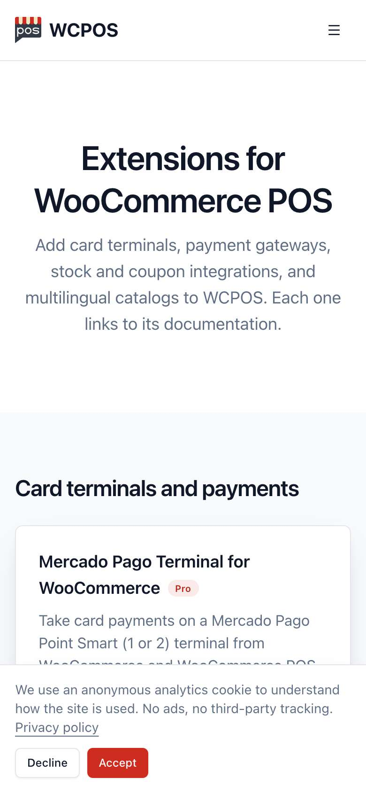
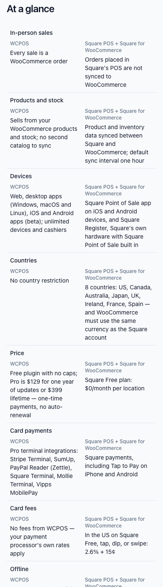
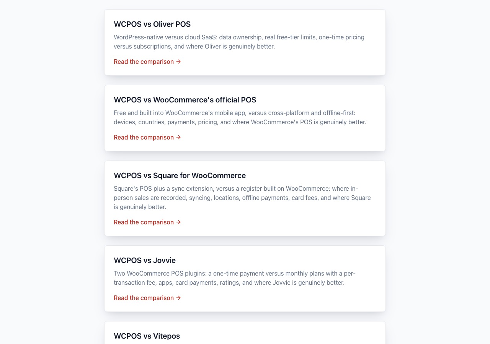

# wcpos.com hill climb — round 16 (2026-11-18)

This round re-judges the live site after round 15's three fixes (#767 to
#769, all live) and records the fixes chosen from the result.

- Captures: [`2026-11-18-round-16/shots/`](2026-11-18-round-16/shots/) holds
  the fold shots. The full-page shots stay local. Visible text is in `text/`,
  page facts in `facts.json` and Lighthouse in `lighthouse.json`.
- Judges: [`2026-11-18-round-16/judges/`](2026-11-18-round-16/judges/). The
  personas and the brief are the same as round 15: four Opus 5.5 pool
  one-shots, with Codex GPT-6 Astra as the sceptic. The judges were not told
  what changed.

| Page | Desktop | Phone |
|---|---|---|
| Home |  |  |
| /downloads |  |  |
| /compare |  |  |
| /compare/square |  |  |
| /extensions |  |  |

## Scores

| Judge | Marketing | UI | SEO |
|---|---|---|---|
| shop-owner (Opus) | 7 | 7 | 8 |
| woo-dev (Opus) | 7 | 8 | 8 |
| designer (Opus) | 7 | 7 | 8 |
| seo (Opus) | 8 | 8 | 8 |
| sceptic (Astra) | 7 | 8 | 9 |
| **Mean** | **7.2** | **7.6** | **8.2** |
| Round 15 | 7.4 | 7.6 | 8.2 |
| **Delta** | **−0.2** | **0** | **0** |

The overall mean is 7.67, down 0.07. **Nothing is reverted.**

- The Marketing dip is the sceptic alone, 8 → 7. Its worst defect is the
  home offline line ("Internet drops? Keep selling; WCPOS syncs when you're
  back online"), which it says leaves out that card-reader payments need a
  connection. No round-15 change touched the home page, and the wording is a
  front-desk item, so it stays parked.
- No judge repeats a round-15 defect: no "nothing to sync", no wrapping
  /extensions docs links, and no missing breadcrumb.
- The designer criticises the #769 breadcrumb on phone (it wraps to two
  lines and repeats the H1), but its UI score held at 7. It is a refinement
  candidate, not a revert.

## Lighthouse (live, light theme)

| Page | Mobile perf | Desktop perf | A11y / BP / SEO | Mobile LCP | vs round 15 (mobile) |
|---|---|---|---|---|---|
| / | 93 | 100 | 100 | 3.2 s | 0 |
| /pro | 100 | 100 | 100 | 1.2 s | 0 |
| /compare | 100 | 100 | 100 | 1.4 s | 0 |
| /downloads | 99 | 100 | 100 | 2.0 s | +5 |
| /de | 93 | 100 | 100 | 3.2 s | +2 |

/downloads is back to 99, which confirms round 15's 94 was run noise.

## Worst defects

**Marketing**

- The /downloads step-3 Pro card lists "Payments" first, which reads as
  "taking payments needs Pro" (woo-dev, seo; woo-dev also in round 15).
- /extensions marks 12 of 15 cards Pro with no explanation or /pro link
  (designer, second round).
- The compare disclosure says the pages are "published by kilbot" without
  naming a person or linking /about (shop-owner).
- The home offline line has no card-reader qualifier (sceptic). Front desk.

**UI**

- On phone the /compare/* "At a glance" table shows the product names only
  once at the top, so later rows show two unlabelled answers (shop-owner,
  sceptic).
- The #769 breadcrumb wraps to two lines on phone and repeats the H1
  (designer).
- The header "Pro" nav item looks like the active page (woo-dev).
- On phone, the /downloads platform picker pushes the download button below
  the fold (seo, second round).

**SEO**

- The /compare hub card H2s are not links, and all seven anchors read "Read
  the comparison" (seo, shop-owner; seo also in round 15).
- The home features grid has no links (woo-dev, fourth round).
- A weak /support H1 and description (designer).
- The /compare/square title is 68 characters, and "An Honest Comparison"
  adds little (sceptic).

## Fixes this round

There are three fixes, one per track. Two judges named each defect this
round. Opus 5.5 pool one-shots implemented each one from a written spec,
as `route-implementation` said `opus`. Each PR got one review on its head
by this machine, which read the full diff, reran the acceptance commands
and applied the mutations itself.

| Track | Defect | Fix | PR |
|---|---|---|---|
| UI | Phone glance table has no product names after the top | Below `sm` each answer carries a small `aria-hidden` product label, and the header row is `sr-only` (still read by assistive tech). From `sm` up nothing changes. | #771 |
| SEO | Hub card H2s not linked; seven identical "Read the comparison" anchors | Each card's H2 title is now its link. The CTA line stays visible and clickable but is `aria-hidden` with `tabIndex={-1}`, so there is one link per card, named by its title. | #772 |
| Marketing | "Payments" listed first on the /downloads Pro card | The first item now uses the term the card's own line above already uses: "Terminal payments" (and the same term in each locale). The rest of each string is unchanged. | #773 |

- #773's de/nl/fr/es/it/pt/ja/ko/zh terms are copied from each locale's
  existing `steps.pro.body`, so no new wording was invented.
- On phone the longer product names ("Square POS + Square for
  WooCommerce") wrap to two lines in the new labels. It stays readable.

Checked live after the 828d05e deploy, in headless Chromium with a fresh
browser context per page:

- All seven /compare/* pages on phone: the header row is 1 px tall
  (`sr-only`), and every answer has a visible product label (14 to 26 per
  page). On desktop /compare/square the header row is 40 px tall and no
  label is visible.
- /compare on desktop and phone: seven H2 links, each to its own
  comparison, and no "Read the comparison" link outside `aria-hidden`.
- /downloads and /de/downloads: the Pro card starts with "Terminal
  payments" / "Terminalzahlungen", and no plain "Payments" item is left.

| /compare/square glance table, phone | /compare hub, desktop |
|---|---|
|  |  |

| /downloads Pro card (en) | /de/downloads Pro card |
|---|---|
|  |  |

Round 17's judging measures the effect of these fixes.

## Deferred

- Candidates for round 17:
  - the #769 breadcrumb on phone: show the hub link alone below `sm`
    (designer)
  - /extensions: no explanation of the Pro badge, no /pro link (designer)
  - home features grid links to /extensions (woo-dev, fourth round)
  - the header "Pro" nav item looking active (woo-dev)
  - the /downloads phone picker pushing the download button below the fold
    (seo)
  - the /support H1 and description (designer); the /compare/square title
    length (sceptic)
  - runner-ups: the /extensions "Pro" chip on its own line under long
    titles; the /nl/pro "Meest populair" badge wrapping; the clipped /support
    search placeholder; no pricing H2 on /pro; no `softwareVersion` in the
    JSON-LD; FooSales last on the hub; the home subline "the tablet"
- For the front desk, carried over:
  - the home offline qualifier (the sceptic's worst Marketing defect again),
    a Compare item in the header nav, the home `<title>` and the Square price
    line on /compare/square
  - the /pro multi-store card's stock sharing, and multi-store against the
    licence terms, both of which need a plugin fact check
  - new: the compare disclosure naming "kilbot" rather than a person
