# wcpos.com hill climb — round 17 (2026-11-18)

This round re-judges the live site after round 16's three fixes (#771 to
#773, all live) and records the fixes chosen from the result.

- Captures: [`2026-11-18-round-17/shots/`](2026-11-18-round-17/shots/) holds
  the fold shots. The full-page shots stay local. Visible text is in `text/`,
  page facts in `facts.json` and Lighthouse in `lighthouse.json`.
- Judges: [`2026-11-18-round-17/judges/`](2026-11-18-round-17/judges/). The
  personas and the brief are the same as round 16: four Opus 5.5 pool
  one-shots, with Codex GPT-6 Astra as the sceptic. The judges were not told
  what changed.

| Page | Desktop | Phone |
|---|---|---|
| Home | 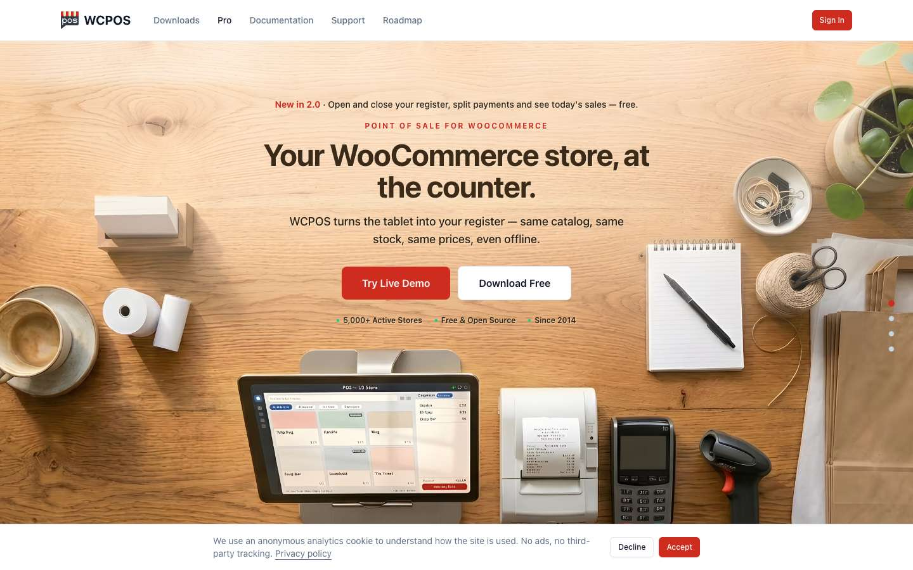 | 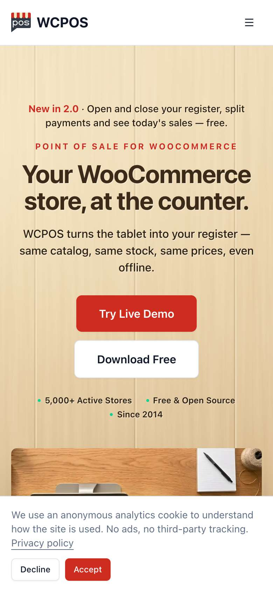 |
| /downloads |  | 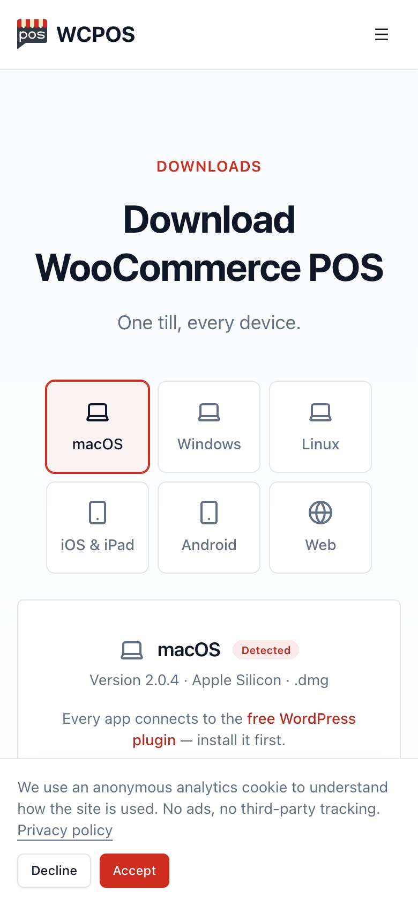 |
| /compare/square | 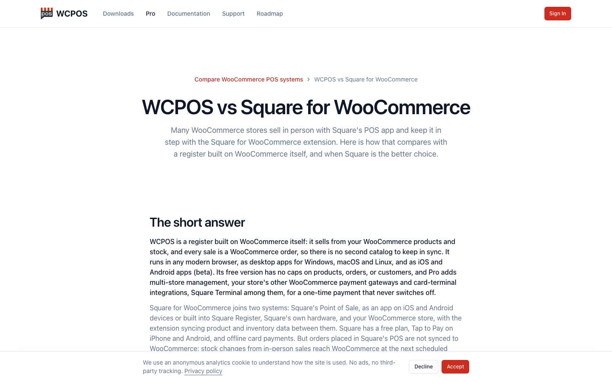 | 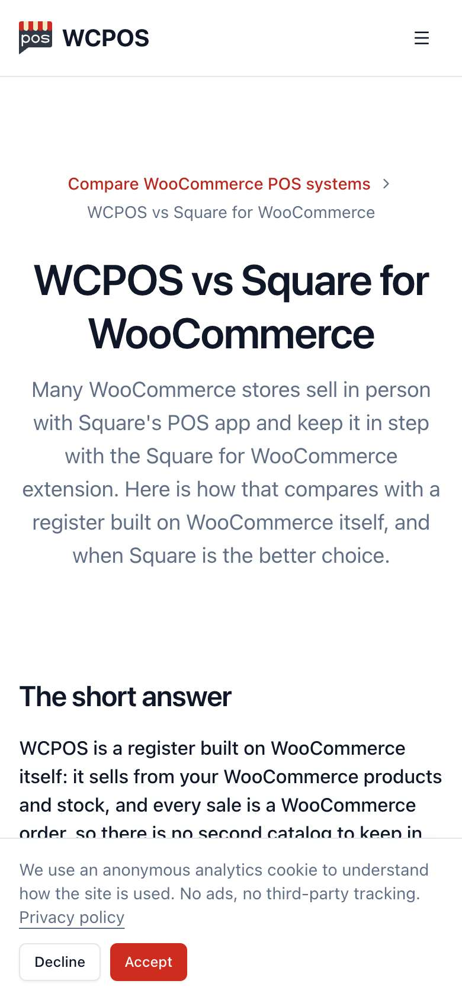 |
| /extensions | 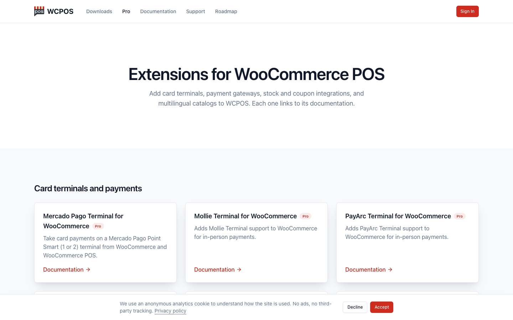 | 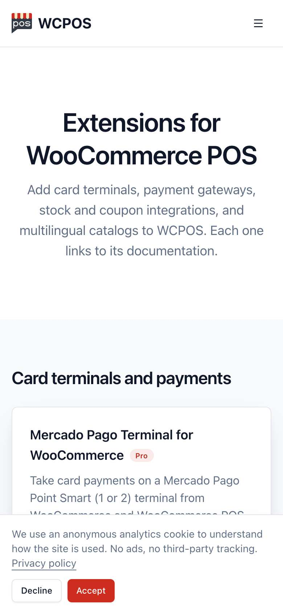 |

## Scores

| Judge | Marketing | UI | SEO |
|---|---|---|---|
| shop-owner (Opus) | 7 | 7 | 8 |
| woo-dev (Opus) | 7 | 8 | 8 |
| designer (Opus) | 7 | 7 | 8 |
| seo (Opus) | 8 | 8 | 8 |
| sceptic (Astra) | 8 | 9 | 9 |
| **Mean** | **7.4** | **7.8** | **8.2** |
| Round 16 | 7.2 | 7.6 | 8.2 |
| **Delta** | **+0.2** | **+0.2** | **0** |

The overall mean is 7.80, up 0.13. **Nothing is reverted.**

- Both rises come from the sceptic: Marketing 7 → 8 and UI 8 → 9. The other
  four judges' scores are unchanged from round 16.
- No judge repeats a round-16 defect. The phone glance table, the hub card
  anchors and the /downloads "Payments" wording are not mentioned again.

## Lighthouse (live, light theme)

| Page | Mobile perf | Desktop perf | A11y / BP / SEO | Mobile LCP | vs round 16 (mobile) |
|---|---|---|---|---|---|
| / | 96 | 100 | 100 | 2.8 s | +3 |
| /pro | 100 | 100 | 100 | 1.8 s | 0 |
| /compare | 100 | 100 | 100 | 1.7 s | 0 |
| /downloads | 100 | 100 | 100 | 1.7 s | +1 |
| /de | 95 | 100 | 100 | 2.9 s | +2 |

## Worst defects

**Marketing**

- /extensions marks 12 of 15 cards Pro with no explanation and no /pro link
  in the body (designer for the third round; seo; woo-dev as its SEO pick).
  Seo adds that the badge runs into the card title.
- The home page has no comparison link near the pricing call to action
  (shop-owner).
- The /pro multi-store card's wording (woo-dev). Front desk, needs a plugin
  fact check.
- The home offline line has no card-reader qualifier (sceptic). Front desk.

**UI**

- The #769 breadcrumb wraps to two lines on phone and repeats the H1
  directly below it (designer, seo).
- The header "Pro" nav item looks like the active page (woo-dev, second
  round).
- On phone the /compare lead paragraph runs six centred lines (shop-owner).
- Inline code in the /downloads release notes overflows on phone (sceptic).

**SEO**

- The /pro price box heading "Get Pro" is a `
`, so the page has no
  pricing heading (seo).
- The /compare/* titles run up to 72 characters with " | WCPOS" (68 for
  Square, 72 for WooCommerce's own POS), and the
  suffix "An Honest Comparison" adds little (shop-owner; seo as runner-up;
  sceptic in round 16).
- A weak /support H1 and description (designer, second round).
- /support doc links are static, so they don't follow the locale
  (sceptic).

## Fixes this round

There are three fixes, one per track. Opus 5.5 pool one-shots implemented
each one from a written spec, as `route-implementation` said `opus`. Each
PR got one review on its head by this machine, which read the full diff,
reran the acceptance commands and applied the mutations itself.

| Track | Defect | Fix | PR |
|---|---|---|---|
| Marketing | Pro badge unexplained on /extensions | One line under the hero: "Extensions marked Pro need WCPOS Pro.", with the link to /pro, in all ten locales (`extensions.proNote`). It says only what the existing `requiresPro` flag means. | #775 |
| UI | Phone breadcrumb wraps and repeats the H1 | Below `sm` only the hub link shows, as "‹ Compare WooCommerce POS systems". The separator and current page are `max-sm:hidden`. From `sm` up and in the JSON-LD nothing changes. | #776 |
| SEO | Long /compare/* titles | All 70 titles now end at the year ("WCPOS vs Square for WooCommerce (2026)"). The text before the year is unchanged. A test holds each title under 60 characters with " | WCPOS". | #777 |

- The titles spec needed two amendments. Six ja titles write the year as
  `（2026年）`, so the test accepts that form. The shortened titles are brand
  names plus a year, so 33 locale values now equal en; the seven keys joined
  their `hero.title` siblings in the parity test's language-neutral list.
- The /pro price heading (seo) was the other SEO candidate. It moves to
  round 18.

Checked live after the fa86745 deploy, in headless Chromium with a fresh
browser context per page:

- /extensions on desktop and phone, and /de/extensions on phone: the hero
  holds the note, and its link goes to `/pro` or `/de/pro`.
- All seven /compare/* pages on phone: one breadcrumb item is visible and
  the nav is 22 px tall. On desktop, /compare/square shows all three items.
- With " | WCPOS", en titles range from 30 characters (jovvie) to 50
  (woocommerce), and /de/compare/woocommerce-pos is 59. `og:title` matches each `<title>`, and
  ja keeps `（2026年）` where it had it.

| /extensions hero, phone | /de/extensions hero, phone |
|---|---|
| 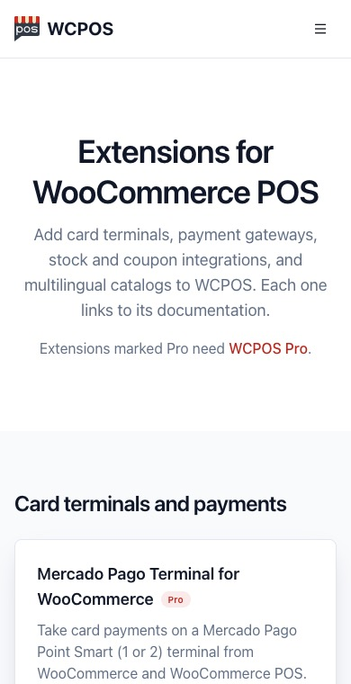 | 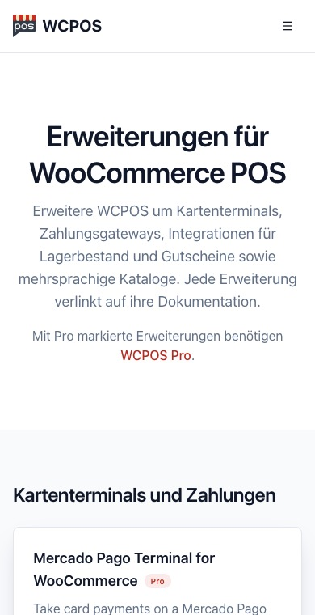 |

| /compare/square breadcrumb, phone | /compare/square breadcrumb, desktop |
|---|---|
| 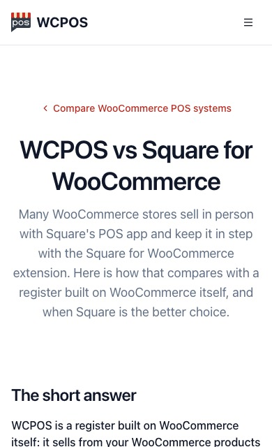 | 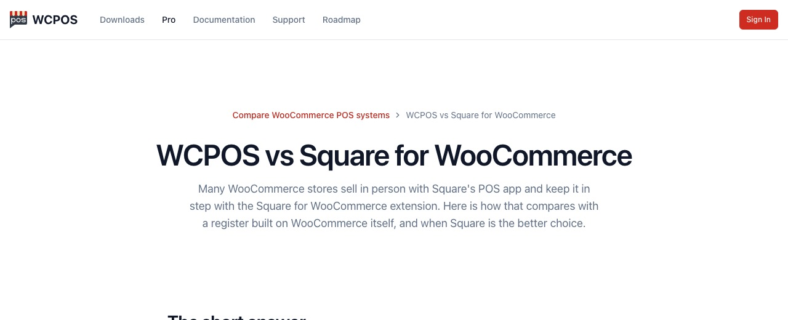 |

Round 18's judging measures the effect of these fixes.

**Record fix.** `docs/climb/.gitignore` commits only the home, pro, de-pro
and downloads fold shots. The round 14 to 16 records also link compare and
extensions fold shots, which were never committed, so those images were
broken. This PR force-adds the 14 linked files, plus round 17's own, and
does not change the ignore rule.

## Deferred

- Candidates for round 18:
  - the /pro price box heading as an `<h2>` (seo)
  - a comparison link near the home pricing call to action (shop-owner)
  - the header "Pro" nav item looking active (woo-dev, second round)
  - the six-line centred /compare lead on phone (shop-owner)
  - /downloads release-note inline code overflowing on phone (sceptic)
  - the /support H1 and description (designer); /support's static doc
    links (sceptic)
  - carried over: home features grid links to /extensions (woo-dev); the
    /downloads phone picker pushing the download button below the fold
    (seo)
- For the front desk, carried over:
  - the home offline qualifier, a Compare item in the header nav, the home
    `<title>` and the Square price line on /compare/square
  - the /pro multi-store card's stock sharing, and multi-store against the
    licence terms, both of which need a plugin fact check
  - the compare disclosure naming "kilbot" rather than a person
