# wcpos.com hill climb, round 18 (2026-11-18)

This round re-judges the live site after round 17's three fixes (#775 to
#777, all live). It then records the fixes chosen from the result, plus the
front desk's disclosure ruling.

- Captures: [`2026-11-18-round-18/shots/`](2026-11-18-round-18/shots/) holds
  the fold shots. The full-page shots stay local. Visible text is in `text/`,
  page facts are in `facts.json` and Lighthouse results in `lighthouse.json`.
- Judges: [`2026-11-18-round-18/judges/`](2026-11-18-round-18/judges/). The
  personas and the brief are the same as in round 17: four Opus 5.5 pool
  one-shots, with Codex GPT-6 Astra as the sceptic. The judges were not told
  what changed.

| Page | Desktop | Phone |
|---|---|---|
| Home | 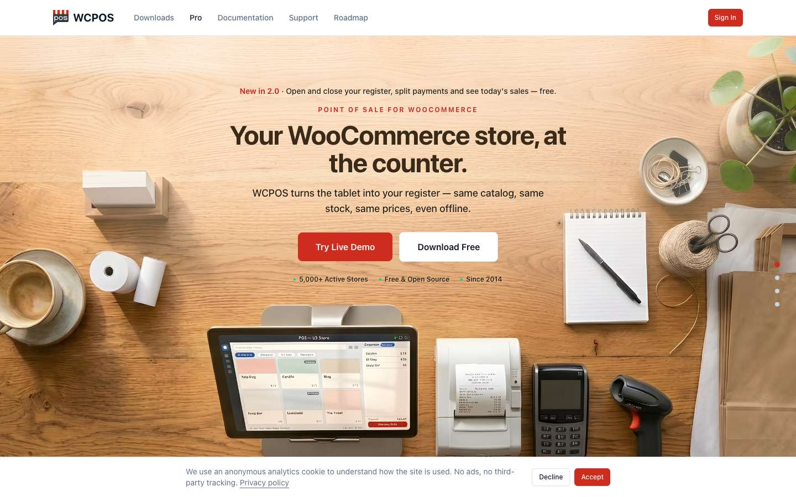 | 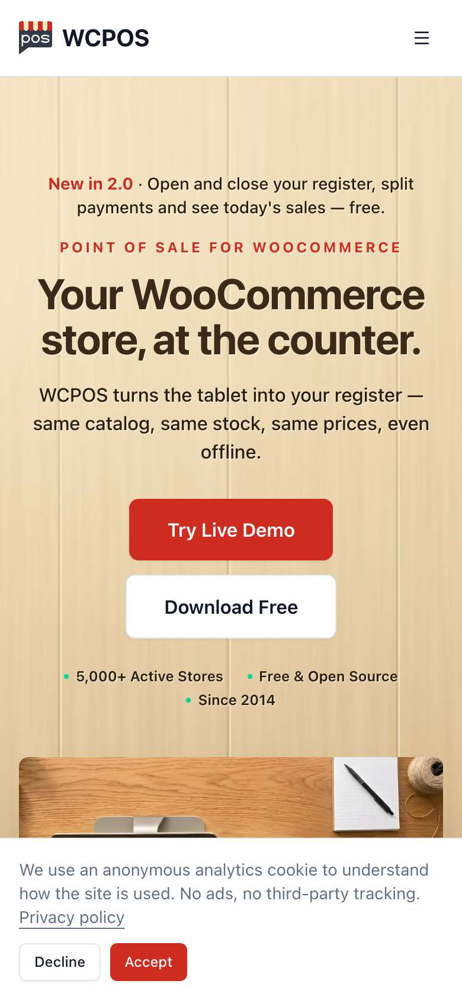 |
| /downloads | 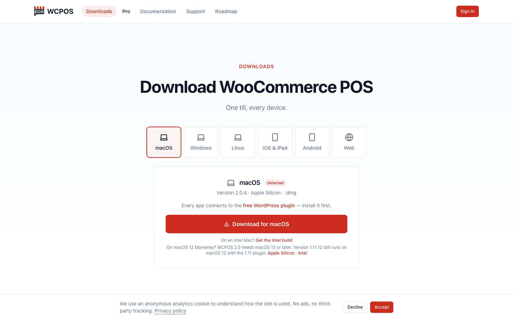 |  |
| /compare/square | 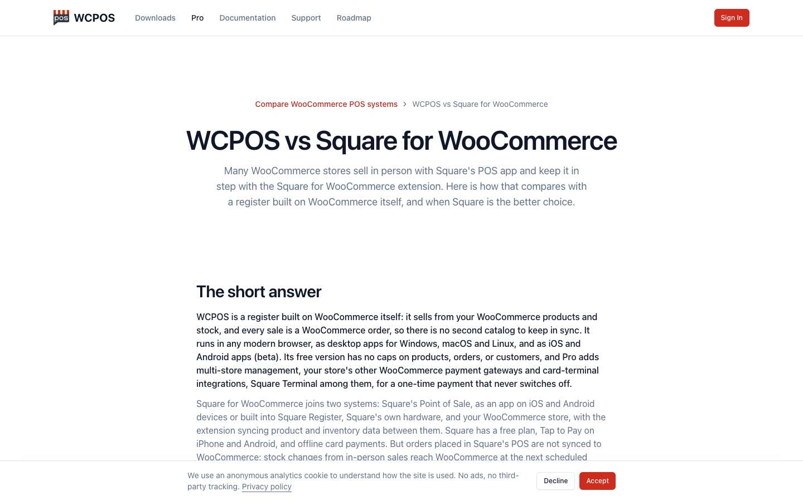 | 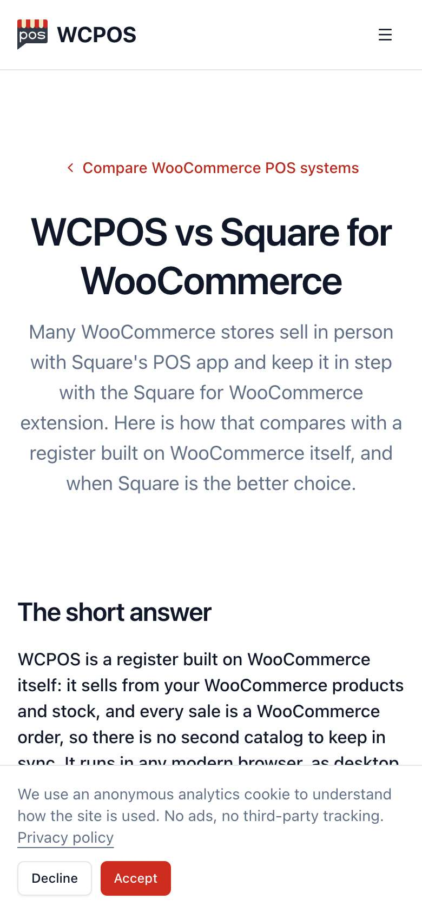 |
| /extensions | 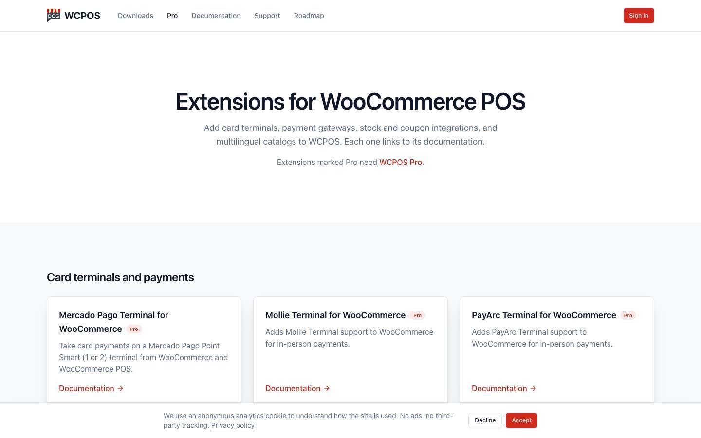 | 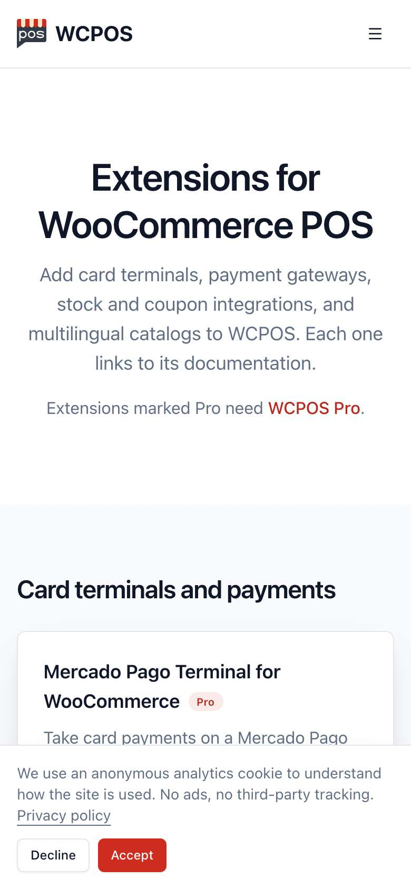 |

## 10-second test

All five judges answered both questions from the home fold. WCPOS is a free,
open-source WooCommerce POS that turns a tablet or browser into the
register. 2.0 makes opening and closing the register, split payments and
today's sales report free.

## Scores

| Judge | Marketing | UI | SEO |
|---|---|---|---|
| shop-owner (Opus) | 7 | 7 | 8 |
| woo-dev (Opus) | 7 | 8 | 8 |
| designer (Opus) | 7 | 7 | 8 |
| seo (Opus) | 8 | 8 | 8 |
| sceptic (Astra) | 7 | 8 | 9 |
| **Mean** | **7.2** | **7.6** | **8.2** |
| Round 17 | 7.4 | 7.8 | 8.2 |
| **Delta** | **−0.2** | **−0.2** | **0** |

The overall mean is 7.67, down 0.13. **Nothing is reverted.**

- Both dips come from the sceptic alone: Marketing 8 → 7 and UI 9 → 8. The
  four Opus judges gave the same scores as in round 17. This is the
  sceptic's swing back from its round-17 rise (7 → 8, 8 → 9).
- None of the sceptic's defects touch a round-17 change. Its Marketing
  defect is the /downloads beta wording, its UI defect is the prose ahead of
  the /compare/square table, and its SEO defect is the home title.
- No judge repeats a round-17 defect. No one mentions the unexplained
  /extensions Pro badge, the two-line breadcrumb or the long /compare titles.

## Lighthouse (live, light theme)

| Page | Mobile perf | Desktop perf | A11y / BP / SEO | Mobile LCP | vs round 17 (mobile) |
|---|---|---|---|---|---|
| / | 93 | 100 | 100 | 3.2 s | −3 |
| /pro | 100 | 100 | 100 | 1.2 s | 0 |
| /compare | 100 | 100 | 100 | 1.4 s | 0 |
| /downloads | 99 | 100 | 100 | 1.8 s | −1 |
| /de | 92 | 100 | 100 | 3.3 s | −3 |

Home and /de are back at their round-16 values (93 and 93). No round-17
change touched either page, so this is run-to-run noise.

## Worst defects

**Marketing**

- No link from the home body to /extensions: "Pro connects card readers like
  Stripe Terminal and SumUp" is plain text (seo; woo-dev as its SEO pick).
- No comparison link near the home pricing call to action (shop-owner, second
  round).
- /downloads "What's new" opens 2.0.4's bug fixes in semibold, and 2.0.0 is
  collapsed fifth (designer).
- /downloads beta links don't say the 2.0 store apps aren't out yet
  (sceptic).
- Coupons missing from the /pro and home Pro lists (woo-dev).

**UI**

- The /compare/* hero lead runs six centred lines on phone (shop-owner, second
  round; seo).
- The /extensions "Pro" chip wraps alone onto its own line (designer).
- The header "Pro" nav item looks active (woo-dev, third round). The designer
  and seo judges note that this is documented intent (#729).
- Prose before the /compare/square glance table, with no jump link
  (sceptic).

**SEO**

- The /pro price box title "Get Pro" is a `
`, so the page has no pricing
  heading (shop-owner, designer, seo; woo-dev as a runner-up).
- The home `<title>` omits "free" (sceptic). This is with the front desk.

## Fixes this round

There are three fixes, one per track, and a fourth PR that applies the front
desk's disclosure ruling. Opus 5.5 pool one-shots implemented each one from
a written spec, because `route-implementation` said `opus`. Each PR got one
review on its head by this machine, which read the full diff, reran the
acceptance commands and applied the mutations itself.

| Track | Defect | Fix | PR |
|---|---|---|---|
| SEO | The /pro price box title is a `
` | "Get Pro" is now an `<h2>` with the same classes, so it looks the same. | #780 |
| UI | The /compare/* hero lead runs six centred lines on phone | The hero heading on all seven detail pages gets `max-sm:text-left`. Below `sm`, the H1 and lead are left-aligned; from `sm` up they stay centred. | #781 |
| Marketing | No home link to /extensions | In the "Smooth checkout flow" card, "card readers" links to /extensions in all ten locales. The wording is otherwise unchanged. | #782 |
| Ruling | The /compare disclosure names "kilbot" | The first sentence now reads "This page is published by WCPOS, the makers of WooCommerce POS." in all ten locales. The rest of the disclosure is unchanged. | #779 |

- The disclosure sweep found no other "kilbot" in the message files. The
  About page founder letter is signed by the founder and links to
  `github.com/kilbot`. That is the letter's signature, not page attribution,
  so #779 leaves it alone and the question goes to the front desk.

Checked live after the 688744d deploy, in headless Chromium with a fresh
browser context per page:

- /compare/square, /de/compare/square and /ja/compare/foosales: the
  disclosure opens with the new sentence, and no page text contains
  "kilbot".
- /pro and /de/pro: the h2 outline is "What's included in Pro?", "Get Pro"
  ("Hol dir Pro"), "Frequently Asked Questions". The title is still 18 px.
- All seven /compare/* pages on phone: the H1 and lead are left-aligned. The
  square lead is six lines, and the yith-pos lead is the longest at eleven.
  On desktop, /compare/square stays centred.
- Home: the card links to `/extensions`. On /de it links "Kartenlesegeräte"
  to `/de/extensions`, and on /ja it links "カードリーダー" to
  `/ja/extensions`.

| /compare/square hero, phone | /de/compare/square hero, phone |
|---|---|
| 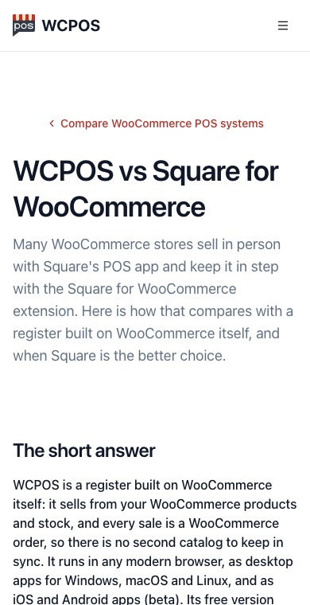 | 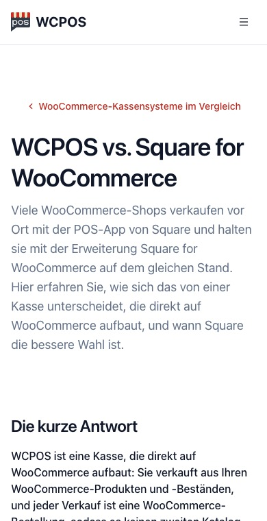 |

| /pro price box, desktop | Home checkout card, phone |
|---|---|
| 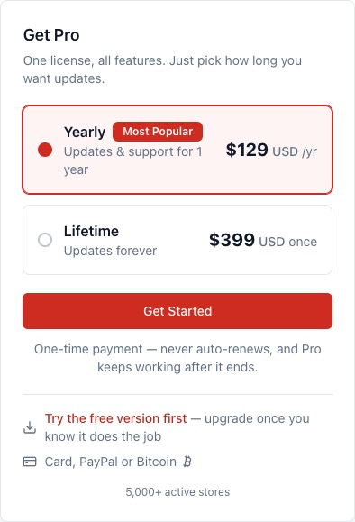 | 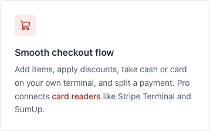 |

Round 19's judging measures the effect of these fixes.

## Deferred

- Candidates for round 19:
  - a comparison link near the home pricing call to action (shop-owner,
    third round)
  - /downloads "What's new" opening on 2.0.4 rather than 2.0.0 (designer);
    the beta links' wording (sceptic)
  - coupons in the /pro and home Pro lists (woo-dev)
  - the /extensions "Pro" chip wrapping alone (designer)
  - a jump link to the /compare/square glance table (sceptic)
  - carried over: /downloads inline code overflow and phone picker; the
    /support H1 and description
- For the front desk, carried over:
  - the home offline qualifier, a Compare item in the header nav, the home
    `<title>` and the Square price line on /compare/square
  - the /pro multi-store facts, which need a plugin fact check
  - new: whether the About founder letter's signature and its
    `github.com/kilbot` link fall under the attribution ruling
