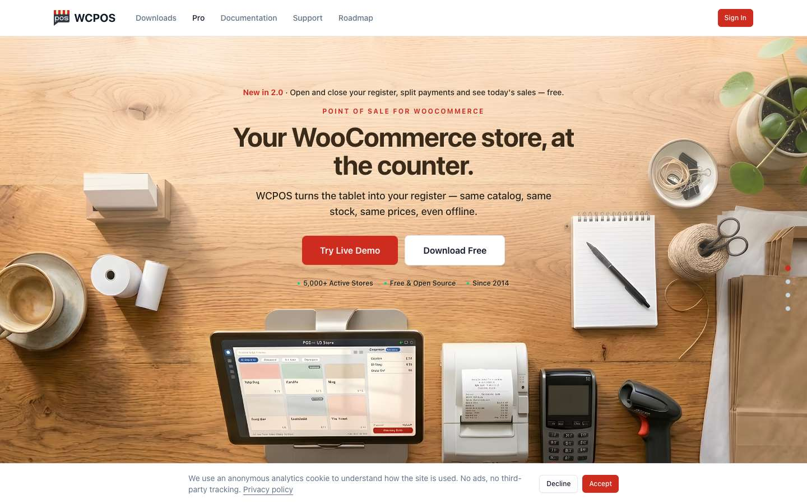
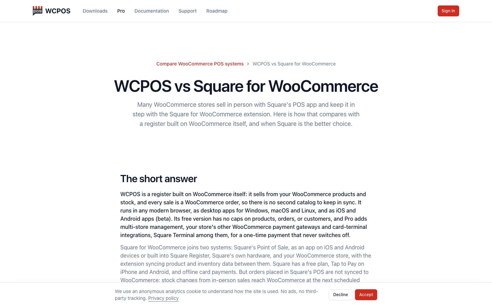
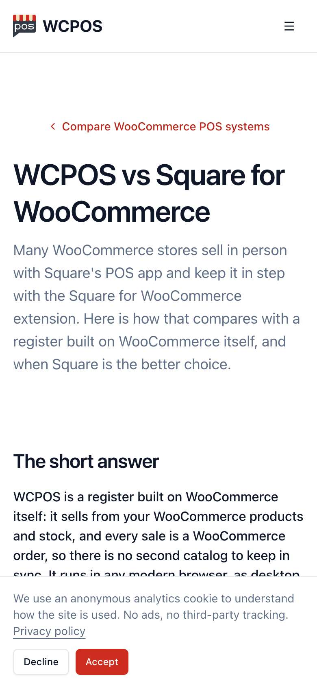
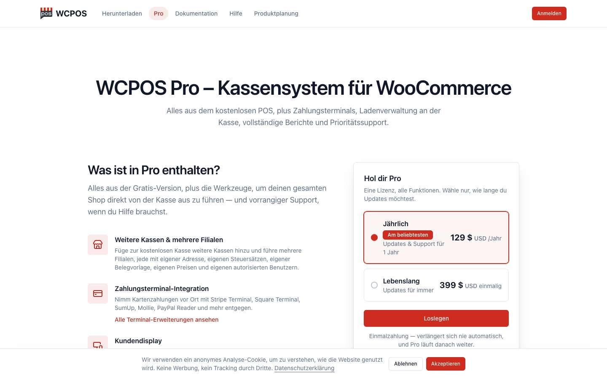
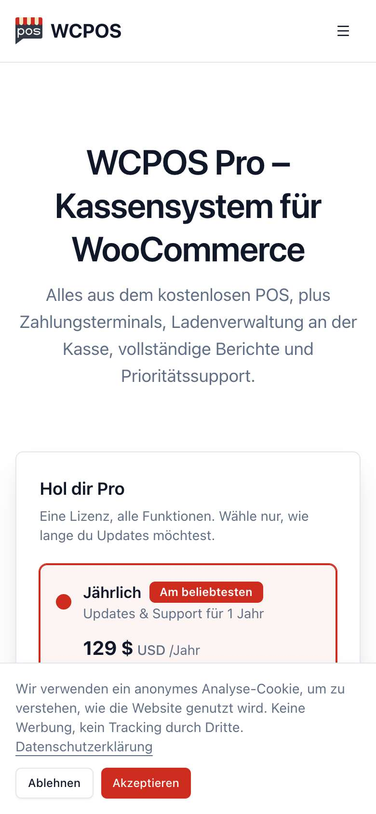
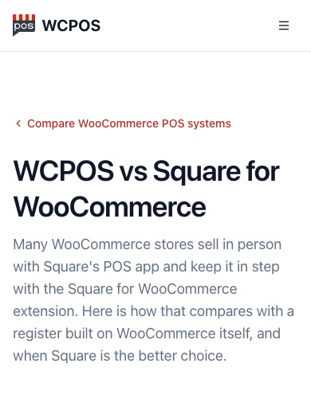
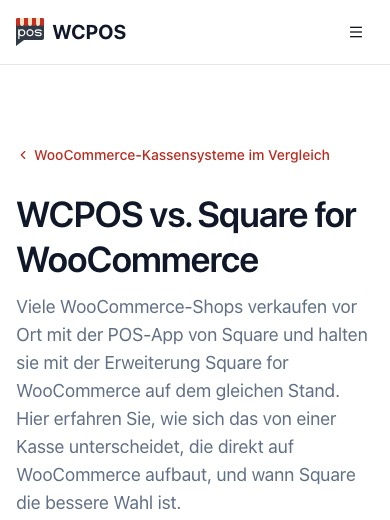
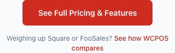
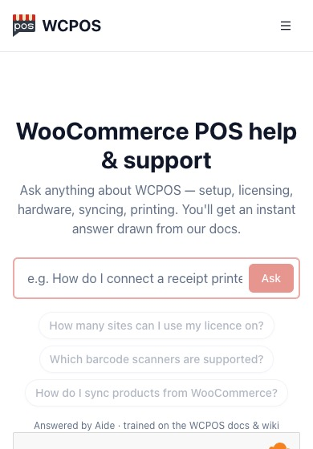
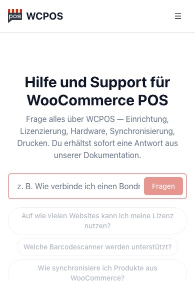

# wcpos.com hill climb, round 19 (2026-11-18)

This round re-judges the live site after round 18's fixes (#779 to #782,
all live). It then records the fixes chosen from the result.

- Captures: [`2026-11-18-round-19/shots/`](2026-11-18-round-19/shots/) holds
  the fold shots. The full-page shots stay local. Visible text is in `text/`,
  page facts are in `facts.json` and Lighthouse results in `lighthouse.json`.
- Judges: [`2026-11-18-round-19/judges/`](2026-11-18-round-19/judges/). The
  personas and the brief are the same as in round 18: four Opus 5.5 pool
  one-shots, with Codex GPT-6 Astra as the sceptic. The judges were not told
  what changed.

| Page | Desktop | Phone |
|---|---|---|
| Home |  |  |
| /downloads |  |  |
| /compare/square |  |  |
| /pro (de) |  |  |

## 10-second test

All five judges answered both questions from the home fold. WCPOS is a free,
open-source WooCommerce POS that turns a tablet into the register and sells
from the store's own catalog, stock and prices, even offline. 2.0 makes
opening and closing the register, split payments and today's sales report
free.

## Scores

| Judge | Marketing | UI | SEO |
|---|---|---|---|
| shop-owner (Opus) | 7 | 7 | 8 |
| woo-dev (Opus) | 7 | 8 | 8 |
| designer (Opus) | 7 | 7 | 8 |
| seo (Opus) | 8 | 8 | 8 |
| sceptic (Astra) | 7 | 8 | 9 |
| **Mean** | **7.2** | **7.6** | **8.2** |
| Round 18 | 7.2 | 7.6 | 8.2 |
| **Delta** | **0** | **0** | **0** |

The overall mean is 7.67, unchanged. **Nothing is reverted.**

- Every judge gave the same three scores as in round 18.
- No judge repeats a round-18 defect. The designer checked the /pro
  "Get Pro" h2 in the outline and the left-aligned phone hero, and found no
  regression.
- The left-aligned hero (#781) did leave the breadcrumb above it centred.
  Two judges (woo-dev, seo) named this mixed alignment as their UI defect.
  It is fixed this round.

## Lighthouse (live, light theme)

| Page | Mobile perf | Desktop perf | A11y / BP / SEO | Mobile LCP | vs round 18 (mobile) |
|---|---|---|---|---|---|
| / | 91 | 100 | 100 | 3.4 s | −2 |
| /pro | 96 | 100 | 100 | 2.7 s | −4 |
| /compare | 97 | 100 | 100 | 2.6 s | −3 |
| /downloads | 99 | 100 | 100 | 1.8 s | 0 |
| /de | 92 | 100 | 100 | 3.3 s | 0 |

A second run straight after gave /pro 100 and /compare 100, home 88,
/downloads 94 and /de 92 on mobile. The dips are run-to-run noise: no
round-18 change touched the /compare hub, and #780 changed one `
` to an
`<h2>` on /pro.

## Worst defects

**Marketing**

- No comparison link near the home pricing call to action (shop-owner,
  third round).
- /downloads "What's new" opens on 2.0.4's bug fixes in bold, with 2.0.0
  closed fifth (designer, second round).
- /downloads step 3's Pro pitch leaves out more registers and stores, and
  says "till" (seo).
- The /pro multi-store card never says a store is a location in one
  WooCommerce site (woo-dev). This is a product-fact and licence question,
  marked needs-front-desk.
- The home offline line doesn't say integrated readers and online gateways
  need a connection (sceptic). This is with the front desk.

**UI**

- The /compare/* breadcrumb is still centred above the left-aligned H1 and
  lead on phone (woo-dev, seo).
- The /compare hub lists the cards in a different order from its lead, so
  Square and FooSales come late on phone (shop-owner).
- The /extensions "Pro" chip wraps alone onto its own line (designer, fourth
  round).
- No jump link to the /compare/square glance table (sceptic, second round).

**SEO**

- /support: the H1 "How can we help?" and the 104-character description
  name neither WooCommerce nor POS (designer, woo-dev).
- The home and /downloads SoftwareApplication JSON-LD uses the en `url` on
  every locale and has no `description` (seo, third round).
- /compare/* pages show a "verified" date but have no Article JSON-LD with
  dates (shop-owner).
- /compare/square's sources are plain text, not links (sceptic).

## Fixes this round

There are three fixes, one per track. Opus 5.5 pool one-shots implemented
each one from a written spec, because `route-implementation` said `opus`.
Each PR got one review on its head by this machine, which read the full diff,
reran the acceptance commands and applied the mutations itself.

| Track | Defect | Fix | PR |
|---|---|---|---|
| UI | The /compare/* breadcrumb is centred above the left-aligned hero on phone | The breadcrumb `nav` and `ol` get `max-sm:justify-start`, so below `sm` the breadcrumb lines up with the H1 and lead. From `sm` up it stays centred. | #784 |
| Marketing | No comparison link near the home pricing call to action | A line under the home Pro button reads "Weighing up Square or FooSales? See how WCPOS compares", with the second sentence linking to /compare, in all ten locales. | #785 |
| SEO | The /support H1 and description name neither WooCommerce nor POS | The H1 is "WooCommerce POS help & support". The description names the product and the topics the page already lists (145 characters in en), in all ten locales. The length test now covers it. | #786 |

- #786's first head failed E2E, because `e2e/support.spec.ts` waited for the
  old "How can we help?" heading. A second one-line spec updated the
  assertion, which now also requires the heading to be an H1. CI was green on
  the new head before the merge.
- In #786, the fr, es, it and pt descriptions are noun lists ("configuration,
  licences, …"), so they fit 160 characters. A native-speaker read would be
  worthwhile.

Checked live after the c6e60b4 deploy, in headless Chromium with a fresh
browser context per page:

- All seven /compare/* pages on phone: the breadcrumb's left edge is at 16
  px, the same as the H1 (`justify-content: flex-start`). On desktop,
  /compare/square stays centred.
- Home: the line links to `/compare` on en, `/de/compare` on /de and
  `/ja/compare` on /ja, with no horizontal overflow on phone. The de line
  wraps to two lines under "Alle Preise & Funktionen ansehen".
- /support, /de/support and /ja/support: the H1s are "WooCommerce POS help &
  support", "Hilfe und Support für WooCommerce POS" and "WooCommerce
  POSのヘルプとサポート", and the meta descriptions are the new ones. There is
  no overflow on phone.

| /compare/square hero, phone | /de/compare/square hero, phone |
|---|---|
|  |  |

| Home pricing CTA, phone | /de home pricing CTA, phone |
|---|---|
|  |  |

| /support hero, phone | /de/support hero, phone |
|---|---|
|  |  |

Round 20's judging measures the effect of these fixes.

## Deferred

- Candidates for round 20:
  - /downloads "What's new" opening on 2.0.4 rather than 2.0.0 (designer,
    second round)
  - /downloads step 3's Pro pitch, and "till" (seo)
  - the /compare hub card order against its lead (shop-owner)
  - the /extensions "Pro" chip wrapping alone (designer, fourth round)
  - a jump link to the /compare/square glance table (sceptic, second round)
  - the SoftwareApplication JSON-LD `url` and `description` per locale (seo,
    third round)
  - Article JSON-LD with dates on /compare/* (shop-owner)
  - links for the /compare/square sources (sceptic)
  - carried over: the /support greyed controls and clipped placeholder on
    phone; home stats "Active Installations" against "Active Stores"; the /de
    "2014 / In Entwicklung seit" stat
- Dropped: coupons in the Pro lists. woo-dev notes that coupons in the cart
  are free in 2.0, and only the Coupons screen is Pro.
- For the front desk, carried over:
  - the home offline qualifier (the sceptic raised it again), a Compare item
    in the header nav, the home `<title>` and the Square price line
  - /pro multi-store: woo-dev cites the wiki
    `product/features/pro-and-add-ons.md` lines 14 and 28 and proposes card
    wording. The licence wording is a front-desk call.
  - whether the About founder letter's `github.com/kilbot` link falls under
    the attribution ruling
