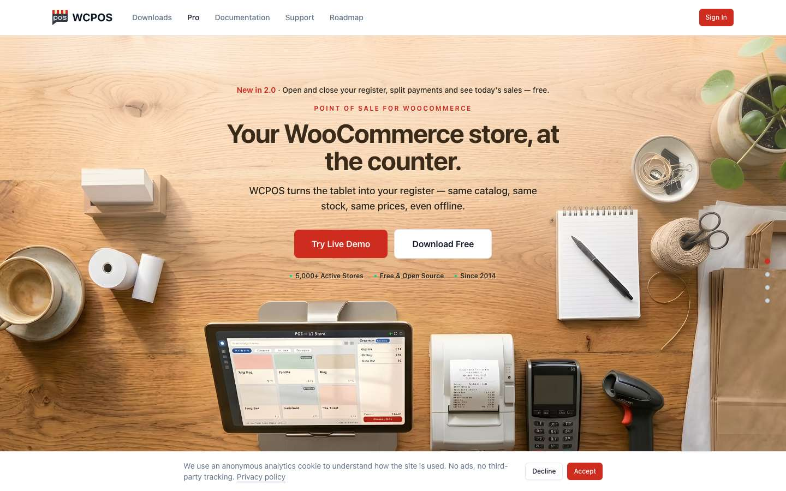
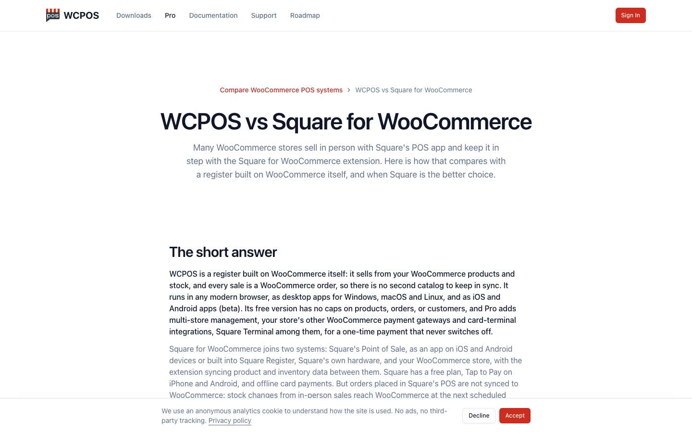
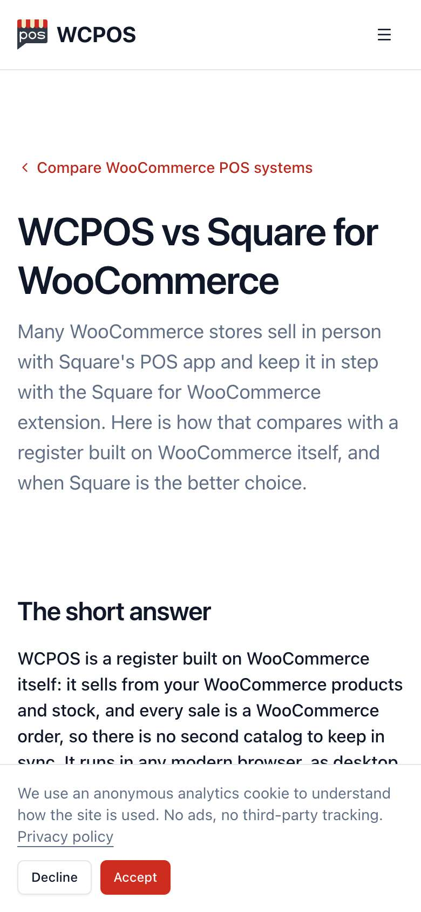
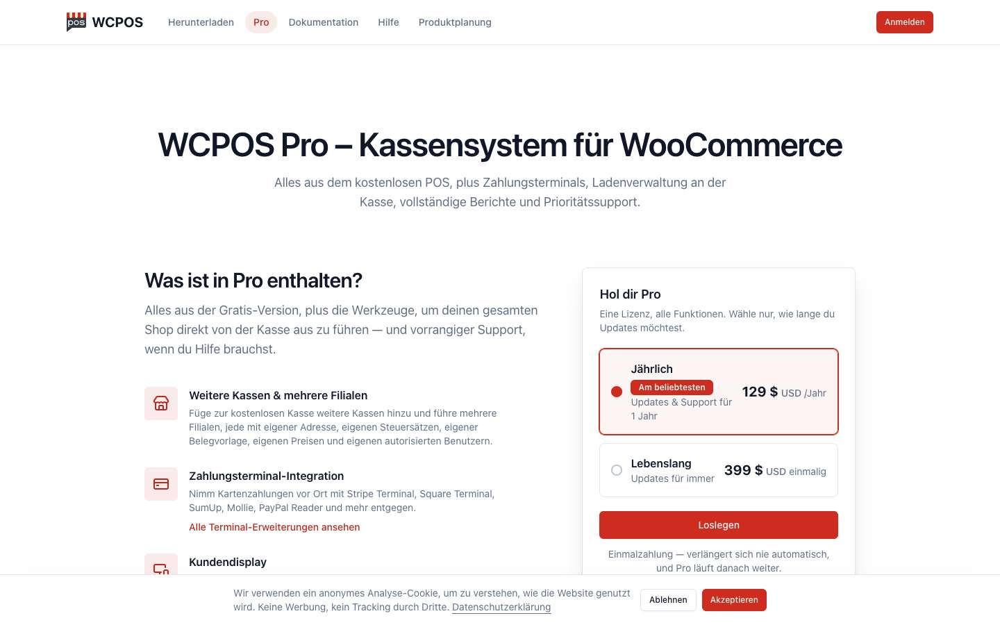
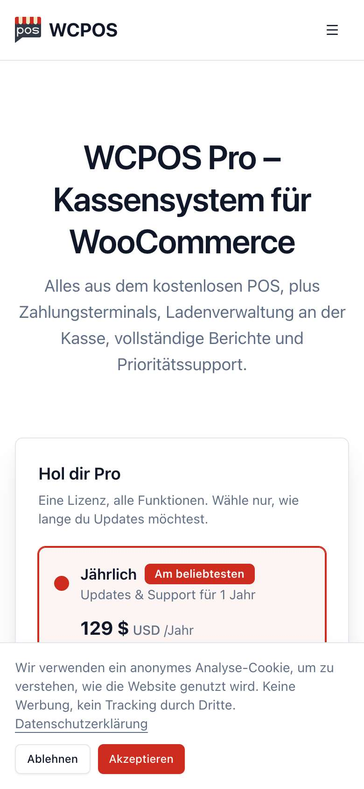
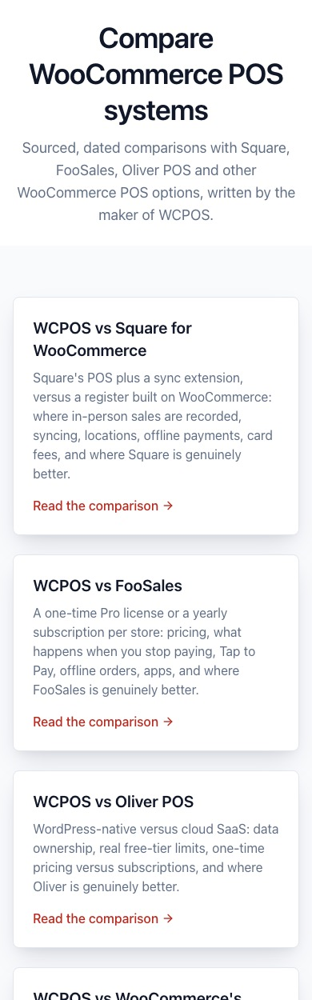
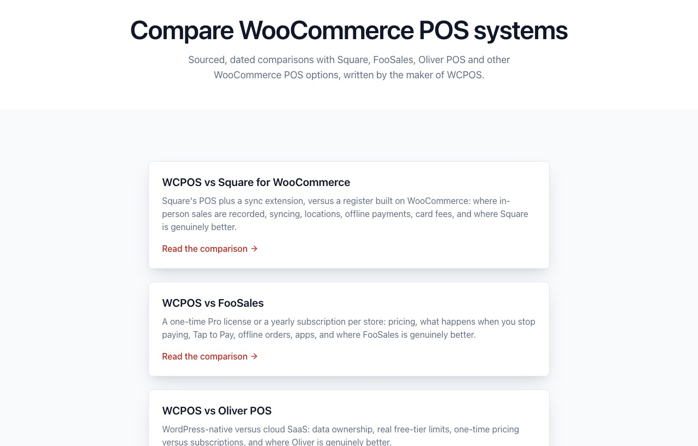
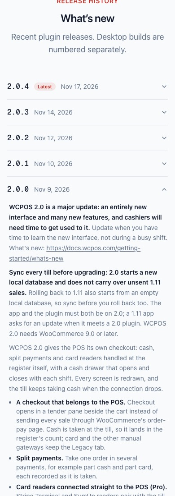
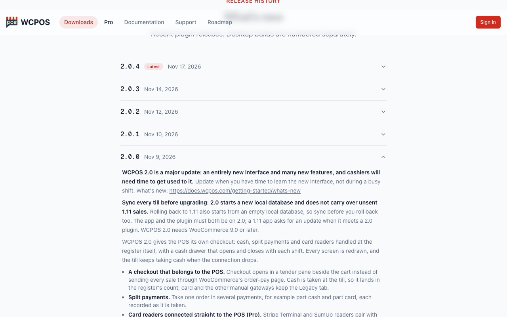

# wcpos.com hill climb, round 20 (2026-11-18)

This round re-judges the live site after round 19's fixes (#784 to #786, all
live). It then records the fixes chosen from the result.

- Captures: [`2026-11-18-round-20/shots/`](2026-11-18-round-20/shots/) holds
  the fold shots. The full-page shots stay local. Visible text is in `text/`,
  page facts are in `facts.json` and Lighthouse results in `lighthouse.json`.
- Judges: [`2026-11-18-round-20/judges/`](2026-11-18-round-20/judges/). The
  personas and the brief are the same as in round 19: four Opus 5.5 pool
  one-shots, with Codex GPT-6 Astra as the sceptic. The judges were not told
  what changed.

| Page | Desktop | Phone |
|---|---|---|
| Home |  |  |
| /downloads |  |  |
| /compare/square |  |  |
| /pro (de) |  |  |

## 10-second test

All five judges answered both questions from the home fold. WCPOS is a free,
open-source WooCommerce POS that turns a tablet into the register and sells
from the store's own catalog, stock and prices, even offline. 2.0 makes
opening and closing the register, split payments and today's sales report
free.

## Scores

| Judge | Marketing | UI | SEO |
|---|---|---|---|
| shop-owner (Opus) | 8 | 7 | 8 |
| woo-dev (Opus) | 7 | 8 | 8 |
| designer (Opus) | 7 | 7 | 8 |
| seo (Opus) | 8 | 8 | 8 |
| sceptic (Astra) | 7 | 8 | 9 |
| **Mean** | **7.4** | **7.6** | **8.2** |
| Round 19 | 7.2 | 7.6 | 8.2 |
| **Delta** | **+0.2** | **0** | **0** |

The overall mean is 7.73 (+0.07). **Nothing is reverted.**

- The one change is the shop-owner's Marketing score, from 7 to 8. Their
  verdict quotes #785's home line ("Weighing up Square or FooSales?") as
  live. They had asked for that link for three rounds.
- No judge names a regression from #784 to #786. The designer saw the new
  /support H1 break with "& support" at the start of the phone line. It is
  a runner-up note, not a defect.
- #785 sends visitors to /compare for Square and FooSales, but the hub
  lists them third and last. Two judges (shop-owner, seo) named that as
  their UI defect. It is fixed this round.

## Lighthouse (live, light theme)

| Page | Mobile perf | Desktop perf | A11y / BP / SEO | Mobile LCP | vs round 19 (mobile) |
|---|---|---|---|---|---|
| / | 87 | 100 | 100 | 3.3 s | −4 |
| /pro | 97 | 100 | 100 | 2.6 s | +1 |
| /compare | 97 | 100 | 100 | 2.6 s | 0 |
| /downloads | 100 | 100 | 100 | 1.4 s | +1 |
| /de | 94 | 100 | 100 | 3.1 s | +2 |

Home's mobile score is in the band of round 19's two runs (91 and 88), and
its LCP is a little faster. The only round-19 change on home is one line of
text below the fold (#785).

## Worst defects

**Marketing**

- /downloads "What's new" opens on 2.0.4's two bug-fix bullets, with 2.0.0
  closed fifth (designer, third round).
- /downloads step 3's Pro pitch leaves out more registers and stores, and
  says "till" (seo, second round).
- /pro has no live-demo link. Its only "try first" nudge goes to /downloads
  (shop-owner).
- The /pro multi-store card never says a store is a location inside one
  WooCommerce site (woo-dev). This needs the front desk.
- The home offline line doesn't say that connected readers and online
  gateways need a connection (sceptic). This is with the front desk.

**UI**

- The /compare hub lists Oliver first and FooSales last, while its lead and
  the home line name Square and FooSales (shop-owner, seo).
- The /extensions "Pro" chip wraps onto its own line, on five phone cards in
  a row (designer, fifth round).
- /support on phone: the placeholder is clipped, and the Ask button and
  suggestion chips look greyed out while Turnstile verifies, with no hint
  (woo-dev).
- The /downloads ".zip" button opens the GitHub releases list, not a zip
  (sceptic).

**SEO**

- The home and /downloads SoftwareApplication JSON-LD uses the en `url` on
  every locale and has no `description` (seo, designer, woo-dev; fourth
  round).
- /compare/* pages show a "verified" date but have no Article JSON-LD with
  dates (shop-owner, second round).
- The /compare meta description names no competitor and is 162 characters
  (sceptic; the seo and designer judges noted the length).

## Fixes this round

Three defects were fixed, one per track. Each was written as one spec and
implemented by an Opus 5.5 pool one-shot (route: opus). This machine
reviewed the full diff and reran the acceptance commands and mutations.

| Track | Defect | PR | Merge |
|---|---|---|---|
| UI | /compare hub order doesn't match its lead or the home line | [#788](https://github.com/wcpos/wcpos-com/pull/788) | a3a9876 |
| Marketing | /downloads "What's new" opens 2.0.4, not 2.0.0 | [#789](https://github.com/wcpos/wcpos-com/pull/789) | b79263f |
| SEO | SoftwareApplication JSON-LD has the en `url` on every locale and no `description` | [#790](https://github.com/wcpos/wcpos-com/pull/790) | 8bbdad2 |

- **#788:** the hub cards and their ItemList JSON-LD now run Square,
  FooSales, Oliver POS, WooCommerce, Jovvie, Vitepos, YITH, matching the
  lead. Swapping Square and Oliver back fails two tests.
- **#789:** `ReleaseHistory` gains an `openFeatureRelease` prop, and only
  /downloads passes it. The open row is the newest `x.y.0` release, falling
  back to the first row. The "Latest" badge stays on 2.0.4, and /changelog
  still opens its first row. Each of the two mutations (always opening row
  0; dropping the fallback) fails a test.
- **#790:** home and /downloads pass `url: localeUrl(locale, '/')` and
  their own meta description. Dropping either one fails a test.

## After (live, 2026-11-18 13:10 UTC)

The checks were run in headless Chromium against wcpos.com.

- `/compare`, `/de/compare` (phone and desktop): the cards and the ItemList
  both run square, foosales, oliver-pos, woocommerce-pos, jovvie, vitepos,
  yith-pos. No horizontal overflow.
- `/downloads`, `/de/downloads`: 2.0.0 is the only open row, and 2.0.4
  keeps "Latest" / "Neueste Version". `/changelog` still opens 2.0.4.
- SoftwareApplication JSON-LD on `/`, `/de`, `/downloads`, `/de/downloads`
  and `/ja/downloads` now carries the locale `url` (`https://wcpos.com`,
  `/de`, `/ja`) and that page's own meta description. `downloadUrl` is
  unchanged.

| /compare hub, phone | /compare hub, desktop |
|---|---|
|  |  |

| /downloads "What's new", phone | /downloads "What's new", desktop |
|---|---|
|  |  |

## Deferred

These carry over to round 21 as candidates:

- /downloads step 3's Pro pitch and "till" (seo, second round).
- /pro has no live-demo link (shop-owner).
- The /extensions "Pro" chip wraps on phone (designer, fifth round).
- /support on phone: the clipped placeholder, and controls that look
  disabled during Turnstile (woo-dev).
- The /downloads ".zip" button opens the GitHub releases list (sceptic).
- /compare/* has no Article JSON-LD with dates (shop-owner, second round).
- The /compare meta description names no competitor and is 162 characters
  (sceptic).
- The /support H1 breaks before "& support" on phone (designer, runner-up).
- The bold bug-fix notes in release history.
- `softwareVersion` in the SoftwareApplication JSON-LD.
- Home "Bring your own hardware" has no printer docs link.

These are held for the front desk: the offline qualifier, the /pro
multi-store wording, the founder-letter link, a Compare nav entry, the home
title and the Square price line.

