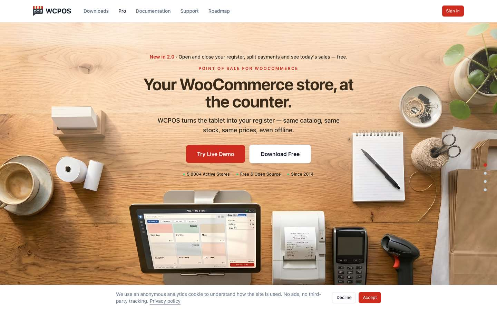
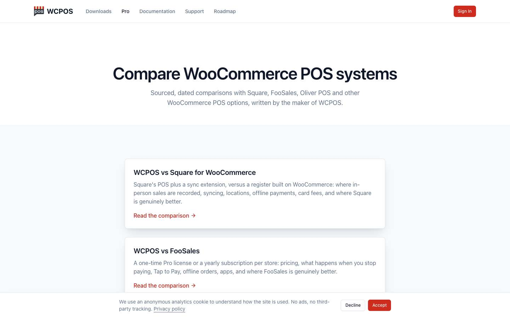
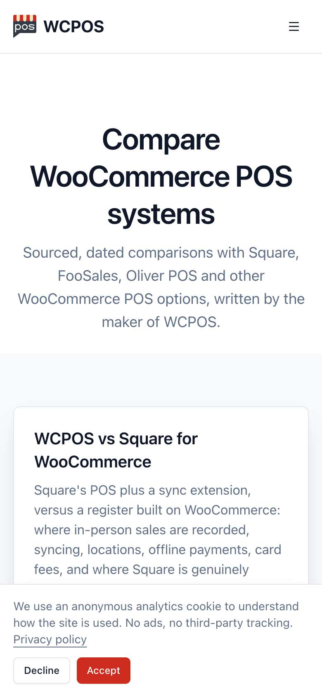
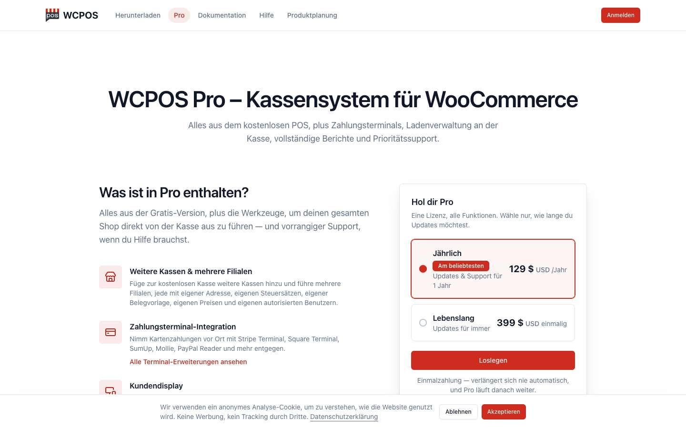
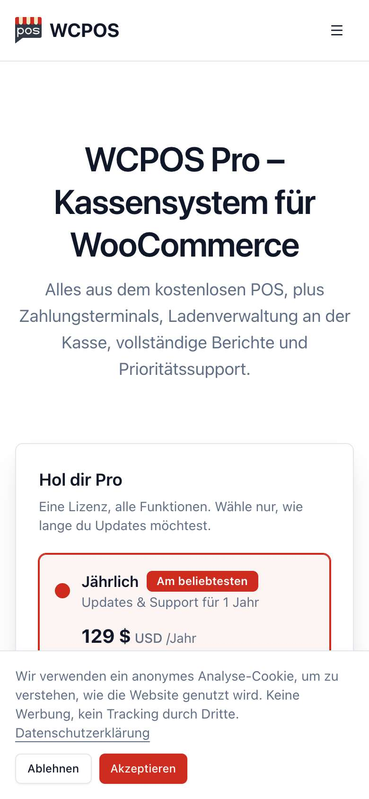
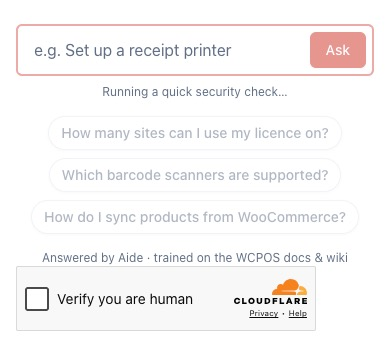
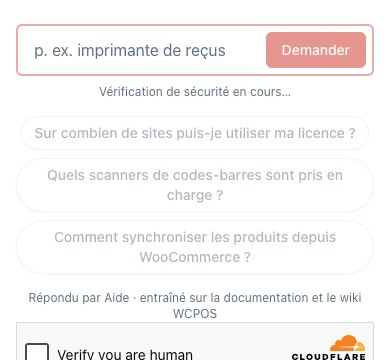
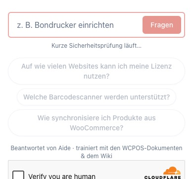
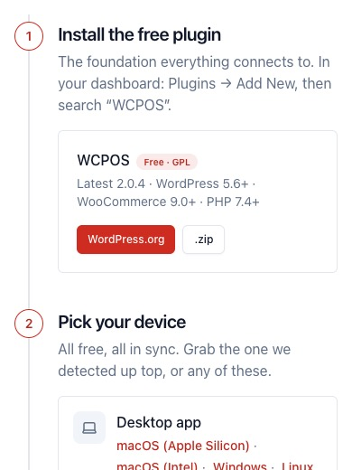
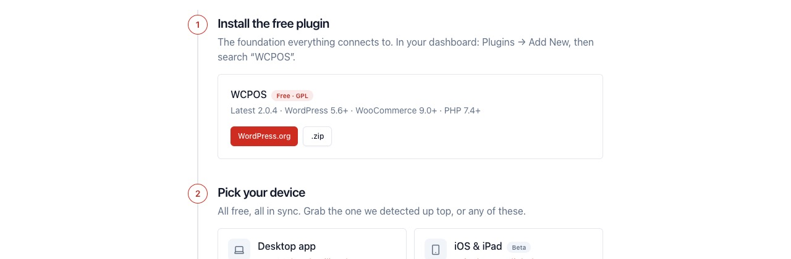

# wcpos.com hill climb, round 21 (2026-11-18)

This round re-judges the live site after round 20's fixes (#788 to #790,
all live). It then records the fixes chosen from the result.

- Captures: [`2026-11-18-round-21/shots/`](2026-11-18-round-21/shots/) holds
  the fold shots. The full-page shots stay local. Visible text is in `text/`,
  page facts are in `facts.json` and Lighthouse results in `lighthouse.json`.
- Judges: [`2026-11-18-round-21/judges/`](2026-11-18-round-21/judges/). The
  personas and the brief are the same as in round 20: four Opus 5.5 pool
  one-shots, with Codex GPT-6 Astra as the sceptic. The judges were not told
  what changed.

| Page | Desktop | Phone |
|---|---|---|
| Home |  |  |
| /downloads |  |  |
| /compare |  |  |
| /pro (de) |  |  |

## 10-second test

All five judges answered both questions from the home fold. WCPOS is a free,
open-source WooCommerce POS that turns a tablet into the register and sells
from the store's own catalog, stock and prices, even offline. 2.0 makes
opening and closing the register, split payments and today's sales report
free.

## Scores

| Judge | Marketing | UI | SEO |
|---|---|---|---|
| shop-owner (Opus) | 8 | 7 | 8 |
| woo-dev (Opus) | 7 | 8 | 8 |
| designer (Opus) | 7 | 7 | 8 |
| seo (Opus) | 8 | 7 | 8 |
| sceptic (Astra) | 7 | 8 | 9 |
| **Mean** | **7.4** | **7.4** | **8.2** |
| Round 20 | 7.4 | 7.6 | 8.2 |
| **Delta** | **0** | **−0.2** | **0** |

The overall mean is 7.67 (−0.07). **Nothing is reverted.**

- The one change is the seo judge's UI score, from 8 to 7. Their UI defect
  is the /support phone form: a clipped placeholder and chips that look
  disabled. Nothing on that page has changed since round 19. No judge
  names a regression from #788 to #790.
- Three judges confirm round 20's fixes live. The shop-owner judge confirms
  the /compare hub order (#788). The designer confirms that 2.0.0 now opens
  on /downloads (#789), though its notes lead with two bold warnings. The
  seo judge confirms the locale `url` and `description` in the JSON-LD
  (#790).
- The founder letter is settled. The front desk ruled that it keeps Paul's
  signature and GitHub link, so it leaves the front-desk list.

## Lighthouse (live, light theme)

| Page | Mobile perf | Desktop perf | A11y / BP / SEO | Mobile LCP | vs round 20 (mobile) |
|---|---|---|---|---|---|
| / | 93 | 100 | 100 | 3.2 s | +6 |
| /pro | 96 | 100 | 100 | 2.7 s | −1 |
| /compare | 99 | 100 | 100 | 2.1 s | +2 |
| /downloads | 93 | 100 | 100 | 3.2 s | −7 |
| /de | 92 | 100 | 100 | 3.3 s | −2 |

/downloads changed in #789, so I reran its mobile Lighthouse three times
more:

| Run | Perf | LCP |
|---|---|---|
| 1 | 91 | 3.5 s |
| 2 | 100 | 1.4 s |
| 3 | 93 | 3.2 s |

The page lands in one of two bands, 100 or about 92. It did the same in
round 19 (99, then 94), before #789 existed, and the row #789 opens is
below the fold. I read this as run-to-run noise, not a regression from
#789.

## Worst defects

**Marketing**

- The /downloads step 1 requirements say "WooCommerce 5.3+". The 2.0.0
  notes on the same page say 2.0 needs WooCommerce 9.0 (woo-dev, sceptic).
- /downloads step 3's Pro pitch leaves out more registers and stores, and
  the page says "till" in four places (designer, seo; third round).
- /pro has no live-demo link (shop-owner, second round).

**UI**

- On phone, the /support placeholder is clipped, and the chips look
  disabled during the security check with no hint (seo, woo-dev; designer
  runner-up; second round). Measured live at 390 px, the placeholder
  overflows in nine of ten locales. Only zh fits.
- The /extensions "Pro" chip wraps onto its own line (designer, sixth
  round).
- The /compare/square "Choose … if" verdicts are run-on sentences
  (shop-owner).
- The /downloads "Web" device card leads to the demo, not to how to open
  your own store's web register (sceptic).

**SEO**

- /compare/* show a verified date but carry no dated JSON-LD (shop-owner,
  designer, seo; third round).
- The /downloads SoftwareApplication has no `softwareVersion` or
  `softwareRequirements` (woo-dev).
- The /compare/square meta description lists topics rather than the key
  difference (sceptic).

## Fixes this round

Three defects were fixed, one per track. Each was written as one spec and
implemented by an Opus 5.5 pool one-shot (route: opus). This machine
reviewed the full diff and reran the acceptance commands and mutations.

| Track | Defect | PR | Merge |
|---|---|---|---|
| Marketing | /downloads says WooCommerce 5.3+, the 2.0.0 notes say 9.0 | [#792](https://github.com/wcpos/wcpos-com/pull/792) | adcb23f |
| UI | /support placeholder clipped on phone; no hint while Turnstile runs | [#793](https://github.com/wcpos/wcpos-com/pull/793) | 16edf1a |
| SEO | /compare/* carry no dated JSON-LD | [#794](https://github.com/wcpos/wcpos-com/pull/794) | 175c4a7 |

- **#792:** both requirement strings say `WooCommerce 9.0+` in all ten
  locales. The number is the one the live 2.0.0 notes publish ("WCPOS 2.0
  needs WooCommerce 9.0 or later"). Putting 5.3+ back in de fails the new
  test.
- **#793:** the placeholder is a short example in nine locales, and zh is
  unchanged. A small `role="status"` line shows under the form only while
  `verifying` is true. A test caps every locale's placeholder at a display
  width of 30, with CJK and Hangul counting 2. Restoring the old en string
  (width 40) fails the cap. Rendering the line unconditionally fails both
  status tests.
- **#794:** each /compare/* page appends a WebPage node. `dateModified` is
  the page's facts-verified date, taken from `COMPARE_FACTS_VERIFIED` in
  `src/lib/compare-page-json-ld.ts`. The node also has the locale `url`,
  `name`, `description`, `inLanguage` and the WCPOS publisher. A test
  matches each date against the English footer copy. Changing one date
  fails that test and the page test. Dropping the node from square fails
  its page test.

## After (live, 2026-11-18 15:00 UTC)

The checks were run in headless Chromium against wcpos.com after the
175c4a7 deploy.

- `/downloads` (phone and desktop), `/de/downloads`, `/ja/downloads`: step
  1 reads "Latest 2.0.4 · WordPress 5.6+ · WooCommerce 9.0+ · PHP 7.4+",
  with "Latest" localised.
- `/support` in all ten locales at 360 and 390 px: no placeholder is
  clipped, and there is no horizontal overflow.

  | Locale | Needed at 360 px | Available | Before, at 390 px |
  |---|---|---|---|
  | fr | 191 px | 194 px | 387 of 224 |
  | ja | 205 px | 206 px | 299 of 236 |
  | nl | 173 px | 176 px | 256 of 206 |
  | en | 197 px | 238 px | 285 of 268 |

  The status line shows in each locale while the check runs.
- JSON-LD on all seven `/compare/*` pages, plus `/de/compare/square` and
  `/ja/compare/foosales`: the node list is Organization, FAQPage,
  BreadcrumbList, WebPage. Each WebPage carries the locale url, the
  `inLanguage` and the page's date: 2026-07-08 Oliver, 2026-07-09 Jovvie,
  2026-10-06 WooCommerce and Square, 2026-10-07 Vitepos, YITH and FooSales.

| /support, en phone | /support, fr phone | /support, de phone |
|---|---|---|
|  |  |  |

| /downloads step 1, phone | /downloads step 1, desktop |
|---|---|
|  |  |

Headless Chromium got Turnstile's interactive "Verify you are human"
checkbox, which is what the shots show. While that challenge is up, the
gate keeps `verifying` true, so the line reads "Running a quick security
check…" above a box the visitor has to tick. The line is accurate, but a
"tick the box below" variant would help more. That needs the hook to
expose its `interacting` state, which is out of this round's scope, so it
goes on the deferred list.

## Deferred

These carry over to round 22 as candidates:

- /downloads step 3's Pro pitch leaves out registers and stores, and
  "till" appears in four places (designer, seo; third round).
- /pro has no live-demo link (shop-owner, second round).
- The /extensions "Pro" chip wraps on phone (designer, sixth round).
- The /compare/square "Choose … if" verdicts are run-on sentences
  (shop-owner).
- The /downloads "Web" card leads to the demo, not to opening your own
  store's web register (sceptic).
- `softwareVersion` and `softwareRequirements` in the SoftwareApplication
  JSON-LD (woo-dev).
- The /compare/square meta description lists topics, not the key
  difference (sceptic). The /compare hub meta description is 162
  characters.
- /support: the status line during an interactive Turnstile challenge (see
  above), and the H1 breaking before "& support" on phone.
- The 2.0.0 notes lead with bold warnings, and /support spells it
  "licence".
- Home "Bring your own hardware" has no printer docs link.
- The /downloads ".zip" button opens the GitHub releases list (sceptic,
  round 20).

These are held for the front desk: the offline qualifier, the /pro
multi-store wording, a Compare nav entry, the home title, the Square price
line, the /pro H1 ("POS for POS") and the /pro Yearly card wrapping
"1 / year". The founder letter is closed: the front desk ruled that it
keeps Paul's signature and GitHub link.
