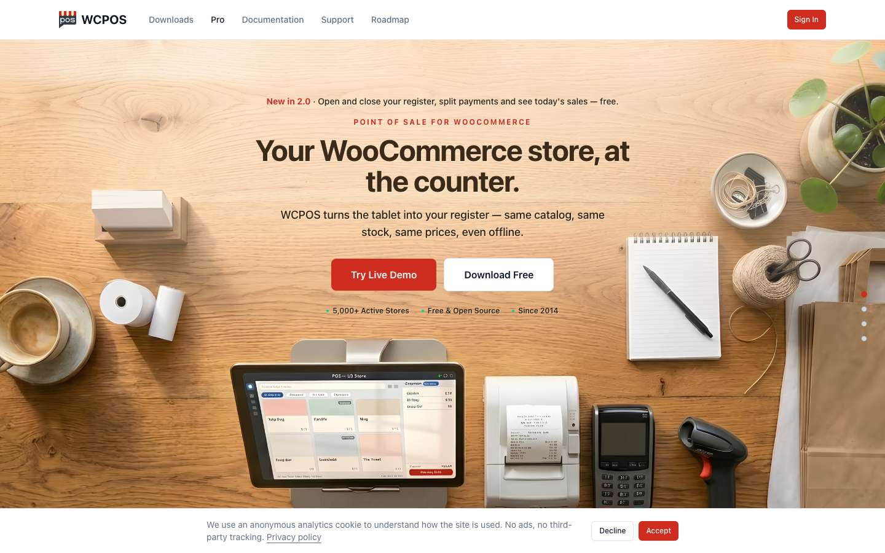
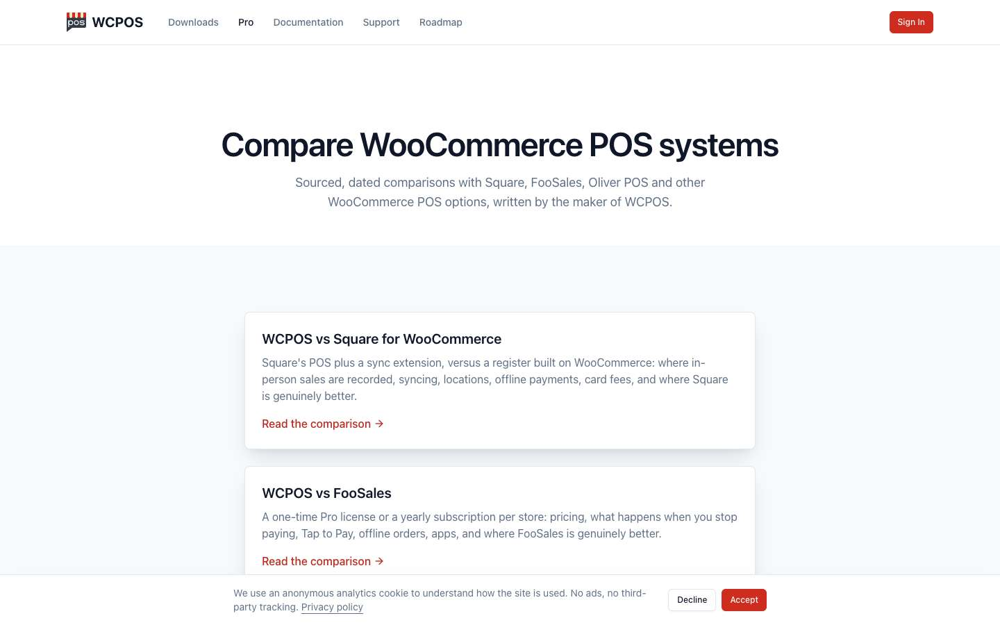
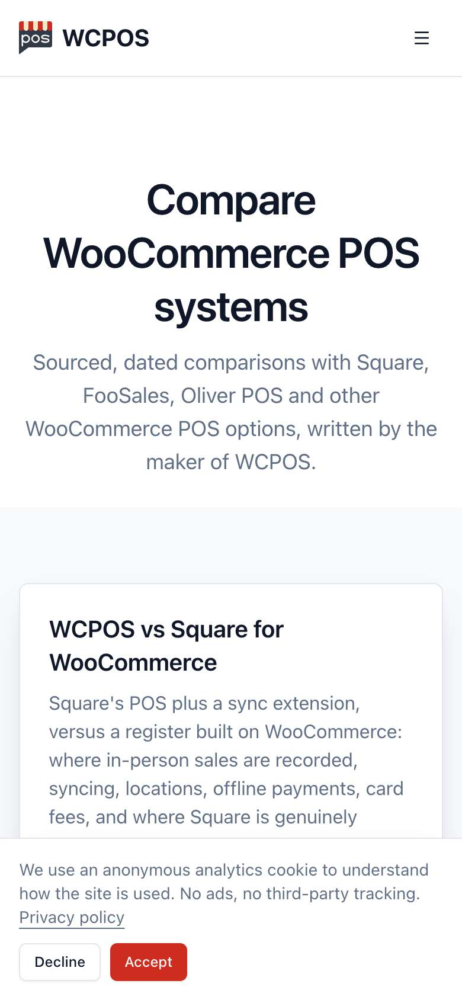
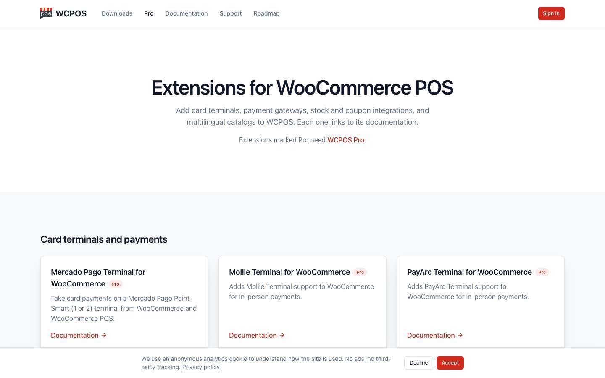
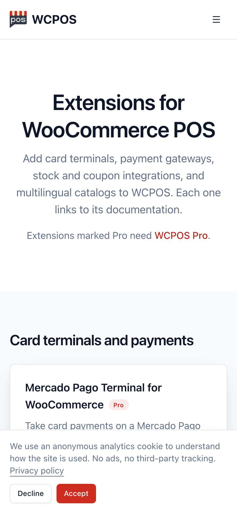
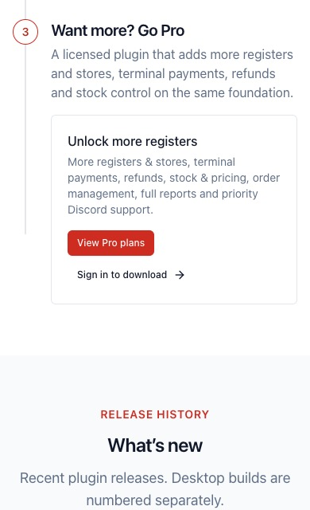
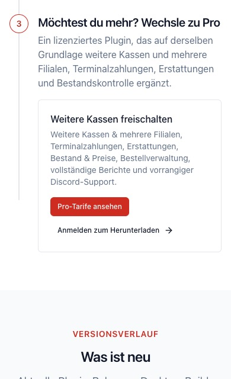
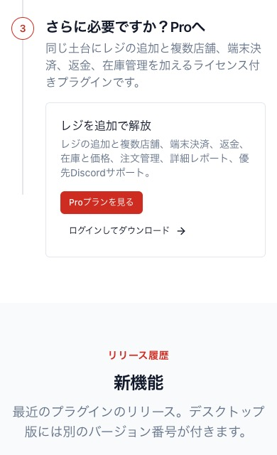
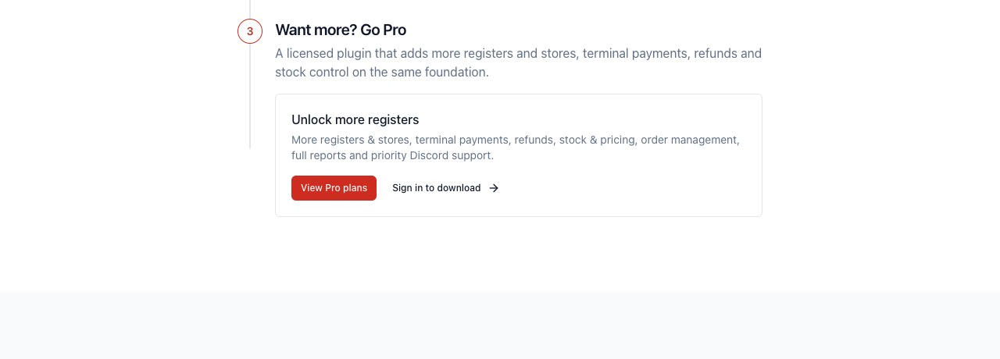
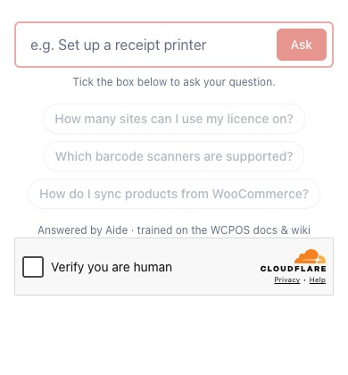

# wcpos.com hill climb, round 22 (2026-11-18)

This round re-judges the live site after round 21's fixes (#792 to #794,
all live). It then records the fixes chosen from the result.

- Captures: [`2026-11-18-round-22/shots/`](2026-11-18-round-22/shots/) holds
  the fold shots. The full-page shots stay local. Visible text is in `text/`,
  page facts are in `facts.json` and Lighthouse results in `lighthouse.json`.
- Judges: [`2026-11-18-round-22/judges/`](2026-11-18-round-22/judges/). The
  personas and the brief are the same as in round 21: four Opus 5.5 pool
  one-shots, with Codex GPT-6 Astra as the sceptic. The judges were not told
  what changed.

| Page | Desktop | Phone |
|---|---|---|
| Home |  |  |
| /downloads |  |  |
| /compare |  |  |
| /extensions |  |  |

## 10-second test

All five judges answered both questions from the home fold. WCPOS is a free,
open-source WooCommerce POS that turns a tablet into the register and sells
from the store's own catalog, stock and prices, even offline. 2.0 makes
opening and closing the register, split payments and today's sales report
free.

## Scores

| Judge | Marketing | UI | SEO |
|---|---|---|---|
| shop-owner (Opus) | 7 | 7 | 8 |
| woo-dev (Opus) | 7 | 8 | 8 |
| designer (Opus) | 7 | 7 | 8 |
| seo (Opus) | 8 | 8 | 8 |
| sceptic (Astra) | 7 | 7 | 9 |
| **Mean** | **7.2** | **7.4** | **8.2** |
| Round 21 | 7.4 | 7.4 | 8.2 |
| **Delta** | **−0.2** | **0** | **0** |

The overall mean is 7.60 (−0.07). **Nothing is reverted.**

- Marketing: the shop-owner judge went from 8 to 7. Their defect is that
  /compare/square links no sources. Round 21 changed only that page's
  JSON-LD (#794), and none of its visible copy. No judge names a
  regression from #792 to #794.
- UI: the seo judge went back up from 7 to 8, and the sceptic went down
  from 8 to 7. The sceptic's UI defect is where the /downloads sync
  warning sits, which #792 did not move. So the UI mean is unchanged.
- The seo judge confirms all three round-21 fixes live: the /support
  placeholder fits, /downloads says WooCommerce 9.0+, and the compare
  pages carry the WebPage node.
- The designer says the /extensions "Pro" chip still wraps onto its own
  indented line, and the seo judge says it no longer does. The phone shot
  above shows the chip inline after the last word of the title. Both
  judges are reading the same build, so I count it as fixed.

## Lighthouse (live, light theme)

| Page | Mobile perf | Desktop perf | A11y / BP / SEO | Mobile LCP | vs round 21 (mobile) |
|---|---|---|---|---|---|
| / | 91 | 100 | 100 | 3.3 s | −2 |
| /pro | 100 | 100 | 100 | 1.5 s | +4 |
| /compare | 97 | 100 | 100 | 2.6 s | −2 |
| /downloads | 92 | 100 | 100 | 3.1 s | −1 |
| /de | 92 | 100 | 100 | 3.4 s | 0 |

Every move is within the two-band spread seen on /downloads in round 21
(91 to 100 across reruns). The sceptic's SEO defect is the /downloads
mobile LCP: it suggests deferring the below-fold device diagram's
animation. It stays a candidate until a rerun isolates the diagram's share
of the LCP.

## Worst defects

**Marketing**

- /downloads step 3's Pro pitch leaves out more registers and stores, and
  the page says "till" in three places (woo-dev, designer, seo; fourth
  round).
- /compare/square links no sources, though its disclosure box promises
  them (shop-owner).
- Home's offline line doesn't say that card readers and online gateways
  need a connection (sceptic). The offline qualifier is held for the
  front desk.

**UI**

- On /support during an interactive Turnstile challenge, the status line
  reads "Running a quick security check…" above a box the visitor has to
  tick (seo, deferred from round 21).
- The open 2.0.0 notes run about 4,300 px of the /downloads phone page,
  and one link's text is a bare URL (woo-dev).
- /compare/square on phone has about 170 px of padding above the short
  answer (shop-owner).
- The sync-before-upgrading warning sits below the download button
  (sceptic).

**SEO**

- The SoftwareApplication JSON-LD has no `softwareVersion` or
  `softwareRequirements`, and `operatingSystem` leaves out Web (woo-dev,
  designer, seo; second round).
- The seven /compare/* pages don't link to each other in the body
  (shop-owner).
- /downloads mobile LCP is 3.1 s (sceptic; see Lighthouse above).

## Fixes this round

Three defects were fixed, one per track. Each was written as one spec and
implemented by an Opus 5.5 pool one-shot (route: opus). This machine
reviewed the full diff and reran the acceptance commands and mutations.

| Track | Defect | PR | Merge |
|---|---|---|---|
| Marketing | /downloads Pro step leaves out registers and stores; "till" | [#796](https://github.com/wcpos/wcpos-com/pull/796) | 423e70c |
| UI | /support says "security check" during an interactive Turnstile challenge | [#798](https://github.com/wcpos/wcpos-com/pull/798) | 008fd31 |
| SEO | SoftwareApplication JSON-LD has no version, requirements or Web | [#797](https://github.com/wcpos/wcpos-com/pull/797) | 77a25c1 |

- **#796:** the Pro step body and card now lead with more registers and
  stores in all ten locales, using each locale's /pro words. The card title
  is "Unlock more registers". My first spec said "Unlock every register",
  which I changed before shipping because "every" reads as unlimited. In en
  the tagline and the how-it-fits title say "register" instead of "till".
  The #773 test now checks that terminal payments is named anywhere in the
  card list instead of first. The phrase is no longer first, but it is
  still never a bare "Payments". Mutations:
  - The old en title fails the new test.
  - The old de body fails it too.
  - "payments" without "terminal" fails the #773 test.
- **#798:** the Turnstile hook exposes its existing `interacting` state as
  one read-only field. The /support status line shows "Tick the box below
  to ask your question." while it is true, and the field is in all ten
  locales. Register and checkout don't read the field. Always rendering
  the old line fails the new sequence test, and so does a hook that
  returns `interacting: false`.
- **#797:** the shared helper adds `softwareRequirements` and appends Web
  to `operatingSystem`. The requirements come from a
  `WCPOS_SOFTWARE_REQUIREMENTS` constant, which a test ties to the visible
  /downloads copy. /downloads also emits `softwareVersion` from the
  release lookup, and only when the lookup returns one. Mutations:
  - Changing the constant to 5.3+ fails the copy-match test.
  - A hard-coded fallback version fails the no-version test.

  CI's hard-coded English scan flagged the two schema strings. I
  allowlisted them with the repo's own `pnpm i18n:hardcoded:update`,
  because they are crawler values, not visible copy.

## After (live, 2026-11-18 16:20 UTC)

The checks were run in headless Chromium against wcpos.com after the
77a25c1 deploy.

- `/downloads` step 3 in en (phone and desktop), de, ja and nl shows the
  new body, card title and card body, with no horizontal overflow. The en
  tagline reads "One register, every device."
- SoftwareApplication on `/`, `/ja`, `/downloads` and `/de/downloads`:
  `operatingSystem` "Windows, macOS, Linux, iOS, Android, Web" and
  `softwareRequirements` "WordPress 5.6+, WooCommerce 9.0+, PHP 7.4+".
  The two /downloads pages also carry `softwareVersion` "2.0.4".
- `/support` in en, de and ja: headless Chromium got the interactive
  challenge again. The status line went from "Running a quick security
  check…" to "Tick the box below to ask your question." (de: "Setze unten
  das Häkchen, um deine Frage zu stellen.", ja: "質問するには、下の
  ボックスにチェックを入れてください。").

| /downloads Pro step, en phone | /downloads Pro step, de phone | /downloads Pro step, ja phone |
|---|---|---|
|  |  |  |

| /downloads Pro step, en desktop | /support during the challenge, en phone |
|---|---|
|  |  |

"till" still appears five times on /downloads, all of them inside the
2.0.0 release notes. Those notes come from the GitHub release, so the
site copy doesn't change them.

## Deferred

These carry over to round 23 as candidates:

- /compare/square links no sources, though its disclosure box promises
  them (shop-owner).
- The open 2.0.0 notes run about 4,300 px on phone, lead with bold
  warnings, link one bare URL and say "till" (woo-dev).
- The sync-before-upgrading warning sits below the download button
  (sceptic).
- /compare/square on phone has about 170 px of padding above the short
  answer (shop-owner). Its "Choose … if" verdicts are run-on sentences,
  and its meta description lists topics, not the key difference.
- The seven /compare/* pages don't link to each other in the body
  (shop-owner). The /compare hub meta description is 162 characters.
- /downloads mobile LCP is 3.1 s; the device diagram's animation is a
  suspect (sceptic).
- /pro has no live-demo link, and the /downloads "Web" card leads to the
  demo.
- /support: the H1 breaks before "& support" on phone, and the page says
  "licence".
- Home "Bring your own hardware" has no printer docs link, and the
  /downloads ".zip" button opens the GitHub releases list.

The front-desk holds from round 21 are unchanged: the offline qualifier,
/pro multi-store wording, a Compare nav entry, the home title, the Square
price line, the /pro H1 and the /pro Yearly wrap.
