# wcpos.com hill climb, round 23 (2026-11-18)

This round re-judges the live site after round 22's fixes (#796 to #798,
all live). It then records the fixes chosen from the result.

- Captures: [`2026-11-18-round-23/shots/`](2026-11-18-round-23/shots/) holds
  the fold shots. The full-page shots stay local. Visible text is in `text/`,
  page facts are in `facts.json` and Lighthouse results in `lighthouse.json`.
- Judges: [`2026-11-18-round-23/judges/`](2026-11-18-round-23/judges/). The
  personas and the brief are the same as in round 22: four Opus 5.5 pool
  one-shots, with Codex GPT-6 Astra as the sceptic. The judges were not told
  what changed.

| Page | Desktop | Phone |
|---|---|---|
| Home | 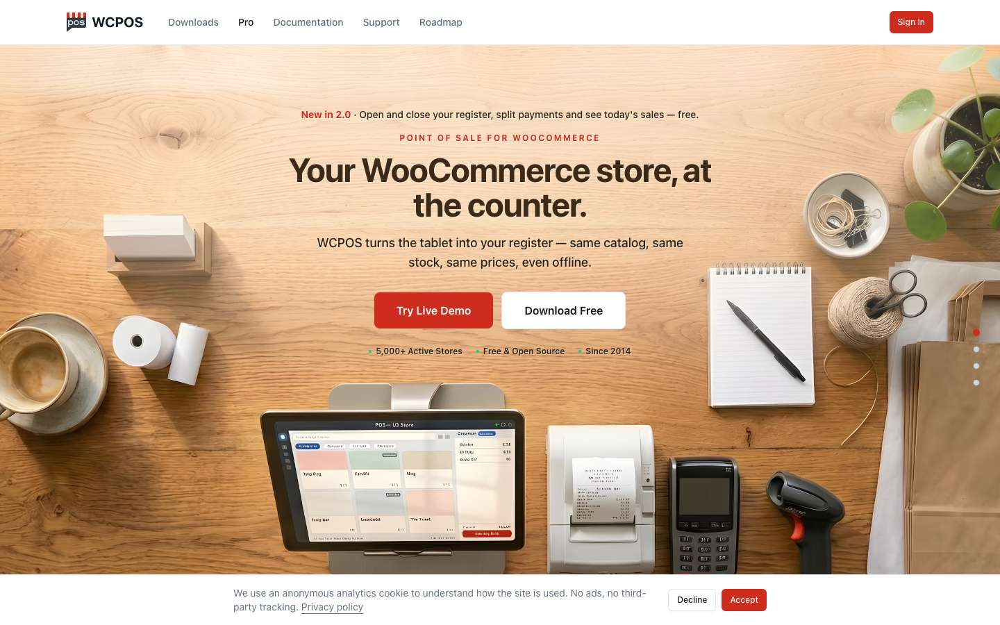 |  |
| /downloads | 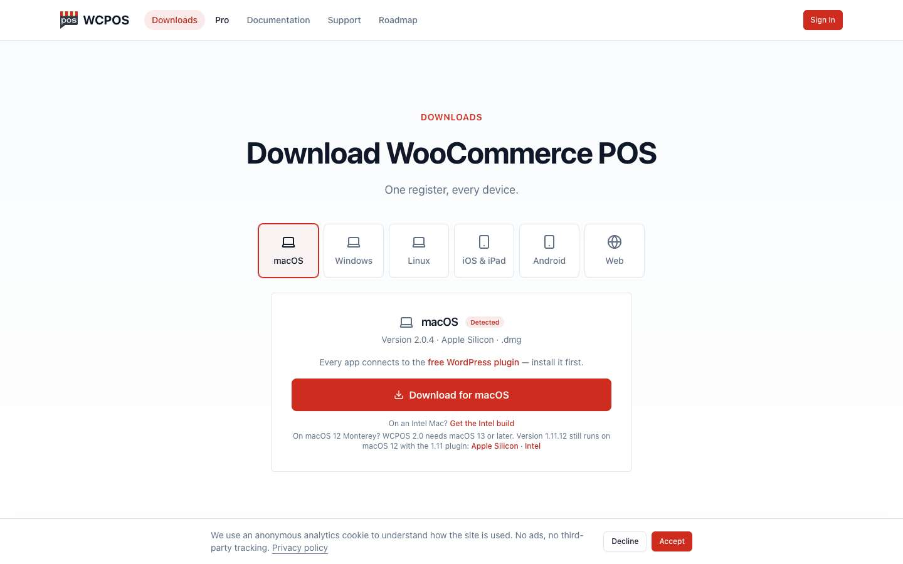 | 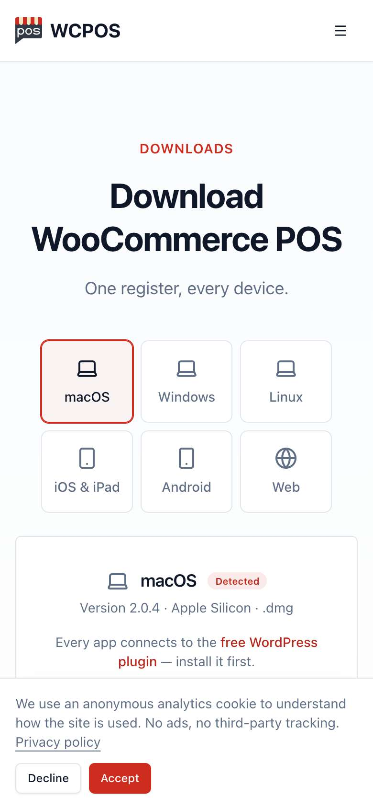 |
| /compare | 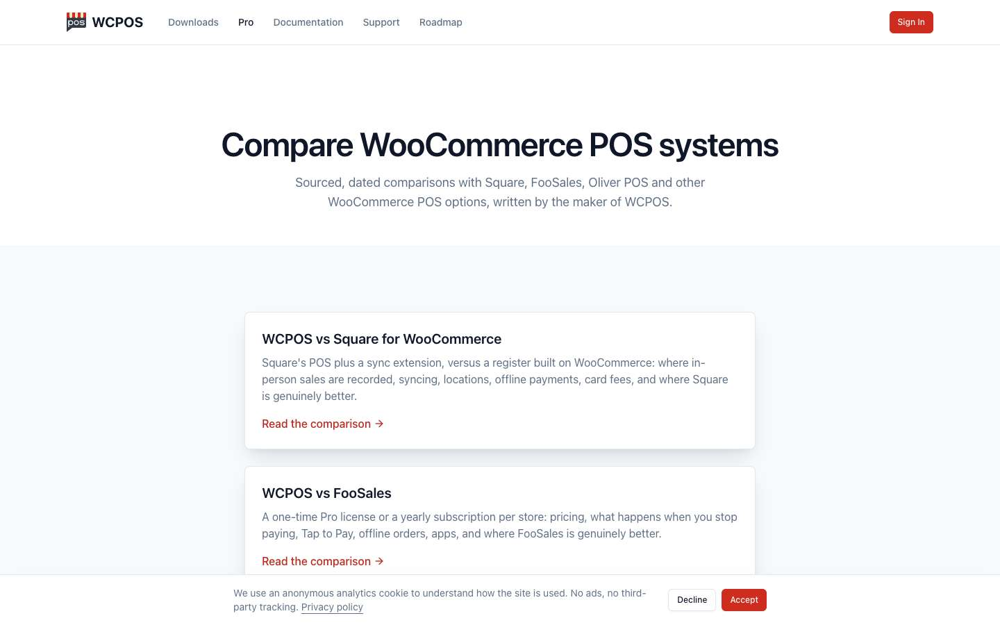 | 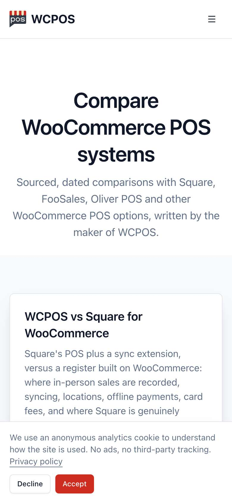 |
| /extensions | 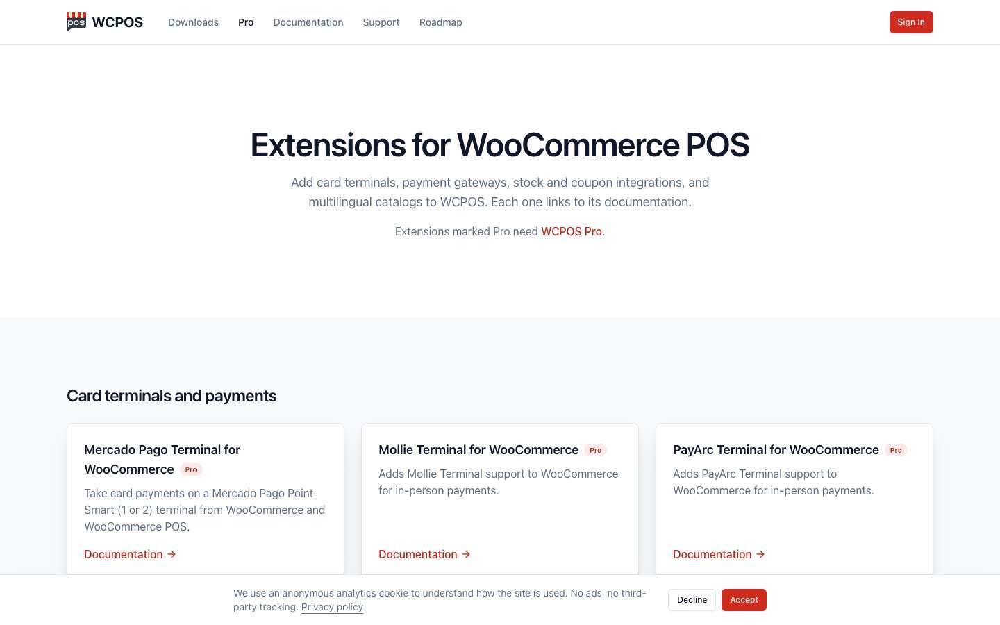 | 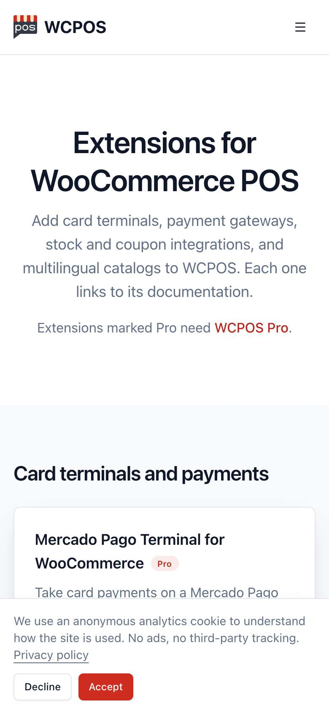 |

## 10-second test

All five judges answered both questions from the home fold. WCPOS is a free,
open-source WooCommerce POS that turns a tablet into the register and sells
from the store's own catalog, stock and prices, even offline. 2.0 makes
opening and closing the register, split payments and today's sales report
free. The designer and seo judges point to the "New in 2.0" line above the
H1 as the answer, on desktop and on phone, in en, nl and de.

## Scores

| Judge | Marketing | UI | SEO |
|---|---|---|---|
| shop-owner (Opus) | 7 | 7 | 8 |
| woo-dev (Opus) | 7 | 8 | 8 |
| designer (Opus) | 7 | 7 | 8 |
| seo (Opus) | 8 | 8 | 8 |
| sceptic (Astra) | 7 | 9 | 9 |
| **Mean** | **7.2** | **7.8** | **8.2** |
| Round 22 | 7.2 | 7.4 | 8.2 |
| **Delta** | **0** | **+0.4** | **0** |

The overall mean is 7.73 (+0.13). **Nothing is reverted.**

- UI: the sceptic went from 7 to 9. Its round-22 UI defect was the
  /support status line, which #798 fixed. Its round-23 UI defect is
  smaller: inline code in the 2.0.0 notes runs past the phone viewport.
- Marketing: the scores are the same as round 22. Three judges now name
  the missing sources on /compare/square as the worst marketing defect.
  No judge names a regression from #796 (the /downloads Pro step).
- **Correction to round 22:** the round-22 record counted the
  /extensions phone "Pro" chip as fixed. The round-23 full-page phone
  shot shows it still wrapping onto its own line under the titles of
  PayPal Reader, Square, Stripe and SumUp Terminal, as the designer says.
  The round-22 fold shot showed only one card, where the chip happened
  to fit. It is open again below.

## Lighthouse (live, light theme)

| Page | Mobile perf | Desktop perf | A11y / BP / SEO | Mobile LCP | vs round 22 (mobile) |
|---|---|---|---|---|---|
| / | 89 | 100 | 100 | 3.3 s | −2 |
| /pro | 99 | 100 | 100 | 1.6 s | −1 |
| /compare | 100 | 100 | 100 | 1.8 s | +3 |
| /downloads | 90 | 100 | 100 | 3.5 s | −2 |
| /de | 70 | 94 | 100 | 3.7 s | −22 |

I reran /de on its own after the fixes deployed. The machine was still
busy, at a load average of 10 to 14:

| /de rerun | Perf | SEO | LCP | TBT |
|---|---|---|---|---|
| mobile 1 / 2 / 3 | 99 / 92 / 91 | 100 | 1.8 / 3.3 / 3.3 s | 10 / 30 / 110 ms |
| desktop 1 / 2 | 100 / 95 | 100 | 0.7 / 0.8 s | 0 / 180 ms |

The mobile median is 92, the same as in round 22. The capture's
70 came with a 700 ms TBT that no rerun came near, so it was host load
during the capture, not a regression.

## Worst defects

**Marketing**

- /compare/square makes many factual claims about Square and links no
  sources, though its footer says they come from Square's own pages
  (shop-owner, designer, seo). The seo judge adds that the Oliver POS,
  WooCommerce POS and Jovvie comparisons have no Sources list either.
- Home act 3 "Bring your own hardware" overstates which card terminals
  work (woo-dev).
- /downloads doesn't say plainly whether the phone apps are released or
  in beta (sceptic).

**UI**

- The open 2.0.0 notes are more than two phone screens long on
  /downloads (woo-dev, seo), and an inline `<code>` in them runs past the
  390 px viewport (sceptic).
- The /extensions phone "Pro" chip wraps onto its own line for PayPal
  Reader, Square, Stripe and SumUp Terminal (designer).
- /compare/square on phone has too much padding above the short answer
  (shop-owner).

**SEO**

- The seven /compare/* pages don't link to each other in the body
  (woo-dev, designer, seo; second round).
- The /compare hub meta description is 162 characters in en (de 187,
  nl 192, fr 204), and the metadata length test doesn't cover the hub
  (shop-owner).
- The /pro SoftwareApplication `operatingSystem` leaves out Web, which
  #797 added for home and /downloads (sceptic).

## Fixes this round

Three defects were fixed, one per track. Each was written as one spec and
implemented by an Opus 5.5 pool one-shot (route: opus). This machine
reviewed the full diff and reran the acceptance commands and mutations.

| Track | Defect | PR | Merge |
|---|---|---|---|
| Marketing | /compare/square makes Square claims and links no sources | [#801](https://github.com/wcpos/wcpos-com/pull/801) | 84c5942 |
| UI | The open 2.0.0 notes run over two phone screens on /downloads | [#802](https://github.com/wcpos/wcpos-com/pull/802) | 9767ccf |
| SEO | The seven /compare/* pages don't link to each other | [#800](https://github.com/wcpos/wcpos-com/pull/800) | c441cad |

- **#801:**
  - Before the spec was written, an isolated research run loaded each
    Square and WooCommerce page and quoted the supporting sentence. All
    11 facts on the page still hold as worded, so no claim changes.
  - /compare/square now has a Sources section with 14 nofollow links:
    nine on squareup.com and five in the Square for WooCommerce docs. It
    sits after the FAQ, and its intro gives both dates, 2026-10-06 and
    2026-11-18. It is in all ten locales.
  - Mutations:
    - A URL on another host fails the host test.
    - A label missing from de fails the parity test.
    - Moving Sources after the CTA fails the order test.
  - CI's hard-coded scan read the `register` message key as copy, so I
    allowlisted it.
- **#800:**
  - `COMPARISONS` in `src/lib/compare-pages.ts` is the one list behind
    the hub cards and a new "More comparisons" block. That block sits
    before the CTA on every spoke and links the other six, never the
    page itself.
  - The page tests mock the nested async block, as they already did for
    the CTA.
  - Mutations:
    - Dropping the self-filter fails the block test.
    - Removing the block from /compare/jovvie fails that page's test.
    - /compare/yith-pos passing the Vitepos href as `current` fails its
      test.
- **#802:**
  - /downloads passes a new `clampLongNotes` prop. Notes of at least
    1,500 characters with more than three blocks show the first three
    blocks, and the rest goes in a closed native disclosure, "Show all
    {version} release notes", in all ten locales.
  - /changelog keeps full notes.
  - Inline code and links in the notes now wrap.
  - The first implementer found that `Collapsible`'s
    `group-open:rotate-180` matches any open ancestor in Tailwind v4, so
    the nested closed chevron pointed up. A second one-shot changed it to
    `[[open]>summary>&]:rotate-180`.
  - Each of these mutations fails a test:
    - six preview blocks
    - a `defaultOpen` nested disclosure
    - clamping without the prop
    - restoring `group-open:`
  - On this branch a release-guard hook refused shell commands that
    named `release-history.tsx` (a UI component that ships nothing). I
    applied those mutations with the editor and ran tests by directory,
    and sent the false positive to the front desk.

## After (live, 2026-11-18 20:00 UTC)

The checks were run in headless Chromium against wcpos.com after the
9767ccf deploy.

- `/downloads` in en (phone and desktop), de and nl:
  - The open 2.0.0 row shows three blocks, then the closed "Show all
    2.0.0 release notes" (de "Alle Versionshinweise zu 2.0.0 anzeigen",
    nl "Alle release-opmerkingen van 2.0.0 tonen").
  - On phone the notes before it are 426 px tall, down from about
    4,300 px for the full notes in round 22.
  - There is no horizontal overflow.
  - Computed chevron `rotate`: 180deg on the open row, none on the
    nested closed disclosure, and 180deg once the nested one is opened.
- `/compare/square` in en (phone and desktop) and de:
  - The last four h2s are FAQ, Sources, More comparisons and the CTA
    (de: Quellen, Weitere Vergleiche).
  - It has 14 nofollow links, all on squareup.com and woocommerce.com.
  - It has six comparison links and none to itself.
- `/compare/oliver-pos` (phone) and `/compare/yith-pos` (desktop) each
  show the other six comparisons, with no overflow.

| /downloads notes, en phone | /downloads notes, de phone | /downloads notes, en desktop |
|---|---|---|
| 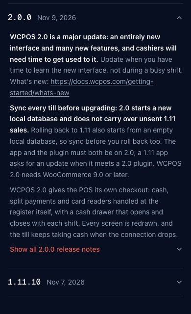 | 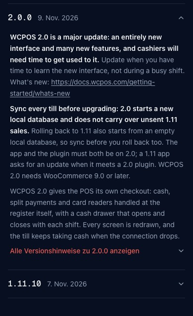 | 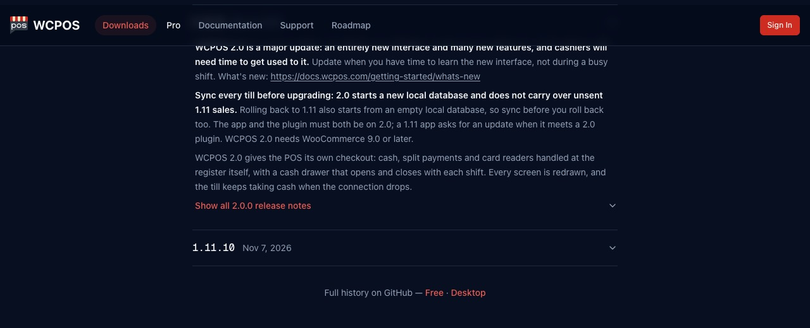 |

| /compare/square Sources, phone | /compare/square Sources, desktop | /compare/oliver-pos More comparisons, phone |
|---|---|---|
| 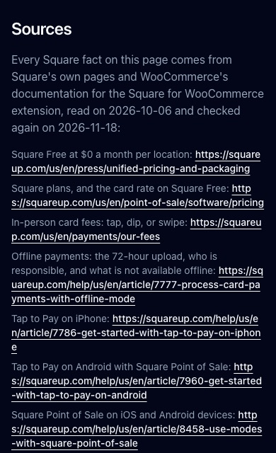 | 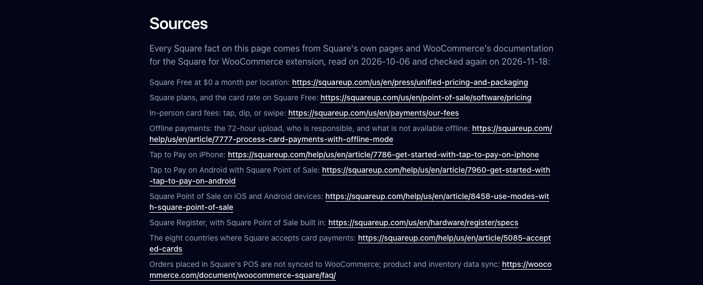 | 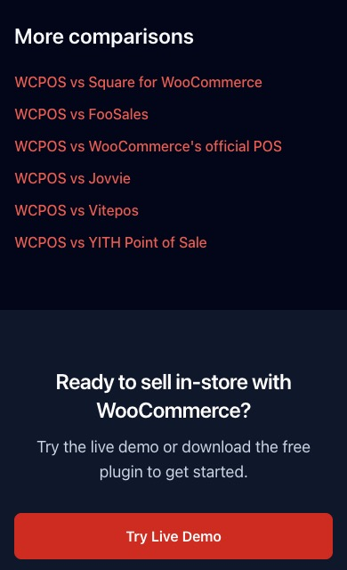 |

The after-shots show a new defect. The Sources lists use the raw URL as
the link text, so on a 390 px phone the URLs break mid-word ("square /
up.com"). The pattern came from FooSales, so every spoke with Sources has
it.

## Deferred

These carry over to round 24 as candidates:

- Sources lists show raw URLs that break mid-word on phone (Square,
  FooSales, Vitepos, YITH).
- Oliver POS, WooCommerce POS and Jovvie have no Sources list (seo).
- Home act 3 "Bring your own hardware" overstates which card terminals
  work (woo-dev).
- /downloads doesn't say plainly whether the phone apps are released or
  in beta (sceptic).
- The /extensions phone "Pro" chip wraps onto its own line (designer).
- /compare/square on phone has too much padding above the short answer
  (shop-owner).
- The /compare hub meta description is 162 characters in en, and the
  metadata length test doesn't cover the hub (shop-owner).
- The /pro SoftwareApplication `operatingSystem` leaves out Web
  (sceptic).
- "till" remains on /pro and in the compare rows.
- /support: the H1 breaks before "& support" on phone, and the page says
  "licence".

The front-desk holds from round 21 are unchanged: the offline qualifier,
/pro multi-store wording, a Compare nav entry, the home title, the Square
price line, the /pro H1 and the /pro Yearly wrap.
