# wcpos.com hill climb, round 24 (2026-11-18)

This round re-judges the live site after round 23's fixes (#800 to #802,
all live). It then records the fixes chosen from the result.

- Captures: [`2026-11-18-round-24/shots/`](2026-11-18-round-24/shots/) holds
  the fold shots. The full-page shots stay local. Visible text is in `text/`,
  page facts are in `facts.json` and Lighthouse results in `lighthouse.json`.
- Judges: [`2026-11-18-round-24/judges/`](2026-11-18-round-24/judges/). The
  personas and the brief are the same as in round 23: four Opus 5.5 pool
  one-shots, with Codex GPT-6 Astra as the sceptic. The judges were not told
  what changed.

| Page | Desktop | Phone |
|---|---|---|
| Home | 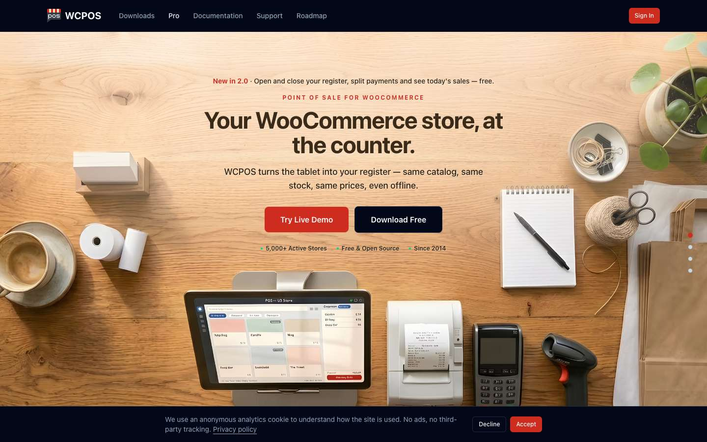 |  |
| /downloads | 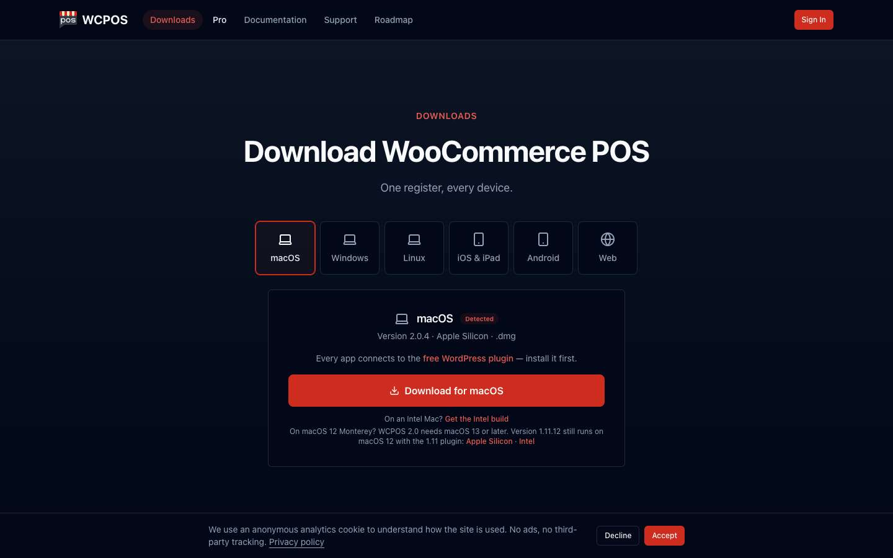 | 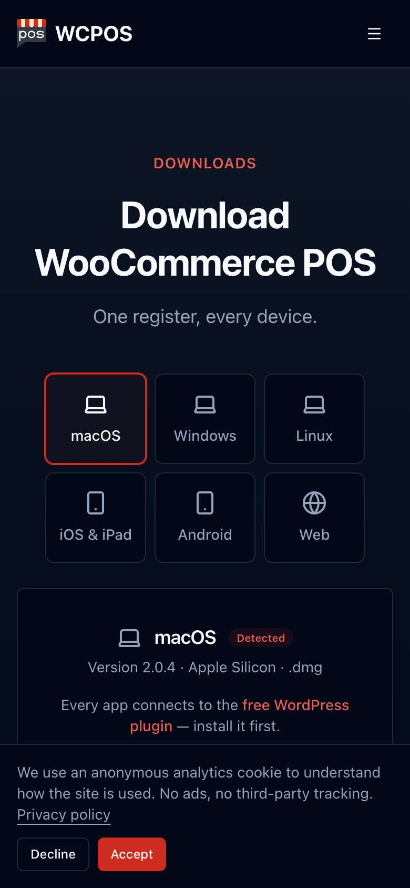 |
| /compare | 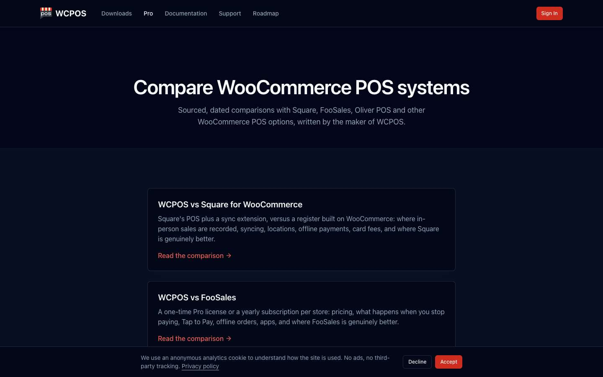 | 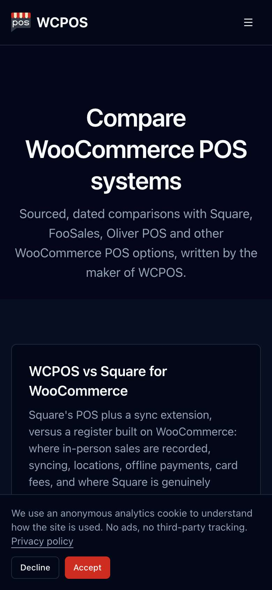 |
| /extensions | 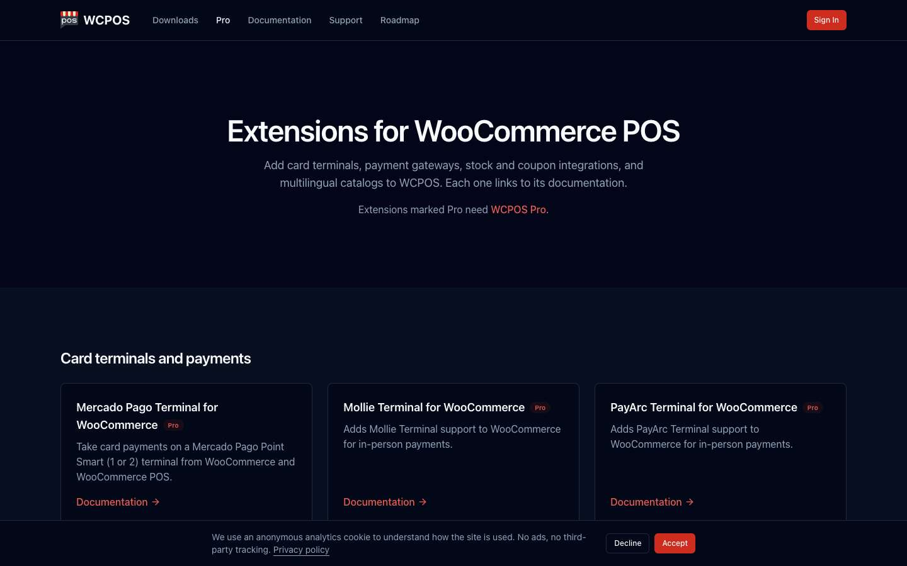 | 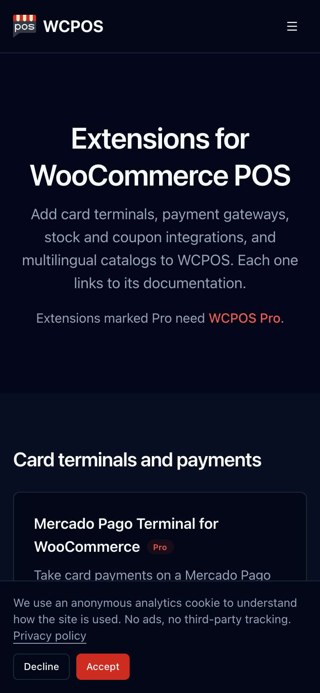 |

## 10-second test

All five judges answered both questions from the home fold. WCPOS is a free,
open-source WooCommerce POS that runs the register from the store's own
catalog, stock and prices. The "New in 2.0" line above the H1 answers why
v2: opening and closing the register, split payments and today's sales
report are now free.

## Scores

| Judge | Marketing | UI | SEO |
|---|---|---|---|
| shop-owner (Opus) | 7 | 7 | 8 |
| woo-dev (Opus) | 7 | 8 | 8 |
| designer (Opus) | 7 | 7 | 8 |
| seo (Opus) | 8 | 8 | 8 |
| sceptic (Astra) | 7 | 7 | 9 |
| **Mean** | **7.2** | **7.4** | **8.2** |
| Round 23 | 7.2 | 7.8 | 8.2 |
| **Delta** | **0** | **−0.4** | **0** |

The overall mean is 7.6 (−0.13). **Nothing is reverted.**

- UI: the whole drop is the sceptic, from 9 to 7. Its round-24 UI defect
  is the /downloads warning to sync before upgrading, which sits below
  the download button. That layout predates round 23, and none of the
  round-23 changes touched it. No Opus judge's UI score moved. It is
  judge variance, not a regression, so no round-23 change is reverted.
- Marketing and SEO: the scores are the same as round 23. All five judges
  name the /compare hub meta description as the worst SEO defect or a
  runner-up.

## Lighthouse (live, light theme)

| Page | Mobile perf | Desktop perf | A11y / BP / SEO | Mobile LCP | vs round 23 (mobile) |
|---|---|---|---|---|---|
| / | 99 | 100 | 100 | 1.9 s | +10 |
| /pro | 100 | 100 | 100 | 1.6 s | +1 |
| /compare | 89 | 100 | 100 | 3.4 s | −11 |
| /downloads | 94 | — | 100 | 3.0 s | +4 |
| /de | 84 | 99 | 100 | 3.4 s | −8 (vs rerun median 92) |

The /downloads desktop run returned no score. I reran /compare and /de on
their own at a load average of 6 to 8:

| Rerun | Mobile perf (1 / 2 / 3) | Mobile LCP | Desktop perf (1 / 2) |
|---|---|---|---|
| /compare | 96 / 97 / 100 | 2.6 / 2.6 / 1.7 s | 100 / 100 |
| /de | 92 / 92 / 92 | 3.3 s each | 99 / 100 |

The /compare mobile median is 97 and /de is 92, the same as the round-23
rerun. The capture's 89 and 84 were host load, not a regression. /de's
mobile LCP stays at 3.3 s on every run, so it is the slowest page on
phone.

## Worst defects

**Marketing**

- Home act 3 "Bring your own hardware" puts card terminals first among
  hardware you can just plug in. The feature card on the same page says
  you take cards on your own terminal and that Pro connects card readers
  (shop-owner, designer; woo-dev as a runner-up).
- The /pro multi-store card leaves out stock, and the ATUM link is only
  on /extensions (woo-dev).
- Oliver POS, WooCommerce POS and Jovvie have no Sources list (seo).
- /downloads doesn't explain that the 2.0 phone apps aren't out in the
  stores while the versions must match (sceptic).

**UI**

- The /extensions phone "Pro" chip wraps onto its own line (woo-dev, seo;
  designer as a runner-up; third round).
- The Sources lists show raw URLs with `break-all`, so they break
  mid-word on phone (designer).
- /compare/square on phone has about 100 px and 85 px of padding above
  and below the short answer (shop-owner).
- The /downloads warning to sync before upgrading sits below the
  download button (sceptic).

**SEO**

- The /compare hub meta description is too long in every Latin locale
  (en 162 against 155; it 172, pt 184, de 187, nl 192, es 202, fr 204
  against 160). It names none of the comparisons, and the length test
  doesn't cover it (all five).

## Fixes this round

Three defects were fixed, one per track. Each was written as one spec and
implemented by an Opus 5.5 pool one-shot (route: opus). This machine
reviewed the full diff and reran the acceptance commands and mutations.

| Track | Defect | PR | Merge |
|---|---|---|---|
| Marketing | Home act 3 overstates card terminals | [#805](https://github.com/wcpos/wcpos-com/pull/805) | 4f8a8e9 |
| UI | The /extensions phone "Pro" chip wraps onto its own line | [#804](https://github.com/wcpos/wcpos-com/pull/804) | f6cd2f6 |
| SEO | The /compare hub meta description is too long and names no rival | [#806](https://github.com/wcpos/wcpos-com/pull/806) | 9dd8026 |

- **#805:**
  - `home.story.a3.b` now reads, in en: "Receipt printers and barcode
    scanners: plug in what’s already on your counter. Take cards on your
    own terminal and WCPOS records them; Pro connects Stripe Terminal,
    SumUp and more."
  - Each locale reuses the words of its own home feature card, so
    every fact was already on the page. Each new value is at most 1.3×
    its old length.
  - Mutations:
    - The old de value fails the de case.
    - `Sumup` in ja fails the ja case.
- **#804:**
  - The card header on /extensions is a flex row. The title wraps in its
    own column (`min-w-0`), and the badge keeps `shrink-0` at the top
    right.
  - Mutations: `ml-2` back on the badge fails the new test, and so does
    `inline` back on the `h3`.
- **#806:**
  - `compare.hub.metadata.description` names Square, FooSales, Oliver
    POS and WooCommerce's official POS in all ten locales. en 149, de 156,
    nl 148, fr 139, es 141, it 136, pt 160, ja 93, ko 99, zh 87.
  - Where a locale did not fit, it dropped "and more", then free-tier
    limits, then pricing, in that order. de lost all three; nl, fr, es
    and it lost the first two.
  - The metadata length test now covers the key, and a new case checks
    the three names.
  - Mutations:
    - The old en value fails the en length and naming cases.
    - de without Oliver POS fails the de naming case.
    - With the `KEYS` line removed, a 171-character fr value passes. With
      the line back, it fails, so the line is what covers the key.
- Without "and more", the Latin-locale descriptions list the rivals
  with no "and" before the last one. That reads as snippet style, not an
  error.

## After (live, 2026-11-18 21:00 UTC)

The checks were run in headless Chromium against wcpos.com after the
9dd8026 deploy.

- `/extensions` at 390 px in en, de and nl, and at 1280 px in en:
  - All 12 Pro badges sit on the first line of their title and inside the
    card.
  - Nine titles wrap to two lines on phone, and the chip stays at the top
    right of each.
  - There is no horizontal overflow.
- Home act 3 at 390 px in en, de and nl, and at 1280 px in en:
  - The new sentence renders in full: 104 px tall in en and nl, 130 px in
    de, with no clipping and no horizontal overflow.
- `/compare` meta description in the live HTML: en 149, de 156, fr 139,
  ja 93, each naming Square, FooSales and Oliver POS.

| /extensions, en phone | /extensions, de phone | /extensions, en desktop |
|---|---|---|
| 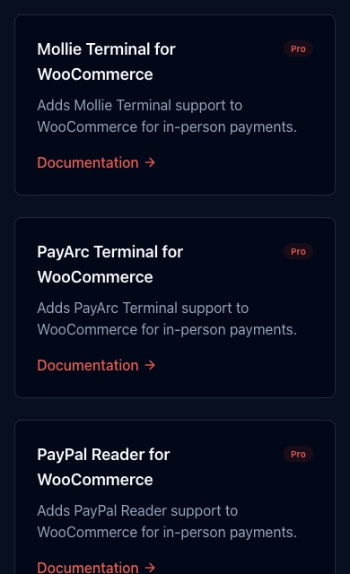 | 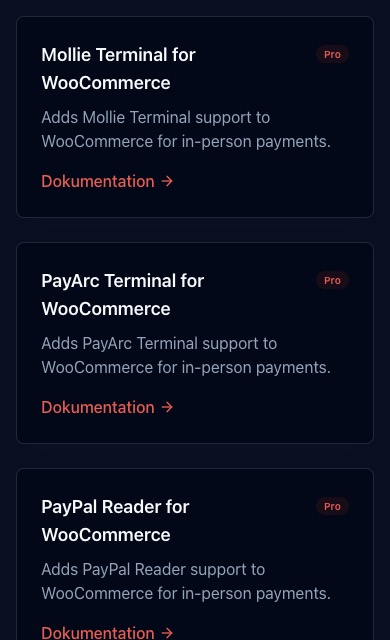 | 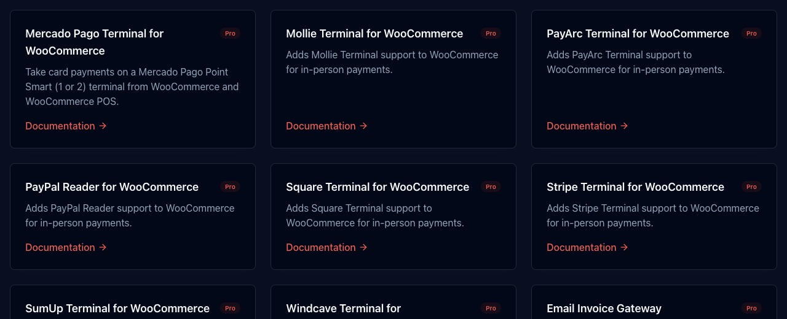 |

| Act 3, en phone | Act 3, de phone | Act 3, nl phone | Act 3, en desktop |
|---|---|---|---|
| 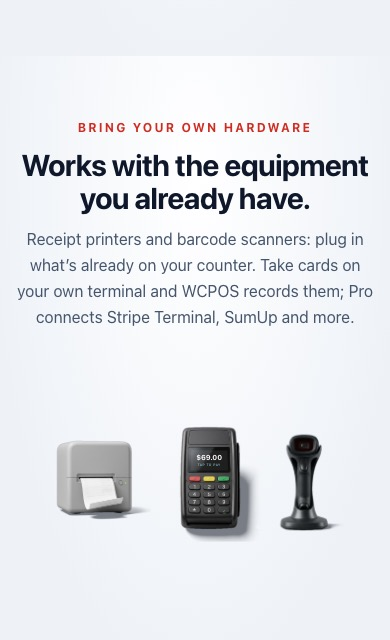 | 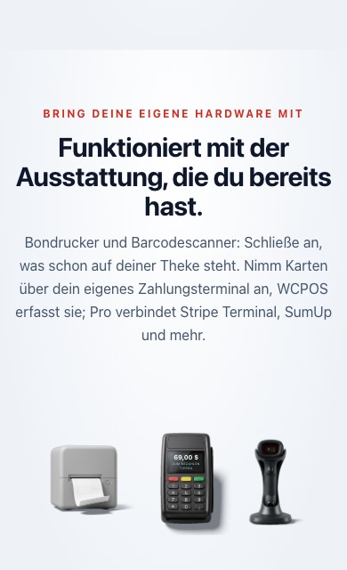 | 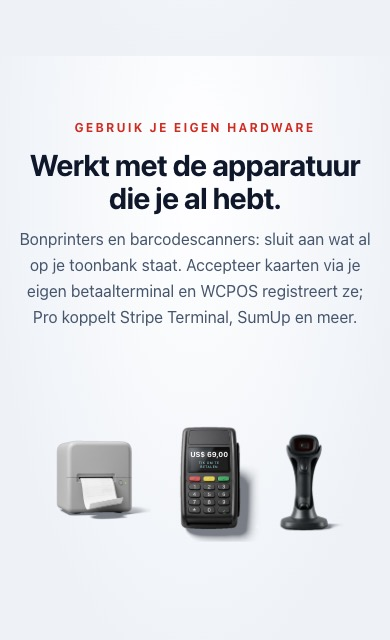 | 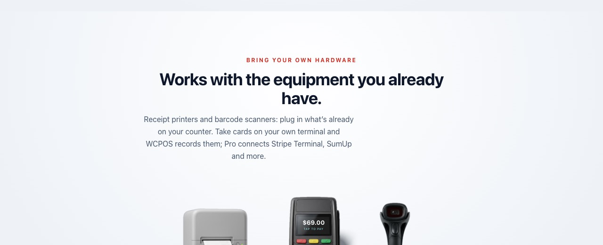 |

## Deferred

These carry over to round 25 as candidates:

- Sources lists show raw URLs that break mid-word on phone (Square,
  FooSales, Vitepos, YITH) (designer).
- Oliver POS, WooCommerce POS and Jovvie have no Sources list (seo).
- /compare/square on phone has too much padding around the short answer,
  and likely the other six spokes too (shop-owner).
- /downloads doesn't explain that the 2.0 phone apps aren't in the stores
  while the versions must match (sceptic).
- The /downloads warning to sync before upgrading sits below the download
  button (sceptic).
- The /pro multi-store card leaves out stock, and the ATUM link is only on
  /extensions (woo-dev; the stock claim needs the owner to confirm).
- On /downloads, 2.0.0 is open while 2.0.4 (Latest) is collapsed (woo-dev).
- "till" remains on /pro, and "centre" on /downloads.
- The /pro SoftwareApplication `operatingSystem` leaves out Web.
- /support: the Aide caption sits on the Turnstile widget, the H1 breaks
  before "& support" on phone, and the page says "licence".
- The spoke titles repeat the brand (seo).
- The home compare line links only the hub, and the offline copy has no
  card-reader caveat (shop-owner).
- The capture script stitches `compare-square-phone-full.jpg` badly.

The front-desk holds from round 21 are unchanged: the offline qualifier,
/pro multi-store wording, a Compare nav entry, the home title, the Square
price line ("$129 or more", which the shop-owner named again), the /pro H1
and the /pro Yearly wrap.
