# wcpos.com hill climb, round 25 (2026-11-18)

This round re-judges the live site after round 24's fixes (#804 to #806,
all live). It then records the fixes chosen from the result.

- Captures: [`2026-11-18-round-25/shots/`](2026-11-18-round-25/shots/) holds
  the fold shots. The full-page shots stay local. Visible text is in `text/`,
  page facts are in `facts.json` and Lighthouse results in `lighthouse.json`.
- Judges: [`2026-11-18-round-25/judges/`](2026-11-18-round-25/judges/). The
  personas and the brief are the same as in round 24: four Opus 5.5 pool
  one-shots, with Codex GPT-6 Astra as the sceptic. The judges were not told
  what changed.

| Page | Desktop | Phone |
|---|---|---|
| Home | 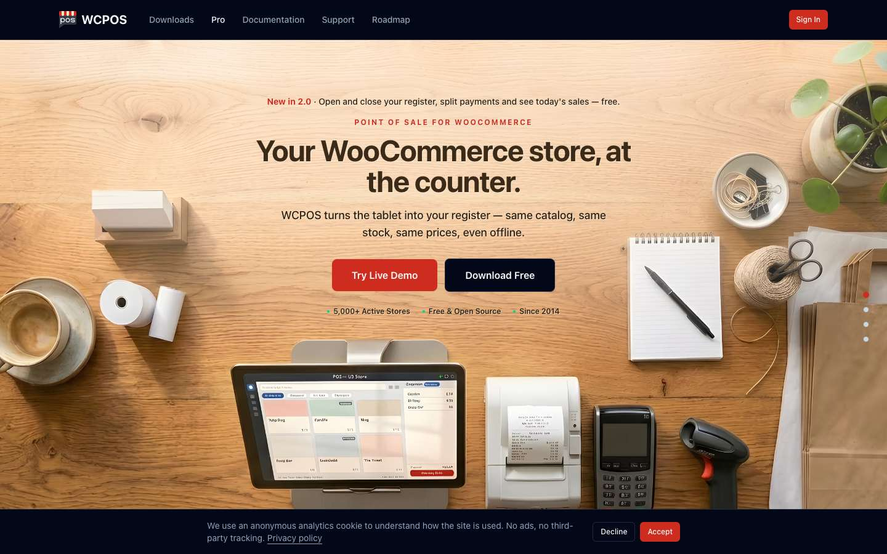 |  |
| /downloads | 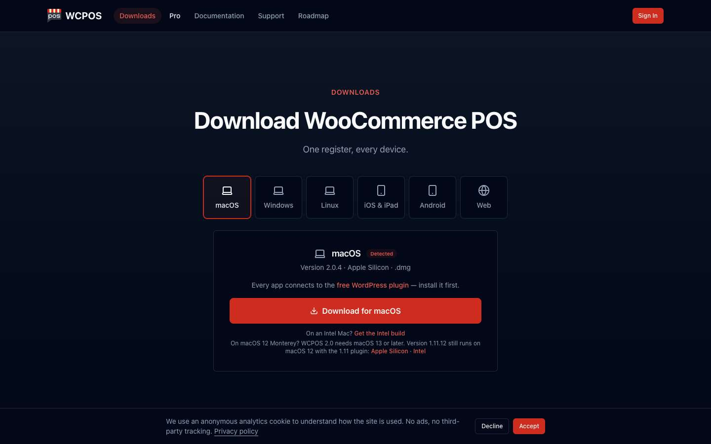 | 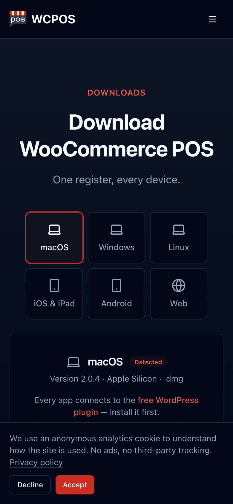 |
| /compare | 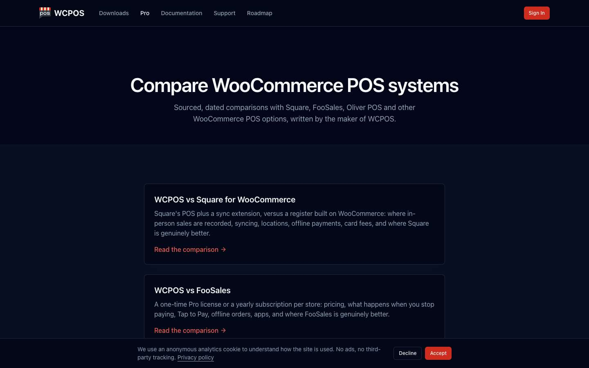 | 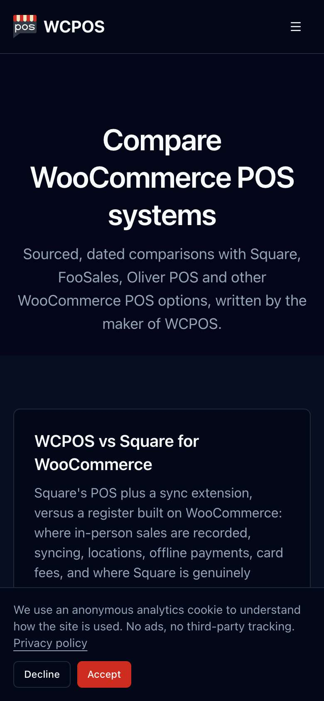 |
| /compare/square | 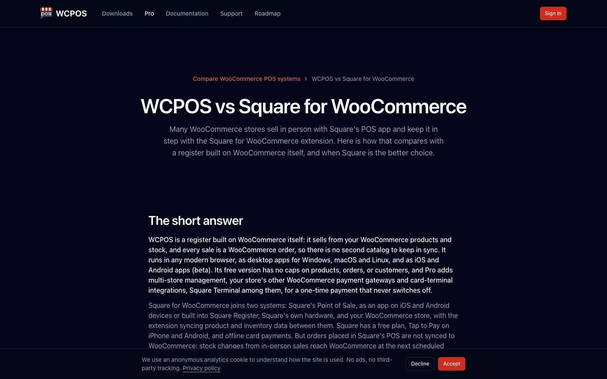 | 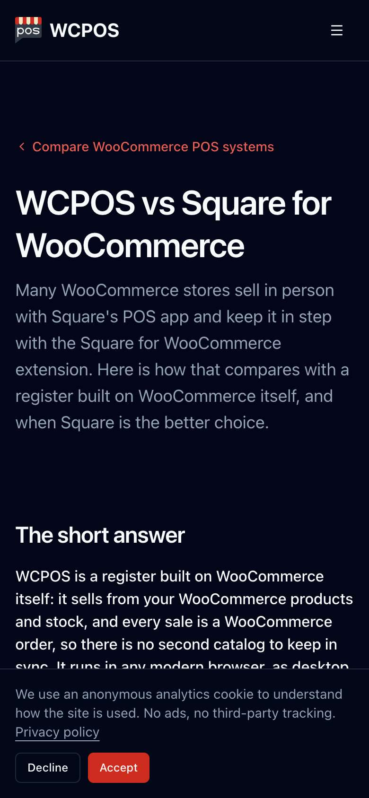 |

## 10-second test

All five judges answered both questions from the home fold. WCPOS is a free,
open-source WooCommerce POS that turns a tablet into the register, selling
from the store's own catalog, stock and prices. The "New in 2.0" line above
the H1 answers why v2: opening and closing the register, split payments and
today's sales report are now free.

## Scores

| Judge | Marketing | UI | SEO |
|---|---|---|---|
| shop-owner (Opus) | 7 | 7 | 8 |
| woo-dev (Opus) | 7 | 8 | 8 |
| designer (Opus) | 7 | 7 | 8 |
| seo (Opus) | 8 | 8 | 8 |
| sceptic (Astra) | 7 | 8 | 9 |
| **Mean** | **7.2** | **7.6** | **8.2** |
| Round 24 | 7.2 | 7.4 | 8.2 |
| **Delta** | **0** | **+0.2** | **0** |

The overall mean is 7.67 (+0.07). **Nothing is reverted.**

- UI: the sceptic is back from 7 to 8. No Opus judge's UI score moved. Nobody
  named the /extensions Pro chip again (#804).
- Marketing and SEO: the scores are the same as round 24. No judge named the
  /compare hub meta description (#806) or home act 3 (#805) as a defect.

## Lighthouse (live, light theme)

| Page | Mobile perf | Desktop perf | A11y / BP / SEO | Mobile LCP | vs round 24 (mobile) |
|---|---|---|---|---|---|
| / | 100 | 100 | 100 | 1.7 s | +1 |
| /pro | 99 | 100 | 100 | 1.2 s | −1 |
| /compare | 96 | 100 | 100 | 2.6 s | +7 (−1 vs rerun median 97) |
| /downloads | 99 | 100 | 100 | 1.6 s | +5 |
| /de | 98 | 100 | 100 | 2.4 s | +14 (+6 vs rerun median 92) |

The box was quieter for this capture. /de's mobile LCP drops from a steady
3.3 s to 2.4 s, and /downloads now scores on desktop too.

## Worst defects

**Marketing**

- /compare/oliver-pos says the free version is "truly unlimited …
  no caps on anything" (short answer) and "unlimited" (trial FAQ). That
  contradicts the page's own devices row: one register free, more with
  Pro (seo).
- The home compare line, "Weighing up Square or FooSales?", links only the
  hub, not the two named spokes (shop-owner; designer as its worst SEO
  defect).
- On /downloads the macOS button is the only primary action; the plugin
  step is an inline link (designer).
- Home act 3 names printers but links no printer docs (woo-dev; needs a
  docs URL from the owner).
- The home offline promise leaves out the payment limitation (sceptic;
  front-desk hold).

**UI**

- The Sources lists print raw URLs with `break-all`, which break mid-word
  on phone (designer, seo; third round).
- /compare/square on phone has about 100 px of padding around the short
  answer (shop-owner; third round).
- The /downloads warning to sync before upgrading is buried below the
  download button (woo-dev).
- The /downloads Web step offers only the demo link (sceptic).

**SEO**

- The /compare spoke titles go through the `'%s | WCPOS'` template, so they
  read "WCPOS vs Jovvie (2026) | WCPOS". Five never say "WooCommerce POS"
  (seo, woo-dev).
- The /pro `SoftwareApplication` `operatingSystem` leaves out Web
  (shop-owner; designer and seo as runners-up).
- /compare/square dates disagree: the caption, footer and `dateModified`
  say 2026-10-06, while Sources says 2026-11-18 (sceptic; shop-owner as a
  runner-up).

## Fixes this round

Three defects were fixed, one per track. Each was written as one spec and
implemented by an Opus 5.5 pool one-shot (route: opus). This machine
reviewed the full diff and reran the acceptance commands and mutations.

| Track | Defect | PR | Merge |
|---|---|---|---|
| Marketing | /compare/oliver-pos calls the free plugin unlimited | [#808](https://github.com/wcpos/wcpos-com/pull/808) | bb7ea09 |
| UI | Sources lists print raw URLs with `break-all` | [#810](https://github.com/wcpos/wcpos-com/pull/810) | 53b3a14 |
| SEO | Spoke titles repeat the brand and skip "WooCommerce POS" | [#809](https://github.com/wcpos/wcpos-com/pull/809) | e7301bd |

- **#808:**
  - In en, the short answer now says "the free version has no caps on
    products, customers or orders and runs one register (more with Pro)".
    The trial FAQ now says "WCPOS's free plugin has no caps on products,
    customers or orders and runs one register".
  - The other nine locales reuse their own home pricing-card and
    devices-row wording. Only the free-version clause changed.
  - A new test checks two things:
    - in every locale, neither value uses that locale's word for
      "unlimited";
    - in en, both values say "one register".
  - Mutations: the old en short answer fails three cases, and
    `unbegrenzt` in the de FAQ fails the de case.
- **#810:**
  - A shared `SourceList` links each source's label and shows the host
    after it in muted text. It is used on Square, FooSales, Vitepos and
    YITH.
  - Labels, URLs, `rel` and the source counts are unchanged.
  - Mutations, each failing its test:
    - URL as the link text;
    - no `www.` strip;
    - `break-all` back on the link.
- **#809:**
  - The seven spoke titles are absolute, so the layout suffix is gone.
  - In the seven Latin-script locales, foosales, oliver, jovvie and
    vitepos gain "WooCommerce POS Compared" (translated). YITH becomes "…
    YITH Point of Sale for WooCommerce (2026)". Every title is at most
    60 characters.
  - de now uses "vs." in all seven, with "WooCommerce-Kassen im
    Vergleich".
  - ja, ko and zh keep their short titles because the phrase passed the
    40-character cap; they lose only the suffix.
  - The length test counts code points, rejects `| WCPOS`, and checks that
    every en title names WooCommerce.
  - Mutations, each failing its test:
    - jovvie back on the template;
    - the old en foosales title;
    - nl with `| WCPOS`.

## After (live, 2026-11-18 22:30 UTC)

The checks were run in headless Chromium against wcpos.com after the
53b3a14 deploy.

- Sources, checked on four pages:

  | Page | Width | Links |
  |---|---|---|
  | /compare/square | 390 px | 14 |
  | /de/compare/foosales | 390 px | 13 |
  | /nl/compare/vitepos | 390 px | 6 |
  | /compare/yith-pos | 1280 px | 9 |

  On every page, no link text is a raw URL and no element has
  `break-all`. Each source shows its host (squareup.com, help.foosales.com
  and so on). No page overflows horizontally.
- Titles in the live HTML:
  - en: "WCPOS vs FooSales: WooCommerce POS Compared (2026)" (50).
  - de: "WCPOS vs. FooSales: WooCommerce-Kassen im Vergleich (2026)"
    (58).
  - fr: "WCPOS vs Oliver POS : caisses WooCommerce comparées (2026)" (58).
  - ja: "WCPOS vs Jovvie（2026年）".
  - None of these ends in "| WCPOS".
  - The hub keeps "Compare WooCommerce POS Systems | WCPOS".
- /compare/oliver-pos in en and de at 390 px, and in fr at 1280 px: the
  "unlimited" wording is gone, the one-register wording is present, and
  there is no overflow.

| Sources, en phone | Sources, de phone (FooSales) | Sources, en desktop (YITH) | Oliver short answer, en phone |
|---|---|---|---|
| 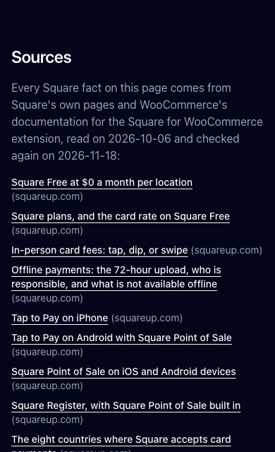 | 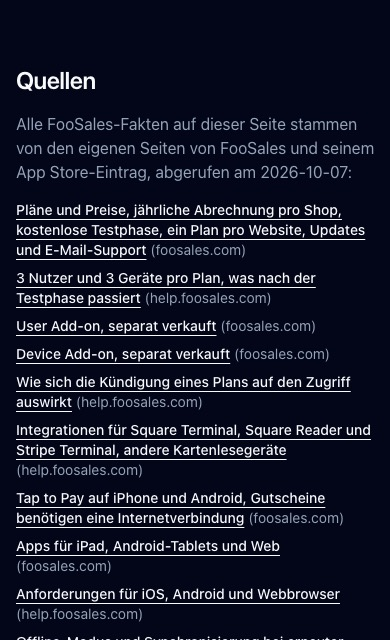 | 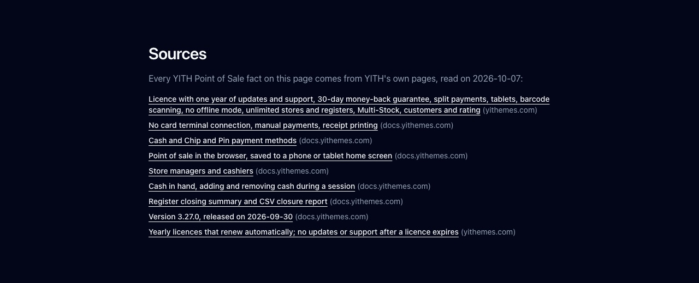 | 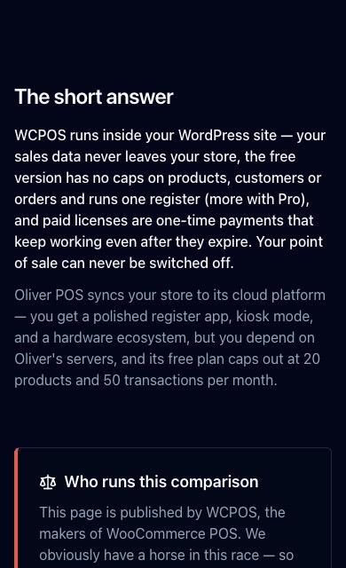 |

## Deferred

These carry over to round 26 as candidates:

- The home compare line should link Square and FooSales to their spokes
  (shop-owner, designer).
- /compare/square phone padding around the short answer, and likely the
  other six spokes (shop-owner; third round).
- The /pro `SoftwareApplication` `operatingSystem` leaves out Web.
- /compare/square dates: 2026-10-06 against 2026-11-18 (sceptic).
- /downloads:
  - the sync warning is buried;
  - the Web step offers only the demo link;
  - the macOS button is the only primary action;
  - 2.0.0 is open while 2.0.4 (Latest) is collapsed;
  - the diagram.
- Oliver POS, WooCommerce POS and Jovvie have no Sources list, and Oliver
  and Jovvie carry a 2026-07 `dateModified` (seo).
- fr, pt and es /pro titles run 68 to 73 characters (seo).
- /compare/square lists six Pro gateways where /extensions lists nine
  (woo-dev).
- "till" remains on /pro, and "centre" on /downloads.
- /support items from round 24, and the "more great features coming up"
  testimonial line (designer).
- Act 3 printer docs link (needs a URL from the owner).
- `compare.foosales.choose.wcpos.body` still says "a free plugin with no
  caps", which is borderline next to the one-register limit.
- The capture script stitches `compare-square-phone-full.jpg` badly.

The front-desk holds are unchanged:

- the offline qualifier, which the sceptic named again;
- /pro multi-store wording;
- a Compare nav entry;
- the home title;
- the Square price line;
- the /pro H1;
- the /pro Yearly wrap.
