# wcpos.com hill climb, round 26 (2026-11-18)

This round re-judges the live site after round 25's fixes (#808 to #810,
all live). It then records the fixes chosen from the result.

- Captures: [`2026-11-18-round-26/shots/`](2026-11-18-round-26/shots/) holds
  the fold shots. The full-page shots stay local. Visible text is in `text/`,
  page facts are in `facts.json` and Lighthouse results in `lighthouse.json`.
- Judges: [`2026-11-18-round-26/judges/`](2026-11-18-round-26/judges/). The
  personas and the brief are the same as in round 25: four Opus 5.5 pool
  one-shots, with Codex GPT-6 Astra as the sceptic. The judges were not told
  what changed.

| Page | Desktop | Phone |
|---|---|---|
| Home | 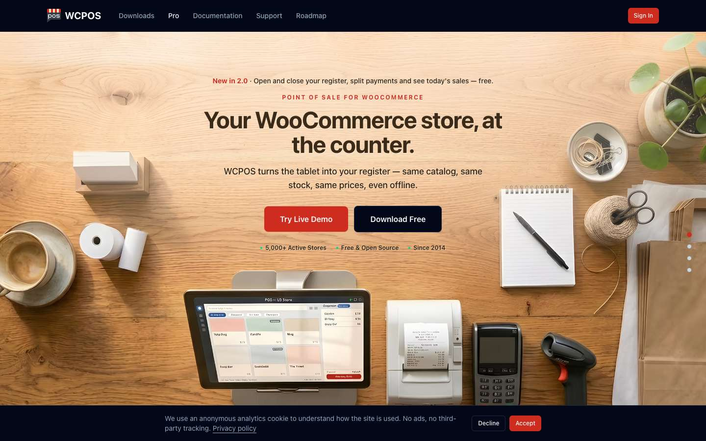 |  |
| /downloads | 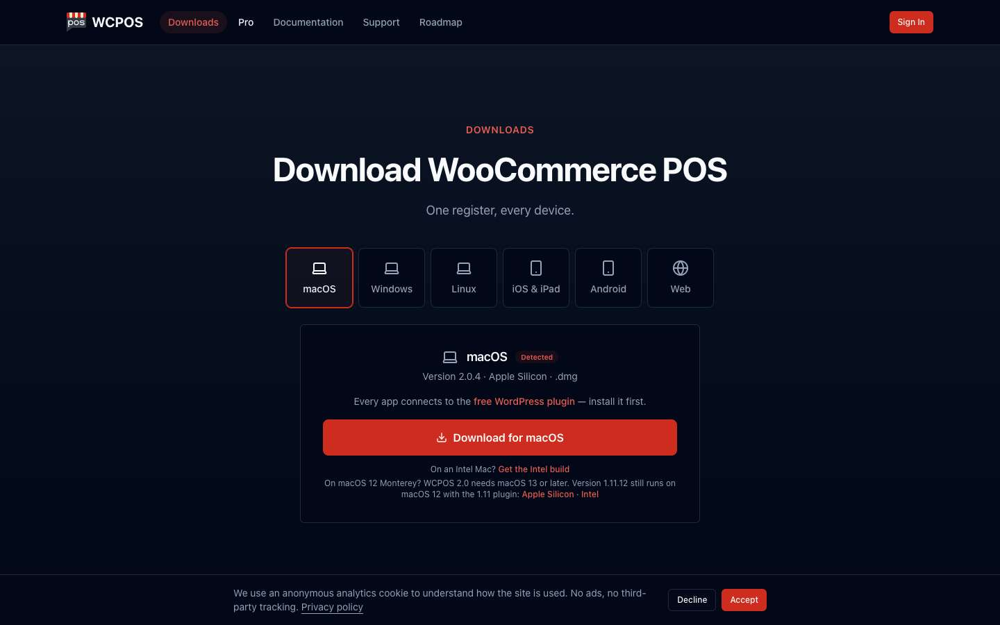 | 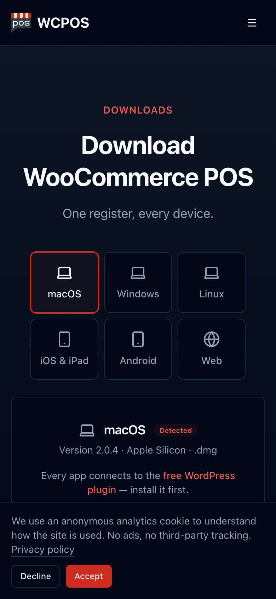 |
| /compare | 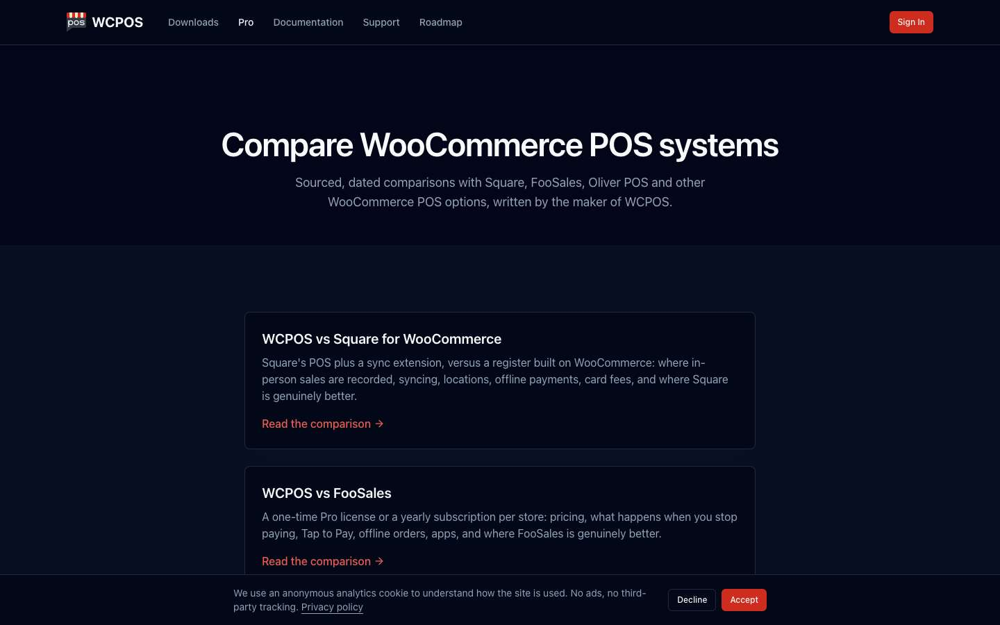 | 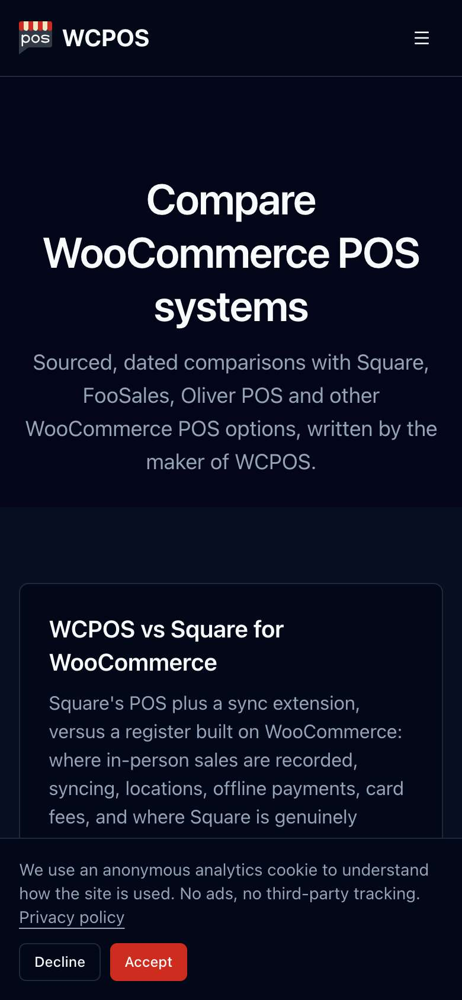 |
| /compare/square | 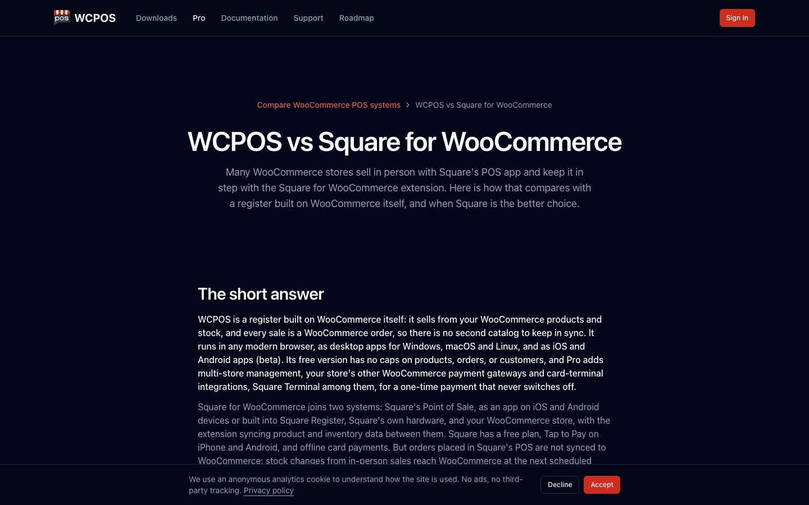 | 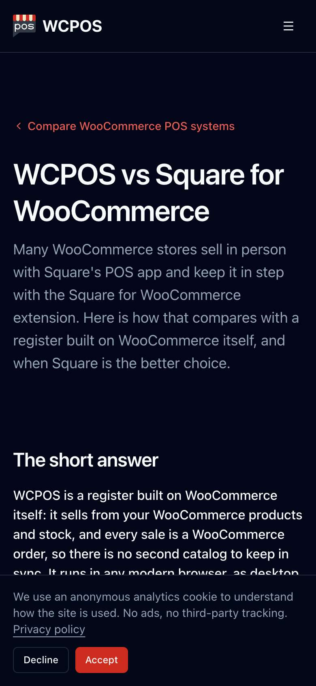 |

## 10-second test

All five judges answered both questions from the home fold. WCPOS is a free,
open-source WooCommerce POS that turns a tablet into the register, selling
from the store's own catalog and stock. The "New in 2.0" line answers why
v2: opening and closing the register, split payments and today's sales are
now free.

## Scores

| Judge | Marketing | UI | SEO |
|---|---|---|---|
| shop-owner (Opus) | 7 | 7 | 8 |
| woo-dev (Opus) | 7 | 8 | 8 |
| designer (Opus) | 7 | 7 | 8 |
| seo (Opus) | 8 | 8 | 8 |
| sceptic (Astra) | 7 | 7 | 9 |
| **Mean** | **7.2** | **7.4** | **8.2** |
| Round 25 | 7.2 | 7.6 | 8.2 |
| **Delta** | **0** | **−0.2** | **0** |

The overall mean is 7.60 (−0.07). **Nothing is reverted.**

- UI: the sceptic is back down from 8 to 7, as in round 24. Its UI defect
  is /downloads mobile performance, which it read from the capture's
  Lighthouse run. That run was taken on a busy box (see below), and every
  judge flagged the number as likely noise.
- No judge named a round-25 change as a defect. The Oliver copy (#808), the
  spoke titles (#809) and the Sources lists (#810) changed no layout, so
  the UI dip cannot be traced to them.

## Lighthouse (live, light theme)

| Page | Mobile perf | Desktop perf | A11y / BP / SEO | Mobile LCP |
|---|---|---|---|---|
| / | 90 | 100 | 100 | 3.6 s |
| /pro | 87 | 100 | 100 | 3.2 s |
| /compare | 97 | 100 | 100 | 2.6 s |
| /downloads | 68 | 97 | 100 | 3.0 s |
| /de | 73 | 99 | 100 | 3.5 s |

The capture ran while four judge sessions started, with the load average
near 9. Round 25 scored 96 to 100 on the same pages.

/downloads was rerun alone, three mobile and two desktop runs:

| When | Mobile perf | Mobile TBT | Desktop perf |
|---|---|---|---|
| Before the fix, load ~8.5 | 89 / 81 / 98 | 340 / 250 / 80 ms | 100 / 100 |
| After #812, load ~5.8 | 94 / 92 / 94 | 80 / 170 / 30 ms | 100 / 100 |

The capture's 68 is mostly box noise. The median TBT after the fix is
lower, but the load also fell, so the change is not isolated.

## Worst defects

**Marketing**

- /compare/square, /compare/woocommerce-pos and /compare/foosales: the
  "At a glance" WCPOS devices cell says "unlimited devices and cashiers"
  with no word that the free version runs one register (woo-dev).
- On /downloads the plugin step is an inline link while the macOS .dmg has
  the only primary button (designer; second round).
- The comparison pages' "where they're genuinely better" bullets say WCPOS
  takes only cash offline (shop-owner). The home offline promise leaves out
  the integrated-reader limitation (sceptic). Both touch the offline
  wording, which is a front-desk hold.
- The home compare line names Square and FooSales but links only the hub
  (seo).

**UI**

- The /downloads sync diagram runs its frame loop non-stop, even
  off-screen (shop-owner as its worst SEO defect, sceptic; designer as a
  runner-up).
- The cookie banner covers about 270 of 844 px on phone and hides the /pro
  Lifetime option (shop-owner).
- /compare/square on phone has about 95 px of padding before the short
  answer, on all seven spokes (seo; fourth round).
- The /downloads warning to sync before upgrading is about 2,700 px below
  the download button (woo-dev; second round).
- /support on phone reaches a human only through a fixed 600 px Discord
  iframe (designer).

**SEO**

- The home compare line: "Square" and "FooSales" should link to their
  spokes (designer, seo; second round).
- The localized /downloads titles render at 74 to 80 characters, and fr,
  pt and es /pro at 68 to 73 (seo).
- The /pro `SoftwareApplication` drifted from the shared one: no Web in
  `operatingSystem`, no `softwareRequirements` (woo-dev).
- /compare/square dates: the caption, footer and `dateModified` say
  2026-10-06, while Sources says 2026-11-18 (sceptic).

## Fixes this round

Three defects were fixed, one per track. Each was written as one spec and
implemented by an Opus 5.5 pool one-shot (route: opus). This machine
reviewed the full diff and reran the acceptance commands and mutations.

| Track | Defect | PR | Merge |
|---|---|---|---|
| Marketing | Glance tables leave out the free one-register limit | [#814](https://github.com/wcpos/wcpos-com/pull/814) | 2d71d27 |
| UI | /downloads diagram animates while off-screen | [#812](https://github.com/wcpos/wcpos-com/pull/812) | b4d224d |
| SEO | Home compare line links only the hub | [#813](https://github.com/wcpos/wcpos-com/pull/813) | 9ce04d2 |

- **#814:**
  - The Square and WooCommerce devices cells append each locale's "one
    register in the free version, more with Pro". The FooSales cell now
    equals the locale's Oliver devices value. All ten locales.
  - The wording is copied only from approved copy on the site.
  - A new test checks two things:
    - every en glance WCPOS cell that says "unlimited devices" also says
      "one register" (license rows excepted);
    - in every locale, the four device cells carry that locale's marker.
  - Mutations: the old en value fails both en cases; the old de FooSales
    value fails the de case.
- **#812:**
  - An IntersectionObserver (100 px margin) sets a ref, and the frame
    callback returns early while the diagram is out of view. It causes no
    re-render. Without IntersectionObserver the diagram animates as
    before.
  - Mutations, each failing its test:
    - the guard reverted;
    - the `disconnect()` cleanup removed.
- **#813:**
  - `home.pricing.compareLine` wraps the two brand names in `<square>` and
    `<foosales>`, in all ten locales. In ja and ko the particles stay
    outside the tags. The hub link is unchanged.
  - Mutations, each failing its test:
    - the Square renderer pointed at `/compare`;
    - the nl `<foosales>` tags removed.

## After (live, 2026-11-18 23:40 UTC)

The checks were run in headless Chromium against wcpos.com after the
2d71d27 deploy.

- Home compare line: in en, de, ja and ko, "Square" links to
  `/<locale>/compare/square`, "FooSales" to `/<locale>/compare/foosales`,
  and the last phrase to `/<locale>/compare`. No page overflows.
- Glance cells:
  - en Square and WooCommerce: "… unlimited devices and cashiers, one
    register in the free version, more with Pro".
  - en FooSales: "Unlimited devices and cashiers; one register in the free
    version, more with Pro".
  - de FooSales: "Unbegrenzt Geräte und Kassierer; eine Kasse in der
    kostenlosen Version, weitere mit Pro".
  - ja Square ends "無料版ではレジ1台、Proではさらに追加可能".
- /downloads diagram, with motion allowed:
  - In view, the desktop wrapper's `left` moves between reads at 1280 px
    and 390 px.
  - Scrolled to the page bottom, it holds still at both widths.
  - At scroll 0 on desktop the diagram starts 83 px below the fold, inside
    the 100 px margin, so it animates there as intended.

| Compare line, en phone | Compare line, de desktop | Square glance, en phone | WooCommerce glance, en desktop | FooSales glance, de phone |
|---|---|---|---|---|
| 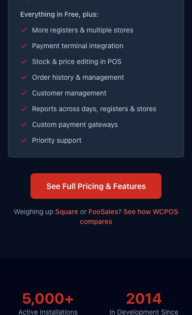 | 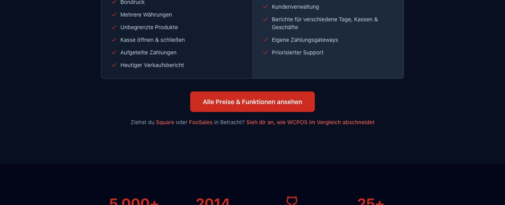 | 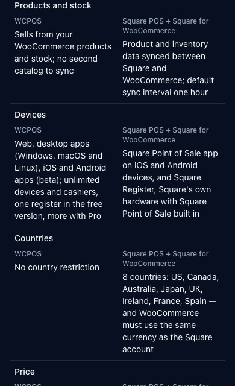 | 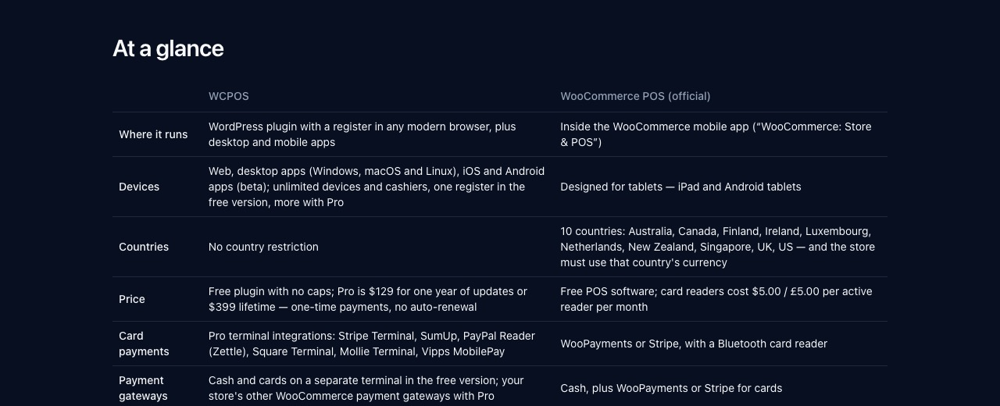 | 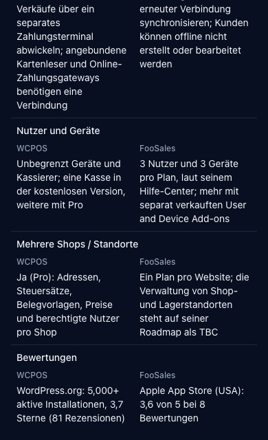 |

## Deferred

These carry over to round 27 as candidates:

- /compare/square phone padding before the short answer, on all seven
  spokes (fourth round).
- Localized /downloads and /pro titles over 60 characters.
- The cookie banner height on phone.
- /downloads:
  - the plugin step has no button;
  - the sync warning is buried;
  - the Web step offers only the demo link.
- The /pro `SoftwareApplication` drift (Web, `softwareRequirements`).
- /compare/square dates: 2026-10-06 against 2026-11-18.
- /support on phone: no direct Discord button.
- The de /pro purchase card mixes "Sie" and "du".
- Oliver, WooCommerce and Jovvie have no Sources list.
- Front-desk holds, unchanged: the offline qualifier (now also the
  comparison pages' "cash only offline" bullets), /pro multi-store, the
  Compare nav, the home title, the Square price line, the /pro H1 and the
  /pro Yearly wrap.
