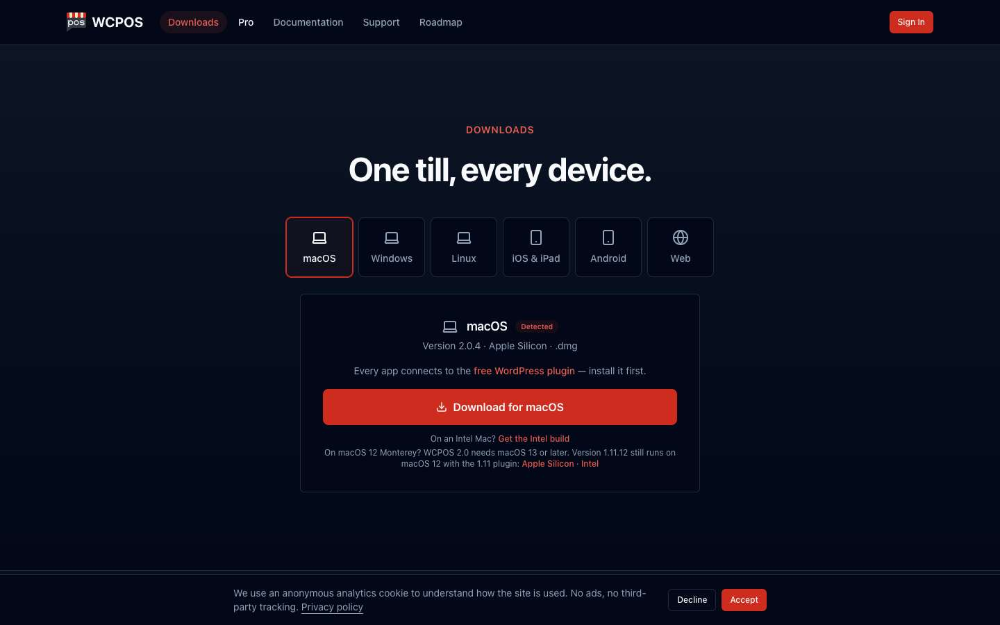
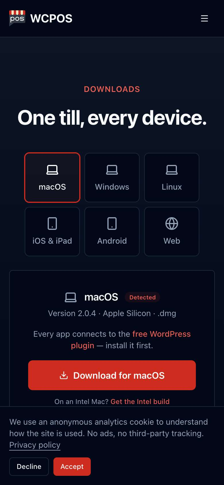
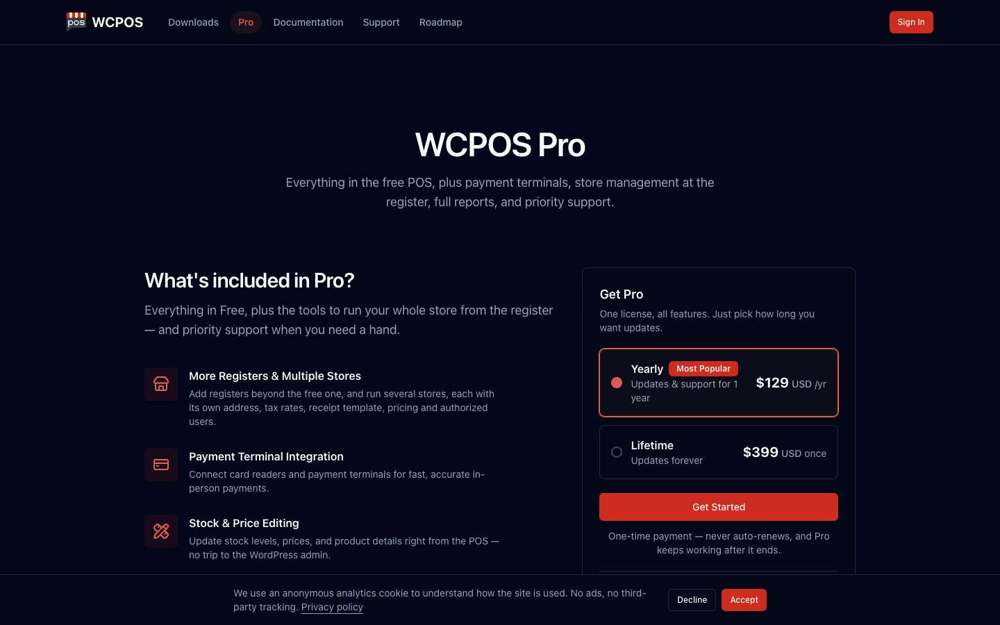
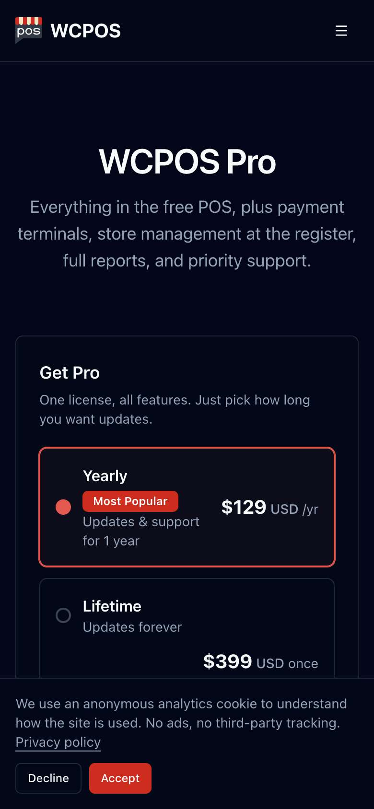

# wcpos.com hill climb — round 8 (2026-11-18)

This round re-judges the live site after round 7's three fixes and records the
fixes chosen from the result. Production is at `f702a33`, with #735 to #737
live.

- Captures: [`2026-11-18-round-8/shots/`](2026-11-18-round-8/shots/) holds
  the fold shots. The full-page shots stay local. Visible text is in `text/`,
  page facts in `facts.json` and Lighthouse in `lighthouse.json`.
- Judges: [`2026-11-18-round-8/judges/`](2026-11-18-round-8/judges/). The
  personas and the brief are the same as round 7: four Opus 5.5 pool
  one-shots, with Codex GPT-6 Astra as the sceptic. The judges were not told
  what changed.

These shots are the "after" views for round 7's fixes. On /downloads, the
plugin step now sits inside the card above the button (#736). On /pro, the
first feature is "More Registers & Multiple Stores" (#737).

| Page | Desktop | Phone |
|---|---|---|
| Downloads |  |  |
| Pro |  |  |

## Scores

| Judge | Marketing | UI | SEO |
|---|---|---|---|
| shop-owner (Opus) | 7 | 8 | 8 |
| woo-dev (Opus) | 7 | 7 | 8 |
| designer (Opus) | 7 | 7 | 8 |
| seo (Opus) | 8 | 8 | 8 |
| sceptic (Astra) | 8 | 8 | 9 |
| **Mean** | **7.4** | **7.6** | **8.2** |
| Round 7 | 7.2 | 7.6 | 8.2 |
| **Delta** | **+0.2** | **0** | **0** |

The overall mean is 7.73, up from 7.67. **Nothing is reverted.**

- Marketing rose for the second round running: the seo judge went 7 → 8. No
  judge repeated round 7's "Pro never mentions registers or stores" or the
  /downloads plugin-order defect.
- UI held at 7.6. The two 7s (designer and woo-dev) both cite the /pro
  buy-box price row on phone, which was round 7's deferred UI candidate.
- SEO held at 8.2. Four judges named the /pro meta description.

## Lighthouse (live, light theme)

| Page | Mobile perf | Desktop perf | A11y / BP / SEO | vs round 7 (mobile) |
|---|---|---|---|---|
| / | 93 | 100 | 100 | −1 |
| /pro | 98 | 100 | 100 | −2 |
| /compare | 100 | 100 | 100 | = |
| /downloads | 99 | 100 | 100 | +7 |
| /de | 92 | 100 | 100 | = |

Home mobile LCP is 3.2 s (3.0 s last round). Unused JavaScript, about
84 KiB, is still the largest opportunity. The /downloads gain and the home and
/pro dips sit within the run-to-run spread seen in earlier rounds.

## Worst defects

**Marketing.**
- The home page never links to /compare above the footer (shop-owner, seo).
- The /pro "Payment Terminal Integration" card names no processor and does not
  link to /extensions (woo-dev).
- The home "New in 2.0" line has no link to /changelog (designer; also round 7).
- /compare/square says "nothing to sync" while the same page explains offline
  sync (sceptic; also round 7).

**UI.**
- On phone, /pro buy-box rows place the price differently by label length and
  locale (designer, woo-dev; also round 7).
- On phone, /compare/* shows the intro and the "Who runs this comparison" card
  before the short answer (shop-owner, sceptic).
- On phone, /pro puts the buy box before "What's included" (seo; also round 7).

**SEO.**
- The /pro meta description lacks "WooCommerce" and registers/stores
  (shop-owner, woo-dev, designer; seo runner-up).
- The /downloads H1 "One till, every device." carries no search term (seo;
  open four rounds).
- The /support title is brand-only, "Support | WCPOS" (sceptic; designer and
  seo runner-up).

## Fixes this round

There are three fixes, one per track. Each comes from a defect that at least
two judges named. Each PR got one review on its head by this machine, which
reran the acceptance commands and applied the mutations itself.

| PR | Merge | Track | Fix |
|---|---|---|---|
| [#739](https://github.com/wcpos/wcpos-com/pull/739) | 193c6a9 | SEO | The /pro meta description now names WooCommerce and leads with "more registers and multiple stores", in all ten locales within the length budgets (en 155). A test checks both in every locale. |
| [#740](https://github.com/wcpos/wcpos-com/pull/740) | 177d04f | UI | On phone, each /pro buy-box price takes its own row, indented to the label; from `sm` up the layout is unchanged. Before merging, I captured it at 390 px on a local build: [en](2026-11-18-round-8/shots/buybox-after-en.png), [de](2026-11-18-round-8/shots/buybox-after-de.png). |
| [#741](https://github.com/wcpos/wcpos-com/pull/741) | 33f8abc | Marketing | The home closing band gets a text link to /compare, labelled with each locale's own /compare hub title (en "Compare WooCommerce POS systems"). |

Known gap: no home test renders the closing band, so the home-side wiring of
#741 is checked by round 9's live capture rather than by a unit test.

Round 9's judging measures the effect of these fixes.

## Deferred

- Candidates for round 9:
  - a keyword in the /downloads H1
  - a /support title with a keyword
  - the order of the short answer and the disclosure card on /compare/* on
    phone
  - the /pro terminal card linking to /extensions
  - the /compare/square "nothing to sync" wording
  - a /changelog link on the home "New in 2.0" line
  - `FAQPage` markup on /pro
- The scroll-story chip overflow at 390 px touches the owner's open PR, so it
  waits for that PR.
- A Compare entry in the header nav is still a front-desk candidate.
