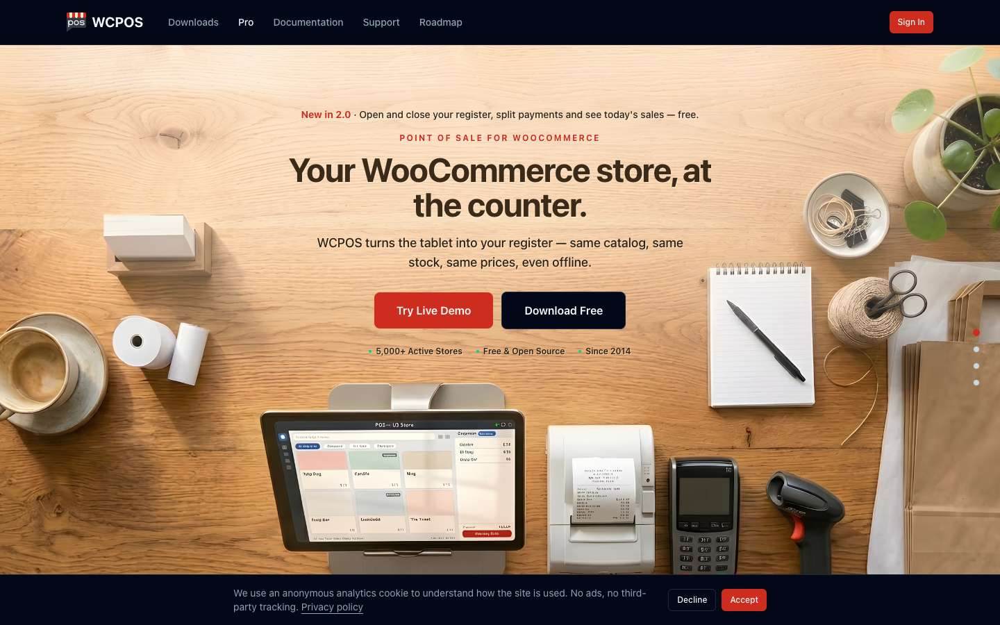
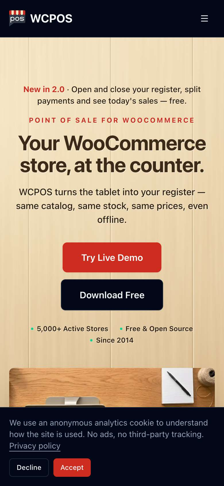
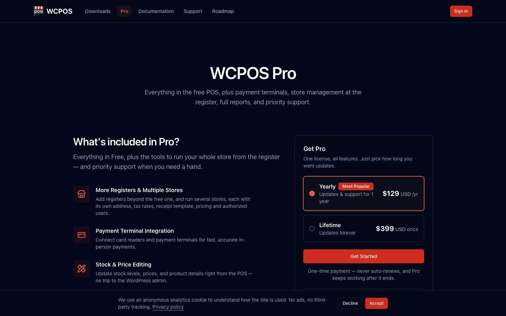
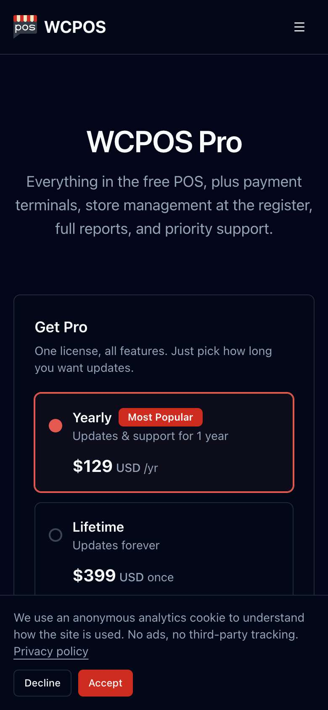
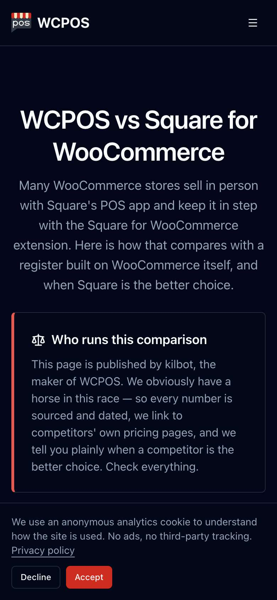

# wcpos.com hill climb — round 9 (2026-11-18)

This round re-judges the live site after round 8's three fixes and records the
fixes chosen from the result. Production is at `33f8abc`, with #739 to #741
live.

- Captures: [`2026-11-18-round-9/shots/`](2026-11-18-round-9/shots/) holds
  the fold shots. The full-page shots stay local. Visible text is in `text/`,
  page facts in `facts.json` and Lighthouse in `lighthouse.json`.
- Judges: [`2026-11-18-round-9/judges/`](2026-11-18-round-9/judges/). The
  personas and the brief are the same as round 8: four Opus 5.5 pool
  one-shots, with Codex GPT-6 Astra as the sceptic. The judges were not told
  what changed.

These shots are the "after" views for round 8's fixes. On home, the closing
band now links to /compare (#741). On /pro, each buy-box price sits on its own
row on phone (#740). The /compare/square phone fold is the "before" view for
this round's UI fix.

| Page | Desktop | Phone |
|---|---|---|
| Home |  |  |
| Pro |  |  |
| /compare/square | — |  |

## Scores

| Judge | Marketing | UI | SEO |
|---|---|---|---|
| shop-owner (Opus) | 7 | 8 | 8 |
| woo-dev (Opus) | 7 | 8 | 8 |
| designer (Opus) | 7 | 7 | 8 |
| seo (Opus) | 8 | 8 | 8 |
| sceptic (Astra) | 7 | 8 | 9 |
| **Mean** | **7.2** | **7.8** | **8.2** |
| Round 8 | 7.4 | 7.6 | 8.2 |
| **Delta** | **−0.2** | **+0.2** | **0** |

The overall mean is 7.73, the same as round 8. **Nothing is reverted**: the
mean did not fall.

- UI rose 0.2: woo-dev went 7 → 8. No judge repeated round 8's /pro buy-box
  price defect, which #740 fixed.
- Marketing fell 0.2: the sceptic went 8 → 7, over the /compare/square
  "nothing to sync" wording, which it also named in rounds 7 and 8. No judge
  repeated "the home page never links to /compare", which #741 fixed. Four of
  five judges now name the /pro terminal card as the worst marketing or UI
  defect.
- SEO held at 8.2. No judge repeated the /pro meta description, which #739
  fixed. Four judges named the /support title.

## Lighthouse (live, light theme)

| Page | Mobile perf | Desktop perf | A11y / BP / SEO | vs round 8 (mobile) |
|---|---|---|---|---|
| / | 99 | 100 | 100 | +6 |
| /pro | 97 | 100 | 100 | −1 |
| /compare | 100 | 100 | 100 | = |
| /downloads | 93 | 100 | 100 | −6 |
| /de | 92 | 100 | 100 | = |

Mobile LCP: home 2.1 s (3.2 s last round), /pro 2.6 s, /downloads 3.0 s, /de
3.3 s. The home gain and the /downloads dip sit within the run-to-run spread
seen in earlier rounds; none of round 8's fixes touched script weight.

## Worst defects

**Marketing.**
- The /pro "Payment Terminal Integration" card names no processor and does not
  link to /extensions, which lists eight terminal extensions (woo-dev,
  shop-owner, seo; the sceptic files it under UI).
- On phone, /compare/* opens with the lead and the disclosure card, so the
  first screen holds no product fact (designer).
- /compare/square says "nothing to sync" while the same page explains offline
  sync (sceptic; also rounds 7 and 8).

**UI.**
- On phone, /compare/* shows the "Who runs this comparison" card before the
  short answer (woo-dev, shop-owner; designer under marketing).
- On phone, the /compare/* "At a glance" tables squeeze three columns into
  390 px, so cells run 5–10 lines (designer).
- On phone, /pro puts the buy box before "What's included" (seo; also rounds
  7 and 8).
- The /pro terminal card has no link to supported terminals (sceptic).

**SEO.**
- The /support title is brand-only, "Support | WCPOS" (woo-dev, shop-owner,
  designer, sceptic).
- The /downloads H1 "One till, every device." carries no search term (seo;
  open five rounds).

## Fixes this round

There are three fixes, one per track. Each comes from a defect that at least
three judges named. Each PR got one review on its head by this machine, which
reran the acceptance commands and applied the mutations itself.

| PR | Merge | Track | Fix |
|---|---|---|---|
| [#743](https://github.com/wcpos/wcpos-com/pull/743) | 84a498b | Marketing | The /pro terminal card names Stripe Terminal, Square Terminal, SumUp, Mollie and PayPal Reader "and more", each with its own extension on /extensions, and links to /extensions ("See all terminal extensions"), in all ten locales. |
| [#744](https://github.com/wcpos/wcpos-com/pull/744) | 6f7a298 | UI | On all seven vendor /compare pages, the short answer now comes straight after the hero, and the disclosure card follows it, above the "At a glance" table. Before merging, I captured /compare/square at 390 px on a local build ([en](2026-11-18-round-9/shots/compare-square-after-en.png), [de](2026-11-18-round-9/shots/compare-square-after-de.png)). The short answer is now on the first screen; the live capture above shows the card there before. |
| [#745](https://github.com/wcpos/wcpos-com/pull/745) | 871c85f | SEO | The /support title names each locale's WooCommerce POS term in at most 52 code points, e.g. en "WooCommerce POS Help & Support \| WCPOS". A test checks every locale. |

Round 10's judging measures the effect of these fixes.

## Deferred

- Candidates for round 10:
  - the /compare/square "nothing to sync" wording
  - a stacked phone layout for the /compare/* "At a glance" tables
  - a keyword in the /downloads H1
  - a /changelog link on the home "New in 2.0" line (touches the
    scroll-story, so check it against the owner's PR first)
  - the home stats band: the "GPL Licensed" stat's alignment and
    "Installations" vs the hero's "Stores"
  - `FAQPage` markup on /pro and a per-locale `url` and `description` in the
    SoftwareApplication JSON-LD
- The scroll-story chip overflow at 390 px touches the owner's open PR, so it
  waits for that PR.
- A Compare entry in the header nav is still a front-desk candidate.
