# wcpos.com hill climb, round 27 (2026-11-19)

This round re-judges the live site after round 26's fixes (#812 to #814,
all live). It then records the fixes chosen from the result.

- Captures: [`2026-11-19-round-27/shots/`](2026-11-19-round-27/shots/) holds
  the fold shots. The full-page shots stay local. Visible text is in `text/`,
  page facts are in `facts.json` and Lighthouse results in `lighthouse.json`.
- Judges: [`2026-11-19-round-27/judges/`](2026-11-19-round-27/judges/). The
  personas and the brief are the same as in round 26: four Opus 5.5 pool
  one-shots, with Codex GPT-6 Astra as the sceptic. The judges were not told
  what changed.

| Page | Desktop | Phone |
|---|---|---|
| Home | 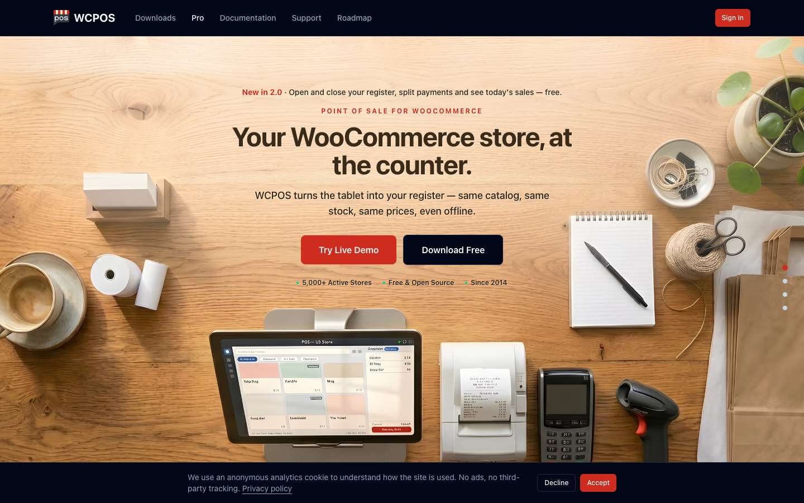 |  |
| /downloads | 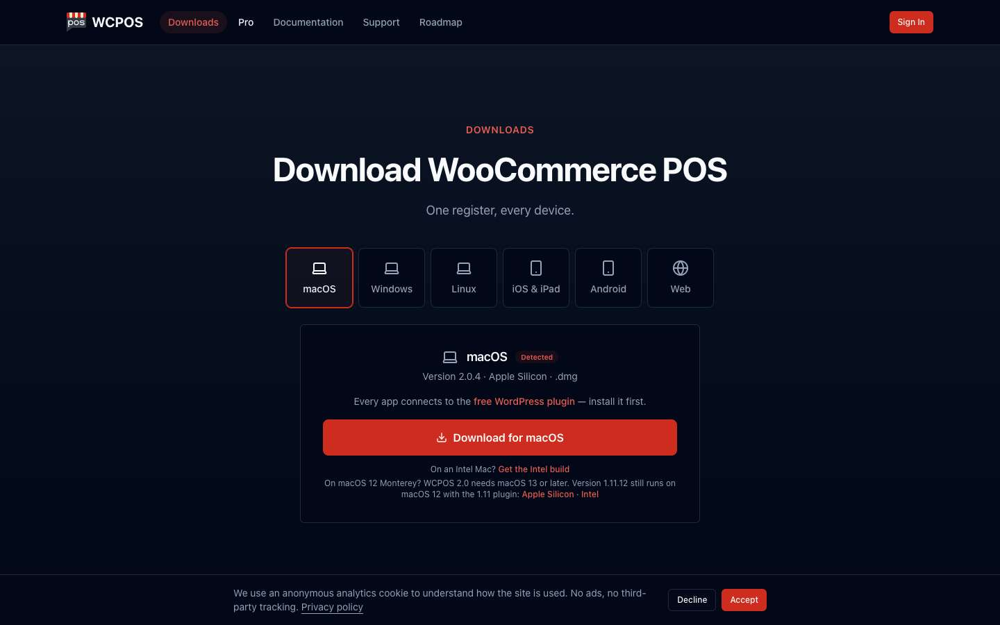 | 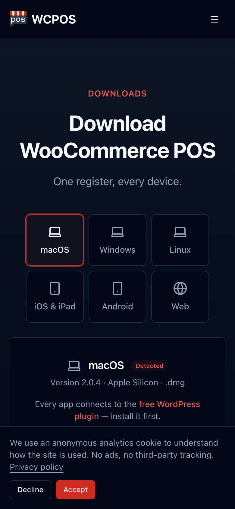 |
| /compare | 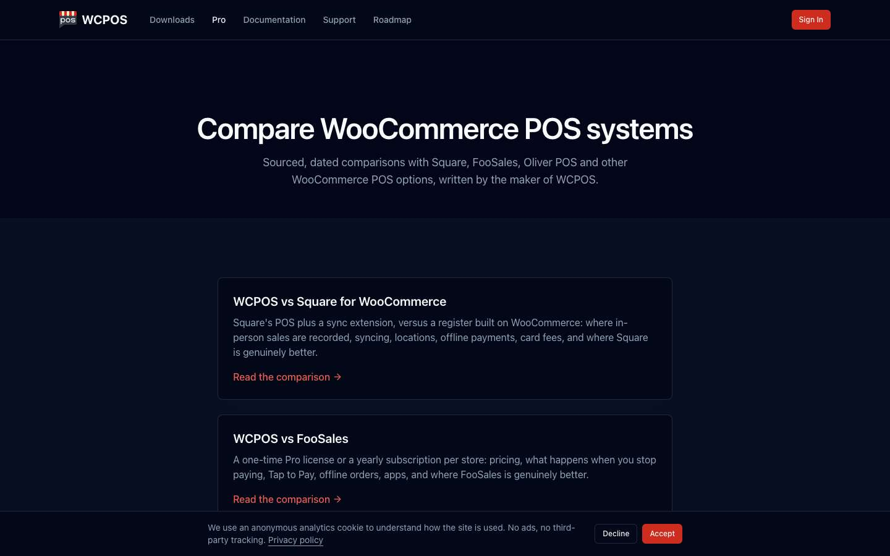 | 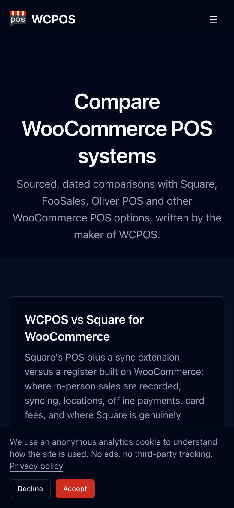 |
| /compare/square | 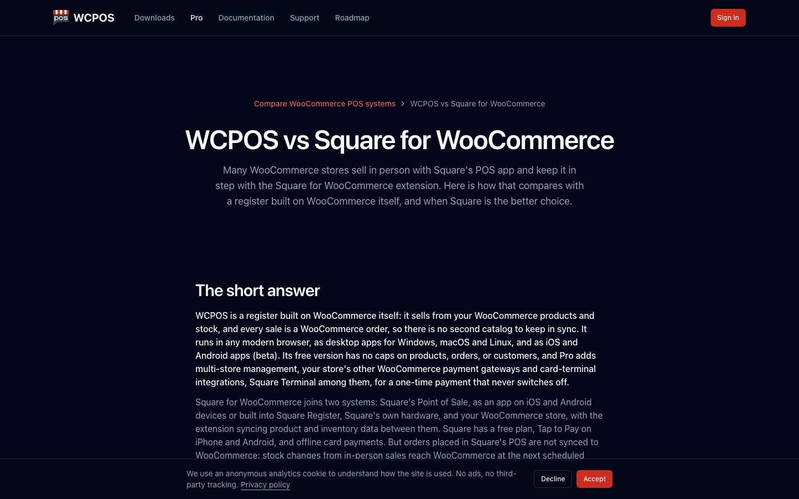 | 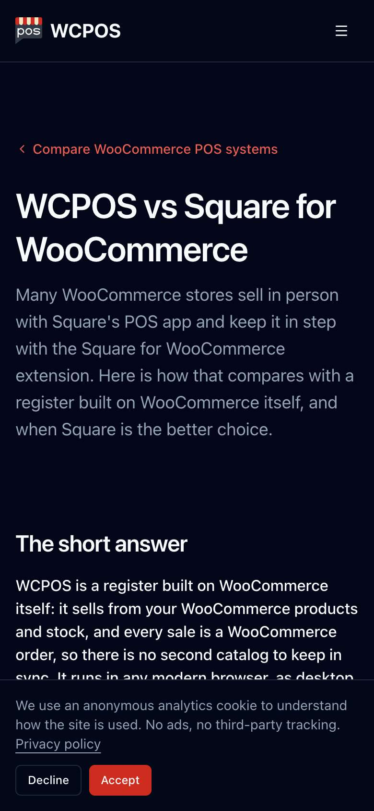 |

## 10-second test

All five judges answered both questions from the home fold. WCPOS is a free,
open-source WooCommerce POS that turns a tablet into the register, selling
from the store's own catalog and stock. The "New in 2.0" line answers why
v2: opening and closing the register, split payments and today's sales are
now free.

## Scores

| Judge | Marketing | UI | SEO |
|---|---|---|---|
| shop-owner (Opus) | 7 | 7 | 8 |
| woo-dev (Opus) | 7 | 8 | 8 |
| designer (Opus) | 7 | 7 | 8 |
| seo (Opus) | 8 | 7 | 8 |
| sceptic (Astra) | 7 | 7 | 9 |
| **Mean** | **7.2** | **7.2** | **8.2** |
| Round 26 | 7.2 | 7.4 | 8.2 |
| **Delta** | **0** | **−0.2** | **0** |

The overall mean is 7.53 (−0.07). **Nothing is reverted.**

- UI: only the seo judge moved, from 8 to 7. Its UI defect is the cookie
  banner on phone, which covers about 270 of 844 px. That banner has not
  changed since round 25, and the shop-owner judge named it in round 26.
- No judge named a round-26 change as a defect. The diagram pause (#812)
  shows as /downloads mobile 94, against 68 in round 26's noisy capture. The
  compare-line links (#813) and the glance wording (#814) changed no layout.

## Lighthouse (live, light theme)

| Page | Mobile perf | Desktop perf | A11y / BP / SEO | Mobile LCP |
|---|---|---|---|---|
| / | 87 | 100 | 100 | 3.4 s |
| /pro | 100 | 100 | 100 | 1.7 s |
| /compare | 96 | 100 | 100 | 2.6 s |
| /downloads | 94 | 100 | 100 | 3.0 s |
| /de | 88 | 100 | 100 | 3.6 s |

The load average was near 9.6 during the capture.

## Worst defects

**Marketing**

- /downloads: the plugin, which has to be installed first, is only an
  inline link, and "Download for macOS" is the card's only button (seo,
  designer; third round).
- The comparison pages' "Which should you choose?" cards have no button;
  the first call to action comes after the FAQ and the sources
  (shop-owner).
- The home "Bring your own hardware" panel says receipt printers and
  scanners plug in, but links nowhere (woo-dev).
- The home offline promise leaves out that integrated readers need a
  connection (sceptic). This is the offline wording, a front-desk hold.

**UI**

- The cookie banner covers about 270 of 844 px on phone, hiding the
  /downloads button and the /compare/square short answer (seo; the
  shop-owner and designer as runners-up).
- The /downloads warning to sync every register before upgrading sits in
  the release notes, about 2,700 px below the download button (woo-dev,
  sceptic; third round).
- The `hero` section padding on phone leaves about 85 px above the /pro H1,
  which with the banner pushes Lifetime off the first screen (shop-owner).
- /support on phone shows a blank 600 px Discord iframe and no button that
  opens Discord (designer; second round).

**SEO**

- The localized /downloads titles render at 74 to 80 characters, and
  es, fr and pt /pro at 68 to 73 (seo; second round).
- /compare/square gives three dates: JSON-LD and the caption say
  2026-10-06, while the Sources intro and the sitemap say 2026-11-18
  (shop-owner, designer).
- The /pro `SoftwareApplication` still leaves out Web and
  `softwareRequirements` (woo-dev; second round).
- The /downloads title names the apps but not the plugin (sceptic).

## Fixes this round

Three defects were fixed, one per track. Each one was a single spec,
implemented by an Opus 5.5 pool one-shot (route: opus). This machine
reviewed the full diff and reran the acceptance commands and mutations.

| Track | Defect | PR | Merge |
|---|---|---|---|
| Marketing | /downloads: the plugin step has no button | [#817](https://github.com/wcpos/wcpos-com/pull/817), hotfix [#819](https://github.com/wcpos/wcpos-com/pull/819) | b8d24d5, ed7d44e |
| UI | Cookie banner covers the phone fold | [#818](https://github.com/wcpos/wcpos-com/pull/818) | 4e60133 |
| SEO | Localized /downloads and /pro titles over 60 characters | [#816](https://github.com/wcpos/wcpos-com/pull/816) | 797c753 |

- **#817:**
  - A full-width outline "Install the free plugin" button sits above the
    platform button. It is the card's only plugin link and carries the
    old tracking event.
  - The notice is plain text in all ten locales. The label reuses the
    already translated `downloads.page.steps.plugin.title`.
  - Mutations, each failing its test:
    - the button moved after the platform button;
    - the de `<plugin>` tags restored.
- **#819 (regression, found by the after-check):**
  - #817's button showed the raw key `downloads.page.steps.plugin.title`
    live for about 50 minutes. The /downloads page hands the client
    provider only `downloads.hero` and `downloads.platforms`, and #817's
    test mocked next-intl.
  - #819 adds the one leaf key to the client list
    (`DOWNLOADS_CLIENT_MESSAGES`).
  - A new test renders the hero with the real provider and the picked
    messages in all ten locales.
  - Mutation: dropping the key fails the test in every locale.
- **#818:**
  - Below `sm`, the message sits beside the buttons at 12 px, with Accept
    stacked over Decline. The padding is `py-2.5`, and the bottom padding
    respects the iOS safe area.
  - From `sm` up nothing changes. The wording, the consent logic and the
    attributes are untouched.
  - Mutations, each failing its test:
    - `sm:text-sm` dropped;
    - Accept writing `denied`.
- **#816:**
  - Shorter product nouns bring every rendered title to 60 or fewer.
  - The six European /downloads titles drop Linux, which no longer
    fits; the page still lists it.
  - A test pins the rendered length, "WooCommerce", and Mac and Windows
    in /downloads.
  - Mutations, each failing its test:
    - the old fr title (78);
    - nl without Windows.

## After (live, 2026-11-19)

The checks were run in headless Chromium against wcpos.com after the
ed7d44e deploy.

- Consent banner, fresh context:
  - 91 px tall at 390 × 844 on /, /de, /nl, /downloads and /de/pro, with
    12 px text and 32 px buttons;
  - 73 px tall at 1280 × 800, with 14 px text;
  - no page overflows.
- /downloads card: the first link in en, de and ja is the plugin button
  ("Install the free plugin", "Kostenloses Plugin installieren",
  "無料プラグインをインストール"), followed by the platform button. There
  is one plugin link per card.
- Rendered titles:
  - /downloads: en 59, de 60, nl 57, fr 57, es 59, it 60, pt 60, ja 54;
  - /pro: en 50, de 55, fr 58, es 57, pt 59.

| Banner, en /downloads phone | Banner, de /pro phone | Banner, en home phone | Card, en desktop | Card, de phone |
|---|---|---|---|---|
| 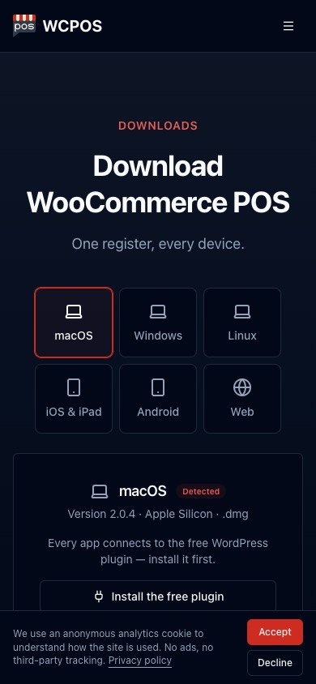 | 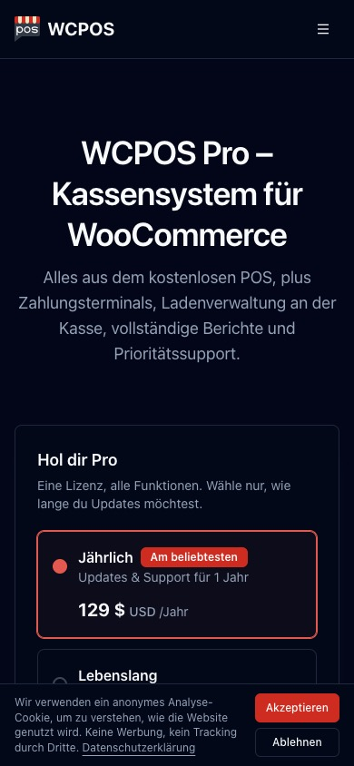 | 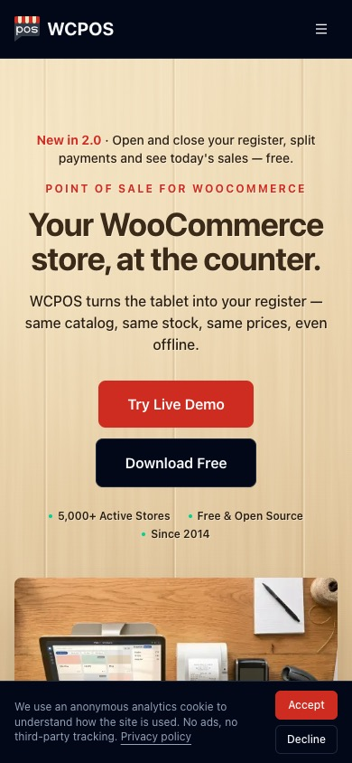 | 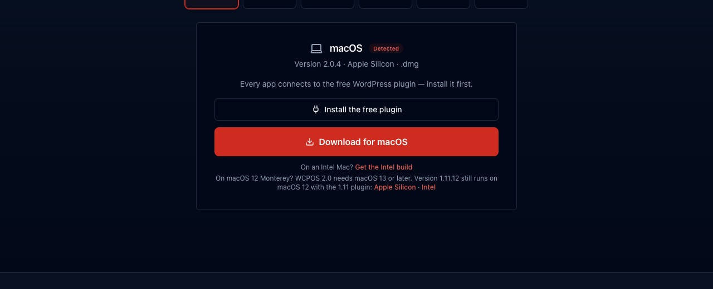 | 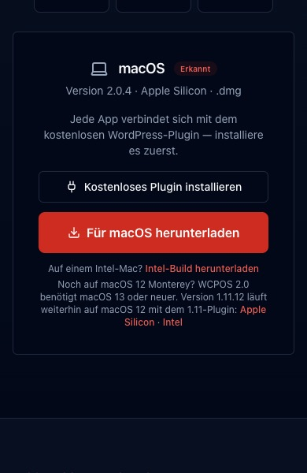 |

## Deferred

These carry over to round 28 as candidates:

- The /downloads warning to sync before upgrading is buried (third
  round).
- The comparison pages' choose cards have no call to action.
- The `hero` section padding on phone.
- /compare/square phone padding before the short answer (fifth round).
- /compare/square dates: 2026-10-06 against 2026-11-18.
- The /pro `SoftwareApplication` drift (Web, `softwareRequirements`).
- /support on phone: no direct Discord button.
- The home hardware panel's printer line links nowhere.
- The de /pro purchase card mixes "Sie" and "du".
- Oliver, WooCommerce and Jovvie have no Sources list.
- Front-desk holds, unchanged: the offline qualifier (now also the
  comparison pages' "cash only offline" bullets), /pro multi-store, the
  Compare nav, the home title, the Square price line, the /pro H1 and the
  /pro Yearly wrap.
