# wcpos.com hill climb, round 28 (2026-11-19)

This round re-judges the live site after round 27's fixes (#816 to #819,
all live). It then records the fixes chosen from the result.

- Captures: [`2026-11-19-round-28/shots/`](2026-11-19-round-28/shots/) holds
  the fold shots. The full-page shots stay local. Visible text is in `text/`,
  page facts are in `facts.json` and Lighthouse results in `lighthouse.json`.
- Judges: [`2026-11-19-round-28/judges/`](2026-11-19-round-28/judges/). The
  personas and the brief are the same as in round 27: four Opus 5.5 pool
  one-shots, with Codex GPT-6 Astra as the sceptic. The judges were not told
  what changed.

| Page | Desktop | Phone |
|---|---|---|
| Home | 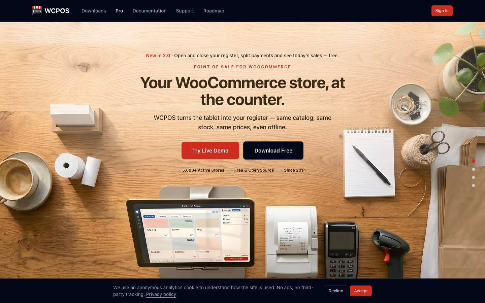 | 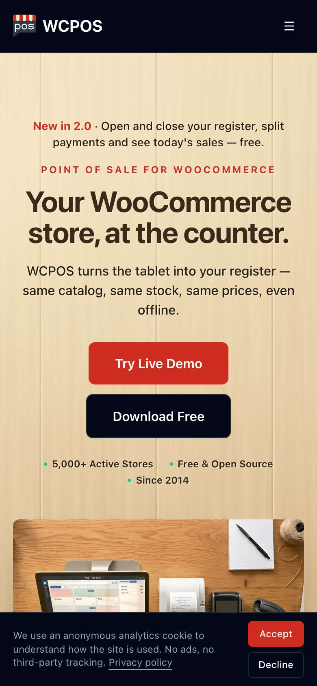 |
| /downloads | 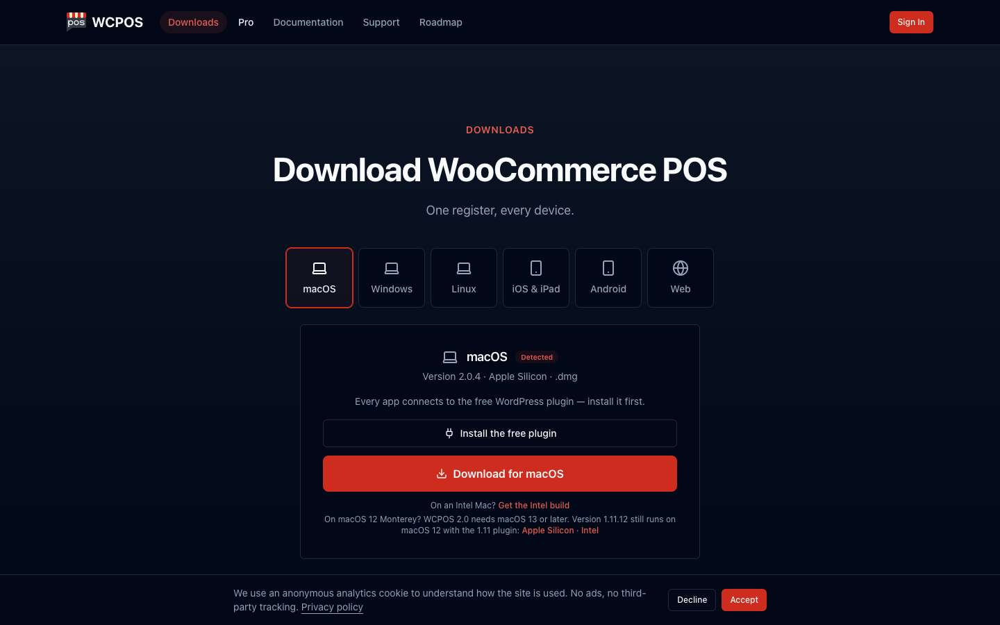 | 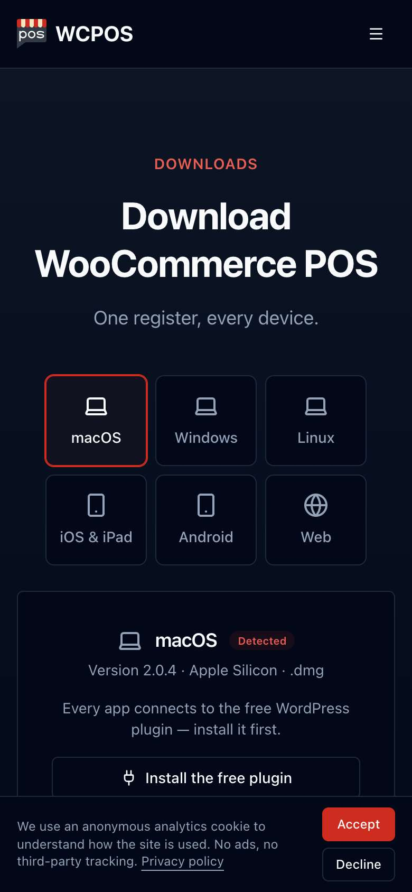 |
| /compare | 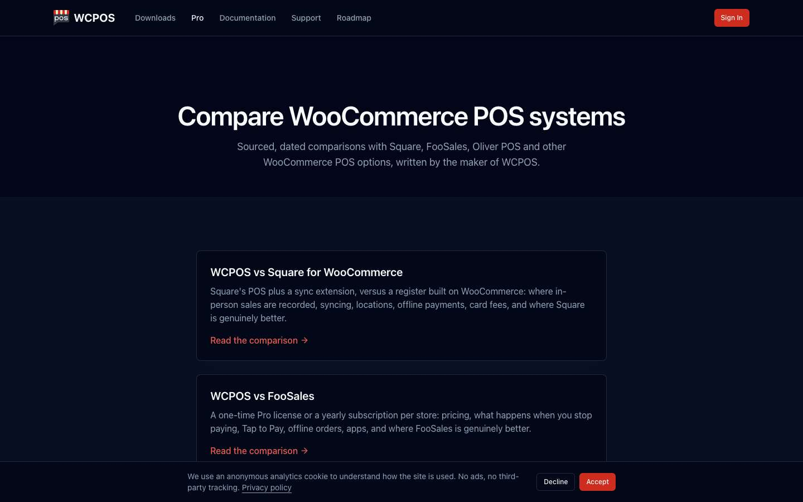 | 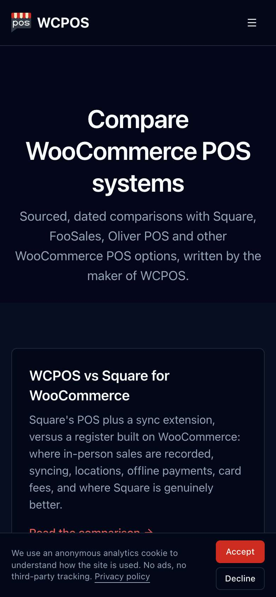 |
| /compare/square | 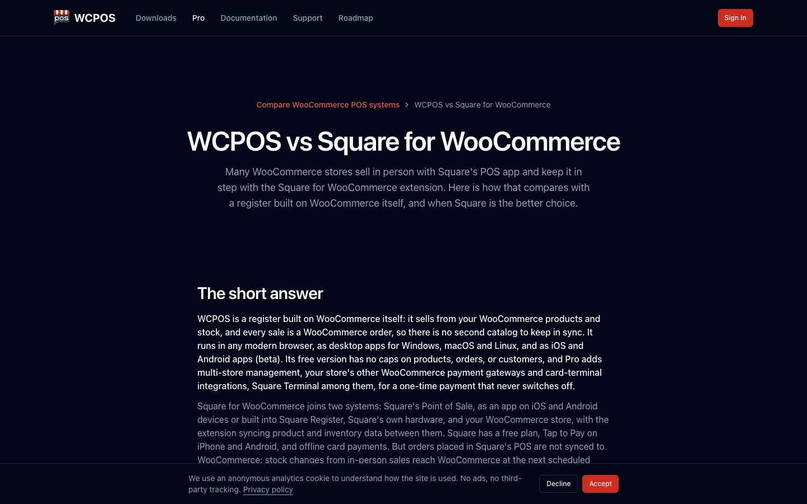 | 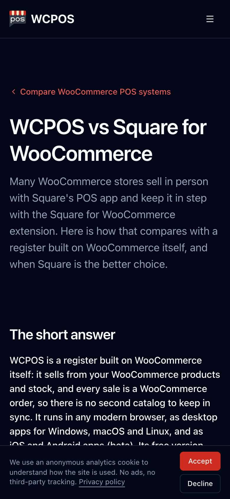 |

## 10-second test

All five judges answered both questions from the home fold. WCPOS is a free,
open-source WooCommerce POS that turns a tablet into the register, selling
from the store's own catalog and stock. The "New in 2.0" line answers why
v2: opening and closing the register, split payments and today's sales are
now free.

## Scores

| Judge | Marketing | UI | SEO |
|---|---|---|---|
| shop-owner (Opus) | 8 | 8 | 8 |
| woo-dev (Opus) | 7 | 8 | 8 |
| designer (Opus) | 7 | 7 | 8 |
| seo (Opus) | 8 | 8 | 8 |
| sceptic (Astra) | 7 | 8 | 9 |
| **Mean** | **7.4** | **7.8** | **8.2** |
| Round 27 | 7.2 | 7.2 | 8.2 |
| **Delta** | **+0.2** | **+0.6** | **0** |

The overall mean is 7.80 (+0.27). Nothing is reverted.

- UI: the shop-owner, seo and sceptic judges each moved from 7 to 8. The seo
  judge named the compact phone consent banner (#818) as the reason. No
  judge named a round-27 change as a defect; the designer saw the plugin
  button and the banner as clean.
- Marketing: the shop-owner and seo judges moved from 7 to 8.

## Lighthouse (live, light theme)

| Page | Mobile perf | Desktop perf | A11y / BP / SEO | Mobile LCP |
|---|---|---|---|---|
| / | 92 | 100 | 100 | 3.3 s |
| /pro | 100 | 100 | 100 | 1.8 s |
| /compare | 100 | 100 | 100 | 1.5 s |
| /downloads | 94 | 100 | 100 | 3.0 s |
| /de | 82 | 100 | 100 | 3.2 s |

The machine was busy during the capture (load average 10 to 18), so mobile
scores move a few points from round to round.

## Worst defects

**Marketing**

- The comparison pages' "Which should you choose?" cards have no button; the
  first call to action comes 1,500 to 8,000 px later, after the FAQ, the
  sources and "More comparisons" (shop-owner, designer, seo).
- The home "Bring your own hardware" panel names printers and scanners but
  links nowhere (woo-dev; shop-owner as runner-up).
- The home offline promise leaves out that integrated readers need a
  connection (sceptic). This is the offline wording, a front-desk hold.

**UI**

- /compare/* on phone: about 80 px of empty space above the breadcrumb and
  about 110 px between the lead and "The short answer" (shop-owner, seo;
  sixth round on the carry-over list).
- /downloads: the warning to sync every register before upgrading sits about
  2,700 px below the download button (woo-dev; fourth round).
- /support on phone: a blank 600 px Discord embed and no button that opens
  Discord (designer; third round).
- /downloads: the Web step links only to the public demo, not to how to open
  the register for the buyer's own store (sceptic).

**SEO**

- /compare/square gives two freshness dates: JSON-LD `dateModified`, the
  "At a glance" caption and the footer say 2026-10-06, while the Sources
  intro and the sitemap say 2026-11-18 (shop-owner, designer, seo; the
  sceptic as runner-up).
- The /pro `SoftwareApplication` still leaves out Web and
  `softwareRequirements` (woo-dev; third round; the seo judge as runner-up).
- /downloads mobile LCP 3.0 s, with about 100 KiB of unused JavaScript
  (sceptic).

## Fixes this round

Three defects were fixed, one per track. Each one was a written spec,
implemented by an Opus 5.5 pool one-shot (route: opus). This machine
reviewed the full diff and reran the acceptance commands and mutations.

| Track | Defect | PR | Merge |
|---|---|---|---|
| Marketing | Comparison choose cards have no button | [#822](https://github.com/wcpos/wcpos-com/pull/822) | 4cad9e7 |
| UI | /compare/* phone gaps above the breadcrumb and before the short answer | [#823](https://github.com/wcpos/wcpos-com/pull/823) | 0956fa2 |
| SEO | /compare/square gives two freshness dates | [#821](https://github.com/wcpos/wcpos-com/pull/821) | 3fb41ff |

- **#822:**
  - A new server component, `CompareChooseActions`, puts the existing
    "Try Live Demo" and "Download Free" buttons (the `home.cta` labels)
    in the "Choose WCPOS if" card on all seven comparison pages. The
    other card and all copy are unchanged.
  - A render test uses the real `NextIntlClientProvider`. A source test
    checks that each page has the actions exactly once, in the WCPOS card.
  - Mutations, each failing its test:
    - the actions removed from the jovvie page;
    - the demo link pointed at `/demo`.
  - The first implementer run stopped because the seven page tests had no
    intl provider. A second spec mocked the component in those tests, the
    way they already mock `CtaSection`.
- **#823:**
  - Two constants in `src/components/compare/compare-layout.ts` set the
    hero and short-answer padding on the seven pages, with
    `spacing="none"`.
  - Phone: header to breadcrumb 80 → 40 px. Lead to "The short answer"
    88 → 48 px. Desktop hero padding is unchanged.
  - The first version used `pb-4` on the phone hero and broke seven
    existing tests that pin `pb-6`. A second spec kept `pb-6`, which still
    fits the 56 px limit.
  - Mutations, each failing its test:
    - `spacing="hero"` put back on yith-pos;
    - `md:pt-24` changed to `md:pt-10`.
- **#821:**
  - `COMPARE_FACTS_VERIFIED.square` is now 2026-11-18, so JSON-LD
    `dateModified` agrees with the Sources intro and the sitemap.
  - The "At a glance" caption and the footer say "verified 2026-10-06 and
    checked again 2026-11-18" in all ten locales.
  - The 2026-11-18 recheck is real: a research run that day loaded all 14
    Square sources.
  - Mutations, each failing its test:
    - the constant set back to 2026-10-06;
    - nl without 2026-11-18.

## After (live, 2026-11-19)

The checks were run in headless Chromium against wcpos.com after the
0956fa2 deploy, each page in a fresh browser context.

- Choose-card buttons on all seven comparison pages, in en, de, ja, nl
  and fr. Every label is translated, there are no raw keys, and the
  download link keeps the locale prefix (`/de/downloads`, `/ja/downloads`).
- Phone spacing at 390 × 844:
  - header to breadcrumb is 40 px on /compare/square and
    /compare/yith-pos;
  - lead to "The short answer" is 48 px on /compare/square,
    /compare/yith-pos, /de/compare/foosales and /nl/compare/oliver-pos;
  - no page overflows.
- Desktop at 1440 × 900 is unchanged: 112 px and 88 px.
- /compare/square: JSON-LD `dateModified` is 2026-11-18, and "checked
  again 2026-11-18" appears four times in the page.

| Top, en square phone | Top, de foosales phone | Top, nl oliver-pos phone | Choose, en square phone | Choose, de foosales desktop | Choose, ja jovvie phone |
|---|---|---|---|---|---|
| 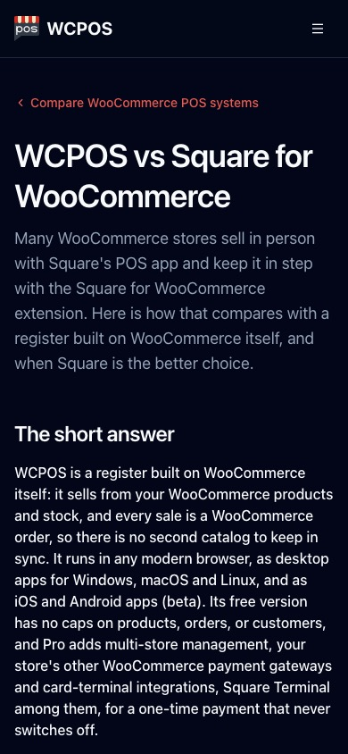 | 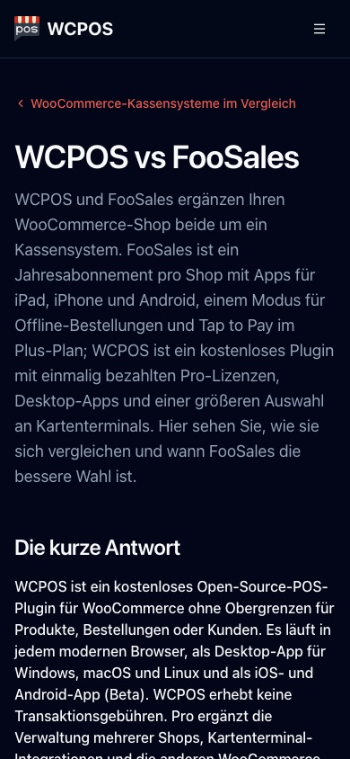 | 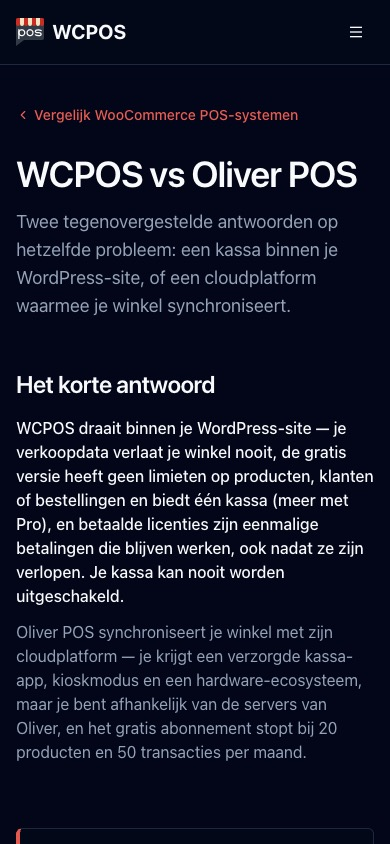 | 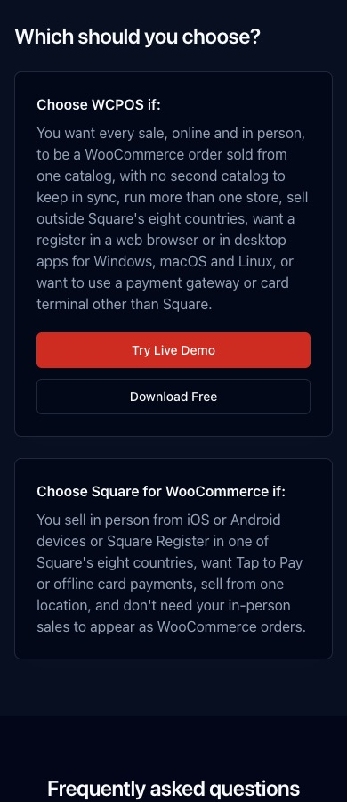 | 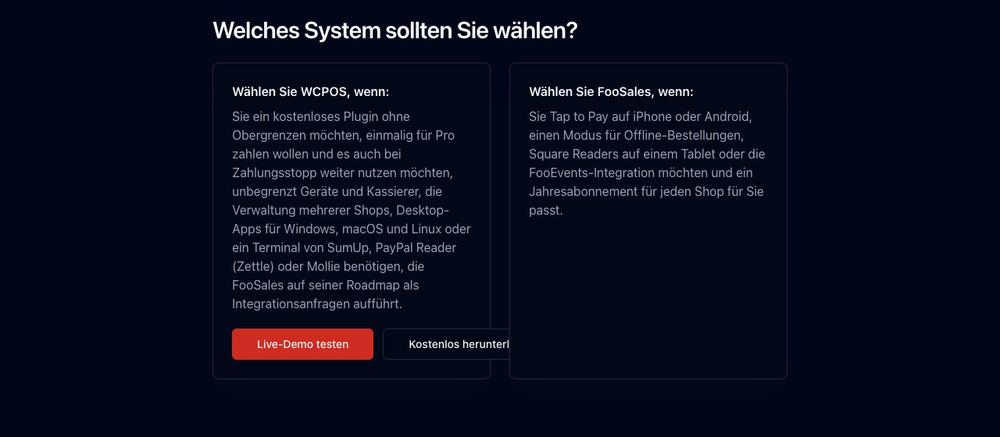 | 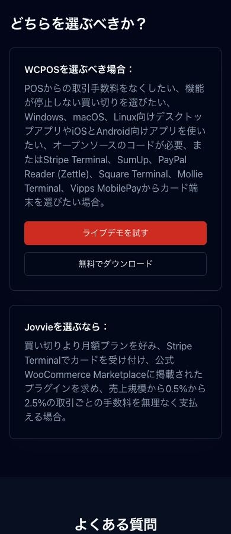 |

## Deferred

These carry over to round 29 as candidates:

- The /downloads warning to sync before upgrading is buried (fourth
  round).
- /support on phone: a blank Discord embed and no direct Discord button
  (third round).
- The /pro `SoftwareApplication` drift: Web, `softwareRequirements`
  (third round).
- The home hardware panel names printers and scanners but links nowhere.
- The /downloads Web step links only to the public demo.
- /downloads mobile LCP 3.0 s.
- The de /pro purchase card mixes "Sie" and "du".
- Oliver, WooCommerce and Jovvie have no Sources list.
- Front-desk holds, unchanged: the offline qualifier (including the
  comparison pages' "cash only offline" bullets), /pro multi-store, the
  Compare nav, the home title, the Square price line, the /pro H1 and the
  /pro Yearly wrap.
