# wcpos.com hill climb, round 29 (2026-11-19)

This round re-judges the live site after round 28's fixes (#821 to #823,
all live). It then records the fixes chosen from the result.

- Captures: [`2026-11-19-round-29/shots/`](2026-11-19-round-29/shots/) holds
  the fold shots. The full-page shots stay local. Visible text is in `text/`,
  page facts are in `facts.json` and Lighthouse results in `lighthouse.json`.
- Judges: [`2026-11-19-round-29/judges/`](2026-11-19-round-29/judges/). The
  personas and the brief are the same as in round 28: four Opus 5.5 pool
  one-shots, with Codex GPT-6 Astra as the sceptic. The judges were not told
  what changed.

| Page | Desktop | Phone |
|---|---|---|
| Home | 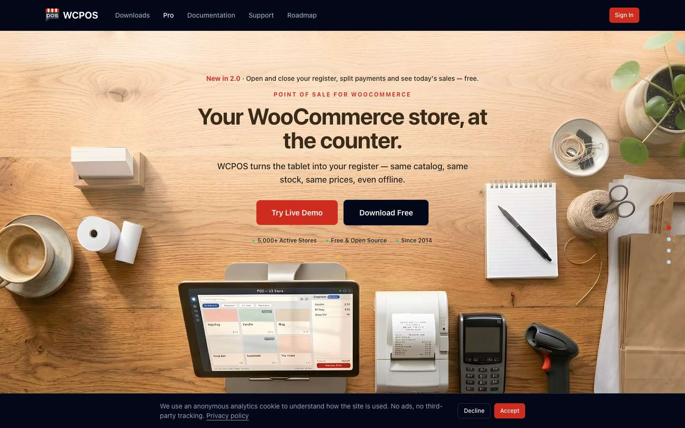 | 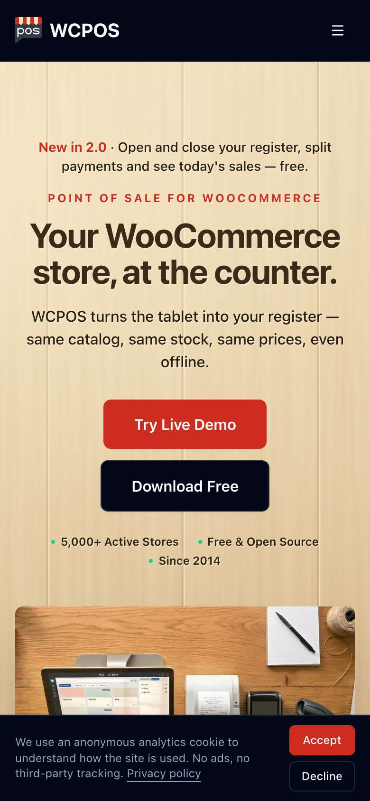 |
| /pro | 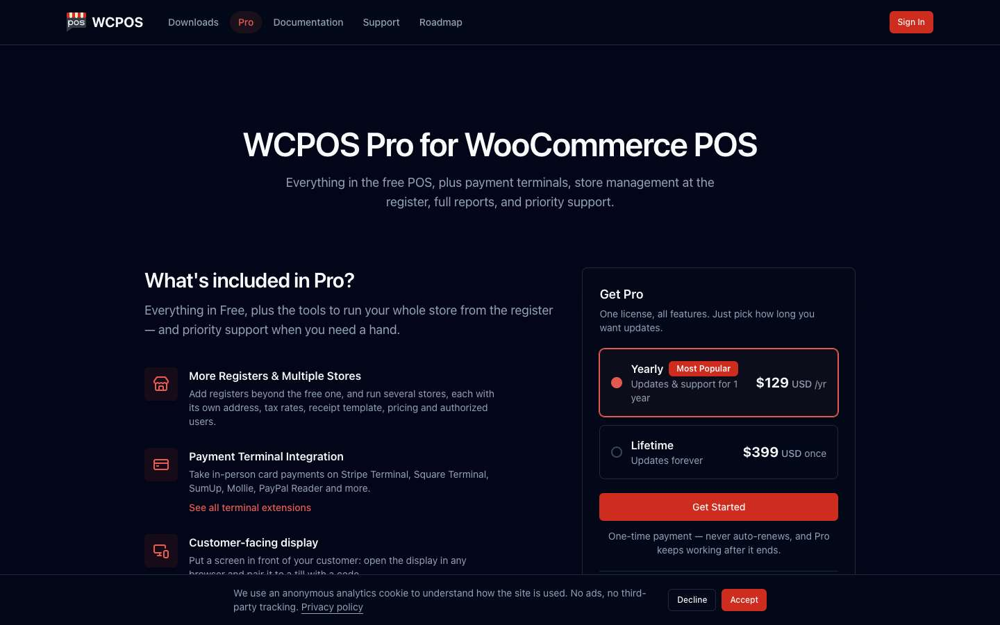 | 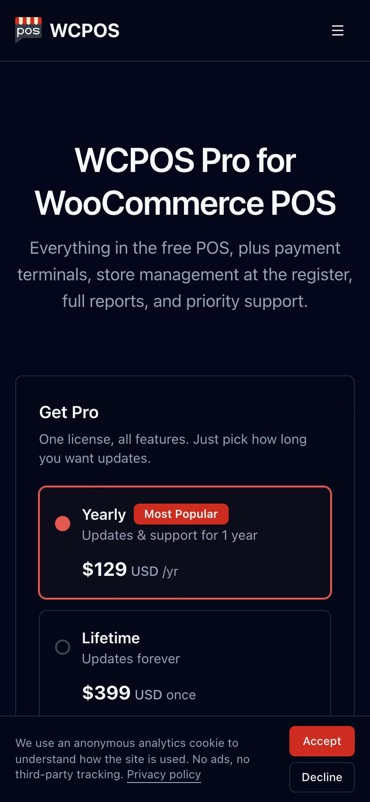 |
| /downloads | 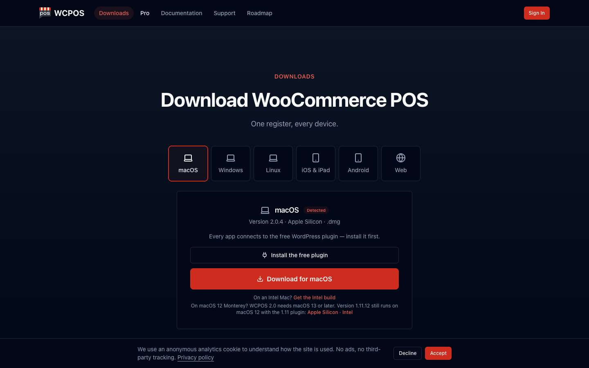 | 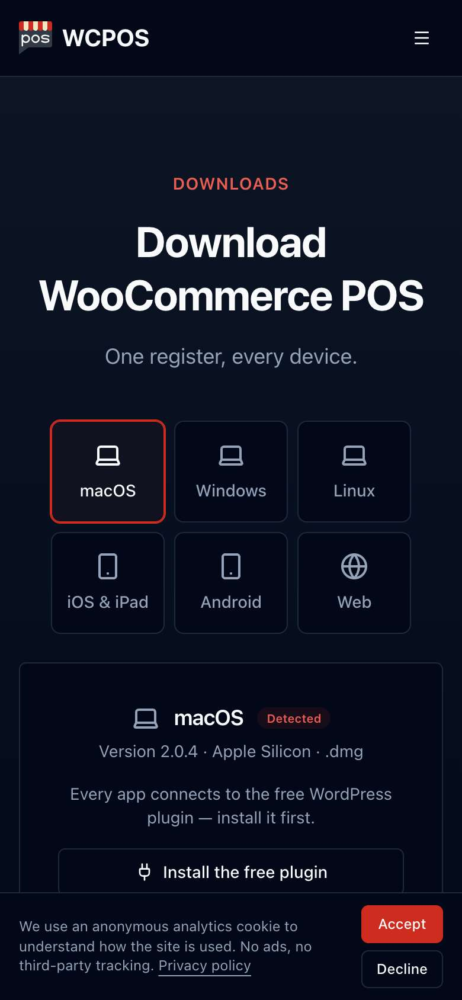 |
| /support | 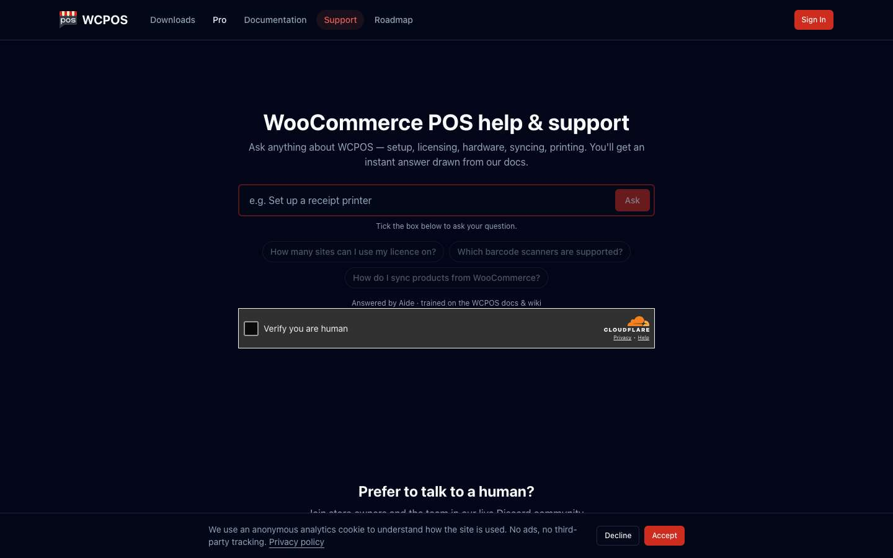 | 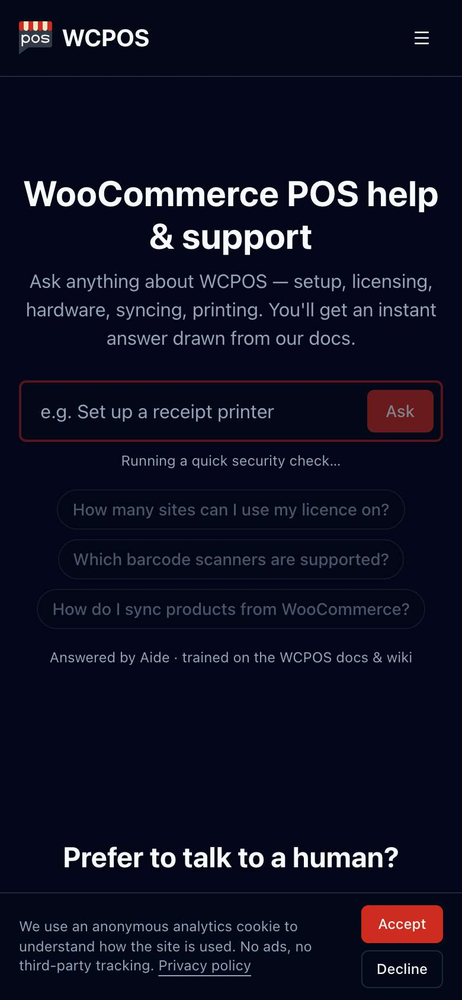 |

## 10-second test

All five judges answered both questions from the home fold. WCPOS is a free,
open-source WooCommerce POS that turns a tablet into the register, selling
from the store's own catalog, stock and prices. The "New in 2.0" line
answers why v2: opening and closing the register, split payments and
today's sales are now free. The designer noted that this line is the
smallest text on the fold, but it answers the question.

## Scores

| Judge | Marketing | UI | SEO |
|---|---|---|---|
| shop-owner (Opus) | 8 | 8 | 8 |
| woo-dev (Opus) | 7 | 8 | 8 |
| designer (Opus) | 7 | 7 | 8 |
| seo (Opus) | 8 | 8 | 8 |
| sceptic (Astra) | 7 | 8 | 9 |
| **Mean** | **7.4** | **7.8** | **8.2** |
| Round 28 | 7.4 | 7.8 | 8.2 |
| **Delta** | **0** | **0** | **0** |

The overall mean is 7.80 (0). Every judge gave the same scores as in round
28. Nothing is reverted: no judge named a round-28 change as a defect, and
the woo-dev judge noted that the /support Discord embed now renders on
phone.

## Lighthouse (live, light theme)

| Page | Mobile perf | Desktop perf | A11y / BP / SEO | Mobile LCP |
|---|---|---|---|---|
| / | 91 | 100 | 100 | 3.3 s |
| /pro | 100 | 100 | 100 | 1.7 s |
| /compare | 100 | 100 | 100 | 1.4 s |
| /downloads | 94 | 100 | 100 | 3.0 s |
| /de | 92 | 100 | 100 | 3.3 s |

## Worst defects

**Marketing**

- /downloads: the only warning that upgrading from 1.11 can lose unsent
  sales sits in the 2.0.0 release notes, about 2,700 px below the download
  buttons (seo; woo-dev under UI; fifth round).
- /extensions: the payment terminals come in alphabetical order, so Square
  and Stripe are fifth and sixth (designer).
- The home "Bring your own hardware" panel names printers and scanners but
  links nowhere (woo-dev; third round).
- The /compare disclosure says "the makers of WooCommerce POS" (shop-owner).
  The front desk has ruled that this wording stays.
- The home offline promise has no payment qualifier (sceptic). This is the
  offline wording, a front-desk hold.

**UI**

- /pro on phone: about 85 px of empty space above the H1 and about 70 px
  before the buy box, so "Get Started" is below the first screen (seo,
  shop-owner).
- /support: no first-party button that opens Discord; the only way in is
  the embedded widget (designer; fourth round).
- /downloads: the Web step links only to the public demo, not to how to open
  the register for the buyer's own store (sceptic).

**SEO**

- The /pro `SoftwareApplication` lists no Web, while the home and /downloads
  markup does, and it has no `softwareRequirements` (seo, shop-owner,
  woo-dev; fourth round).
- The de home meta description dropped "Open Source" and "2.0" when it was
  trimmed to 160 characters (designer).
- The home title has neither "free" nor "plugin" (sceptic). This is a
  front-desk hold.

## Fixes this round

Three defects were fixed, one per track. Each one was a written spec,
implemented by an Opus 5.5 pool one-shot (route: opus). This machine
reviewed the full diff and reran the acceptance commands and mutations.

| Track | Defect | PR | Merge |
|---|---|---|---|
| Marketing | The sync-before-upgrading warning is buried on /downloads | [#827](https://github.com/wcpos/wcpos-com/pull/827) | e9034cc |
| UI | /pro phone hero padding | [#826](https://github.com/wcpos/wcpos-com/pull/826) | 39b7549 |
| SEO | The /pro `SoftwareApplication` lists no Web | [#825](https://github.com/wcpos/wcpos-com/pull/825) | 9c0aca1 |

- **#827:**
  - The download card has one new line under the platform button, on
    every platform: "Upgrading from 1.11? Sync every register first: 2.0
    starts a new local database and does not carry over unsent sales."
    It repeats a fact the release notes already state.
  - All ten locales have it. Each one uses the word for "register" from
    its own tagline.
  - The key sits under `downloads.hero`, which the client messages
    already include. The real-provider messages test passes unchanged in
    all ten locales.
  - Mutations, each failing its test:
    - the key deleted from de: the key-parity test fails, and so does the
      raw-key test for de;
    - the note moved above the plugin button: the order test fails.
- **#826:**
  - The /pro hero uses `spacing="none"` with explicit padding: 40/24 px on
    phone (was 80/32). From `sm` up the padding is exactly as before.
  - The buy-box section's phone top padding is 16 px (was 32).
  - Mutations, each failing its test:
    - `spacing="hero"` put back;
    - the buy box set back to `pt-8`.
- **#825:**
  - `WCPOS_OPERATING_SYSTEM` in `src/lib/software-application-json-ld.ts`
    is now used by the home, /downloads and /pro markup, so /pro lists Web.
  - `softwareRequirements` stays off /pro. The site states minimum
    versions only for the free plugin, so adding them to Pro would be a
    new claim. This is left as a question for the owner.
  - Mutations, each failing its test:
    - the old hard-coded string put back on /pro;
    - `softwareRequirements` added to /pro.

## After (live, 2026-11-19)

The checks were run in headless Chromium against wcpos.com after the
e9034cc deploy, each page in a fresh browser context.

- /pro at 390 × 844 (en, de, nl):
  - header to H1 is 40 px (was about 85);
  - the hero padding is 40/24 px, and the buy-box section's top padding is
    16 px;
  - "Get Started" is on the first screen at 716 px in en, and "Aan de
    slag" at 761 px in nl. In de, "Loslegen" starts at 789 px, at the
    bottom edge;
  - no page overflows.
- /pro at 1440 × 900 is unchanged: 112/40 px hero padding.
- /downloads: the upgrade note shows in the card in en, de and ja on phone
  and in nl on desktop. No raw keys and no overflow.
- /pro JSON-LD: `"operatingSystem":"Windows, macOS, Linux, iOS, Android, Web"`.

| /pro, en phone | /pro, de phone | /pro, en desktop | /downloads card, en phone | /downloads card, de phone | /downloads card, nl desktop |
|---|---|---|---|---|---|
| 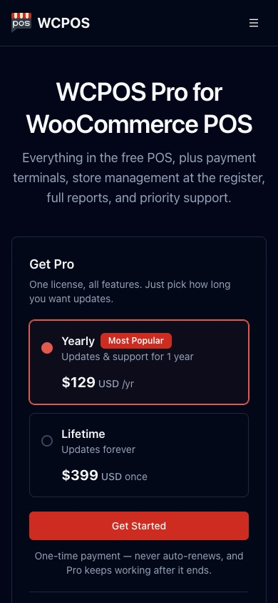 | 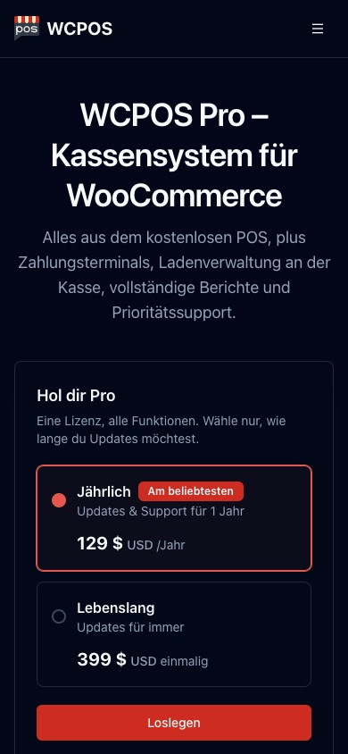 | 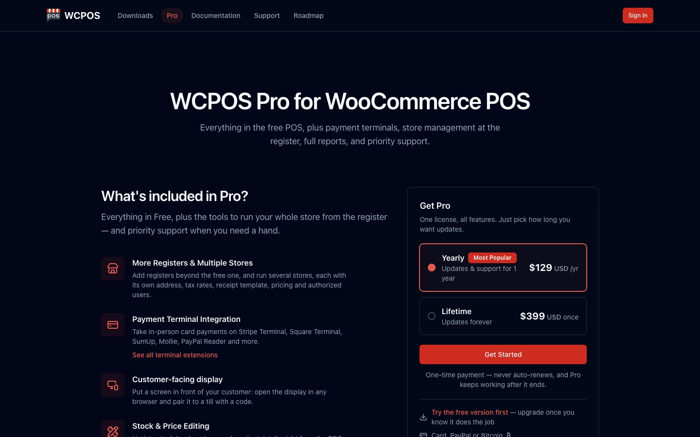 | 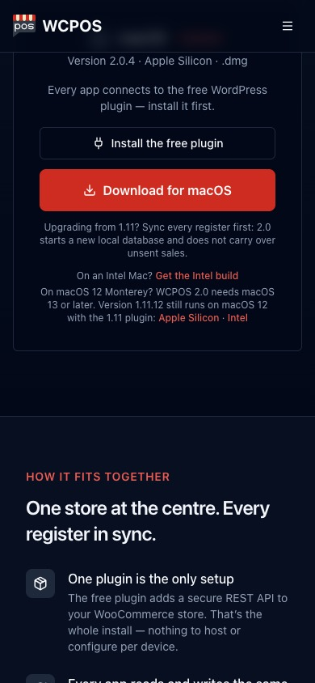 | 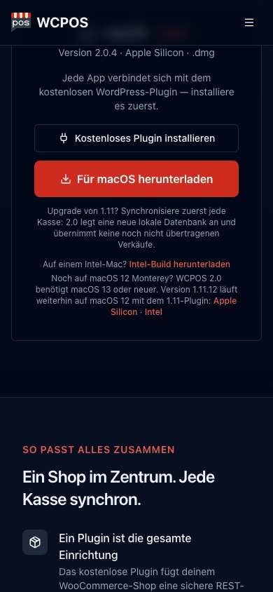 | 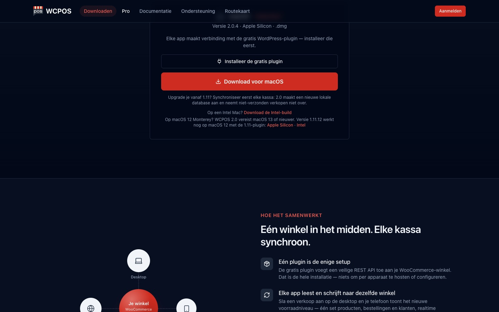 |

## Deferred

These carry over to round 30 as candidates:

- /support on phone: no direct Discord button (fourth round).
- /extensions: Square and Stripe terminals sit below regional brands.
- The de home meta description dropped "Open Source" and "2.0".
- The home hardware panel names printers and scanners but links nowhere.
- The /downloads Web step links only to the public demo.
- /downloads mobile LCP 3.0 s.
- The de /pro purchase card mixes "Sie" and "du".
- Oliver, WooCommerce and Jovvie have no Sources list.
- Owner question: should /pro's `softwareRequirements` state Pro's own
  minimum versions?
- Front-desk holds, unchanged: the offline qualifier (including the
  comparison pages' "cash only offline" bullets), /pro multi-store, the
  Compare nav, the home title, the Square price line, the /pro H1, the
  /pro Yearly wrap, and the /compare "makers of WooCommerce POS" disclosure.
