# wcpos.com hill climb, round 30 (2026-11-19)

This round re-judges the live site after round 29's fixes (#825 to #827,
all live). It then records the fixes chosen from the result.

- Captures: [`2026-11-19-round-30/shots/`](2026-11-19-round-30/shots/) holds
  the fold shots. The full-page shots stay local. Visible text is in `text/`,
  page facts are in `facts.json` and Lighthouse results in `lighthouse.json`.
- Judges: [`2026-11-19-round-30/judges/`](2026-11-19-round-30/judges/). The
  personas and the brief are the same as in round 29: four Opus 5.5 pool
  one-shots, with Codex GPT-6 Astra as the sceptic. The judges were not told
  what changed.

| Page | Desktop | Phone |
|---|---|---|
| Home | 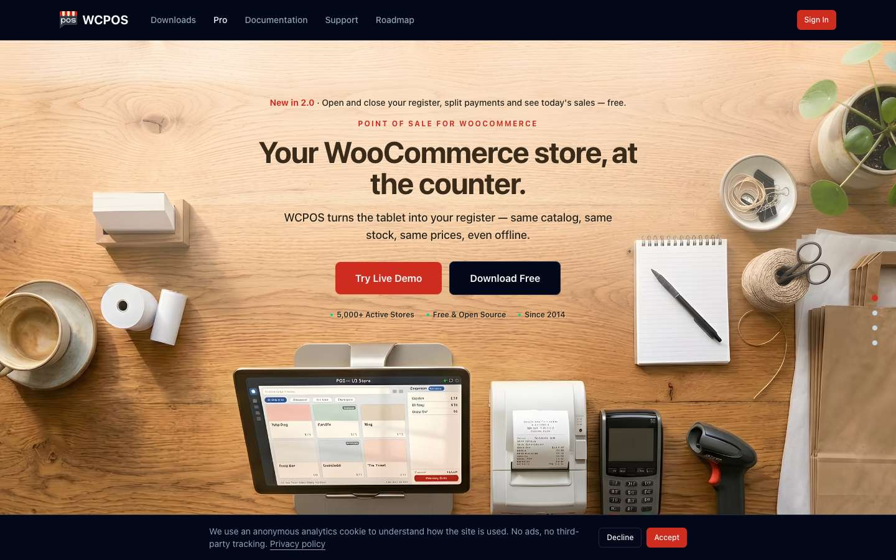 | 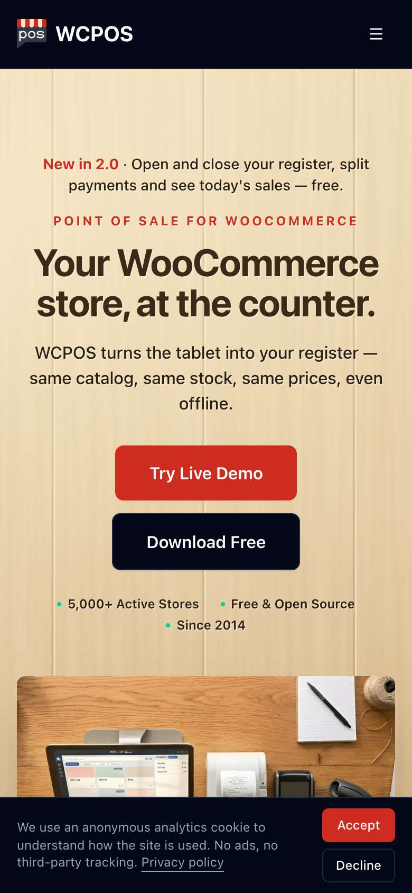 |
| /pro | 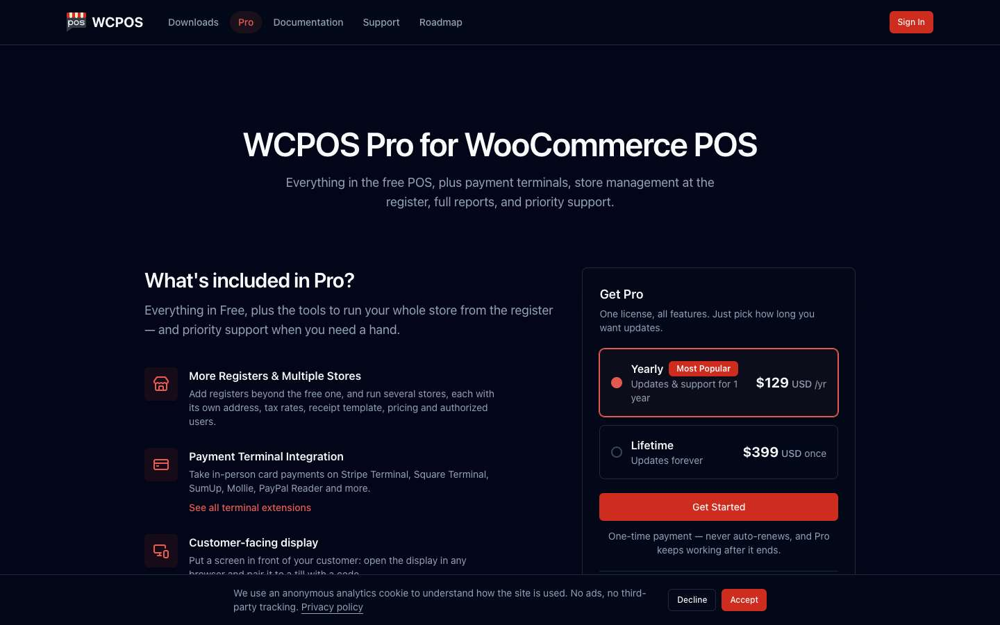 | 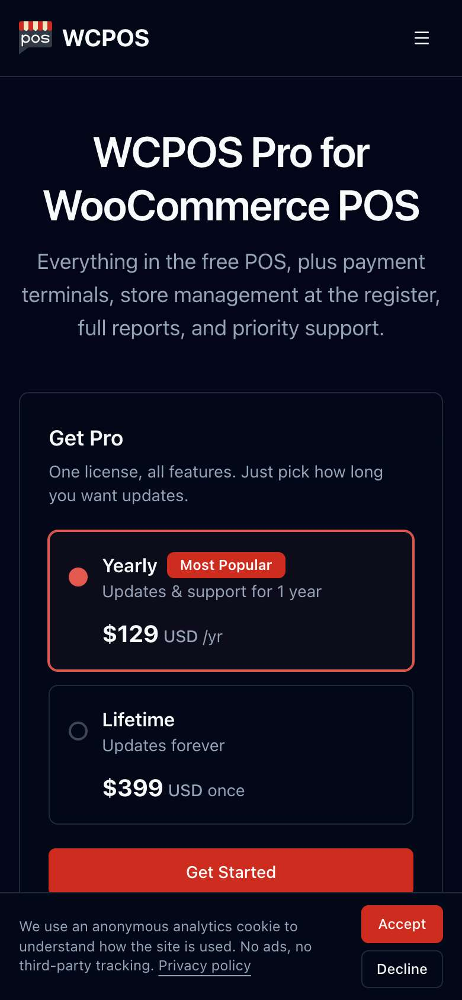 |
| /downloads | 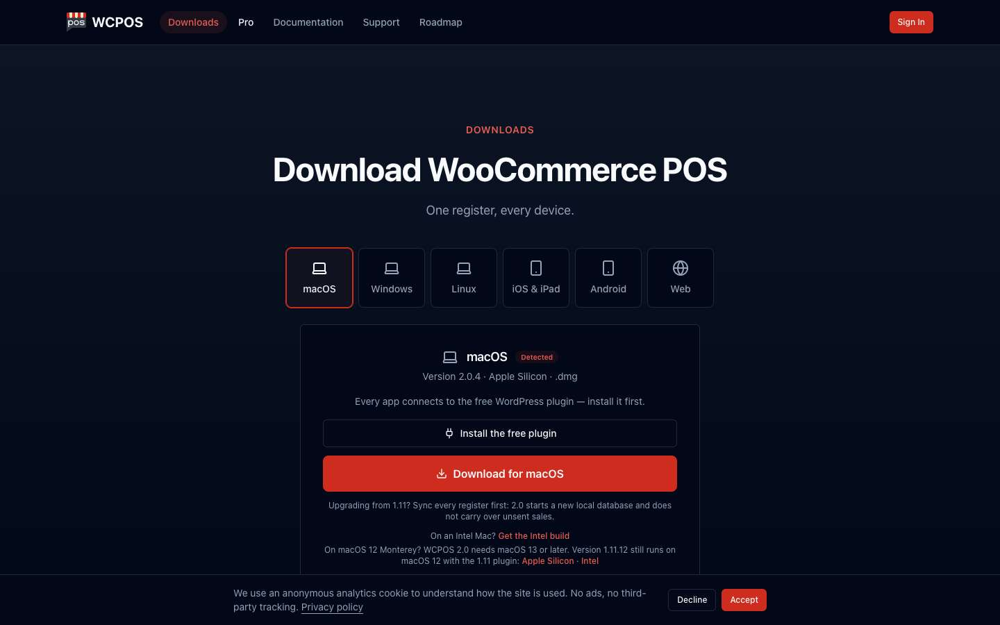 | 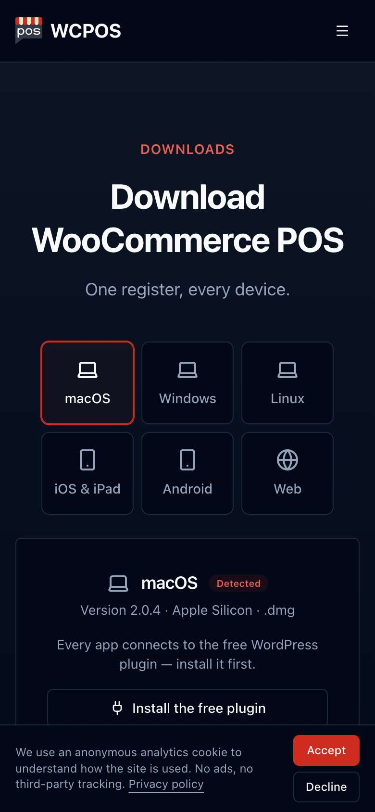 |
| /support | 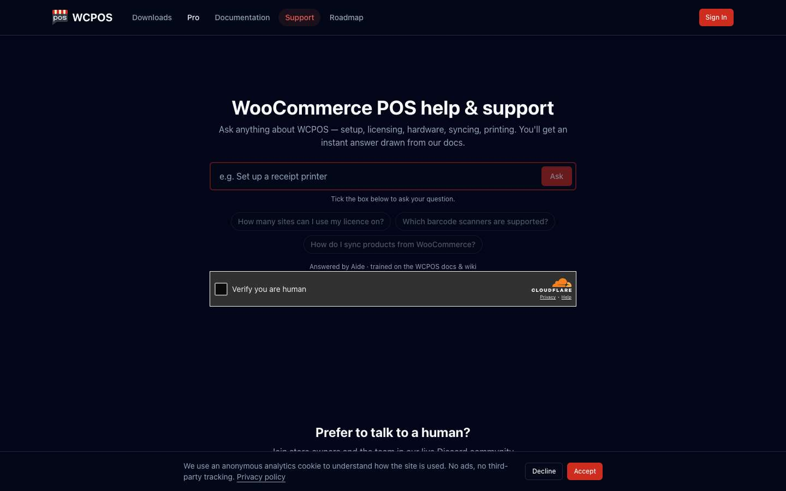 | 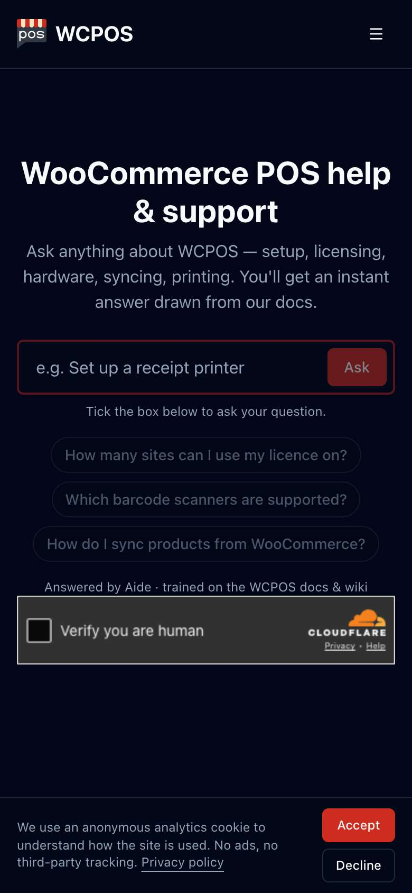 |

## 10-second test

All five judges answered both questions from the home fold. WCPOS is a free,
open-source WooCommerce register that sells from the store's own catalog,
stock and prices. Version 2 makes opening and closing the register, split
payments and today's sales report free.

## Scores

| Judge | Marketing | UI | SEO |
|---|---|---|---|
| shop-owner (Opus) | 8 | 8 | 8 |
| woo-dev (Opus) | 7 | 8 | 8 |
| designer (Opus) | 7 | 7 | 8 |
| seo (Opus) | 8 | 8 | 8 |
| sceptic (Astra) | 7 | 8 | 9 |
| **Mean** | **7.4** | **7.8** | **8.2** |
| Round 29 | 7.4 | 7.8 | 8.2 |
| **Delta** | **0** | **0** | **0** |

The overall mean is 7.80 (0). Every judge gave the same scores as in round
29, so nothing is reverted.

Two judges touched round-29 changes:
- The sceptic's UI defect is the new /downloads upgrade note (#827). The
  sceptic wants it above the download button and at body size. The note
  stays: it did not lower any score.
- /downloads mobile performance read 87 in the capture pass. Three reruns
  on the live page gave 94, 94 and 99 (LCP 3.0, 3.0 and 1.8 s), so the 87
  was run-to-run noise on a busy machine, not #827. The shop-owner judge
  reached the same view from the trend.

## Lighthouse (live, light theme, capture pass)

| Page | Mobile perf | Desktop perf | A11y / BP / SEO | Mobile LCP |
|---|---|---|---|---|
| / | 93 | 100 | 100 | 3.2 s |
| /pro | 99 | 100 | 100 | 2.1 s |
| /compare | 99 | 100 | 100 | 2.0 s |
| /downloads | 87 (reruns 94, 94, 99) | 100 | 100 | 3.4 s |
| /de | 92 | 100 | 100 | 3.3 s |

## Worst defects

**Marketing**

- /extensions: the payment terminals come in alphabetical order, so Square
  and Stripe are fifth and sixth (designer; the seo and shop-owner judges
  as runner-up).
- The home "Bring your own hardware" panel names printers and scanners but
  links nowhere (woo-dev; fourth round).
- /pro buy box: no customer quote next to the price (seo).
- /downloads: the only Web action is the public demo; nothing says how to
  open the register on the buyer's own store (shop-owner; second round).
- The home offline line has no payment qualifier (sceptic). This is the
  offline wording, a front-desk hold.

**UI**

- /support: no first-party button that opens Discord; while the embed
  loads, or when it is blocked, the section is a grey box (designer,
  woo-dev; fifth round).
- /downloads and /support on phone: about 85 px of empty band above the
  eyebrow, so the download button and the upgrade note fall below the
  first screen (seo).
- /extensions on phone: the hero still uses `spacing="hero"`, so no
  terminal card is fully on the first screen (shop-owner).
- /downloads: the upgrade note is small muted text under the button
  (sceptic).

**SEO**

- The de, fr and pt home meta descriptions dropped "2.0", and de and fr
  also dropped "open source" (designer, woo-dev, seo, shop-owner).
- The de /pro description drops reports (woo-dev).
- /downloads Lighthouse mobile 87 (sceptic). The reruns above put it at
  94 to 99.

## Fixes this round

Three defects were fixed, one per track. Each one was a written spec,
implemented by an Opus 5.5 pool one-shot (route: opus). This machine
reviewed the full diff and reran the acceptance commands and mutations.

| Track | Defect | PR | Merge |
|---|---|---|---|
| Marketing | Stripe and Square sit fifth and sixth on /extensions | [#830](https://github.com/wcpos/wcpos-com/pull/830) | 82c19a6 |
| UI | /support has no Discord button | [#831](https://github.com/wcpos/wcpos-com/pull/831) | d0fabb4 |
| SEO | de, fr and pt home descriptions lack open source and 2.0 | [#829](https://github.com/wcpos/wcpos-com/pull/829) | 9a719db |

- **#830:**
  - `PAYMENTS_FIRST` in the /extensions page lists Stripe, then Square.
    This is the order the page's meta description already uses. The other
    terminals keep catalog order, and the two non-terminal gateways stay
    last. The JSON-LD ItemList is unchanged.
  - Mutations, each failing its test:
    - the two slugs swapped: 2 tests fail;
    - the first entries put after the middle ones: 3 tests fail.
- **#831:**
  - An outline "Open Discord" button under the /support Discord subtitle
    opens the existing invite (`DISCORD_INVITE_URL`, the one the footer
    uses) in a new tab. The widget and its lazy mount are unchanged.
  - New key `support.discord.open` in ten locales. The support page
    already passes the whole `support` namespace to the client; a test per
    locale renders the section with the real provider and the picked
    client messages.
  - Mutations, each failing its test:
    - the key deleted from de: the de locale test fails;
    - the href hard-coded to another URL: the link test fails.
- **#829:**
  - The de, fr and pt `home.meta.description` values now say open source
    and "free in 2.0", with each locale's existing offline wording.
  - The first de and fr strings (164 and 168 characters) failed CI on the
    existing 160-character test; my spec's test filter had missed it. A
    second commit from a corrective spec shortened them to 159.
  - Copy only, so there is no mutation; the length test and the parity
    test pass.

## After (live, 2026-11-19)

The checks were run in headless Chromium against wcpos.com after the
9a719db deploy, each page in a fresh browser context.

- /extensions (en phone, de desktop): the payments group opens with Stripe
  Terminal, Square Terminal, then Mercado Pago; Email Invoice Gateway and
  WCPOS Vipps MobilePay stay last; 10 entries; no overflow.
- /support (en and de phone, ja and en desktop): the button reads "Open
  Discord", "Discord öffnen" and "Discordを開く", links to
  `https://discord.gg/GCEeEVpEvX` with `rel="noopener noreferrer"`. No raw
  keys, no overflow.
- Home meta descriptions:
  - /de (159): "Kostenlose Open-Source-WooCommerce-Kasse. Verkaufe offline,
    teile Zahlungen auf, öffne und schließe die Kasse, gratis in 2.0.
    Web/Desktop; iOS/Android in Beta."
  - /fr (159): "Caisse WooCommerce gratuite, open source. Vendez hors
    ligne, divisez les paiements, ouvrez et fermez la caisse, gratuit en
    2.0. Web, bureau ; iOS/Android bêta."
  - /pt (158): "POS gratuito e open source para WooCommerce. Venda offline,
    divida pagamentos, abra e feche a caixa, grátis no 2.0. Apps web e
    desktop; iOS e Android em beta."

| /extensions, en phone | /extensions, de desktop | /support, en phone | /support, de phone | /support, en desktop |
|---|---|---|---|---|
| 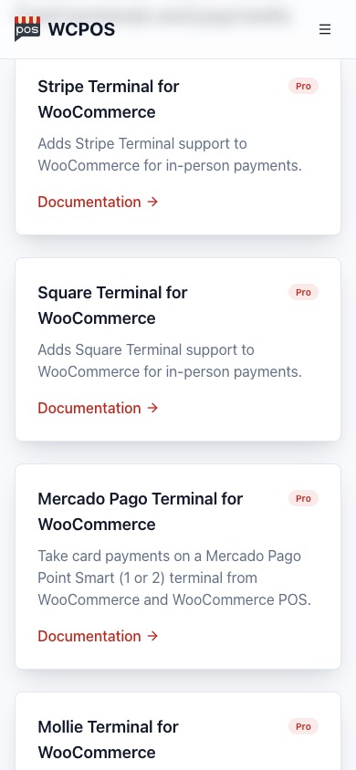 | 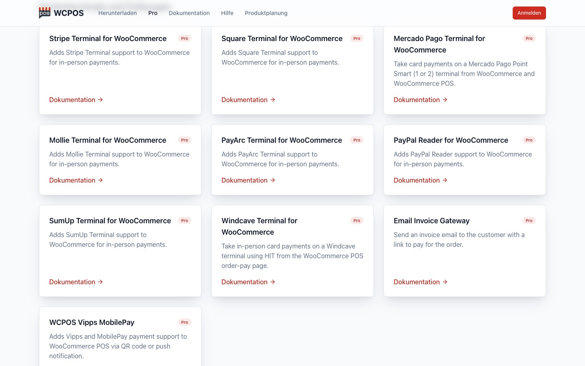 | 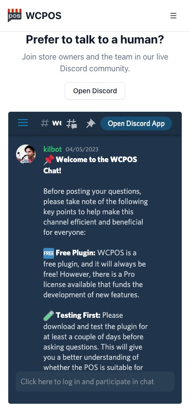 | 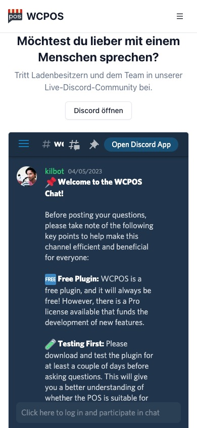 | 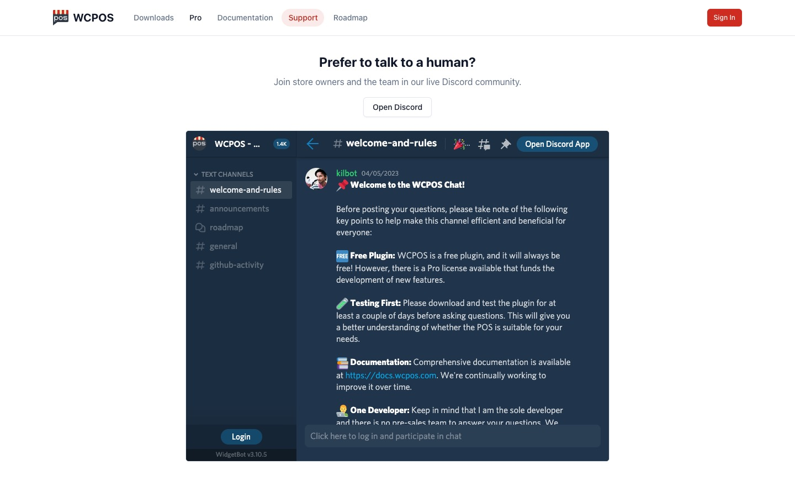 |

## Deferred

These carry over to round 31 as candidates:

- /downloads and /support phone hero: about 85 px of empty band above the
  eyebrow (the /pro #826 padding pattern would apply).
- /extensions phone hero padding.
- /downloads: the Web step links only to the public demo; a line pointing
  to the existing setup guide.
- /downloads upgrade note prominence (sceptic).
- The home hardware panel names printers and scanners but links nowhere.
- The de /pro description drops reports.
- /compare/square on phone: the first button is about 7,500 px down.
- Home testimonial cards on phone carry a near-empty icon band.
- Owner question (from round 29): should /pro's `softwareRequirements`
  state Pro's own minimum versions?
- Front-desk holds, unchanged: the offline qualifier (including the
  comparison pages' "cash only offline" bullets), /pro multi-store, the
  Compare nav, the home title, the Square price line, the /pro H1, the
  /pro Yearly wrap, and the /compare "makers of WooCommerce POS" disclosure.
