# wcpos.com hill climb, round 31 (2026-11-19)

This round re-judges the live site after round 30's fixes (#829 to #831,
all live). It then records the fixes chosen from the result.

- Captures: [`2026-11-19-round-31/shots/`](2026-11-19-round-31/shots/) holds
  the fold shots. The full-page shots stay local. Visible text is in `text/`,
  page facts are in `facts.json` and Lighthouse results in `lighthouse.json`.
- Judges: [`2026-11-19-round-31/judges/`](2026-11-19-round-31/judges/). The
  personas and the brief are the same as in round 30: four Opus 5.5 pool
  one-shots, with Codex GPT-6 Astra as the sceptic. The judges were not told
  what changed.

| Page | Desktop | Phone |
|---|---|---|
| Home | 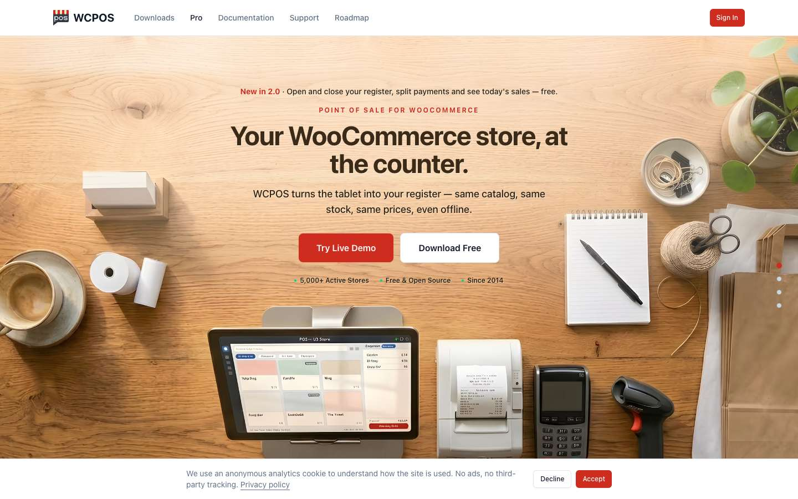 |  |
| /downloads | 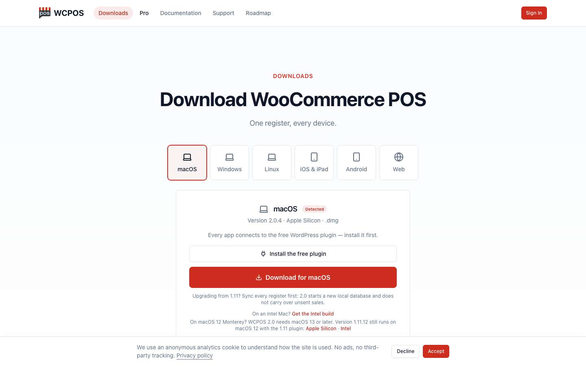 | 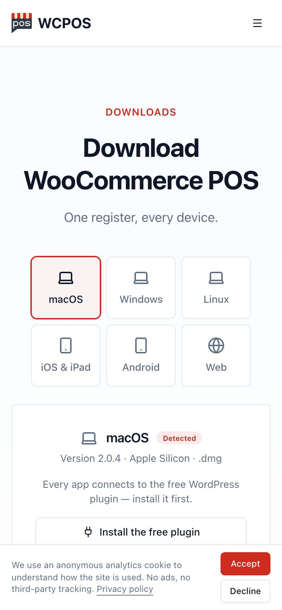 |
| /compare/square | 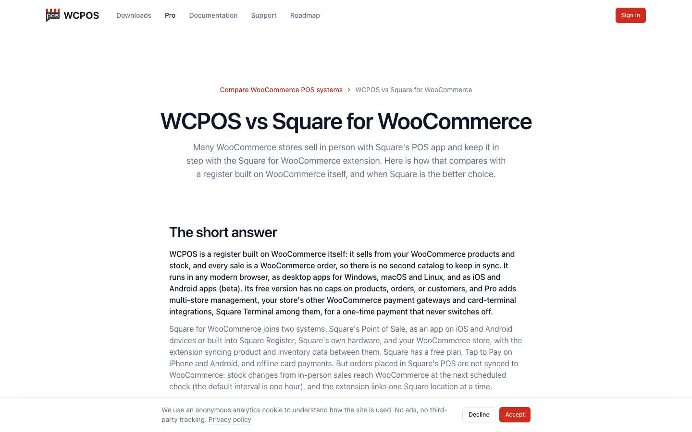 | 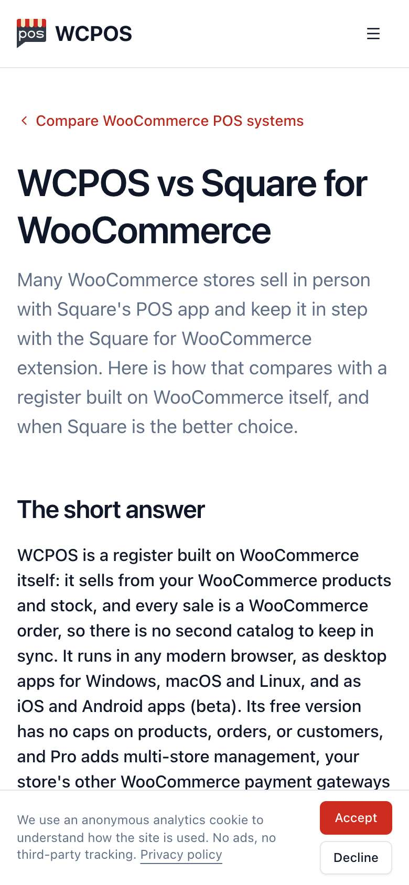 |
| /extensions | 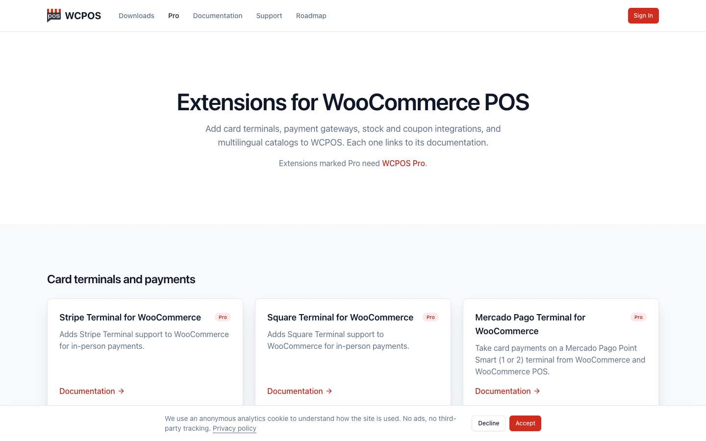 | 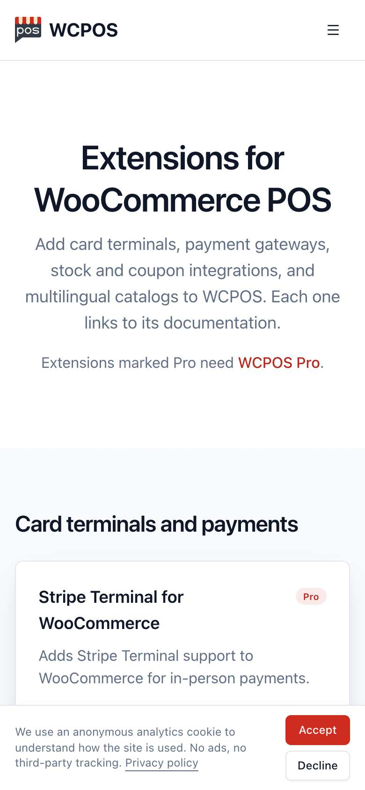 |

## 10-second test

All five judges answered both questions from the home fold. WCPOS is a free,
open-source WooCommerce register that sells from the store's own catalog,
stock and prices. The "New in 2.0" line says why v2 matters: opening and
closing the register, split payments and today's sales are now free.

## Scores

| Judge | Marketing | UI | SEO |
|---|---|---|---|
| shop-owner (Opus) | 8 | 8 | 8 |
| woo-dev (Opus) | 7 | 8 | 8 |
| designer (Opus) | 7 | 7 | 8 |
| seo (Opus) | 8 | 8 | 8 |
| sceptic (Astra) | 7 | 8 | 8 |
| **Mean** | **7.4** | **7.8** | **8.0** |
| Round 30 | 7.4 | 7.8 | 8.2 |
| **Delta** | **0** | **0** | **−0.2** |

The overall mean is 7.73 (−0.07). The only change is the sceptic's SEO
score, 9 to 8. The sceptic's stated reason is the /downloads mobile
Lighthouse score of 82 in the capture pass. No judge named a round-30 change
(#829 to #831) as a defect, so nothing is reverted.

The 82 is noise, not a regression:
- Three reruns on the live page gave 94, 99 and 83 (LCP 3.0, 2.0 and
  3.0 s), with the machine's load average at 19.
- Round 30's three reruns gave 94, 94 and 99.
- The page's code has not changed since round 29.

## Lighthouse (live, light theme, capture pass)

| Page | Mobile perf | Desktop perf | A11y / BP / SEO | Mobile LCP |
|---|---|---|---|---|
| / | 91 | 100 | 100 | 3.3 s |
| /pro | 96 | 100 | 100 | 2.7 s |
| /compare | 97 | 100 | 100 | 2.6 s |
| /downloads | 82 (reruns 94, 99, 83) | 100 | 100 | 3.0 s |
| /de | 91 | 100 | 100 | 3.5 s |

## Worst defects

**Marketing**

- /compare/square on phone: the first button is about 8,000 px down, under
  "Which should you choose?" (shop-owner, designer).
- The home "Bring your own hardware" panel names printers and scanners but
  links nowhere (woo-dev; fifth round).
- /pro buy box: no customer quote next to the price (seo; second round).
- The home offline line has no payment qualifier (sceptic). This is the
  offline wording, a front-desk hold.

**UI**

- /downloads on phone: about 80 px of hero padding and an eyebrow that
  repeats the H1, so the download button starts at about 790 px, below the
  first screen (woo-dev, shop-owner, seo, designer; /support and
  /extensions have the same padding).
- /downloads: the Web step links only to the public demo (sceptic; the
  shop-owner and woo-dev judges as runner-up; third round).

**SEO**

- The de, fr and pt /pro meta descriptions leave out reports; the other
  seven locales end on them (designer, shop-owner, woo-dev; seo as
  runner-up).
- The es and it home meta descriptions lack "open source" (seo).
- /downloads Lighthouse mobile 82 (sceptic). The reruns above put it at 83
  to 99.

## Fixes this round

Three defects were fixed, one per track. Each one was a written spec,
implemented by an Opus 5.5 pool one-shot (route: opus). This machine
reviewed the full diff and reran the acceptance commands and mutations.

| Track | Defect | PR | Merge |
|---|---|---|---|
| Marketing | No button until about 8,000 px down on /compare/square on phone | [#835](https://github.com/wcpos/wcpos-com/pull/835) | 97dea5d |
| UI | /downloads phone hero pushes the download button off the first screen | [#834](https://github.com/wcpos/wcpos-com/pull/834) | 0707fa7 |
| SEO | de, fr and pt /pro descriptions leave out reports | [#833](https://github.com/wcpos/wcpos-com/pull/833) | 9287f00 |

- **#835:**
  - The existing `<CompareChooseActions />` pair ("Try Live Demo" /
    "Download Free") now also ends "The short answer" on all seven
    comparison pages. The WCPOS choose card keeps its pair. No new copy.
  - The first spec missed an existing test that asserted exactly one pair
    per page. The implementer stopped rather than edit a file outside its
    scope, and a two-line corrective spec changed that count to two.
  - Mutations, each failing its test:
    - the new line removed from the Jovvie page;
    - the Square line moved to after the short-answer section.
- **#834:**
  - Below `sm`, the /downloads hero uses 40/40 px padding (was 80/80; the
    /pro #826 pattern), hides the "Downloads" eyebrow that repeats the H1,
    and tightens the tile gap (`mt-6`) and card padding (`p-6`). From `sm`
    up the classes give exactly the old values.
  - Mutations, each failing its test:
    - `spacing="hero"` put back;
    - `max-sm:hidden` removed from the eyebrow.
- **#833:**
  - de, fr and pt `pro.metadata.description` now end on full reports
    (157, 159 and 153 characters).
  - Mutation: an over-long de value fails the 160-character test.

## After (live, 2026-11-19)

The checks were run in headless Chromium against wcpos.com after the
97dea5d deploy, each page in a fresh browser context.

- /downloads at 390 × 844, with the consent banner showing:
  - hero padding is 40/40 px and the eyebrow is hidden in en, de and nl;
  - en: "Download for macOS" spans 668 to 720 px, fully above the banner
    (753 px). It started at about 790 px before;
  - de and nl: the button spans 713 to 765 px, so its bottom 12 px sit
    under the banner until it is dismissed;
  - no overflow.
- /downloads at 1440 × 900 is unchanged: 112/112 px hero padding, eyebrow
  shown.
- /compare/* first "Try Live Demo" button:

  | Page | Viewport | First button | Page height |
  |---|---|---|---|
  | /compare/square | phone | 1,173 px (1.4 screens) | 13,779 px |
  | /de/compare/square | phone | 1,397 px (1.7 screens) | 15,723 px |
  | /compare/jovvie | phone | 1,060 px | 8,795 px |
  | /compare/yith-pos | desktop | 969 px | 7,430 px |

  /compare/square's first button was at about 8,000 px. No page overflows.
- The /de/pro, /fr/pro and /pt/pro meta descriptions carry the new values.

| /downloads, en phone | /downloads, de phone | /downloads, en desktop | /compare/square, en phone | /compare/square, de phone | /compare/yith-pos, en desktop |
|---|---|---|---|---|---|
| 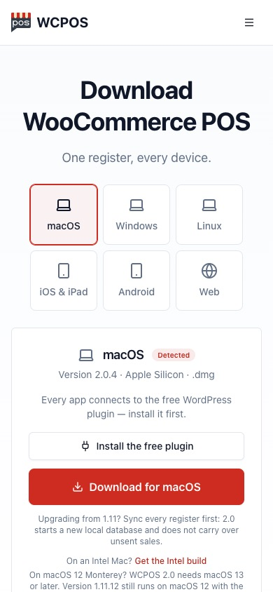 | 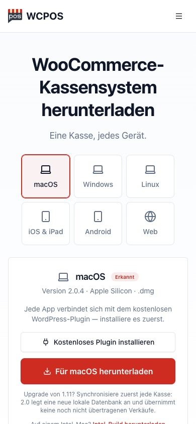 | 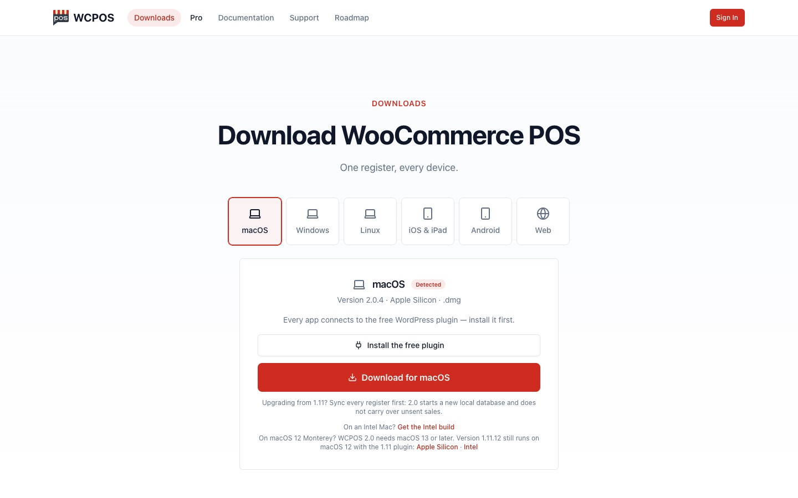 | 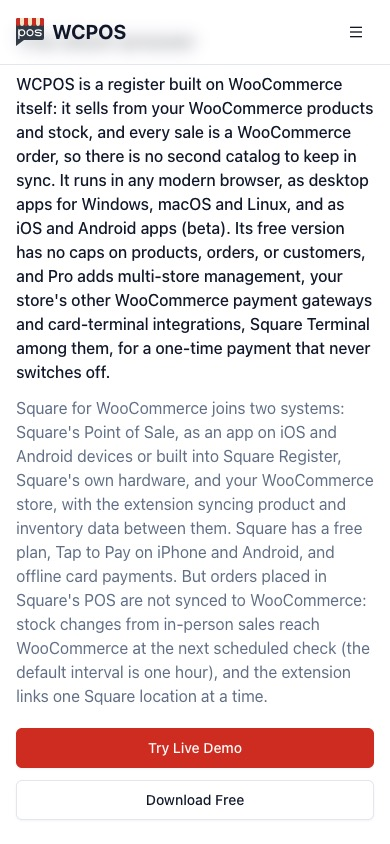 | 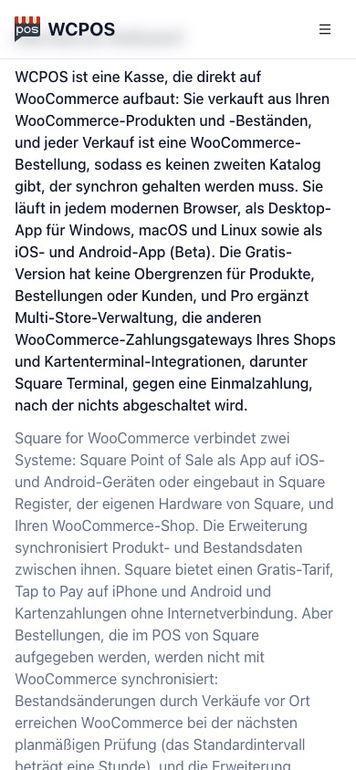 | 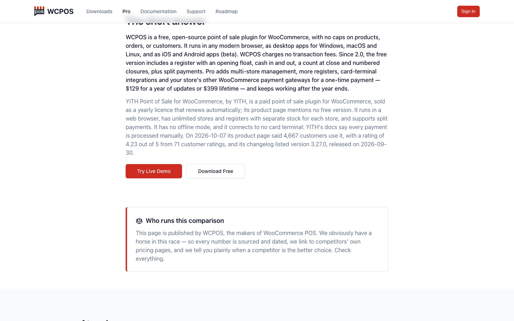 |

## Deferred

These carry over to round 32 as candidates:

- /support and /extensions phone heroes: the same 80 px padding that #834
  removed from /downloads.
- /downloads: the Web step links only to the public demo (third round).
- The home hardware panel names printers and scanners but links nowhere
  (fifth round).
- The es and it home meta descriptions lack "open source".
- Home review cards on phone open with a 112 px icon band each.
- The home hero says "5,000+ Active Stores", the stats band "5,000+ Active
  Installations".
- /pro buy box has no customer quote (a reused existing review only).
- Owner question (from round 29): should /pro's `softwareRequirements`
  state Pro's own minimum versions?
- Front-desk holds, unchanged: the offline qualifier (including the
  comparison pages' "cash only offline" bullets), /pro multi-store and the
  "2 sites" FAQ, the Compare nav, the home title, the Square price line,
  the /pro H1, the /pro Yearly wrap, and the /compare "makers of
  WooCommerce POS" disclosure.
