# wcpos.com hill climb, round 32 (2026-11-19)

This round re-judges the live site after round 31's fixes (#833 to #835,
all live). It then records the fixes chosen from the result.

- Captures: [`2026-11-19-round-32/shots/`](2026-11-19-round-32/shots/) holds
  the fold shots. The full-page shots stay local. Visible text is in `text/`,
  page facts are in `facts.json` and Lighthouse results in `lighthouse.json`.
- Judges: [`2026-11-19-round-32/judges/`](2026-11-19-round-32/judges/). The
  personas and the brief are the same as in round 31: four Opus 5.5 pool
  one-shots, with Codex GPT-6 Astra as the sceptic. The judges were not told
  what changed.

| Page | Desktop | Phone |
|---|---|---|
| Home | 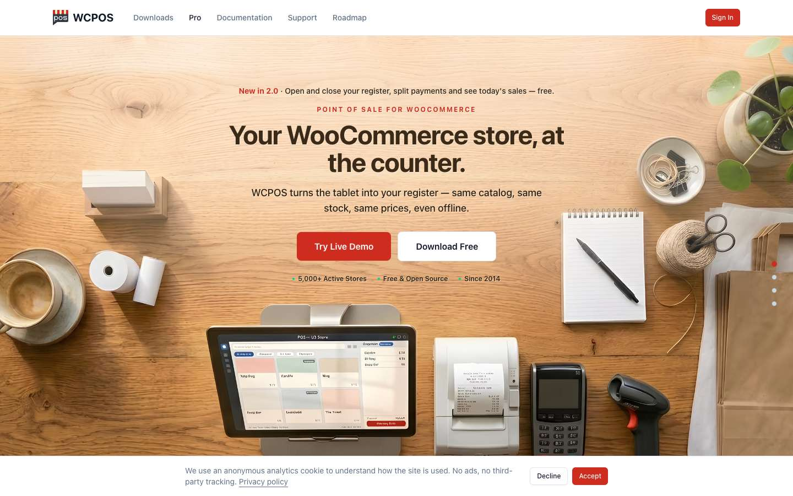 |  |
| /compare | 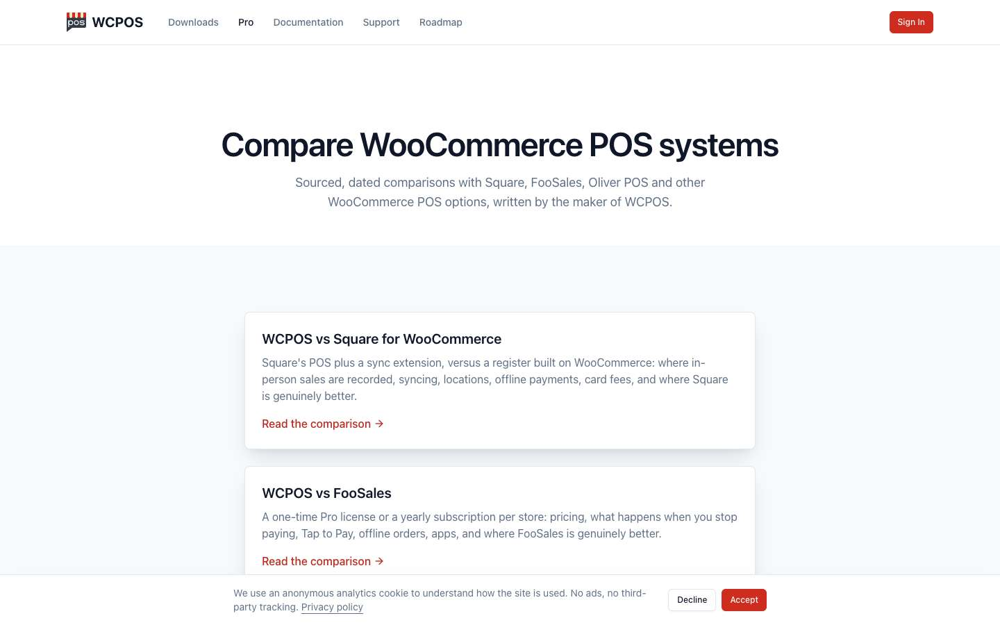 | 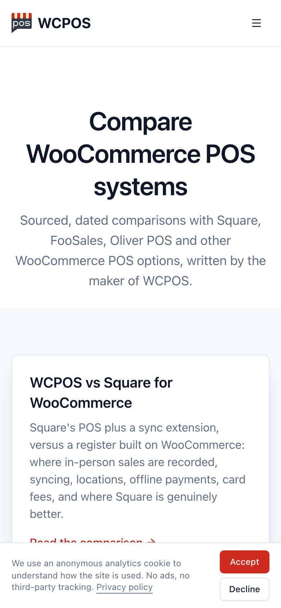 |
| /extensions | 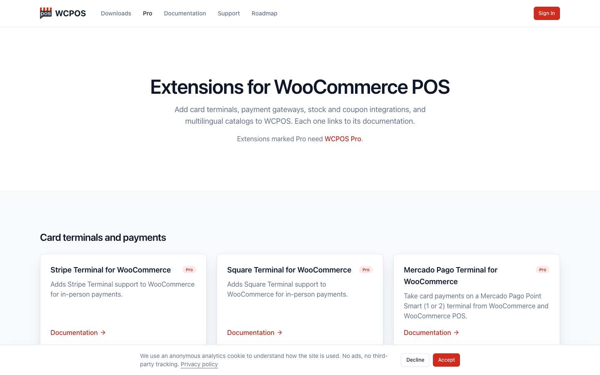 | 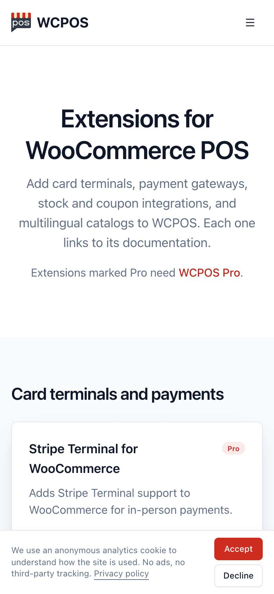 |
| /support | 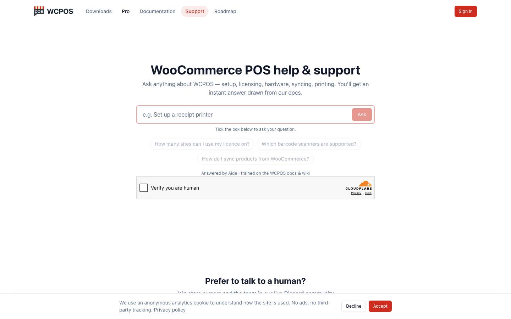 | 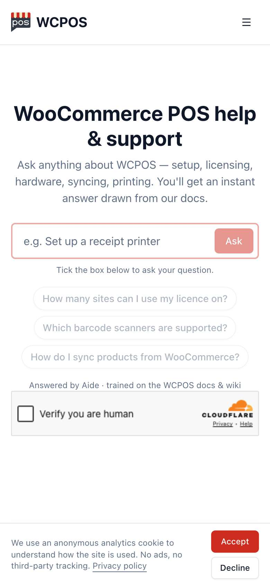 |

## 10-second test

All five judges answered both questions from the home fold. WCPOS is a free,
open-source WooCommerce register with web, desktop and phone apps. The "New
in 2.0" line says why v2 matters: opening and closing the register, split
payments and today's sales are now free.

## Scores

| Judge | Marketing | UI | SEO |
|---|---|---|---|
| shop-owner (Opus) | 8 | 8 | 9 |
| woo-dev (Opus) | 7 | 8 | 8 |
| designer (Opus) | 7 | 7 | 8 |
| seo (Opus) | 8 | 8 | 8 |
| sceptic (Astra) | 7 | 8 | 9 |
| **Mean** | **7.4** | **7.8** | **8.4** |
| Round 31 | 7.4 | 7.8 | 8.0 |
| **Delta** | **0** | **0** | **+0.4** |

The overall mean is 7.87 (+0.13). SEO rose on two scores: the shop-owner
went from 8 to 9, and the sceptic went back from 8 to 9 (its round-31
reason, /downloads at 82 on phone, tests at 95 this round). No judge named a round-31 change (#833 to #835) as a
defect, so nothing is reverted. The shop-owner judge's runner-up note
says the short-answer paragraphs on /compare/square are long. That is
about the copy, not the buttons #835 added under it.

## Lighthouse (live, light theme, capture pass)

| Page | Mobile perf | Desktop perf | A11y / BP / SEO | Mobile LCP |
|---|---|---|---|---|
| / | 91 | 100 | 100 | 3.4 s |
| /pro | 97 | 100 | 100 | 2.6 s |
| /compare | 99 | 100 | 100 | 2.0 s |
| /downloads | 95 | 100 | 100 | 2.9 s |
| /de | 91 | 100 | 100 | 3.4 s |

## Worst defects

**Marketing**

- No closing call to action on the /compare hub, which ends with "How these
  comparisons work" (shop-owner), or on /extensions, where 12 of 15 cards
  are Pro-only and link only to the docs (seo).
- Home "Receipt printing" and "Barcode scanner support" link nowhere,
  although docs pages exist (woo-dev; sixth round for the hardware links).
- The home customer reviews sit under "Works for stores of all kinds", so a
  visitor scanning the headings never sees that they are reviews (designer).
- The home offline line has no payment qualifier (sceptic). This is the
  offline wording, a front-desk hold.

**UI**

- The /compare hub, /extensions and /support still use the 80 px phone hero
  padding that #834 removed from /downloads (shop-owner, woo-dev, seo;
  designer as runner-up).
- Home review cards on phone open with a 112 px icon band each (designer).
- /downloads: the Web step links only to the public demo (sceptic; fourth
  round).

**SEO**

- The es and it home meta descriptions are the only locales without "open
  source" (woo-dev, seo; seo's second round).
- The /compare hub title names no competitor (shop-owner).
- The /compare/square title says "Square for WooCommerce", not "Square POS"
  (sceptic).
- The home title lacks "WooCommerce POS" and "free" (designer). The home
  title is a front-desk hold.

## Fixes this round

Three defects were fixed, one per track. Each one was a written spec,
implemented by an Opus 5.5 pool one-shot (route: opus). This machine
reviewed the full diff and reran the acceptance commands and mutations.

| Track | Defect | PR | Merge |
|---|---|---|---|
| Marketing | No closing call to action on the /compare hub or /extensions | [#839](https://github.com/wcpos/wcpos-com/pull/839) | fcb8796 |
| UI | 80 px phone hero padding on the /compare hub, /extensions and /support | [#838](https://github.com/wcpos/wcpos-com/pull/838) | 769d2ce |
| SEO | es and it home descriptions leave out "open source" | [#837](https://github.com/wcpos/wcpos-com/pull/837) | 51b768f |

- **#839:**
  - The /compare hub and /extensions now end with the existing
    `<CtaSection />` band ("Ready to sell in-store with WooCommerce?", Try
    Live Demo / Download Free). No new copy and no new message keys.
  - A new optional `showCompareLink` prop (default `true`) drops the band's
    "Compare WooCommerce POS systems" link on the hub, which would
    otherwise link to itself. Home and the /compare/* pages render the
    band as before.
  - Mutations, each failing its test:
    - the band removed from /extensions;
    - the hub band rendered with its /compare link.
- **#838:**
  - Below `sm`, the three heroes use 40 px top padding (was 80). This is
    the /downloads pattern from #834. From `sm` up, the classes give
    exactly the old values.
  - A new source test checks that none of the three files uses
    `spacing="hero"`.
  - Mutations, each failing its test:
    - `spacing="hero"` put back on /extensions;
    - `sm:py-20` removed from /support.
- **#837:**
  - The es and it `home.meta.description` values now open with "TPV
    gratis y de código abierto" and "gratuito e open source". Each is 159
    characters.
  - A new test checks for the term in both locales.
  - Mutations:
    - the old es value fails the new test;
    - a 161-character it value fails the 160-character test.

## After (live, 2026-11-19)

The checks were run in headless Chromium against wcpos.com after the
fcb8796 deploy, each page in a fresh browser context.

- Hero padding (top/bottom):

  | Page | 390 × 844 | 1440 × 900 |
  |---|---|---|
  | /compare | 40/24 px | 112/48 px |
  | /extensions | 40/24 px | 112/112 px |
  | /support | 40/40 px | 112/112 px |

- Phone, with the consent banner showing (its top edge is at 753 px):
  - /compare: the first "Read the comparison" link spans 479 to 530 px.
    It was at about 752 px, under the banner;
  - /extensions: the first card spans 503 to 705 px (555 to 757 px in
    de). Before, no complete card fit on the first screen;
  - /support: "Open Discord" spans 802 to 838 px. It is now inside the
    first 844 px, but under the banner until the banner is dismissed.
- Closing band:
  - /compare (phone and desktop) and /extensions (phone, and de desktop)
    each end with the band as the last element of `<main>`;
  - the hub's band links to the demo and /downloads, and not to /compare;
  - the /extensions band keeps its /compare link.
- No checked page overflows horizontally.
- /es and /it serve the new descriptions, 159 characters each.

| /compare, phone top | /extensions, phone top | /support, phone top | /compare, phone end | /extensions, phone end | /compare, desktop end |
|---|---|---|---|---|---|
| 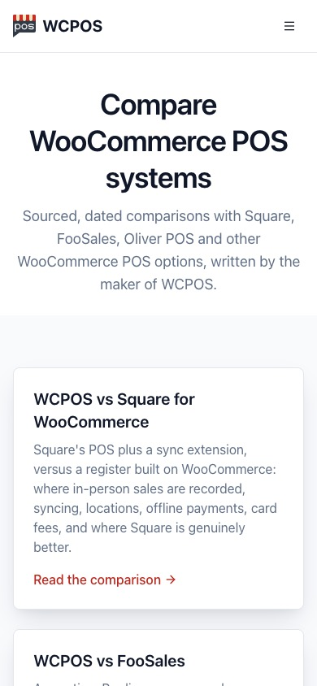 | 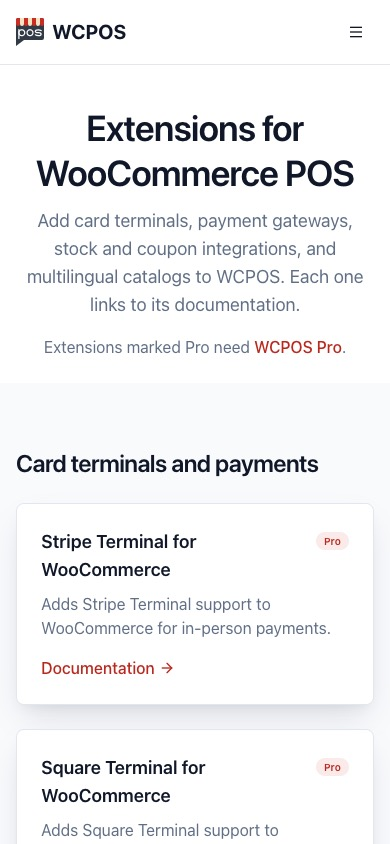 | 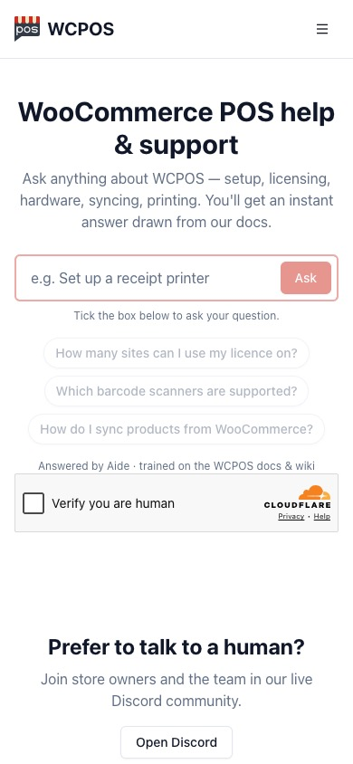 | 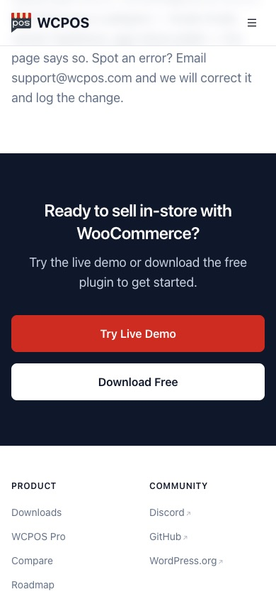 | 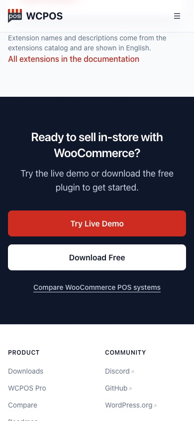 | 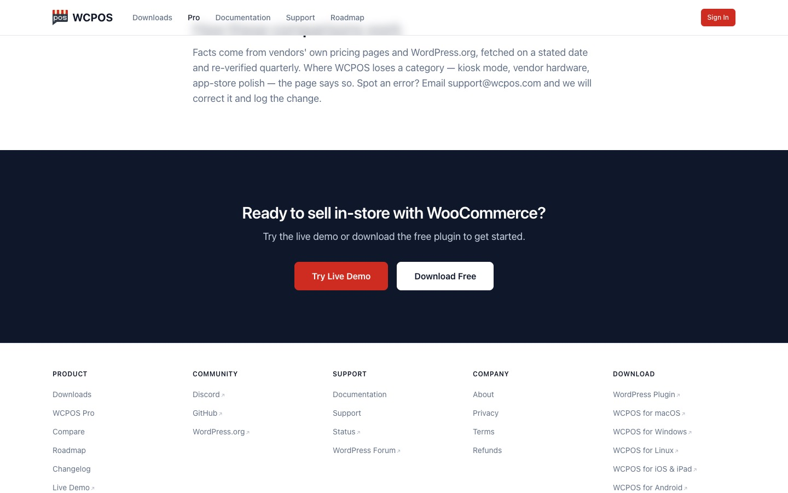 |

## Deferred

These carry over to round 33 as candidates:

- The home customer reviews sit under "Works for stores of all kinds", and
  their cards are tagged "Desktop & Offline".
- Home review cards on phone open with a 112 px icon band each.
- /downloads: the Web step links only to the public demo (fourth round).
- The /compare hub title names no competitor.
- The /compare/square title says "Square for WooCommerce", not "Square
  POS".
- The /compare/square short-answer paragraphs are long.
- The home hero says "5,000+ Active Stores", the stats band "5,000+ Active
  Installations".
- The sitemap's content date is 2026-11-18 for pages changed on
  2026-11-19.
- The "Pro" nav link is darker than the other nav links.
- Owner questions:
  - "one register" on the free plan vs "unlimited devices";
  - should /pro's `softwareRequirements` state Pro's own minimum versions?
- Front-desk holds, unchanged: the offline qualifier (including the home
  line and the comparison pages' "cash only offline" bullets), the home
  hardware panel links (receipt printing, barcode scanner), /pro
  multi-store and the "2 sites" FAQ, the Compare nav, the home title, the
  Square price line, the /pro H1, the /pro Yearly wrap, and the /compare
  "makers of WooCommerce POS" disclosure.
