# wcpos.com hill climb, round 33 (2026-11-19)

This round re-judges the live site after round 32's fixes (#837 to #839,
all live). It then records the fixes chosen from the result.

- Captures: [`2026-11-19-round-33/shots/`](2026-11-19-round-33/shots/) holds
  the fold shots. The full-page shots stay local. Visible text is in `text/`,
  page facts are in `facts.json` and Lighthouse results in `lighthouse.json`.
- Judges: [`2026-11-19-round-33/judges/`](2026-11-19-round-33/judges/). The
  personas and the brief are the same as in round 32: four Opus 5.5 pool
  one-shots, with Codex GPT-6 Astra as the sceptic. The judges were not told
  what changed.

| Page | Desktop | Phone |
|---|---|---|
| Home | 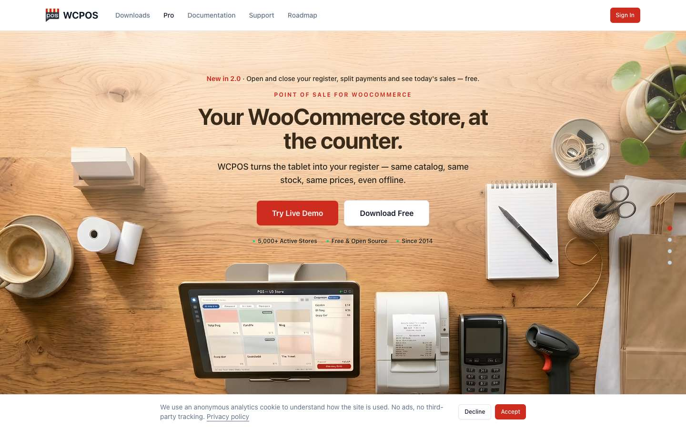 |  |
| /downloads | 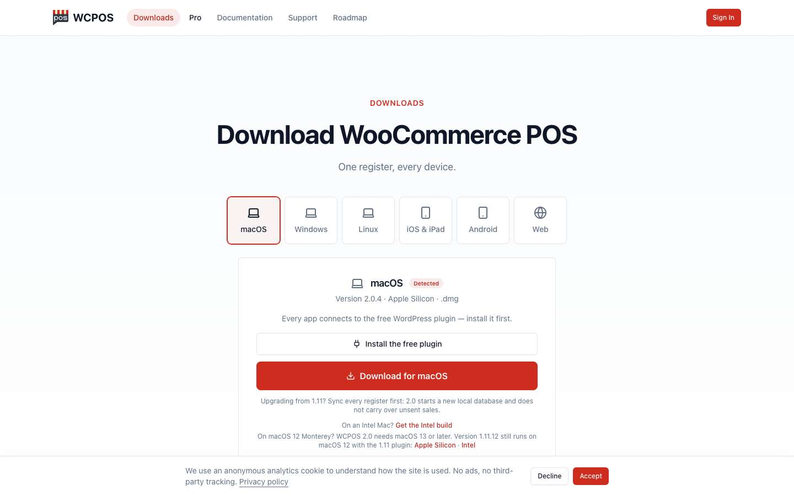 | 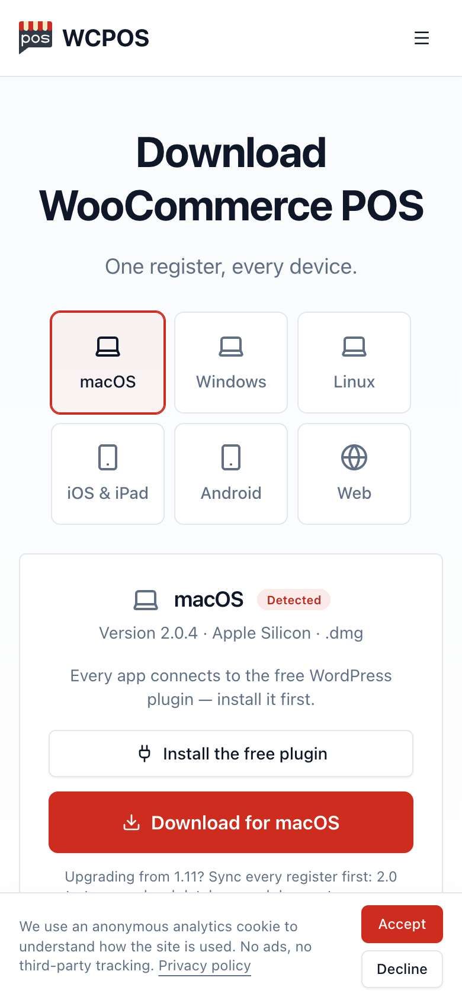 |
| /compare | 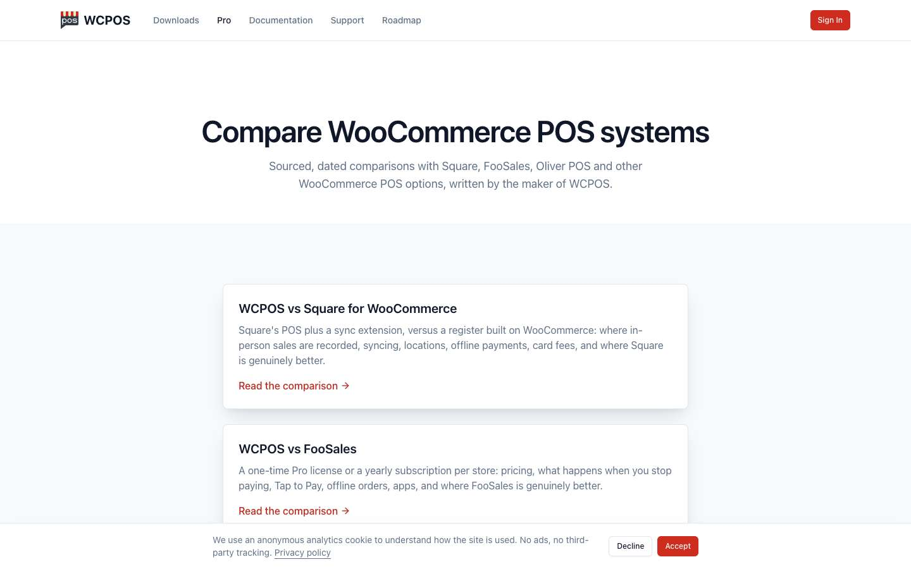 | 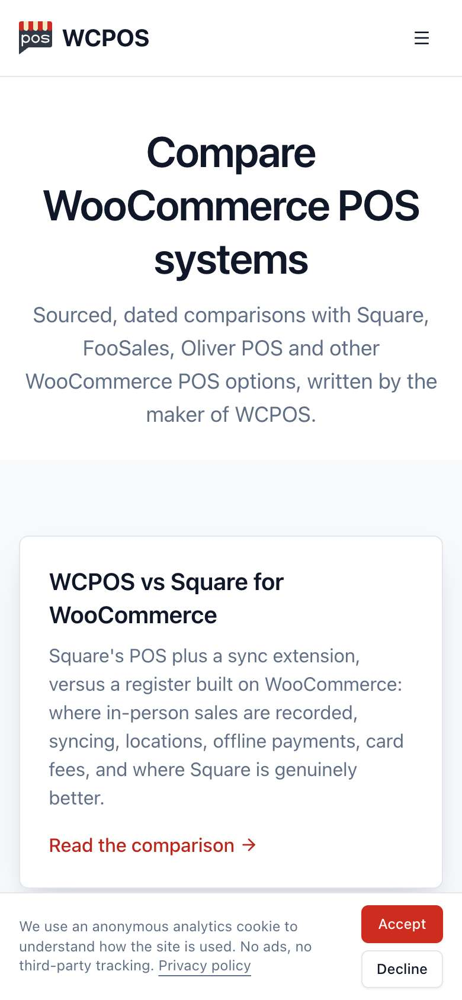 |
| /support | 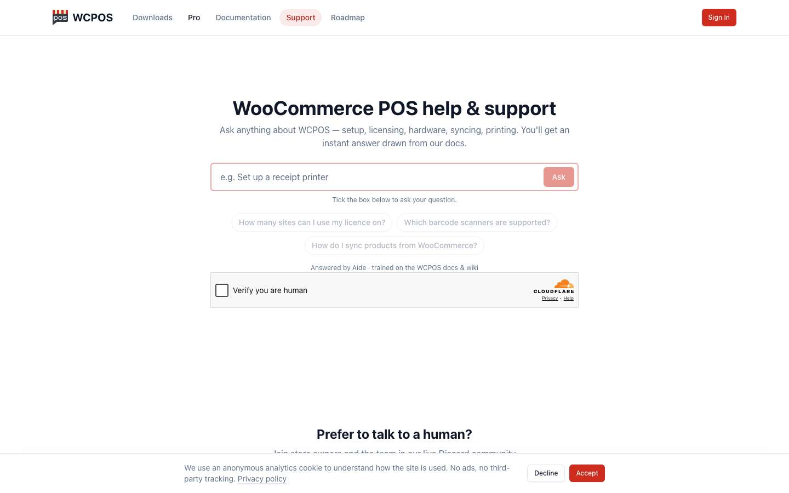 | 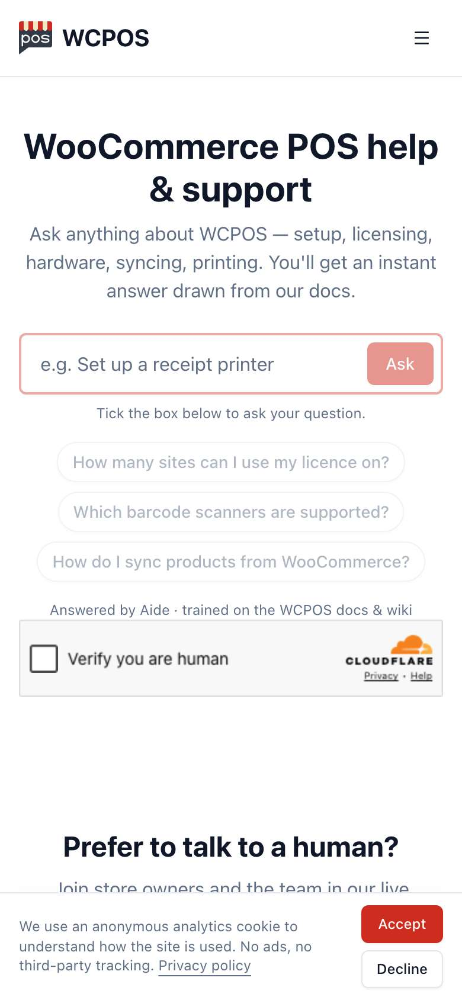 |

## 10-second test

All five judges answered both questions from the home fold. WCPOS is a free,
open-source WooCommerce register that uses the store's own catalog, stock
and prices. The "New in 2.0" line says why v2 matters: opening and closing
the register, split payments and today's sales are now free.

## Scores

| Judge | Marketing | UI | SEO |
|---|---|---|---|
| shop-owner (Opus) | 8 | 8 | 9 |
| woo-dev (Opus) | 7 | 7 | 8 |
| designer (Opus) | 7 | 7 | 8 |
| seo (Opus) | 8 | 8 | 8 |
| sceptic (Astra) | 8 | 9 | 9 |
| **Mean** | **7.6** | **7.8** | **8.4** |
| Round 32 | 7.4 | 7.8 | 8.4 |
| **Delta** | **+0.2** | **0** | **0** |

The overall mean is 7.93 (+0.07). Three scores moved, all from two judges:
- the sceptic's marketing score went from 7 to 8;
- the sceptic's UI score went from 8 to 9;
- the woo-dev UI score went from 8 to 7.

The woo-dev judge's UI defect is the /support Discord embed, which shows as
an empty 600 px panel in the captures. Round 32's #838 changed only the
/support hero: on phone it cut that hero's bottom padding from 80 to 40 px,
and from `sm` up it left the padding as it was. It did not touch the
Discord section. No judge named a round-32 change (#837 to #839) as a
defect, so nothing is reverted.

## Lighthouse (live, light theme, capture pass)

| Page | Mobile perf | Desktop perf | A11y / BP / SEO | Mobile LCP |
|---|---|---|---|---|
| / | 80 | 100 | 100 | 3.5 s |
| /pro | 97 | 100 | 100 | 2.6 s |
| /compare | 100 | 100 | 100 | 1.5 s |
| /downloads | 99 | 100 | 100 | 1.8 s |
| /de | 92 | 100 | 100 | 3.3 s |

Home mobile scored 91 in round 32. Three solo reruns gave 80, 92 and 87,
with total blocking time between 30 and 380 ms, while the machine's load
average was 11 to 15. LCP stayed between 3.3 and 3.6 s. The swing follows
the machine's load, not a site change.

## Worst defects

**Marketing**

- /downloads: the Web step links only to the public demo and never says the
  web register runs on your own store (woo-dev; fifth round for this item).
- Home: the only customer reviews sit under "Works for stores of all
  kinds", and one card's tag, "Desktop & Offline", is not a store type
  (designer; second round).
- /compare/square: "The short answer" is two paragraphs of 89 and 96 words.
  The deciding fact, that orders taken in Square's POS do not sync to
  WooCommerce, comes at the end (shop-owner).
- /pro has no customer quote in the buy box (seo; second round). A quote
  here would be a testimonial added to the page, which the front desk holds.
- The home offline line has no payment qualifier (sceptic). This is the
  offline wording, a front-desk hold.

**UI**

- Home review cards on phone each open with a 112 px icon band (designer;
  second round).
- /support: the Discord embed is an empty 600 px panel in both captures,
  with about 200 px of stacked section padding above it (woo-dev; the
  designer as runner-up).
- /extensions from `md` up: about 208 px of blank space sits before the
  first group heading. The hero's bottom padding stacks on the catalog
  section's top padding (seo).
- /compare/square on phone: the stacked "At a glance" rows repeat the
  two-line label "Square POS + Square for WooCommerce" nine times
  (shop-owner; the designer as runner-up).
- /compare on phone: no compact row of competitor links above the cards
  (sceptic).

**SEO**

- The /compare hub title names no competitor (shop-owner, second round;
  designer).
- /support is thin: one H2, no in-body docs links, and Organization-only
  JSON-LD (woo-dev).
- The /compare disclosure names WCPOS but does not link to /about-us (seo).
- The home title lacks "free" and "open source" (sceptic). The home title
  is a front-desk hold.

## Fixes this round

Three defects were fixed, one per track. Each one was a written spec,
implemented by an Opus 5.5 pool one-shot (route: opus). This machine
reviewed the full diff and reran the acceptance commands and mutations.

| Track | Defect | PR | Merge |
|---|---|---|---|
| Marketing | /downloads: the Web step links only to the public demo | [#842](https://github.com/wcpos/wcpos-com/pull/842) | 01748c2 |
| UI | Home review cards on phone open with a 112 px icon band each | [#843](https://github.com/wcpos/wcpos-com/pull/843) | 1daeaa3 |
| SEO | The /compare hub title names no competitor | [#841](https://github.com/wcpos/wcpos-com/pull/841) | 9ee0631 |

- **#842:**
  - The Web card in "Pick your device" now reads "Set up on your store ·
    Open the live demo". The first link goes to the existing installation
    guide (docs.wcpos.com/getting-started/installation), held in a named
    constant. The demo link is unchanged.
  - One new message key, `downloads.page.steps.device.webSetupCta`, in all
    ten locales.
  - Mutations, each failing the new test:
    - the setup link dropped;
    - the setup link moved after the demo link.
- **#843:**
  - On phone the band is now 56 px with a 28 px icon. From `md` up it stays
    112 px with a 40 px icon.
  - `h-14` leads the class string, because the hard-coded-English scan
    treats a class list as code only when its first token has a hyphen.
  - Mutations, each failing the new test:
    - the old `flex h-28` band put back;
    - `md:h-10` dropped from the icon.
- **#841:**
  - `compare.hub.metadata.title` names Square and FooSales in all ten
    locales, 36 to 53 characters before " | WCPOS". en: "Compare
    WooCommerce POS: Square, FooSales & More". The same key feeds the
    hub's JSON-LD `name`.
  - A new test checks both names and the 53-character limit.
  - Mutations, each failing the new test:
    - the old en title put back;
    - a 54-character fr title.

## After (live, 2026-11-19)

The checks were run in headless Chromium against wcpos.com after the
1daeaa3 deploy, each page in a fresh browser context.

- /downloads Web card:
  - en, de (phone) and en, nl (desktop) each show the setup link first and
    the demo link second, in the same row;
  - on de phone the row wraps after "Im eigenen Shop einrichten ·", so the
    separator ends the first line.
- Home review-card bands (band/icon height):
  - phone, en and de: 56/28 px on all three cards;
  - desktop: 112/40 px on all three cards.
- /compare hub `<title>`:
  - en: "Compare WooCommerce POS: Square, FooSales & More | WCPOS";
  - de: "WooCommerce-POS vergleichen: Square, FooSales & mehr | WCPOS";
  - fr: "Comparatif POS WooCommerce : Square, FooSales et plus | WCPOS";
  - ja: "WooCommerce向けPOS比較：Square、FooSalesほか | WCPOS".
- No checked page overflows horizontally.

| /downloads Web card, en phone | /downloads Web card, de phone | /downloads Web card, desktop | Home reviews, phone | Home reviews, desktop |
|---|---|---|---|---|
| 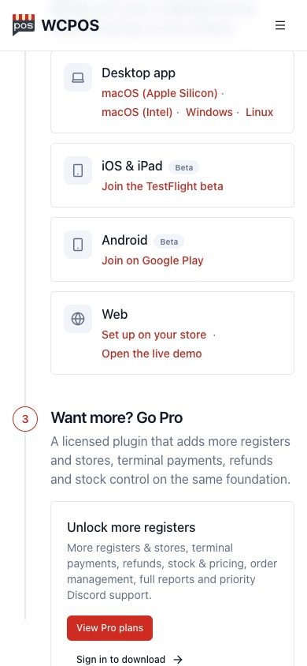 | 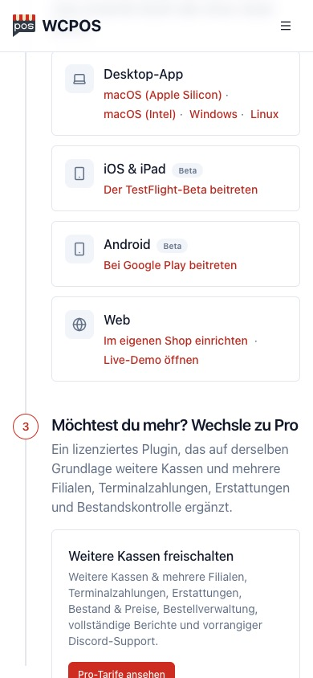 | 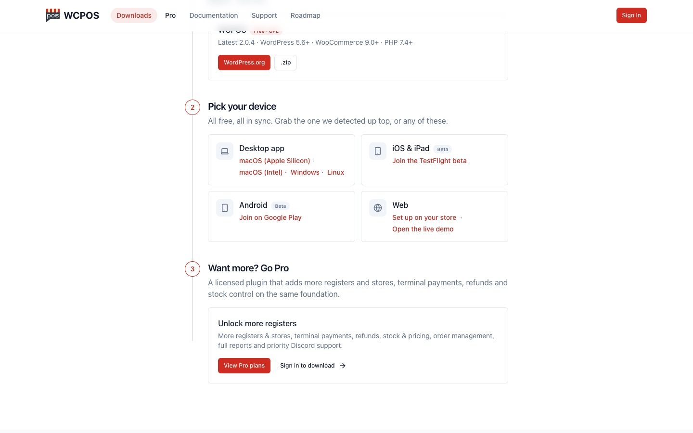 | 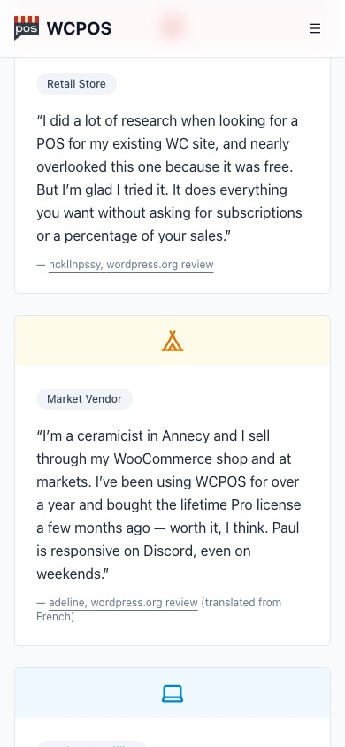 | 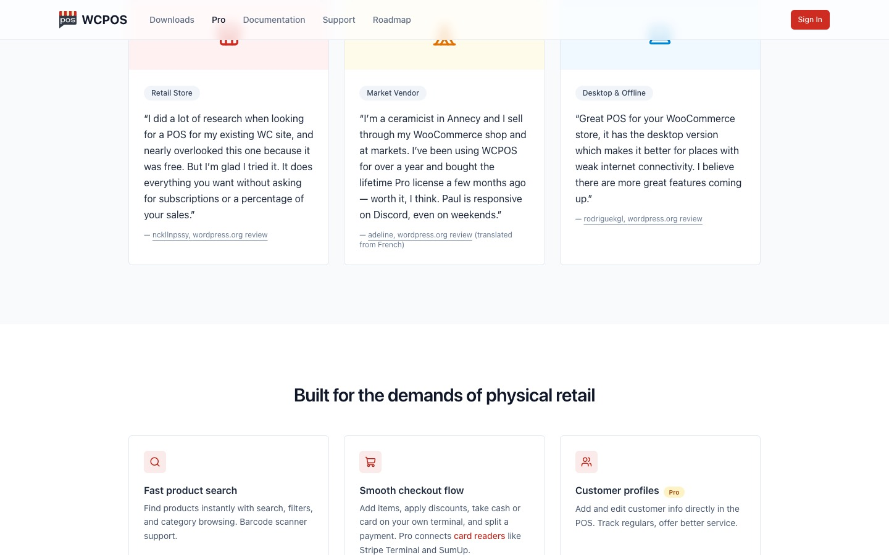 |

## Deferred

These carry over to round 34 as candidates:

- /support: the Discord embed shows as an empty 600 px panel, with about
  200 px of stacked section padding above it.
- /support is thin: one H2, no in-body docs links, Organization-only
  JSON-LD. It is also the only top-level page without the closing band.
- /extensions from `md` up: about 208 px of blank space before the first
  group heading.
- /compare/square: the short-answer paragraphs are long, and on phone the
  "At a glance" rows repeat the two-line column label nine times.
- /compare on phone: no compact row of competitor links above the cards.
- The /compare disclosure does not link to /about-us.
- The home reviews sit under "Works for stores of all kinds", and one
  card's tag, "Desktop & Offline", is not a store type.
- The /downloads Web row's "·" separator ends the first line when the row
  wraps (de phone).
- The home hero says "5,000+ Active Stores", the stats band "5,000+ Active
  Installations".
- The sitemap's content date is 2026-11-18 for pages changed since.
- The /about-us title renders as "About | WCPOS".
- /pro has no Live Demo link.
- Owner questions:
  - "one register" on the free plan vs "unlimited devices";
  - should /pro's `softwareRequirements` state Pro's own minimum versions?
- Front-desk holds, unchanged: the offline qualifier (including the home
  line and the comparison pages' "cash only offline" bullets), the home
  hardware panel links, /pro multi-store and the "2 sites" FAQ, the Compare
  nav, the home title, the Square price line, the /pro H1, the /pro Yearly
  wrap, the /compare "makers of WooCommerce POS" disclosure, and no new
  testimonials (including a /pro buy-box quote).
