# wcpos.com hill climb, round 34 (2026-11-19)

This round re-judges the live site after round 33's fixes (#841 to #843,
all live). It then records the fixes chosen from the result.

- Captures: [`2026-11-19-round-34/shots/`](2026-11-19-round-34/shots/) holds
  the fold shots. The full-page shots stay local. Visible text is in `text/`,
  page facts are in `facts.json` and Lighthouse results in `lighthouse.json`.
- Judges: [`2026-11-19-round-34/judges/`](2026-11-19-round-34/judges/). The
  personas and the brief are the same as in round 33: four Opus 5.5 pool
  one-shots, with Codex GPT-6 Astra as the sceptic. The judges were not told
  what changed.

| Page | Desktop | Phone |
|---|---|---|
| Home | 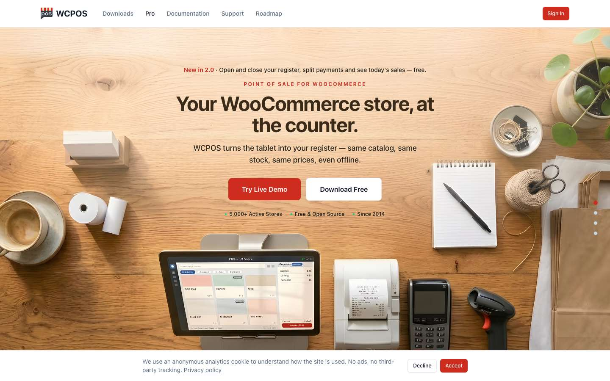 | 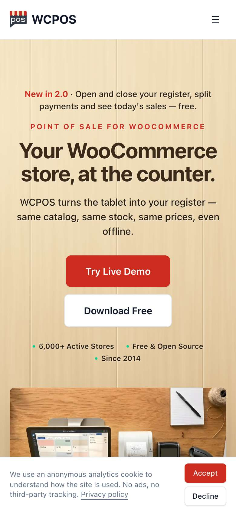 |
| /downloads | 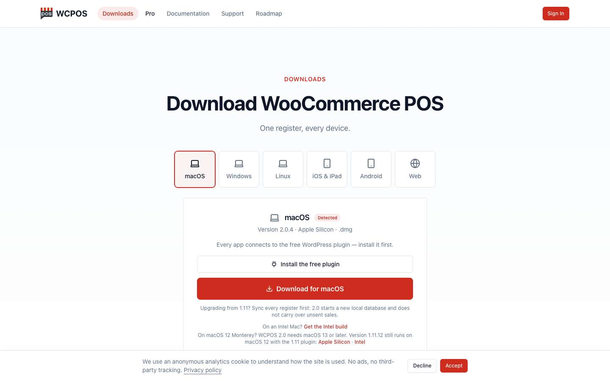 | 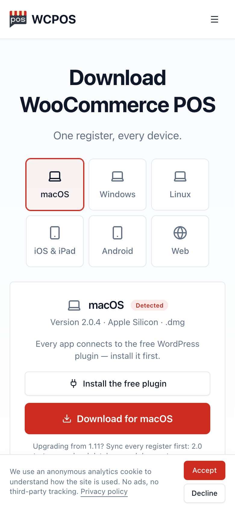 |
| /support | 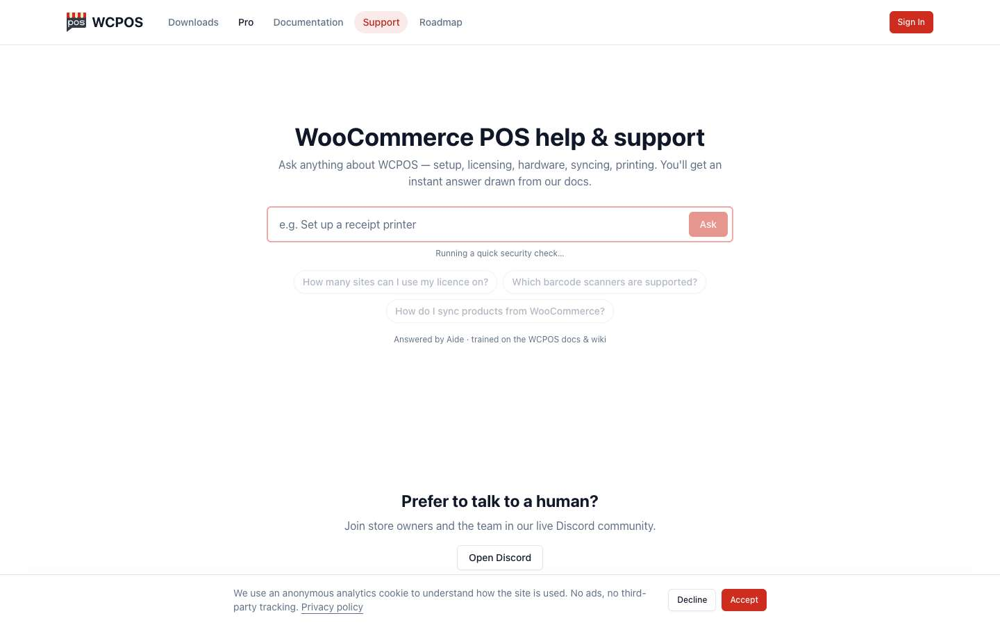 | 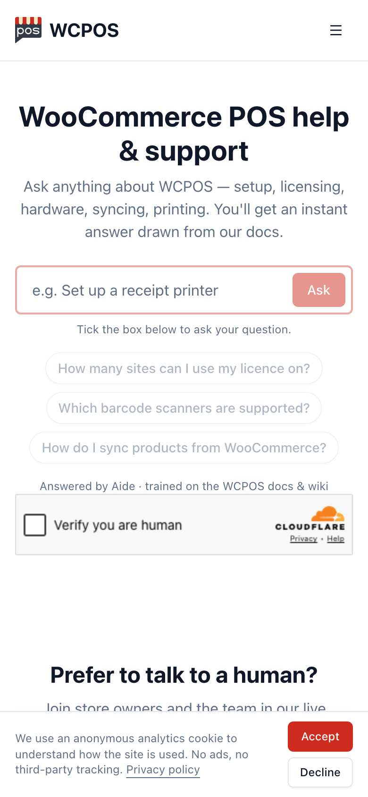 |
| /extensions | 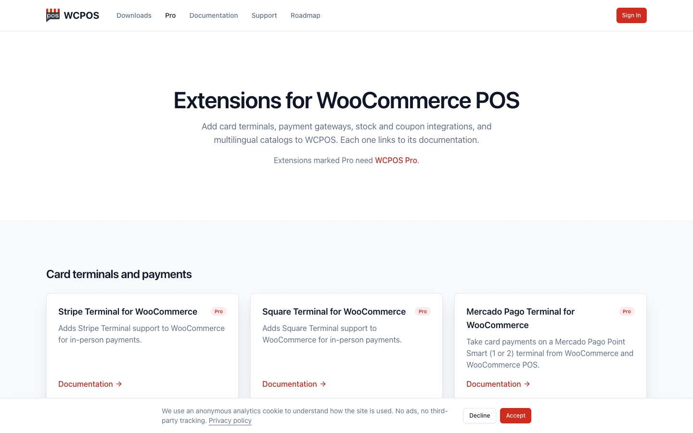 | 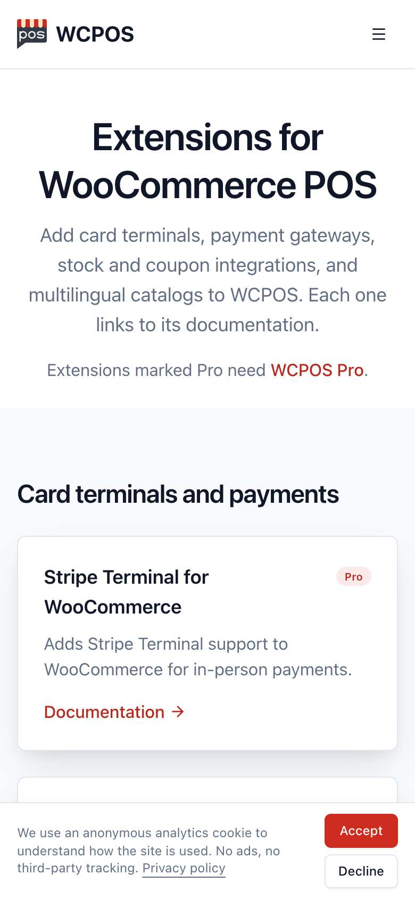 |

## 10-second test

All five judges answered both questions from the home fold. WCPOS is a free,
open-source WooCommerce register that uses the store's own catalog, stock
and prices. The "New in 2.0" line says why v2 matters: opening and closing
the register, split payments and today's sales are now free.

## Scores

| Judge | Marketing | UI | SEO |
|---|---|---|---|
| shop-owner (Opus) | 8 | 8 | 8 |
| woo-dev (Opus) | 7 | 7 | 8 |
| designer (Opus) | 7 | 7 | 8 |
| seo (Opus) | 8 | 8 | 8 |
| sceptic (Astra) | 8 | 8 | 9 |
| **Mean** | **7.6** | **7.6** | **8.2** |
| Round 33 | 7.6 | 7.8 | 8.4 |
| **Delta** | **0** | **−0.2** | **−0.2** |

The overall mean is 7.80 (−0.13). Two scores
moved, both down by one:
- the shop-owner's SEO score went from 9 to 8. Their SEO defect is now the
  home title, a front-desk hold; last round it was the /compare hub title,
  which #841 fixed;
- the sceptic's UI score went from 9 to 8. Its UI defect is the
  /compare/square short answer, unchanged since before round 33.

Was a round-33 change to blame? No judge named #841, #842 or #843 as a
worst defect. The only mention of a round-33 change is a designer runner-up:
the /downloads step-2 rows wrap with the "·" separator at the end of a
line, which the macOS row did before #842 added the Web row's second link.
The designer's scores did not move. Neither falling score traces to a
round-33 change, so nothing is reverted. The separator is a fix candidate.

## Lighthouse (live, light theme, capture pass)

| Page | Mobile perf | Desktop perf | A11y / BP / SEO | Mobile LCP |
|---|---|---|---|---|
| / | 91 | 99 | 100 | 3.4 s |
| /pro | 100 | 100 | 100 | 1.2 s |
| /compare | 97 | 100 | 100 | 2.6 s |
| /downloads | 97 | 100 | 100 | 2.6 s |
| /de | 99 | 100 | 100 | 2.2 s |

Home mobile is back to 91 (80 in the round-33 capture pass, which ran under
a load average of 11 to 15).

## Worst defects

**Marketing**

- Home: the only full customer reviews sit under "Works for stores of all
  kinds", and the third card's tag, "Desktop & Offline", is not a store type
  (designer; third round).
- /pro: the "More Registers & Multiple Stores" card does not say a store is
  a location inside one WooCommerce site, next to a FAQ that says "1 live
  site" (woo-dev). This is /pro multi-store and the "2 sites" FAQ, a
  front-desk hold.
- /pro never links to the live demo (seo).
- No Compare link in the header nav (shop-owner). The Compare nav is a
  front-desk hold.
- The home offline line has no payment qualifier (sceptic). This is the
  offline wording, a front-desk hold.

**UI**

- Home stats band: "5,000+" is hard-coded, so de, nl, it and pt readers,
  who use the comma as a decimal mark, see "five" next to a hero badge that
  says "5.000+" (designer; new).
- /support: the Discord embed is an empty dark panel, about 485 px tall on
  phone, with about 200 px of stacked padding above it (woo-dev; second
  round). The designer's captures show it rendered with content.
- /support: the example chips and the Ask button are pale grey until the
  Turnstile check finishes, so they look disabled (shop-owner).
- /extensions from `md` up: about 210 px of blank space before the first
  group heading (seo; second round).
- /compare/square: "The short answer" is two long paragraphs (sceptic).

**SEO**

- /support is thin: about 60 words, one H2, no in-body docs links,
  Organization-only JSON-LD (woo-dev and designer; second round).
- The /compare disclosure names WCPOS but does not link to /about-us (seo;
  second round). The disclosure is a front-desk hold.
- The home title (shop-owner, sceptic). The home title is a front-desk
  hold.

## Fixes this round

Three defects were fixed, one per track, all named by the two lowest
scorers (woo-dev and designer). Each one was a written spec, implemented by
an Opus 5.5 pool one-shot (route: opus). Two Sonnet one-shots each made a
two-line follow-up from their own specs. This machine reviewed the full
diff and reran the acceptance commands and mutations.

| Track | Defect | PR | Merge |
|---|---|---|---|
| Marketing | Home reviews sit under "Works for stores of all kinds" | [#845](https://github.com/wcpos/wcpos-com/pull/845) | d1c99ab |
| UI | Home stats band hard-codes "5,000+" in every locale | [#846](https://github.com/wcpos/wcpos-com/pull/846) | 64723fd |
| SEO | /support is thin, with no in-body docs links | [#847](https://github.com/wcpos/wcpos-com/pull/847) | cc3bc0a |

- **#845:**
  - `home.useCases.title` now reads "What store owners say" in all ten
    locales (de "Das sagen Shop-Betreiber", fr "Ce qu’en disent les
    commerçants", ja "ストアオーナーの声"). The card tags and quotes are
    unchanged.
  - The first CI run failed E2E: `e2e/homepage.spec.ts` still expected the
    old heading, and the spec had not listed the e2e folder. A follow-up
    spec updated that one expectation.
  - Mutations, each failing the new test:
    - the old en title put back;
    - the heading rendered as h3.
- **#846:**
  - The installs count is a number in code (`ACTIVE_INSTALLS = 5000`),
    rendered with next-intl's `useFormatter()`: "5.000+" in de, nl, it and
    pt, "5 000+" in fr, "5000+" in es, "5,000+" in en, ja, ko and zh. Each
    now matches its locale's hero badge.
  - Mutations, each failing the new test:
    - the literal `5,000+` put back;
    - formatting with a fixed `Intl.NumberFormat("en")`.
- **#847:**
  - A "Start with these guides" block sits between the Aide chat and the
    Discord section: an H2 and five same-tab links to existing
    docs.wcpos.com pages (installation, Pro licence, barcode scanners,
    receipt printers, product sync). New `support.guides` messages in all
    ten locales; the `?ref=` order view is unchanged.
  - The component carries no `'use client'` directive, since the scan
    flags every directive and its only importer is already a client
    module. A follow-up spec removed it.
  - Mutations, each failing a new test:
    - the block dropped from `SupportDefaultContent`;
    - the barcode and printer URLs swapped.

## After (live, 2026-11-19)

The checks were run in headless Chromium against wcpos.com after the
cc3bc0a deploy, each page in a fresh browser context.

- Home review heading: "What store owners say" (en), "Das sagen
  Shop-Betreiber" (de), "Wat winkeliers zeggen" (nl), "Ce qu’en disent les
  commerçants" (fr), "Lo que dicen los comerciantes" (es), "ストアオーナーの声"
  (ja).
- Home installs stat: en "5,000+", de and nl "5.000+", fr "5 000+", es
  "5000+", ja "5,000+".
- /support: the guides H2 comes before the Discord H2 in en, de and ja, on
  phone and desktop. All five links point to their docs pages in the same
  tab, and each docs page answers 200.
- No checked page overflows horizontally.

| Home reviews, en phone | Home reviews, de desktop | Stats, de phone | Stats, en desktop |
|---|---|---|---|
| 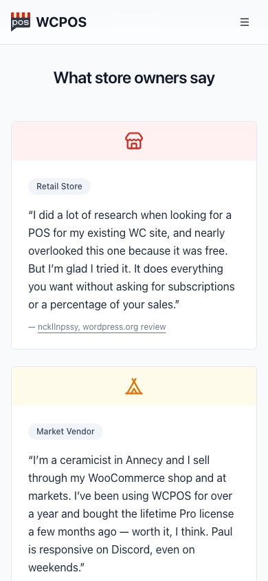 | 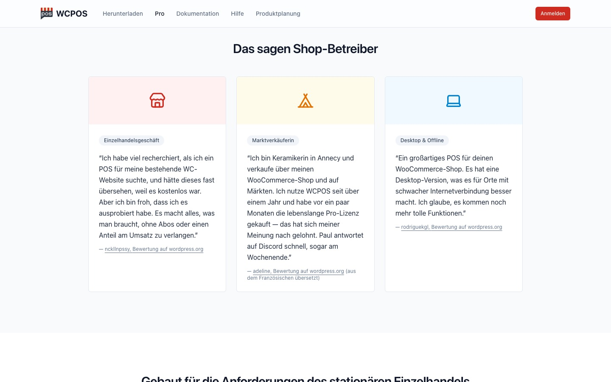 | 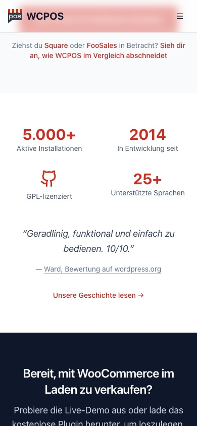 | 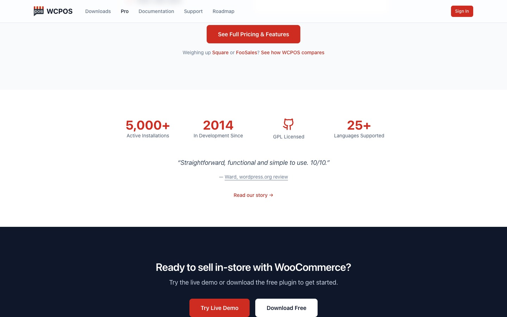 |

| /support guides, en phone | /support guides, de phone | /support guides, desktop |
|---|---|---|
| 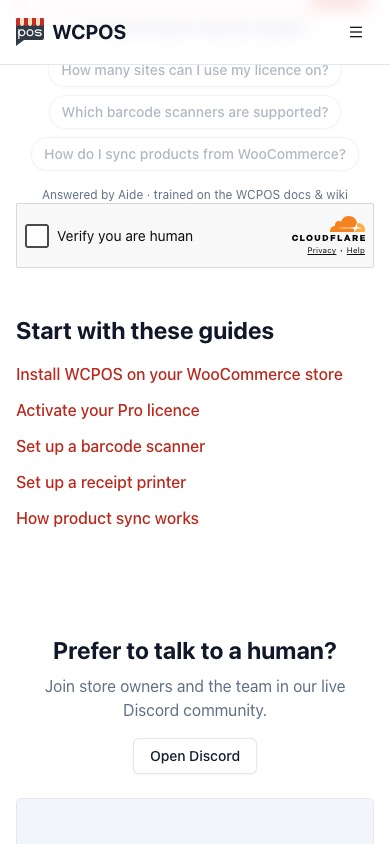 | 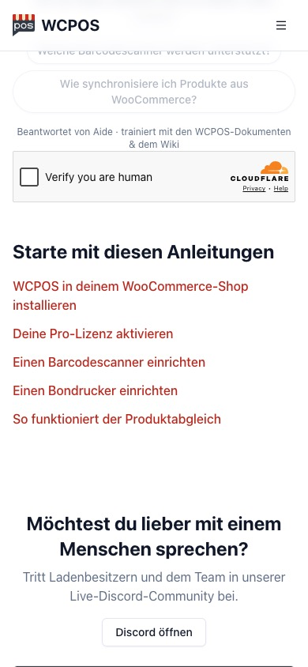 | 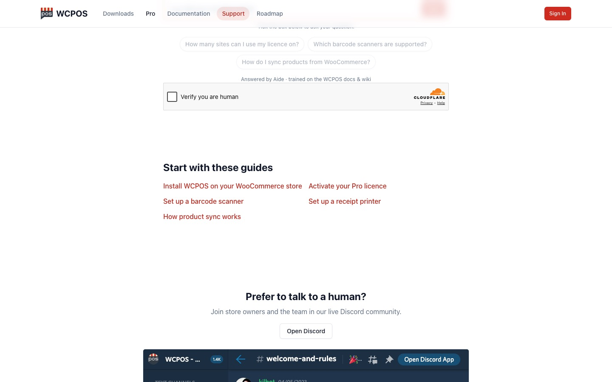 |

## Deferred

These carry over to round 35 as candidates:

- /support on desktop: about 130 px of blank space each side of the
  guides block, from the chat section's bottom padding and the Discord
  section's top padding.
- /support: the example chips and the Ask button look disabled until the
  Turnstile check finishes.
- /support: the Discord embed sometimes renders as an empty dark panel.
- /extensions from `md` up: about 210 px of blank space before the first
  group heading.
- /pro never links to the live demo.
- /compare/square: the short answer is two long paragraphs.
- /downloads: the "·" separator can end a wrapped line (macOS and Web
  rows).
- The home "Desktop & Offline" review tag is not a store type.
- The sitemap's content date is 2026-11-18.
