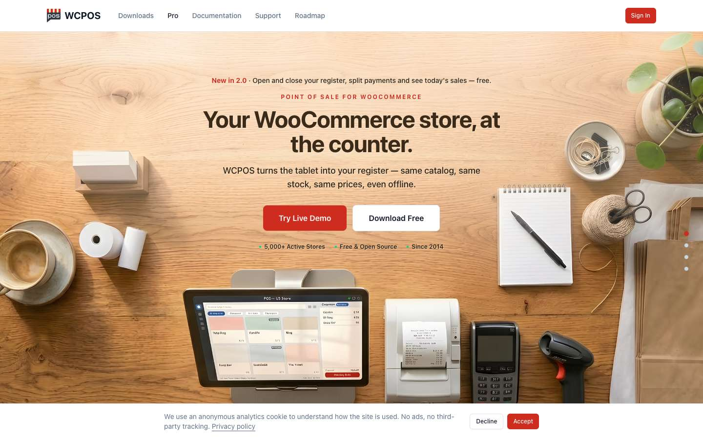
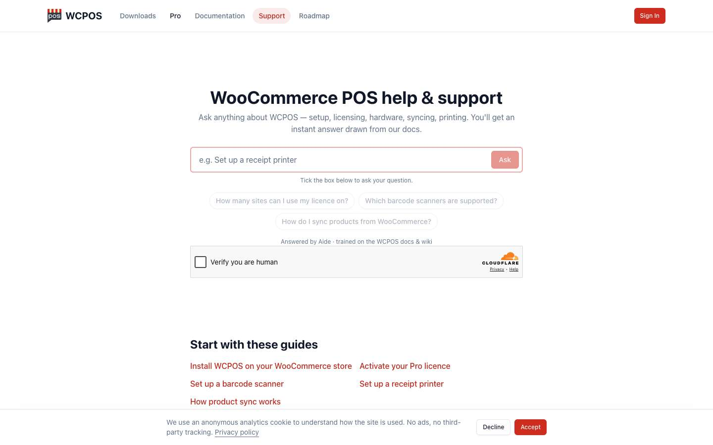
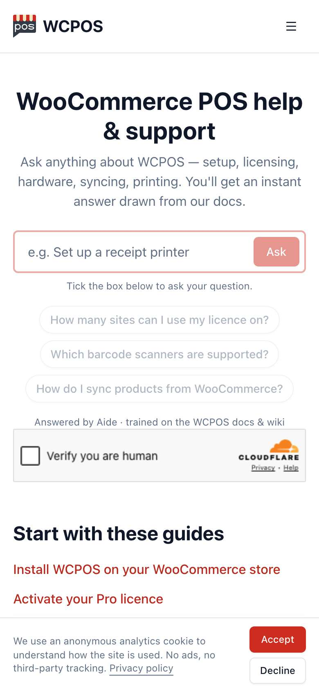
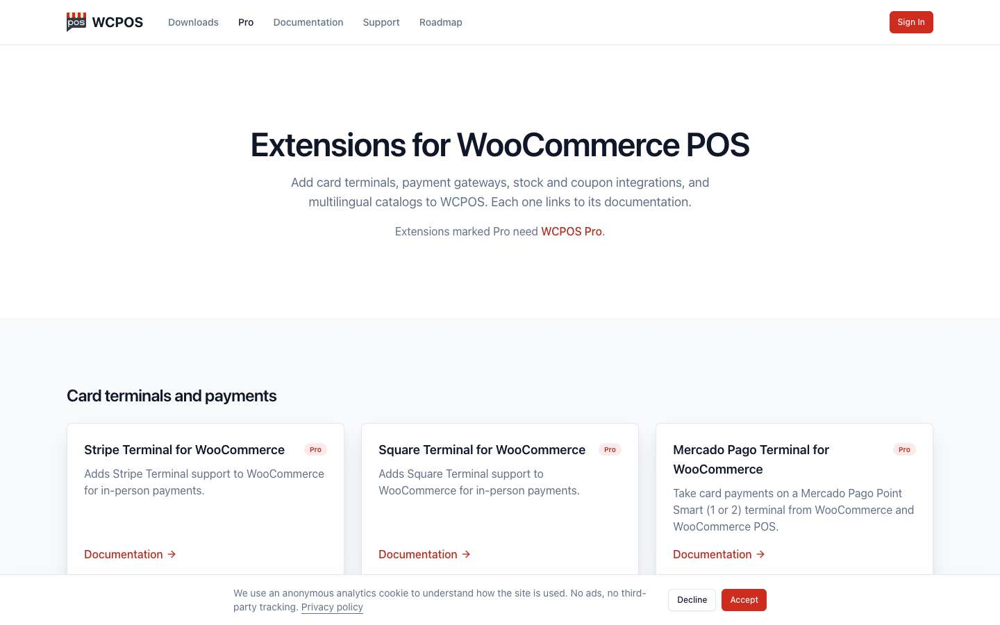
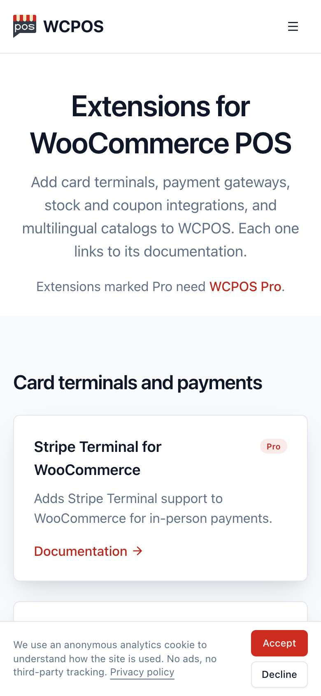
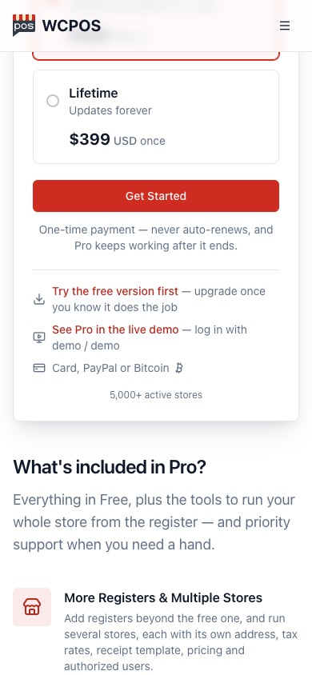
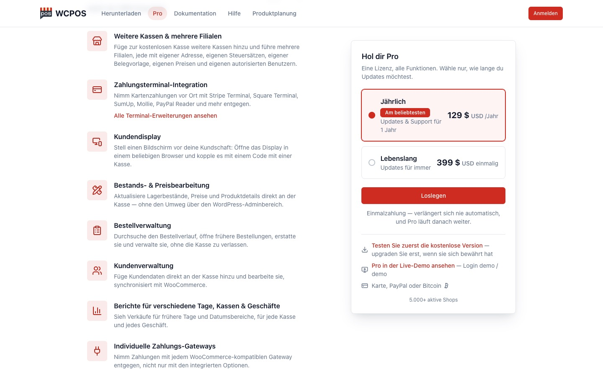
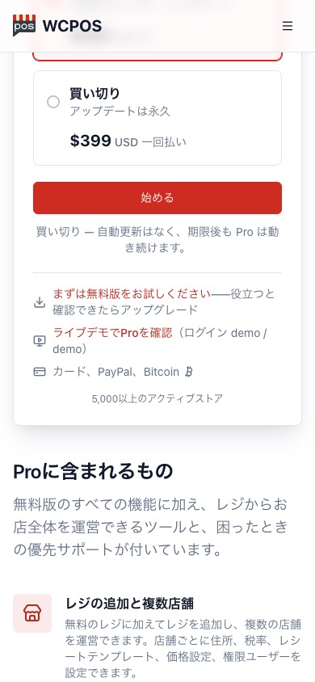
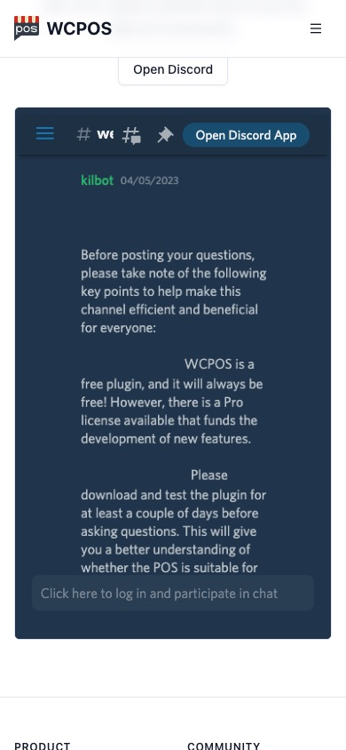
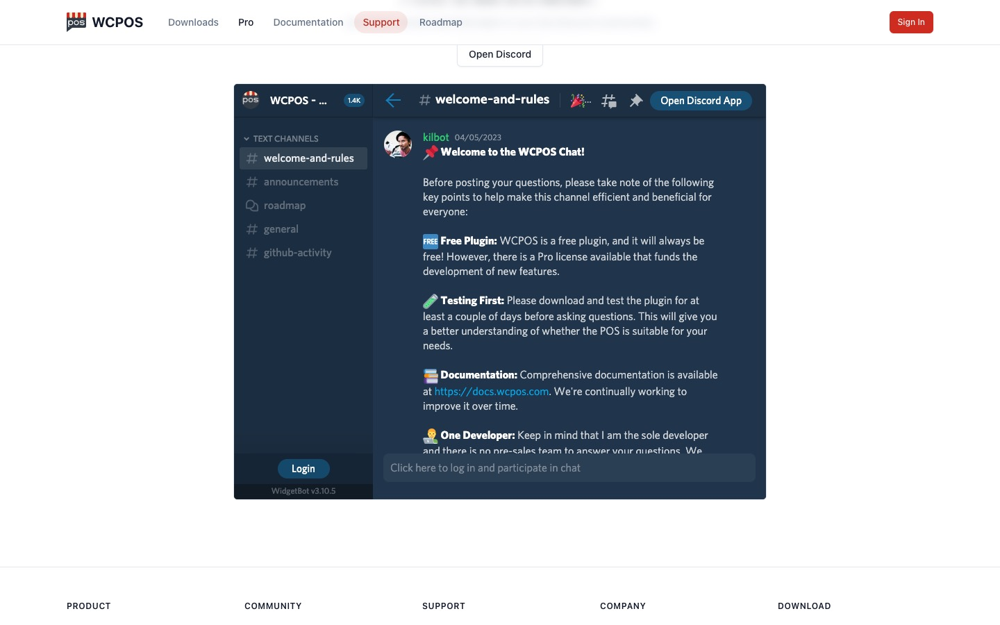

# wcpos.com hill climb, round 35 (2026-11-19)

This round re-judges the live site after round 34's fixes (#845 to #847,
all live). It then records the fixes chosen from the result.

- Captures: [`2026-11-19-round-35/shots/`](2026-11-19-round-35/shots/) holds
  the fold shots. The full-page shots stay local. Visible text is in `text/`,
  page facts are in `facts.json` and Lighthouse results in `lighthouse.json`.
- Judges: [`2026-11-19-round-35/judges/`](2026-11-19-round-35/judges/). The
  personas and the brief are the same as in round 34: four Opus 5.5 pool
  one-shots, with Codex GPT-6 Astra as the sceptic. The judges were not told
  what changed.

| Page | Desktop | Phone |
|---|---|---|
| Home |  |  |
| /support |  |  |
| /extensions |  |  |

## 10-second test

All five judges answered both questions from the home fold. WCPOS is a free,
open-source WooCommerce register that uses the store's own catalog, stock
and prices. The "New in 2.0" line says why v2 matters: opening and closing
the register, split payments and today's sales are now free.

## Scores

| Judge | Marketing | UI | SEO |
|---|---|---|---|
| shop-owner (Opus) | 8 | 8 | 9 |
| woo-dev (Opus) | 7 | 7 | 8 |
| designer (Opus) | 7 | 7 | 8 |
| seo (Opus) | 8 | 8 | 8 |
| sceptic (Astra) | 7 | 8 | 9 |
| **Mean** | **7.4** | **7.6** | **8.4** |
| Round 34 | 7.6 | 7.6 | 8.2 |
| **Delta** | **−0.2** | **0** | **+0.2** |

The overall mean is 7.80, unchanged. Two scores moved by one:
- the sceptic's marketing score went from 8 to 7. Its marketing defect is
  the home "Internet drops?" line having no payment qualifier, which is the
  offline wording, a front-desk hold;
- the shop-owner's SEO score went from 8 to 9.

Was a round-34 change to blame? No judge named #845, #846 or #847 as a
worst defect. #845's new heading, "What store owners say", sharpens an old
defect: the designer and the shop-owner both note that the third card's tag,
"Desktop & Offline", is not a kind of store owner. The designer's scores did
not move. The mean did not fall, so nothing is reverted.

## Lighthouse (live, light theme, capture pass)

| Page | Mobile perf | Desktop perf | A11y / BP / SEO | Mobile LCP |
|---|---|---|---|---|
| / | 92 | 100 | 100 | 3.3 s |
| /pro | 100 | 100 | 100 | 1.2 s |
| /compare | 97 | 100 | 100 | 2.6 s |
| /downloads | 97 | 100 | 100 | 2.6 s |
| /de | 91 | 100 | 100 | 3.4 s |

## Worst defects

**Marketing**

- /compare pages: the terminal list misses Mercado Pago, PayArc and
  Windcave, which /extensions lists, and calls Vipps MobilePay (QR or push)
  a card terminal (woo-dev).
- Home: the third review card's tag, "Desktop & Offline", is a feature, not
  a store owner, and its quote ends on "more great features coming up"
  (designer; shop-owner runner-up).
- /pro never links to the live demo, though the refund policy points buyers
  to it (seo; woo-dev runner-up; deferred in round 34).
- The /compare "connected card readers need a connection" bullets (shop-owner)
  and the home offline line (sceptic). Both are the offline wording, a
  front-desk hold.

**UI**

- /support: the 600 px Discord box shows as an empty dark panel on phone and
  desktop while WidgetBot boots (woo-dev and designer; third round).
- /extensions from `md` up: about 210 px of blank space before the first
  group heading (seo; third round).
- /compare/square on phone: "The short answer" is about 25 lines in two
  paragraphs (shop-owner).
- /support on phone: the "tick the box" instruction sits apart from the
  Turnstile widget (sceptic).

**SEO**

- The sitemap still dates `/` and `/support` 2026-11-18, though both
  changed on 11-19 (woo-dev, checked live; seo runner-up; third round).
- No WebSite JSON-LD on the home page (seo).
- /support carries only the Organization JSON-LD (designer, who calls it a
  weak pick).
- /pro H1 "WCPOS Pro for WooCommerce POS" (shop-owner). The /pro H1 is a
  front-desk hold.
- The /extensions description names terminal brands without the Pro
  requirement (sceptic).

## Fixes this round

Three defects were fixed, one per track. The UI and SEO fixes were the worst
defects named by the two lowest scorers (woo-dev and designer). The
marketing fix was named by two judges. The designer's review tag would need
the reviewer's store type, which the site doesn't have, and woo-dev's
terminal list is a 160-string change that needs a claim check against each
extension. Each fix was a written spec, implemented by an Opus 5.5 pool
one-shot (route: opus). One Sonnet one-shot made a follow-up from its own
spec. This machine reviewed the full diff and reran the acceptance commands
and mutations.

| Track | Defect | PR | Merge |
|---|---|---|---|
| Marketing | /pro never links to the live demo | [#851](https://github.com/wcpos/wcpos-com/pull/851) | c5dfb1e |
| UI | /support Discord box is an empty dark panel while it loads | [#849](https://github.com/wcpos/wcpos-com/pull/849) | f1f0cc6 |
| SEO | Sitemap dates / and /support 2026-11-18 | [#850](https://github.com/wcpos/wcpos-com/pull/850) | 835e63c |

- **#851:**
  - The /pro buy box footer has a new line under "Try the free version
    first": "See Pro in the live demo — log in with demo / demo". It links
    to the same URL and credentials as the /compare pages, in the same tab,
    in all ten locales (`pro.buyBox.demoLink`, `pro.buyBox.demoSuffix`).
  - The page tests render only the async buy box's Suspense fallback, so the
    footer moved verbatim into `ProBuyBoxFooter` with its own test. A
    follow-up spec made that move.
  - Mutations, each failing the new test:
    - demo href set to `/downloads`;
    - demo line moved above the try-free line.
- **#849:**
  - The light skeleton stays over the WidgetBot iframe until the iframe's
    load event fires, then it is removed. The chat still mounts without a
    click, as Paul chose in #647. The box size is unchanged.
  - Mutations, each failing the new test:
    - `onLoad` dropped;
    - skeleton never rendered.
- **#850:**
  - `/`, `/pro` and `/support` lastmod moved to 2026-11-19. A test pins
    those dates, plus `/extensions` keeping 2026-11-18.
  - Mutations, each failing the date test:
    - `/support` set back to 2026-11-18;
    - `/extensions` set to 2026-11-19.

## After (live, 2026-11-19)

The checks were run in headless Chromium against wcpos.com after the
c5dfb1e deploy, each page in a fresh browser context.

- /pro buy box: the demo line follows the try-free line in en, de, nl, fr
  and ja. It links to the demo with no `target`, fits on two lines at 390 px,
  and nothing overflows.
- /support: the WidgetBot channel shows its messages within about two
  seconds of the box scrolling into view, on phone and desktop. No skeleton
  or empty panel remains.
- sitemap.xml: `/`, `/pro`, `/ja/pro`, `/support` and `/de/support` read
  2026-11-19, and `/extensions` reads 2026-11-18.

| /pro demo line, en phone | /pro demo line, de desktop | /pro demo line, ja phone |
|---|---|---|
|  |  |  |

| /support Discord, phone (about 2 s) | /support Discord, desktop |
|---|---|
|  |  |

## Deferred

These carry over to round 36 as candidates:

- /extensions from `md` up: about 210 px of blank space before the first
  group heading.
- The /compare terminal list: missing Mercado Pago, PayArc and Windcave, and
  Vipps MobilePay called a card terminal. Each addition needs checking
  against its /extensions card.
- The home "Desktop & Offline" review tag and the quote's last sentence.
- /compare/square: the short answer is two long paragraphs; its "doesn't do"
  intro still says "As verified on 2026-10-06".
- Home WebSite JSON-LD; /support page-level JSON-LD.
- The /extensions description: terminal brands without "Pro".
- /support on phone: the Turnstile widget sits below the chips.
- /downloads: the "·" separator can end a wrapped line.
