# wcpos.com hill climb, round 36 (2026-11-19)

This round re-judges the live site after round 35's fixes (#849 to #851,
all live). It then records the fixes chosen from the result.

- Captures: [`2026-11-19-round-36/shots/`](2026-11-19-round-36/shots/) holds
  the fold shots. The full-page shots stay local. Visible text is in `text/`,
  page facts are in `facts.json` and Lighthouse results in `lighthouse.json`.
- Judges: [`2026-11-19-round-36/judges/`](2026-11-19-round-36/judges/). The
  personas and the brief are the same as in round 35: four Opus 5.5 pool
  one-shots, with Codex GPT-6 Astra as the sceptic. The judges were not told
  what changed.

| Page | Desktop | Phone |
|---|---|---|
| Home | 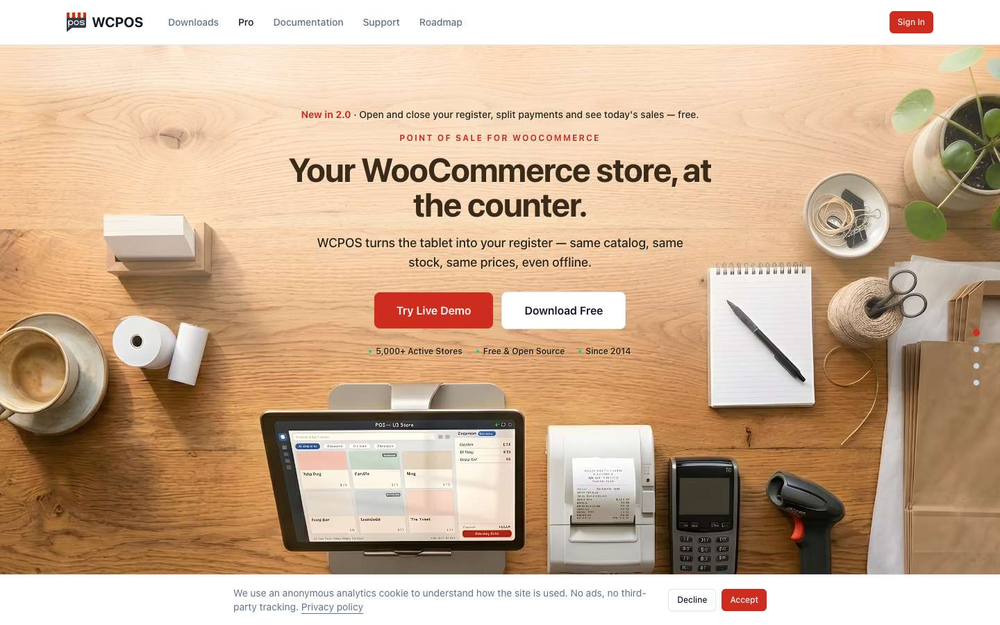 |  |
| /support | 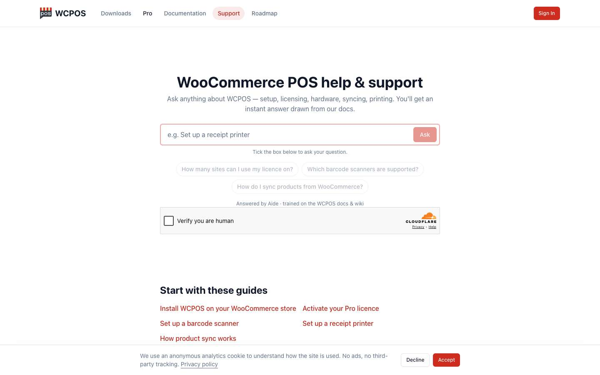 | 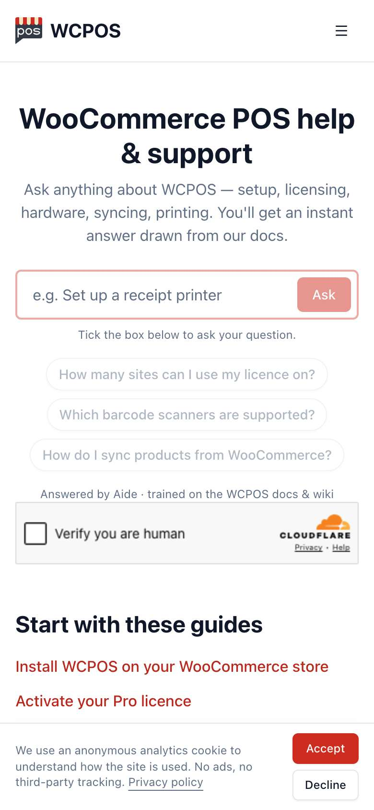 |
| /compare/square | 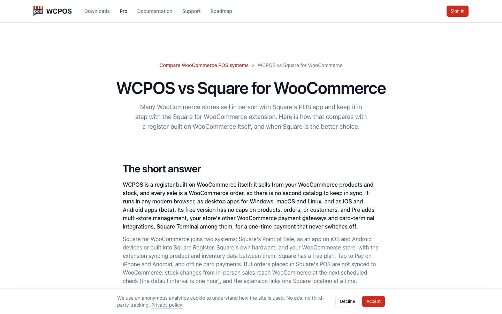 | 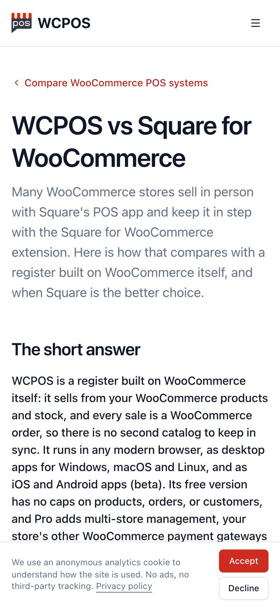 |

## 10-second test

All five judges answered both questions from the home fold. WCPOS is a free,
open-source WooCommerce register that turns a tablet into the shop's till,
selling from the store's own catalog, stock and prices. The "New in 2.0" line
says why v2 matters: opening and closing the register, split payments and
today's sales are now free.

## Scores

| Judge | Marketing | UI | SEO |
|---|---|---|---|
| shop-owner (Opus) | 8 | 8 | 9 |
| woo-dev (Opus) | 7 | 7 | 8 |
| designer (Opus) | 7 | 7 | 8 |
| seo (Opus) | 8 | 8 | 8 |
| sceptic (Astra) | 8 | 8 | 9 |
| **Mean** | **7.6** | **7.6** | **8.4** |
| Round 35 | 7.4 | 7.6 | 8.4 |
| **Delta** | **+0.2** | **0** | **0** |

The overall mean is 7.87 (+0.07). One score moved: the sceptic's marketing
score went from 7 back to 8. Every other judge scored the same as in round 35.

Was a round-35 change to blame? No. #851 (the /pro demo link) and #850 (the
sitemap dates) drew no complaint. woo-dev named the /support Discord box
again, because #849's skeleton came off too early (see the fixes below). The
mean rose, so nothing is reverted.

## Lighthouse (live, light theme, capture pass)

| Page | Mobile perf | Desktop perf | A11y / BP / SEO | Mobile LCP |
|---|---|---|---|---|
| / | 93 | 100 | 100 | 3.2 s |
| /pro | 97 | 100 | 100 | 2.6 s |
| /compare | 100 | 100 | 100 | 1.4 s |
| /downloads | 94 | 100 | 100 | 3.0 s |
| /de | 92 | 100 | 100 | 3.3 s |

## Worst defects

**Marketing**

- /compare pages: the terminal list misses Mercado Pago, PayArc and
  Windcave, and calls Vipps MobilePay a card terminal (woo-dev; third round).
- /pro: the customer-facing display card says "pair it to a till with a
  code"; the site's word is "register" (seo).
- Home hero subline: "WCPOS turns the tablet into your register" (designer).
  This is Paul's own copy, so it is a proposal for the front desk.
- The /compare offline bullet (shop-owner, who asks for the hold to be
  lifted) and the home offline line (sceptic). Both are the offline wording,
  a front-desk hold.

**UI**

- /support: the Discord box is still an empty dark slab in the captures,
  because the iframe's load event fires before WidgetBot paints (woo-dev).
- /extensions from `md` up: about 220 px of blank space before the first
  group heading (seo; fourth round).
- /support: the H1 sits off the site's type scale (designer).
- /compare/square on phone: "The short answer" runs to about 25 lines
  (shop-owner).
- /downloads on phone: the "Upgrading from 1.11?" warning sits below the
  macOS button, where the cookie banner covers it (sceptic).

**SEO**

- The /extensions description names terminal brands but not WCPOS Pro
  (shop-owner, designer and woo-dev).
- No WebSite JSON-LD on the home page (seo).
- The home title (sceptic). This is a front-desk hold.

## Fixes this round

Three defects were fixed, one per track. The SEO fix was named by three
judges. The UI and marketing fixes were the worst defects of the lowest
scorer (woo-dev), and both had carried over from earlier rounds. Each fix
was a written spec, implemented by an Opus 5.5 pool one-shot (route: opus).
The extensions spec was amended once, after its first implementer stopped:
the Korean description could not fit its limit with every required word.
This machine reviewed each full diff and reran the acceptance commands and
mutations.

| Track | Defect | PR | Merge |
|---|---|---|---|
| Marketing | /compare terminal list doesn't match the extension catalogue | [#853](https://github.com/wcpos/wcpos-com/pull/853) | daf463e |
| UI | /support Discord box still flashes dark after load | [#855](https://github.com/wcpos/wcpos-com/pull/855) | 315bc18 |
| SEO | /extensions description doesn't say Pro | [#856](https://github.com/wcpos/wcpos-com/pull/856) | 1fe327d |

- **#853:**
  - The WCPOS terminal cell in the "at a glance" table on all seven
    /compare pages now lists all eight terminals. Vipps MobilePay gets its own
    clause, "by QR code or push", in all ten locales (70 strings). Every
    listed terminal is already in `extensions-catalog.json`.
  - The seven `/compare/<slug>` sitemap dates move to 2026-11-19.
  - Out of scope, for later: the prose mentions (FAQ answers, "choose"
    bodies).
  - A byte check recomputed all 70 strings from the base commit. Mutations,
    each failing its test:
    - `PayArc` dropped from the ko woocommerce cell;
    - `/compare/oliver-pos` set back to 2026-11-18.
- **#855:**
  - A live probe showed what was still wrong. The iframe's load event fires
    on WidgetBot's shell, which then paints rgb(54,57,63) for about 0.7 s.
    About 350 ms after load, WidgetBot posts a `ready` message, and the
    channel paints 250 to 400 ms after that.
  - The skeleton now stays until that message (checked by origin and source)
    plus 600 ms. If no message comes, it is removed 6 s after load. There is
    still no click (#647).
  - Mutations, each failing exactly one test:
    - origin check dropped;
    - grace set to 0;
    - skeleton removed on load.
- **#856:**
  - `extensions.metadata.description` now says "card terminals with WCPOS
    Pro" in all ten locales.
  - The length test now covers the key; the old ko (109) and zh (102)
    values were over their 100-character limit. A new test pins "WCPOS Pro".
  - Mutations, each failing its test:
    - "WCPOS Pro" dropped from de;
    - ja padded to 104 characters.

## After (live, 2026-11-19)

The checks were run in headless Chromium against wcpos.com after the
1fe327d deploy, each page in a fresh browser context.

- /compare: the terminal cell reads "…Mollie Terminal, Mercado Pago, PayArc,
  Windcave; Vipps MobilePay by QR code or push" on /compare/woocommerce-pos
  (desktop) and /compare/oliver-pos (phone). It carries the same list in ko on
  /ko/compare/square and in de on /de/compare/foosales. Nothing overflows at
  390 px.
- /support: I sampled the box every 60 ms for 6 s, twice. It shows the light
  pulsing skeleton until the WidgetBot channel paints, then the channel. No
  dark rgb(54,57,63) frame appears in either run.
- /extensions: the meta description reads as merged in en, de, nl, fr, ja,
  ko and zh, at 151, 158, 155, 160, 100, 100 and 100 characters.
- sitemap.xml: `/compare/oliver-pos`, `/compare/square` and
  `/de/compare/foosales` read 2026-11-19. `/compare` and `/extensions` read
  2026-11-18.

| /compare/woocommerce-pos, desktop | /compare/oliver-pos, phone | /ko/compare/square, phone | /de/compare/foosales, phone |
|---|---|---|---|
| 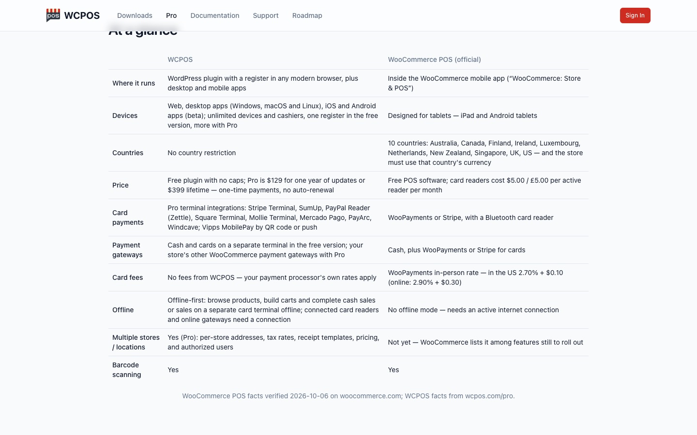 | 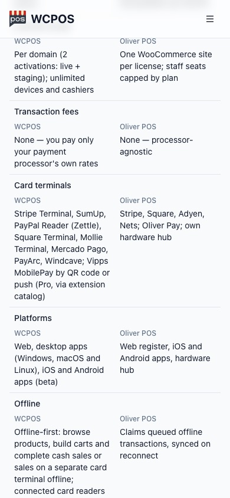 | 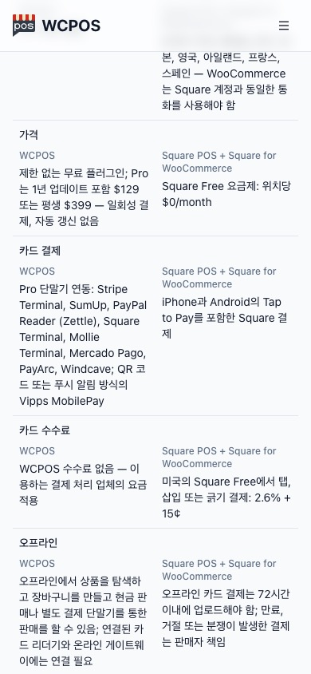 | 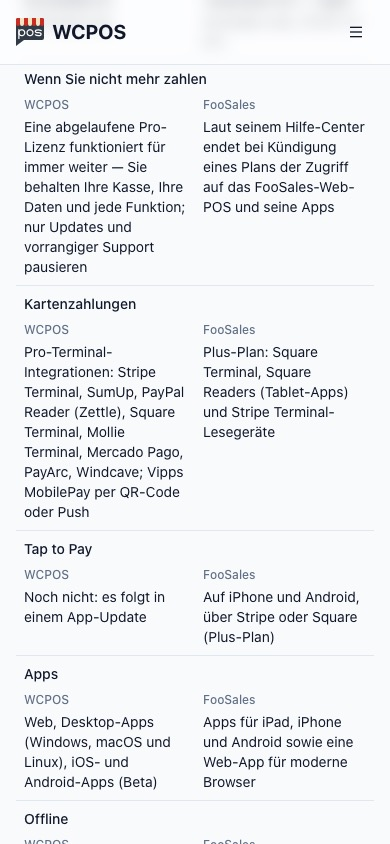 |

| /support Discord, phone (0.7 s) | /support Discord, phone (loaded) | /support Discord, desktop (loaded) |
|---|---|---|
| 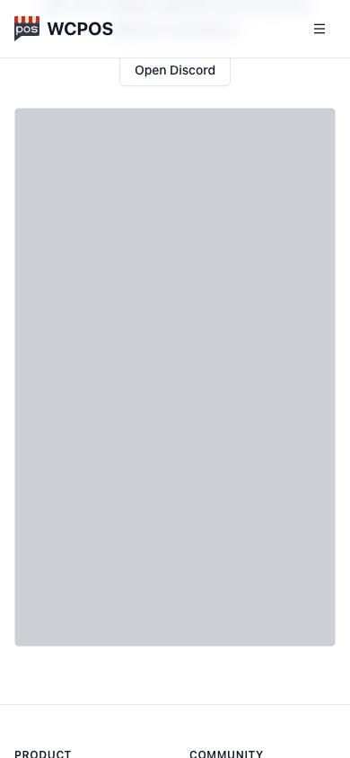 | 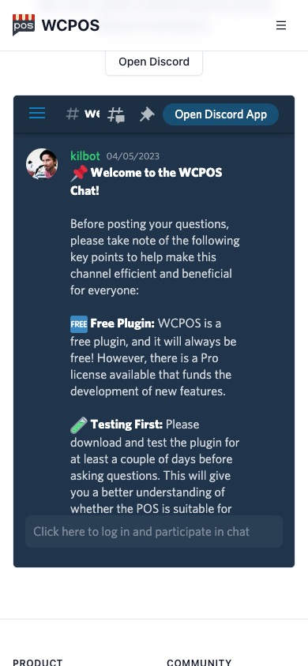 | 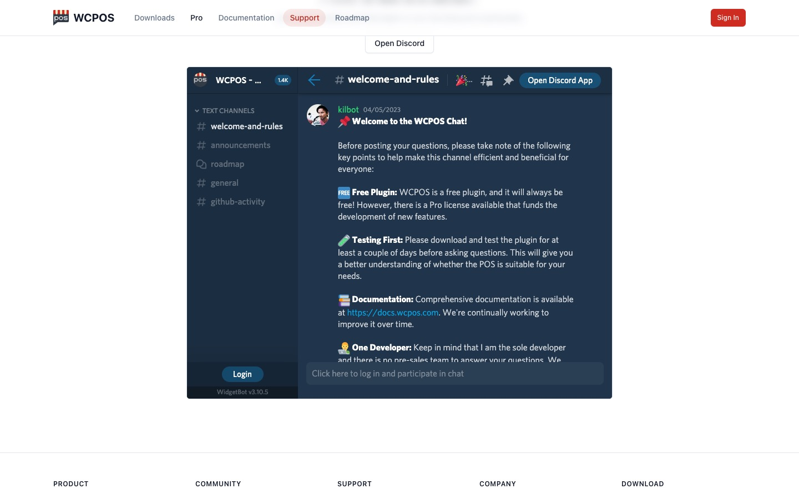 |

## Deferred

These carry over to round 37 as candidates:

- /extensions from `md` up: about 220 px of blank space before the first
  group heading (fourth round).
- The /compare prose terminal mentions: FAQ answers, "choose" bodies and the
  oliver claims response.
- /pro: "pair it to a till" should say "register".
- /support: the H1 sits off the type scale.
- /downloads on phone: move the 1.11 upgrade warning above the macOS button.
- /compare/square: the long short answer, and "As verified on 2026-10-06"
  beside "checked again 2026-11-18".
- Home WebSite JSON-LD.
- For the front desk: the hero subline rewording (Paul's copy), and the
  shop-owner's request to lift the offline hold.
