# wcpos.com hill climb, round 37 (2026-11-19)

This round re-judges the live site after round 36's fixes (#853, #855 and
#856, all live). It then records the fixes chosen from the result.

- Captures: [`2026-11-19-round-37/shots/`](2026-11-19-round-37/shots/) holds
  the fold shots. The full-page shots stay local. Visible text is in `text/`,
  page facts are in `facts.json` and Lighthouse results in `lighthouse.json`.
- Judges: [`2026-11-19-round-37/judges/`](2026-11-19-round-37/judges/). The
  personas and the brief are the same as in round 36. Four Opus 5.5 pool
  one-shots judged as usual. Codex GPT-6 Astra, the usual sceptic, hung twice on "Reconnecting... 1/5" with no verdict, so the sceptic brief ran as a fifth Opus 5.5 one-shot, judging only from the captures. The judges were not told what
  changed.

| Page | Desktop | Phone |
|---|---|---|
| Home | 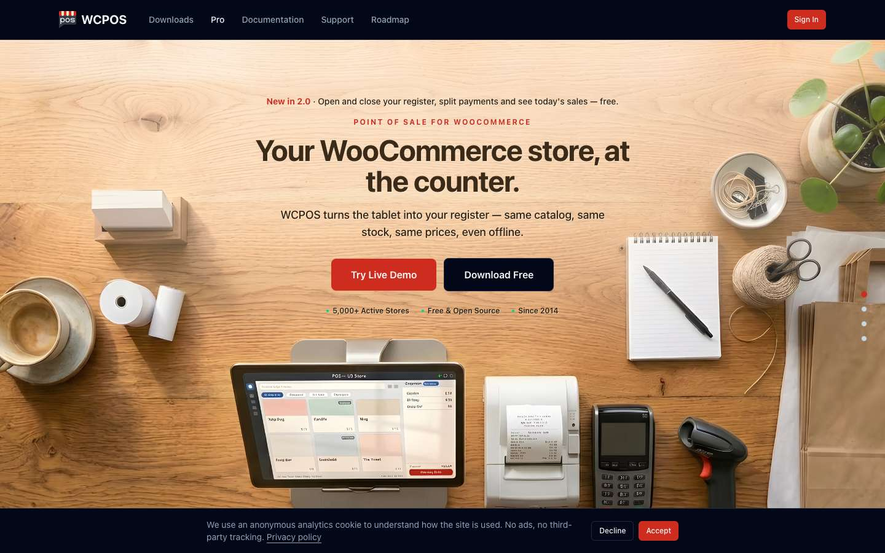 | 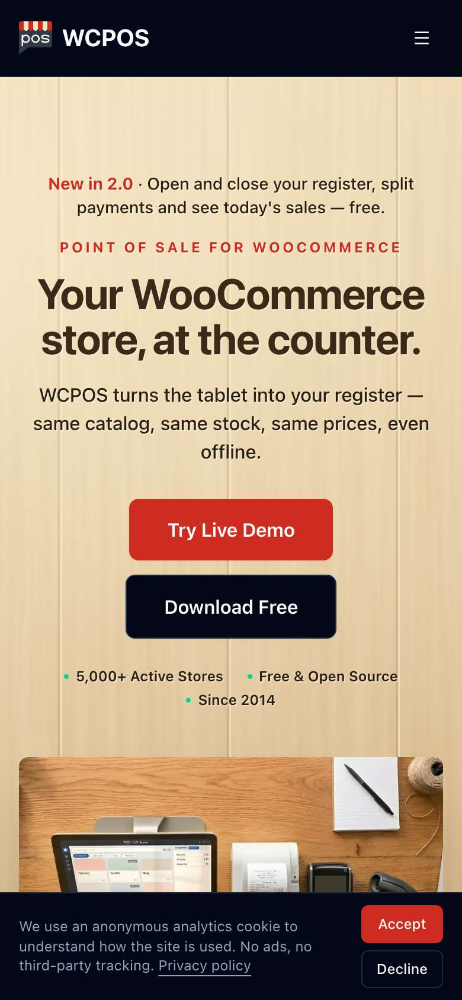 |
| /extensions | 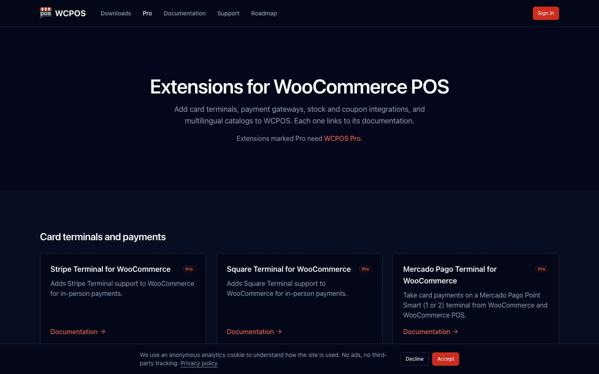 | 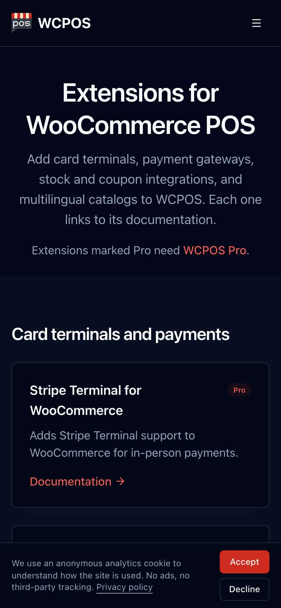 |
| /pro | 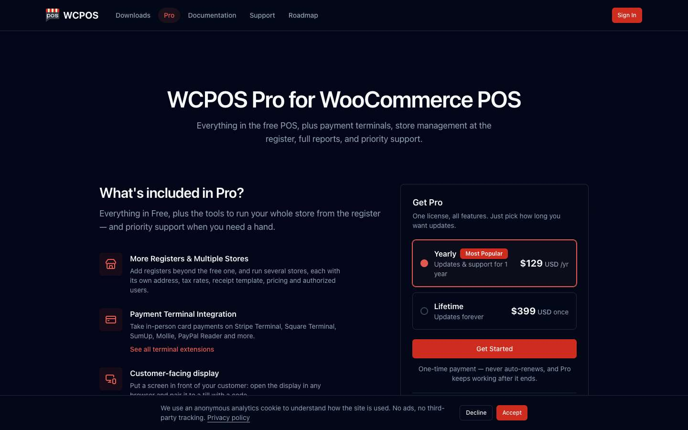 | 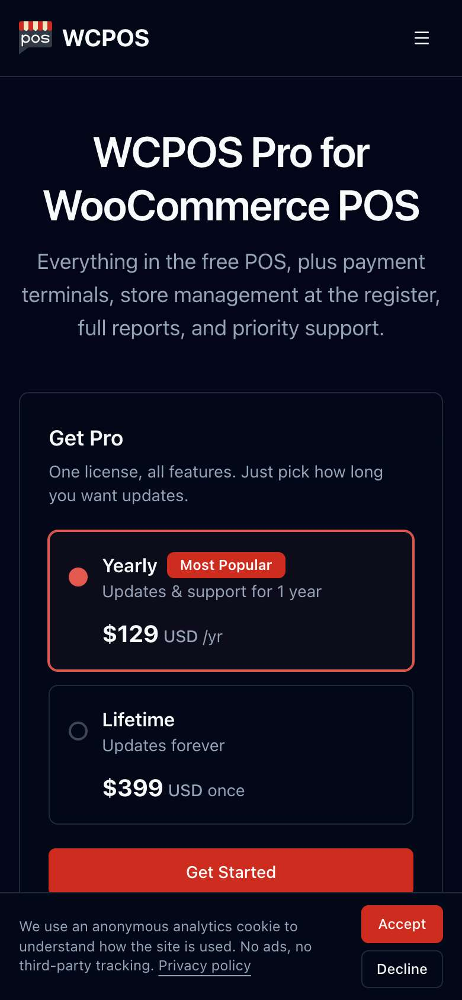 |
| /nl/pro | 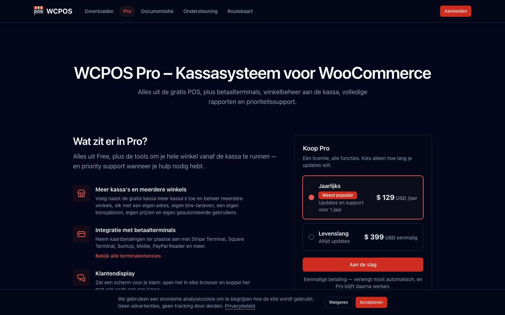 | 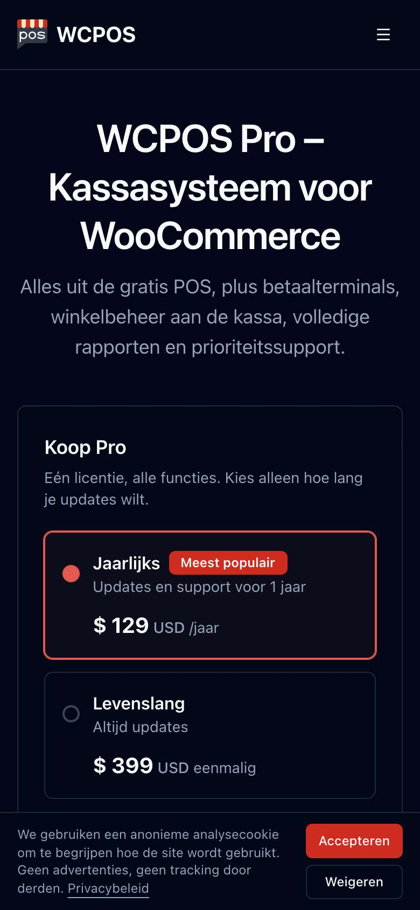 |

## 10-second test

All five judges answered both questions from the home fold. WCPOS is a free,
open-source WooCommerce point of sale that turns a tablet into the shop's
register, selling from the store's own catalog, stock and prices. The "New in
2.0" line says why v2 matters: opening and closing the register, split
payments and today's sales are now free.

## Scores

| Judge | Marketing | UI | SEO |
|---|---|---|---|
| shop-owner (Opus) | 8 | 8 | 9 |
| woo-dev (Opus) | 7 | 7 | 8 |
| designer (Opus) | 7 | 7 | 8 |
| seo (Opus) | 8 | 8 | 8 |
| sceptic (Opus; Astra down) | 7 | 8 | 8 |
| **Mean** | **7.4** | **7.6** | **8.2** |
| Round 36 | 7.6 | 7.6 | 8.4 |
| **Delta** | **−0.2** | **0** | **−0.2** |

The overall mean is 7.73 (−0.13). The four Opus judges scored exactly as in round 36, so the whole drop is the sceptic: Opus scored it 7/8/8, where Astra scored 8/8/9 in round 36. The sceptic is the only judge whose model changed, so the drop reflects the judge swap, not the site.

Was a round-36 change to blame? No. None of the judges named #853 (the
/compare terminal list), #855 (the Discord skeleton) or #856 (the
/extensions description), and the four Opus judges scored exactly as in
round 36. Nothing is reverted.

## Lighthouse (live, light theme, capture pass)

| Page | Mobile perf | Desktop perf | A11y / BP / SEO | Mobile LCP |
|---|---|---|---|---|
| / | 93 | 100 | 100 | 3.2 s |
| /pro | 99 | 100 | 100 | 2.1 s |
| /compare | 100 | 100 | 100 | 1.5 s |
| /downloads | 88 | 100 | 100 | 3.5 s |
| /de | 86 | 99 | 100 | 3.7 s |

/downloads (94 to 88) and /de (92 to 86) dropped on mobile. Round 36 changed
neither page. The /de mobile score is part of a front-desk hold: the home
scroll-story weight is in an open PR of the owner's.

## Worst defects

**Marketing**

- /pro: the customer display card says "pair it to a till with a code"; the
  site's word is "register" (seo; second round).
- nl /pro: "Alles uit Free … priority support", English terms in the Dutch
  features subtitle (designer).
- /compare/square: "Choose WCPOS if:" is a 60-word sentence (shop-owner).
- /pro: the stores card does not say whether stores share stock
  (woo-dev). This needs a product fact the site does not state, so it is not
  a copy fix.
- Home and /pro: "5,000+ Active Stores", while WordPress.org counts
  installs (sceptic). "Active Stores" vs "Active Installations" is a
  front-desk hold.

**UI**

- /extensions from `md` up: about 225 px of blank space between the intro
  and the list (woo-dev and seo; fifth round).
- /support: the H1 (`text-3xl md:text-4xl`) sits off the site's type scale
  (designer).
- /compare glance table on phone: the per-cell label "Square POS + Square for
  WooCommerce" (shop-owner).
- The same glance label on /compare/square at phone width, repeated in all
  nine stacked rows (sceptic).

**SEO**

- No WebSite JSON-LD on the home page (designer and seo).
- /compare/square: the meta description should lead with "Square sales don't
  become WooCommerce orders" (shop-owner).
- /pro: the schema description leaves out multi-store and the customer
  display (woo-dev).
- /downloads mobile Lighthouse 88, LCP 3.5 s. The sceptic suspects the
  server-rendered macOS card swapping to the detected platform after
  hydration; unconfirmed (sceptic).

## Fixes this round

Four defects were fixed. Three are the worst defects named by two judges or
more, or carried over from round 36, one per track. The fourth is the two copy
changes that the front desk approved on 2026-11-19: the home hero subline,
and the WCPOS sentence in the /compare offline bullets. The offline wording
was checked first against the wiki's free-selling page: in 2.0 a sale paid
with the Card tender for an external terminal completes offline on the free
plugin. Each fix was a written spec, implemented by an Opus 5.5 pool one-shot
(route: opus). This machine reviewed each full diff and reran the acceptance
commands and mutations.

| Track | Defect | PR | Merge |
|---|---|---|---|
| UI | /extensions gap between hero and list | [#858](https://github.com/wcpos/wcpos-com/pull/858) | 77918b3 |
| SEO | No home WebSite JSON-LD | [#859](https://github.com/wcpos/wcpos-com/pull/859) | fd4549d |
| Marketing | Hero subline and /compare offline bullets (front desk approved) | [#860](https://github.com/wcpos/wcpos-com/pull/860) | bdaaef4 |
| Marketing | /pro "till"; nl /pro English terms | [#861](https://github.com/wcpos/wcpos-com/pull/861) | 7c77ca8 |

- **#858:**
  - The /extensions hero's bottom padding steps down to `sm:pb-12 md:pb-12
    lg:pb-14`, and the top padding is unchanged.
  - The list section starts at `md:pt-16`.
  - Mutations, each failing its test:
    - hero back to `lg:pb-28`;
    - `md:pt-16` dropped.
- **#859:**
  - The home page adds `{"@type": "WebSite", "name": "WCPOS", "url":
    "https://wcpos.com/", "inLanguage": <locale>}`.
  - `alternateName` is left out on purpose, because the naming variants
    are a front-desk hold.
  - Mutations, each failing its test:
    - `inLanguage` always `'en'`;
    - `alternateName` added.
- **#860:**
  - en `home.story.a1.b` now reads "WCPOS turns your tablet, phone or
    computer into a register".
  - The final WCPOS sentence of the square, vitepos and foosales offline
    bullets is now "WCPOS keeps taking cash sales offline, and records card
    sales taken on your own standalone terminal; connected readers and
    online gateways need a connection."
  - All ten locales (40 strings). A byte check confirmed that only the four
    keys changed and that each competitor sentence is unchanged.
  - The home "Internet drops?" line is still held.
  - Mutations, each failing its test:
    - the en square bullet restored;
    - the de subline restored.
- **#861:**
  - en: "pair it to a till" and "Sync every till" (the /downloads beta
    warning) now say "register".
  - nl: the /pro subtitle now reads "Alles uit de gratis versie … en
    prioriteitssupport", and the two nl FAQ answers say
    "prioriteitssupport".
  - Mutations, each failing its test:
    - "till" restored in the en display card;
    - "priority support" restored in the nl expiry answer.

## After (live, 2026-11-19)

The checks were run in headless Chromium against wcpos.com after the 7c77ca8
deploy, each page in a fresh browser context.

- /extensions at 1440 px: the gap from the intro's last line to the top of
  the list is 120 px. Before, it was about 225 px.
- Home JSON-LD: `/` and `/de` each carry exactly one WebSite node, with
  `inLanguage` `en` and `de` and the url `https://wcpos.com/`.
- /pro reads "pair it to a register", and "to a till" is gone. /nl/pro reads
  "Alles uit de gratis versie" and "prioriteitssupport", and "priority
  support" is gone.
- Home at 390 px, in en, de and nl: the new subline shows, and both CTAs and
  the trust row stay above the fold. Nothing overflows horizontally. de, the
  longest, ends its buttons at about 620 of 844 px.
- /compare/square, /compare/vitepos and /compare/foosales show the new
  offline sentence. The old "but connected card readers" wording is gone.

| /extensions, desktop | Home en, phone | Home de, phone | Home nl, phone |
|---|---|---|---|
| 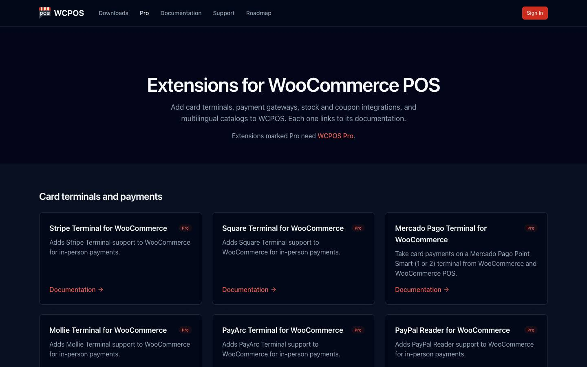 | 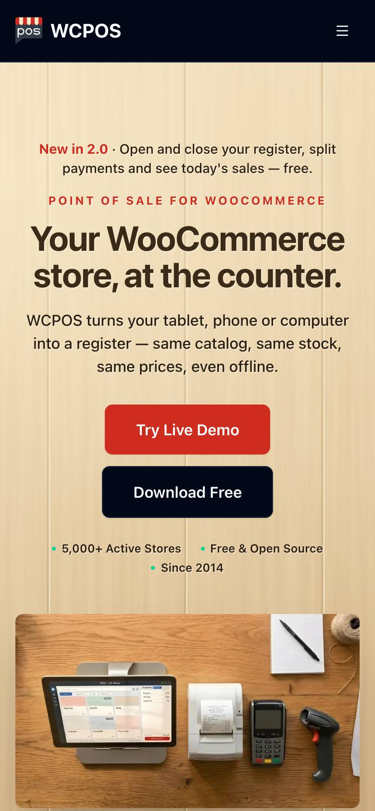 | 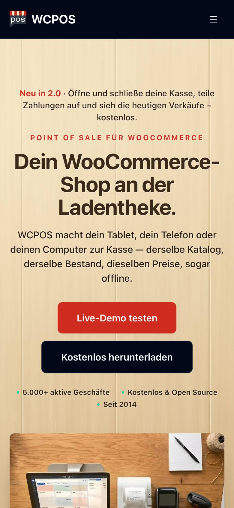 | 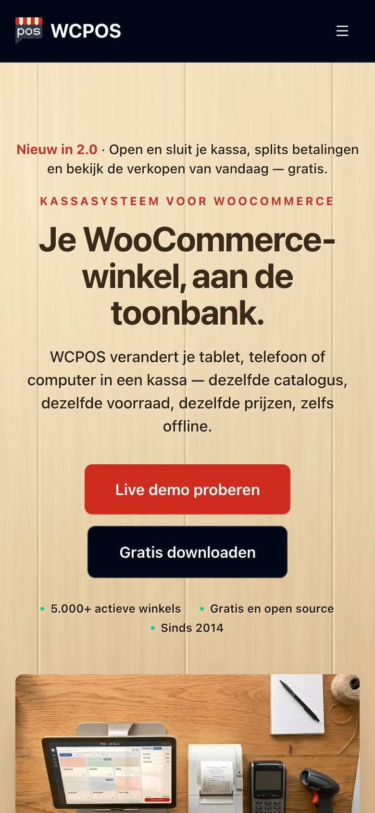 |

## Deferred

These carry over to round 38 as candidates:

- /support: the H1 sits off the type scale.
- /compare/square: "Choose WCPOS if:" as bullets, the long short answer, and
  "As verified on 2026-10-06" beside "checked again 2026-11-18".
- /compare glance table on phone: shorten "Square POS + Square for
  WooCommerce".
- /compare/square meta description.
- /pro schema description: name multi-store and the customer display.
- The /compare prose terminal mentions, and the en /compare "pair it to a
  till" lines.
- /downloads on phone: move the 1.11 upgrade warning above the macOS button.
- /de: the hero eyebrow is still English; the /about-us title; "centre";
  Organization foundingDate.
- /downloads mobile LCP: confirm the LCP element first, then render a
  platform-neutral card on the server (sceptic; shop-owner saw the macOS
  flash too).
- For the front desk: "Active Stores" vs "active installs" (sceptic; held).
