# wcpos.com hill climb, round 38 (2026-11-19)

This round re-judges the live site after round 37's fixes (#858, #859, #860
and #861, all live). It then records the fixes chosen from the result.

- Captures: [`2026-11-19-round-38/shots/`](2026-11-19-round-38/shots/) holds
  the fold shots. The full-page shots stay local. Visible text is in `text/`,
  page facts are in `facts.json` and Lighthouse results in `lighthouse.json`.
- Judges: [`2026-11-19-round-38/judges/`](2026-11-19-round-38/judges/). The
  personas and the brief are the same as in round 37. Four Opus 5.5 pool
  one-shots judged as usual. Codex GPT-6 Astra hung again on
  "Reconnecting... 1/5" and was stopped by its 570 s timeout, so the sceptic
  brief ran as a fifth Opus 5.5 one-shot, as in round 37. The judges were not
  told what changed.

| Page | Desktop | Phone |
|---|---|---|
| Home | 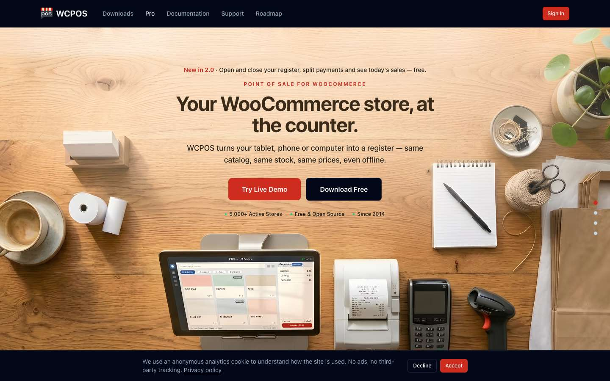 | 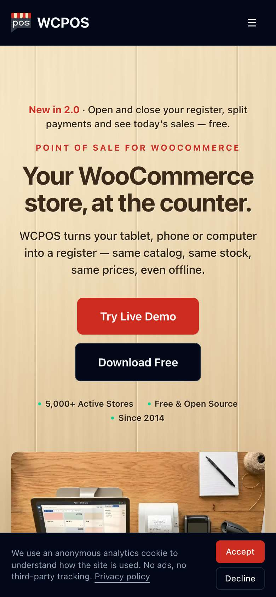 |
| /compare/square | 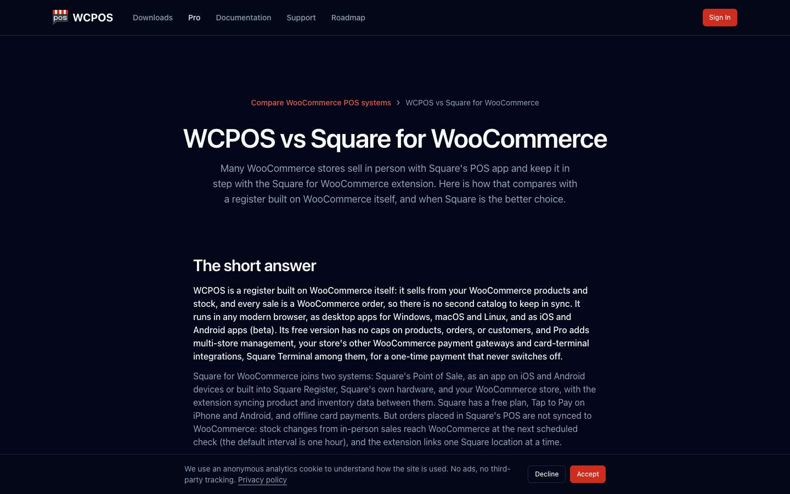 | 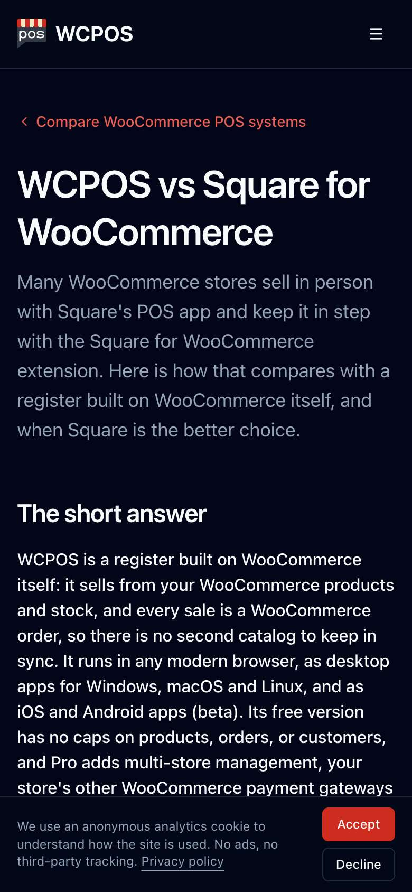 |
| /pro | 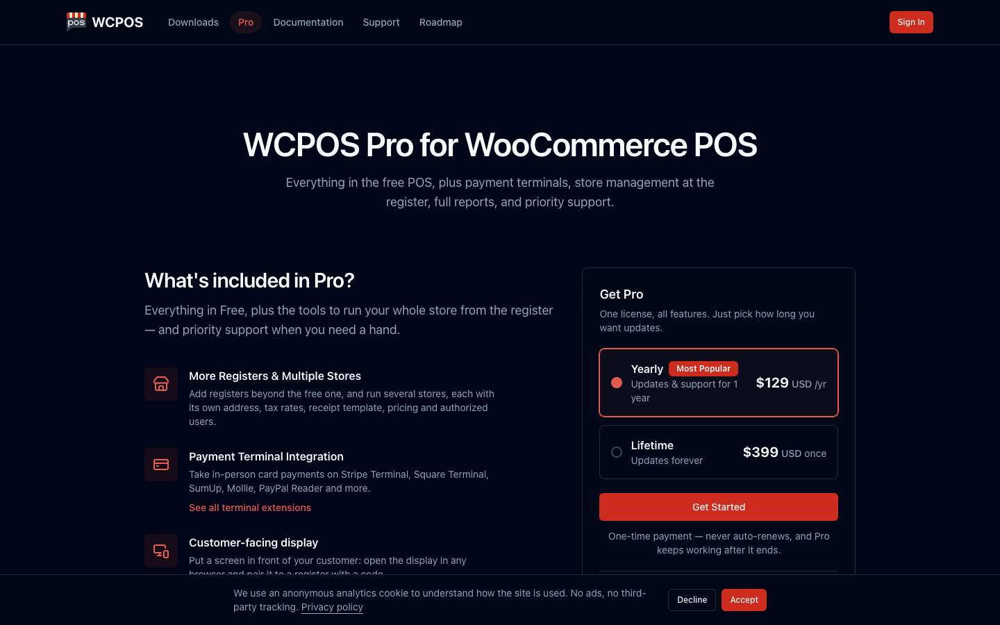 | 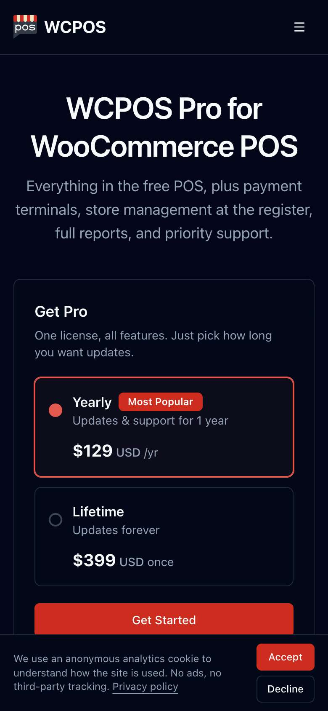 |
| /extensions | 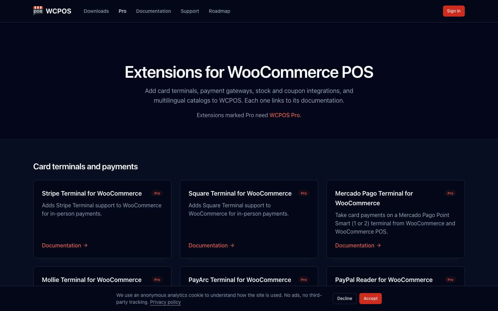 | 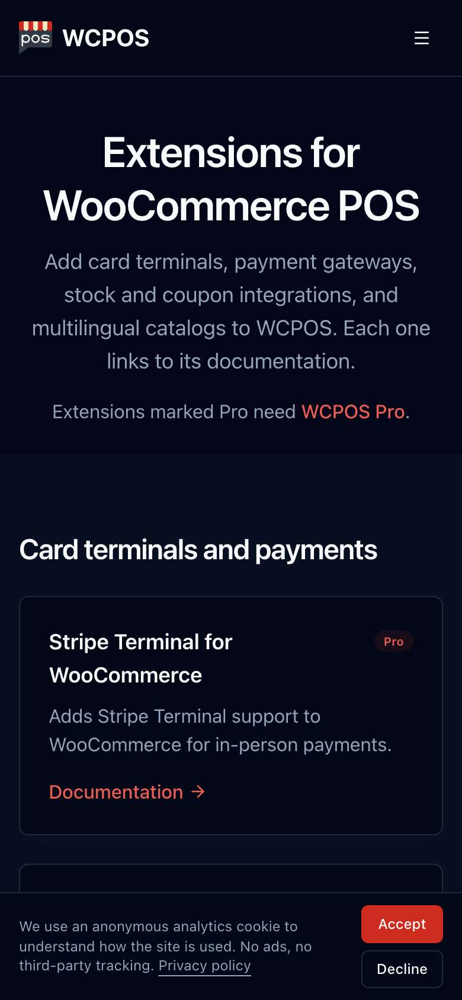 |

## 10-second test

All five judges answered both questions from the home fold. WCPOS is a free,
open-source WooCommerce point of sale that turns a tablet, phone or computer
into the shop's register, selling from the store's own catalog, stock and
prices, even offline. Round 37's new hero subline ("your tablet, phone or
computer") was read back by every judge. The "New in 2.0" line answers why
v2. Two judges still find it easy to skim past. The sceptic reads it as
catching up with Square Free rather than pulling ahead.

## Scores

| Judge | Marketing | UI | SEO |
|---|---|---|---|
| shop-owner (Opus) | 8 | 8 | 9 |
| woo-dev (Opus) | 7 | 8 | 8 |
| designer (Opus) | 7 | 7 | 8 |
| seo (Opus) | 8 | 8 | 8 |
| sceptic (Opus; Astra down) | 7 | 8 | 8 |
| **Mean** | **7.4** | **7.8** | **8.2** |
| Round 37 | 7.4 | 7.6 | 8.2 |
| **Delta** | **0** | **+0.2** | **0** |

The overall mean is 7.80 (+0.07). The same five models judged as in round
37, so this delta compares like with like. The rise is woo-dev's UI score
(7 to 8), and woo-dev no longer names the /extensions gap that #858 closed.
No score fell, so nothing is reverted.

## Lighthouse (live, light theme, capture pass)

| Page | Mobile perf | Desktop perf | A11y / BP / SEO | Mobile LCP |
|---|---|---|---|---|
| / | 92 | 100 | 100 | 3.3 s |
| /pro | 96 | 100 | 100 | 2.7 s |
| /compare | 97 | 100 | 100 | 2.5 s |
| /downloads | 94 | 100 | 100 | 3.0 s |
| /de | 92 | 100 | 100 | 3.3 s |

Mobile scores moved within run-to-run noise. /downloads (88 to 94) and /de
(86 to 92) recovered round 37's drops without a change to either page.

## Worst defects

**Marketing**

- /compare glance table: the WCPOS "Card payments" cell lists only the Pro
  terminal integrations, so free WCPOS reads as taking no cards
  (shop-owner).
- /pro: the stores card does not say whether stores share stock, alongside
  the "2 sites" FAQ (woo-dev). It needs a product fact, and the FAQ is held.
- /compare/square: "Choose WCPOS if:" is one 60-word sentence (designer;
  third round).
- /pro: the hero subline and the features subtitle both say "Everything in
  free, plus …" within 180 px (seo).
- /compare/square: "Square Free ($0/month) … WCPOS Pro costs $129 or more"
  (sceptic). The Square price line is a front-desk hold.

**UI**

- /compare/square on phone: the per-cell label "Square POS + Square for
  WooCommerce" wraps in all nine stacked rows (shop-owner and sceptic; both
  named it in round 37 too).
- /pro: the feature descriptions are `text-sm` in `max-w-md` at 1440 px
  (woo-dev).
- /pro: seven feature titles are Title Case beside one in sentence case, and
  "Frequently Asked Questions" differs from /compare (designer).
- /downloads on phone: the 1.11 upgrade warning sits below the macOS
  button (seo; second round).

**SEO**

- Home title (shop-owner). This is a front-desk hold.
- /pro H1 "WCPOS Pro for WooCommerce POS" (woo-dev). This is a front-desk
  hold.
- /pro `SoftwareApplication` description opens with "Premium" and leaves out
  multiple stores and the customer display (designer; woo-dev in round 37).
- /de home kicker "POINT OF SALE FÜR WOOCOMMERCE" is English, not
  "Kassensystem für WooCommerce" (seo).
- Home meta description opens with an unqualified "Sell offline" (sceptic).

## Fixes this round

Four defects were fixed: the worst named by two judges, the worst carried
over across rounds, and two single-file fixes that needed no new wording
approval. Holds were skipped. Each fix was a written spec, implemented by an
Opus 5.5 pool one-shot (route: opus). This machine reviewed each full diff,
byte-checked the message files against base, and reran the acceptance
commands and mutations.

| Track | Defect | PR | Merge |
|---|---|---|---|
| UI | /compare/square phone glance label | [#863](https://github.com/wcpos/wcpos-com/pull/863) | 9c536bd |
| UI | /pro Title Case feature titles and FAQ heading | [#864](https://github.com/wcpos/wcpos-com/pull/864) | e19457b |
| SEO | /pro schema description | [#865](https://github.com/wcpos/wcpos-com/pull/865) | 17a2bf3 |
| Marketing | /compare Card payments cell lists only Pro | [#866](https://github.com/wcpos/wcpos-com/pull/866) | 1a2906f |

- **#863:**
  - `GlanceTable` takes an optional `otherShortHeader` for its phone-only,
    `aria-hidden` label. The column header, which is also the
    screen-reader header, keeps the full name.
  - /compare/square passes the new `colSquareShort`, "Square" in all ten
    locales.
  - Mutations, each failing its test:
    - the span renders the full header;
    - the de key removed.
- **#864:**
  - en: seven `pro.features.*.title` values and `pro.faq.title` are now
    sentence case. The e2e locator follows.
  - Mutations, each failing its test:
    - "Order Management" restored;
    - "Frequently Asked Questions" restored.
- **#865:**
  - `pro.schema.description` in all ten locales now follows the page's meta
    description. It names more registers and multiple stores and the
    customer-facing display, and drops "Premium". There are no new claims;
    every feature named has its own card on /pro.
  - Mutations, each failing its test:
    - the en "Premium…" string restored;
    - the display term dropped from de.
- **#866:**
  - In 6 pages × 10 locales, the WCPOS Card payments cell now opens with
    "Free: cash, and card sales taken on your own standalone terminal,
    recorded on the order." The unchanged Pro list follows.
  - The fact is the one the front desk approved on 2026-11-19 for the
    offline bullets. A byte check confirmed that exactly the 60 keys changed
    and each new value ends with its old value.
  - Mutations, each failing its test:
    - one en cell restored;
    - the de jovvie cell restored.

## After (live, 2026-11-19)

The checks were run in headless Chromium against wcpos.com after the 1a2906f
deploy, each page in a fresh browser context.

- /compare/square at 390 px, en and de: the phone labels read "WCPOS" ×9 and
  "Square" ×9. The two answers in each row start level. Nothing overflows
  horizontally.
- The Card payments cell opens with the free sentence on /compare/square
  (en, de), /compare/yith-pos (en) and /nl/compare/foosales (nl), and the
  Pro list follows.
- /pro headings read "More registers & multiple stores", "Payment terminal
  integration", "Customer-facing display", "Stock & price editing", "Order
  management", "Customer management", "Reports across days, registers &
  stores", "Custom payment gateways" and "Frequently asked questions".
- /pro and /de/pro `SoftwareApplication.description` carry the new strings
  ("WCPOS Pro for WooCommerce adds more registers and multiple stores, …";
  "WCPOS Pro für WooCommerce ergänzt weitere Kassen und Filialen, …").

| /compare/square en, phone | /compare/square de, phone | /pro, desktop |
|---|---|---|
| 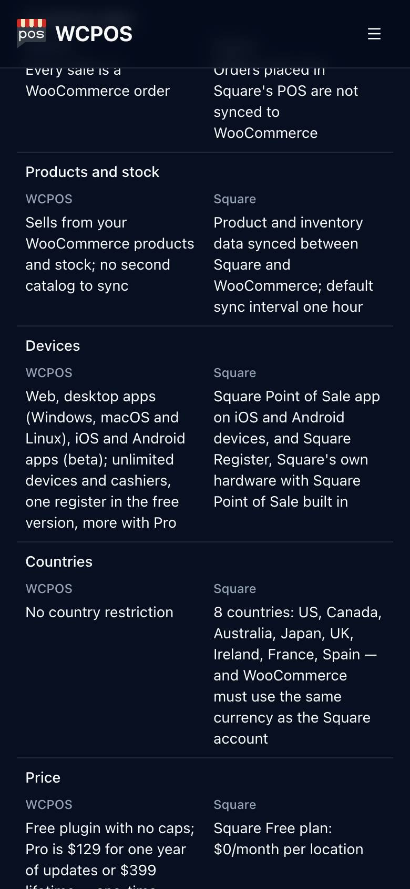 | 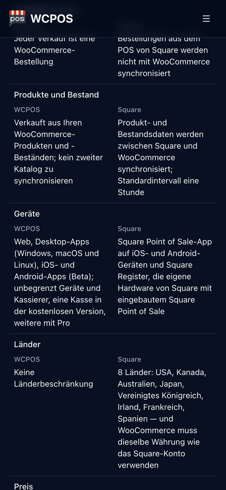 | 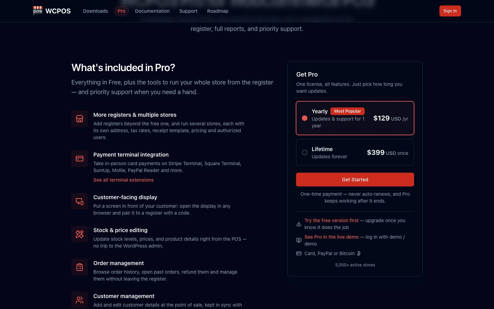 |

## Deferred

These carry over to round 39 as candidates:

- /compare/square: "Choose WCPOS if:" as bullets (designer; third round).
  This restructures seven compare pages in ten locales.
- /downloads on phone: move the 1.11 upgrade warning above the macOS button.
- /de: the home kicker as "Kassensystem für WooCommerce".
- /pro: the duplicate "Everything in free, plus" subtitle.
- /pro: the feature descriptions at `text-sm` in `max-w-md`.
- Home meta description: qualify "Sell offline".
- /support: the H1 sits off the type scale.
- /compare prose: "8 terminals" in the table against six in the prose;
  "As verified on 2026-10-06" beside "checked again 2026-11-18".
- /downloads: the 2.0.0 release note says "till"; mobile LCP and the macOS
  card flash.
- "licence" vs "license" on /support; the de priority-support terms.
- For the front desk: whether stores share stock (an ATUM question), and
  "Active Stores" vs "active installs" (held).
