# wcpos.com hill climb, round 39 (2026-11-19)

This round re-judges the live site after round 38's fixes (#863, #864, #865
and #866, all live). It then records the fixes chosen from the result.

- Captures: [`2026-11-19-round-39/shots/`](2026-11-19-round-39/shots/) holds
  the fold shots. The full-page shots stay local. Visible text is in `text/`,
  page facts are in `facts.json` and Lighthouse results in `lighthouse.json`.
- Judges: [`2026-11-19-round-39/judges/`](2026-11-19-round-39/judges/). The
  personas and the brief are the same as in round 38. Four Opus 5.5 pool
  one-shots judged as usual. Codex GPT-6 Astra hung on "Reconnecting...
  1/5" for the third round running and was stopped by its 570 s timeout, so
  the sceptic brief again ran as a fifth Opus 5.5 one-shot. The judges were
  not told what changed.

| Page | Desktop | Phone |
|---|---|---|
| Home | 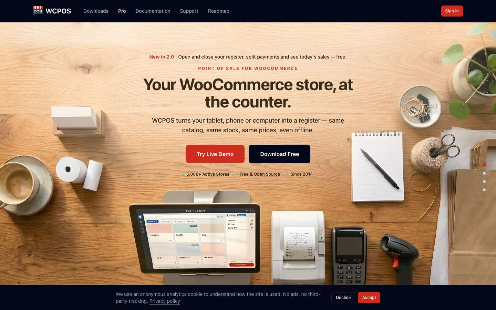 | 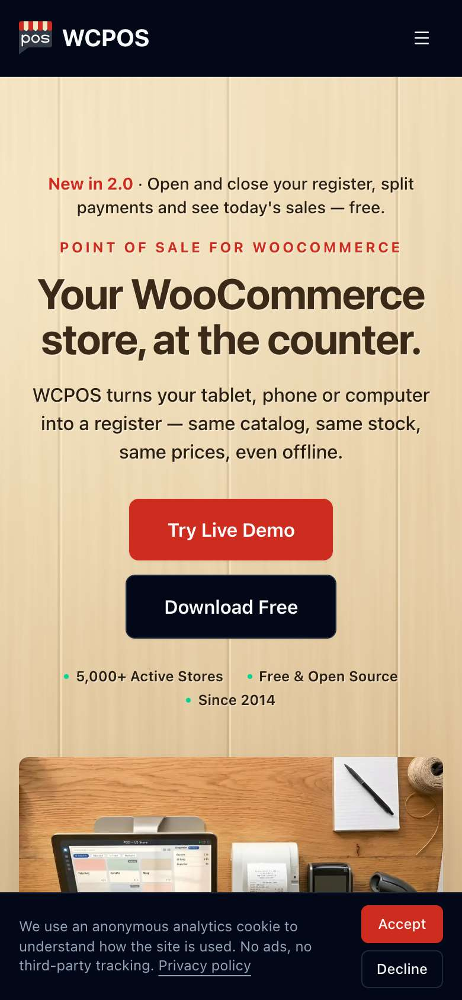 |
| /pro | 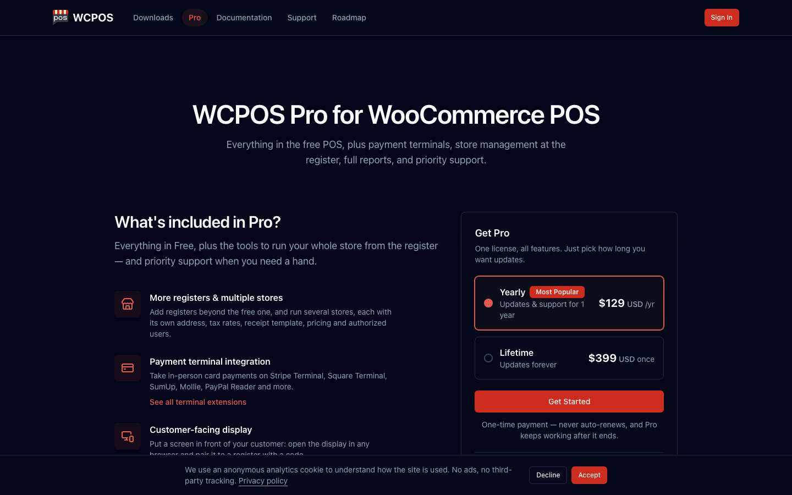 | 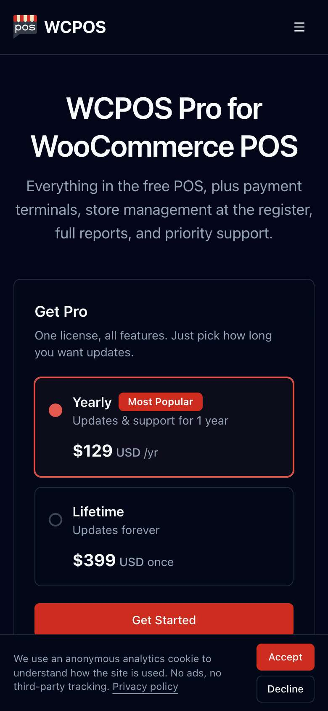 |
| /downloads | 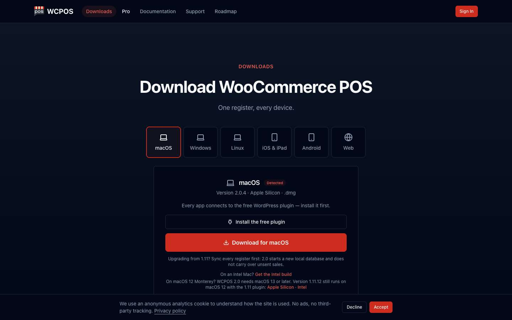 | 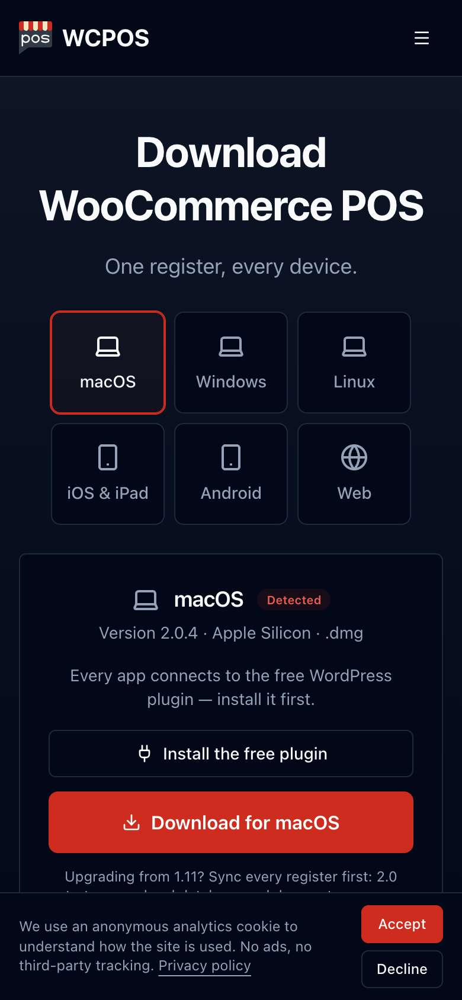 |
| /de | 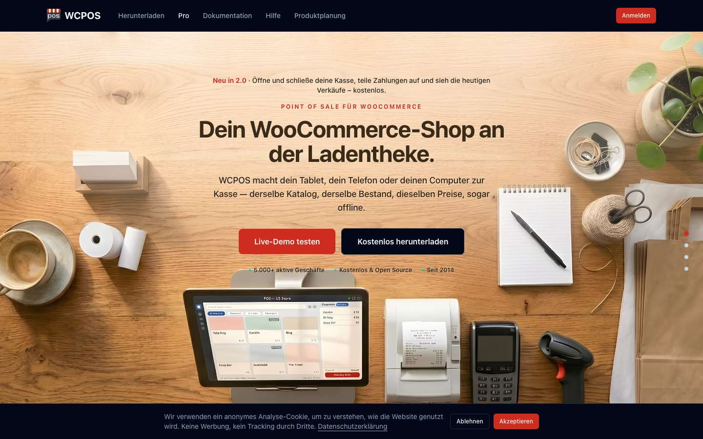 | 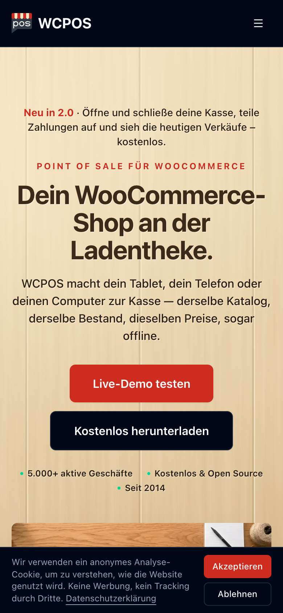 |

## 10-second test

All five judges answered both questions from the home fold: WCPOS turns a
tablet, phone or computer into a register for a WooCommerce store, selling
from the same catalog, stock and prices, even offline. The "New in 2.0" line
answers why v2, but three judges call it weak: it reads as a footnote
(designer), does not say that 2.0 has its own checkout (woo-dev), and names
features Square and FooSales already have (sceptic).

## Scores

| Judge | Marketing | UI | SEO |
|---|---|---|---|
| shop-owner (Opus) | 8 | 8 | 8 |
| woo-dev (Opus) | 7 | 8 | 8 |
| designer (Opus) | 7 | 7 | 8 |
| seo (Opus) | 8 | 8 | 8 |
| sceptic (Opus; Astra down) | 7 | 8 | 8 |
| **Mean** | **7.4** | **7.8** | **8.0** |
| Round 38 | 7.4 | 7.8 | 8.2 |
| **Delta** | **0** | **0** | **−0.2** |

The overall mean is 7.73 (−0.07). The one score that moved is the
shop-owner's SEO, 9 to 8, and its stated defect is the /downloads mobile
Lighthouse score of 69 in the capture pass. That score was capture noise:
the capture ran with the machine's load average at 5–8, and three fresh
mobile runs of /downloads scored 87, 94 and 97 (TBT 270, 40 and 30 ms),
against 1,070 ms in the capture. Home, at 78 in the capture, scored 92 on
all three re-runs. No judge named a round-38 change as a defect, so nothing
is reverted. The sceptic did note that the WCPOS Card payments cell that #866
lengthened now runs about 12 lines at phone width, against 3 for Square; its
UI score held at 8. That length is a candidate for a later round.

## Lighthouse (live, light theme)

| Page | Mobile perf (capture) | Mobile perf (re-runs) | Desktop perf | A11y / BP / SEO |
|---|---|---|---|---|
| / | 78 | 92, 92, 92 | 100 | 100 |
| /pro | 99 | — | 100 | 100 |
| /compare | 100 | — | 100 | 100 |
| /downloads | 69 | 87, 94, 97 | 100 | 100 |
| /de | 93 | — | 100 | 100 |

## Worst defects

**Marketing**

- /compare hub: the Square and FooSales cards list the topics each page
  covers instead of its answer (shop-owner).
- /pro: the site never says whether stores share stock, beside the "2 sites"
  FAQ (woo-dev; third round). This needs a product fact from the owner.
- Home: the "New in 2.0" line is plain small text on the photo with no link
  (designer). It is in the scroll-story, which an open owner PR touches.
- /pro: the hero subline and the features subtitle both say "Everything in
  free, plus … priority support" within 180 px (seo; second round).
- "5,000+ Active Stores" against WordPress.org's installs (sceptic). Held
  since round 37; a front-desk ruling this round released it (#875).

**UI**

- /compare/square on phone: "The short answer" is about 200 words in two
  unlabelled paragraphs, under a six-line subtitle (shop-owner).
- /pro: feature descriptions at `text-sm` in `max-w-md` read as fine print
  (woo-dev; second round).
- /downloads on phone: the "·" separators in the "Pick your device" rows
  leave a stray dot at the end of a line (designer).
- /downloads on phone: the 1.11 upgrade warning sits below the download
  button, under the cookie bar (seo; third round).
- /compare/square on phone: the glance table's WCPOS cells run far longer
  than Square's, the Card payments cell most of all (sceptic).

**SEO**

- /downloads mobile Lighthouse 69 (shop-owner and sceptic). Re-runs show
  capture noise; see above.
- /downloads and the SoftwareApplication JSON-LD state "WordPress 5.6+ ·
  WooCommerce 9.0+" (woo-dev). The judge flags that WooCommerce 9.0 itself
  needs a newer WordPress; the number must be confirmed against the plugin
  readme before any change.
- Home meta description: an unqualified "Sell offline", with "free in 2.0"
  trailing (designer; the sceptic's runner-up in rounds 38 and 39).
- /de home kicker "POINT OF SALE FÜR WOOCOMMERCE" is English (seo; second
  round).

## Fixes this round

Five defects were fixed: four judged defects, plus the "Active Stores" item,
held since round 37 and released by a front-desk ruling this round. Holds
were skipped. Each fix was a written spec, implemented by an Opus 5.5 pool
one-shot (route: opus). This machine reviewed each full diff, byte-checked
the message files against base, and reran the acceptance commands and
mutations.

| Track | Defect | PR | Merge |
|---|---|---|---|
| UI | /downloads upgrade note below the download button | [#871](https://github.com/wcpos/wcpos-com/pull/871) | 08afdc8 |
| SEO | /de home kicker in English | [#872](https://github.com/wcpos/wcpos-com/pull/872) | 0db489f |
| Marketing | /pro features subtitle repeats the hero | [#873](https://github.com/wcpos/wcpos-com/pull/873) | f9e0c26 |
| SEO | Home meta description: unqualified offline | [#874](https://github.com/wcpos/wcpos-com/pull/874) | 6f8b224 |
| Marketing | "Active Stores" label on the installs count | [#875](https://github.com/wcpos/wcpos-com/pull/875) | 81d54c1 |

- **#871:**
  - `download-hero.tsx`: the 1.11 upgrade note now sits between "Install
    the free plugin" and the download button, so it is read before the
    download. The order test follows.
- **#872:**
  - de `home.story.a1.k` is "Kassensystem für WooCommerce". A new test keeps
    the de kicker free of "Point of Sale".
- **#873:**
  - /pro no longer passes a features subtitle; `ProFeatureList` takes it as
    optional. `pro.features.subtitle` is removed from all ten locales.
  - Mutations, each failing its test:
    - en.json and page.tsx restored;
    - de.json alone restored.
- **#874:**
  - `home.meta.description` in all ten locales. en (150 characters): "Free,
    open-source WooCommerce POS for your tablet, phone or computer. Cash
    sales work offline; split payments and register open/close are free in
    2.0." Every phrase is already on the site. The phone-apps clause is
    gone, so the home description needs no "beta" label; /downloads keeps
    its own.
  - Mutations, each failing its test:
    - the old en string restored;
    - "2.0" removed from ko.
- **#875:**
  - The front-desk ruling: the label follows the number's source. The
    5,000+ figure is WordPress.org's active-installs count, so the hero
    badge, the /pro buy-box line and the /compare/oliver-pos hobby-shops
    answer say "active installs" in all ten locales. The last two name
    WordPress.org. The number is unchanged.
  - Mutations, each failing its test:
    - the en badge "Active Stores" restored;
    - the fr buy-box line restored.

## After (live, 2026-11-19)

The checks were run in headless Chromium against wcpos.com after the 81d54c1
deploy, each page in a fresh browser context.

- /downloads at 390 × 844 with the cookie bar showing: the upgrade note
  (top 668 px) now sits above "Download for macOS" (top 728 px), and the
  whole note is visible above the cookie bar (top 753 px).
- /de at 390 px: the kicker reads "KASSENSYSTEM FÜR WOOCOMMERCE".
- / and /de `<meta name="description">` carry the new strings, and the
  /llms.txt opening quote follows the en one.
- Hero badge at 390 px: "5,000+ Active Installs", "5.000+ aktive
  Installationen" and "Plus de 5 000 installations actives" each fit on one
  line. No page overflows horizontally.
- /pro and /de/pro: "What's included in Pro?" leads straight into the list,
  and the old subtitle is gone. The buy box reads "5,000+ active installs on
  WordPress.org" and "5.000+ aktive Installationen auf WordPress.org".
- /compare/oliver-pos: "WCPOS has 5,000+ active installs on WordPress.org",
  and no "active stores" remains.

| /downloads, phone | /fr, phone | /pro, desktop |
|---|---|---|
| 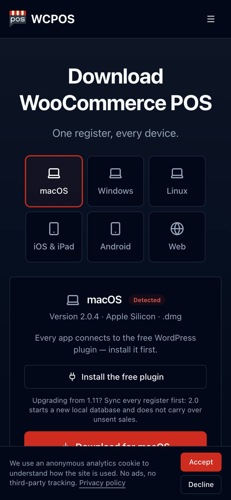 | 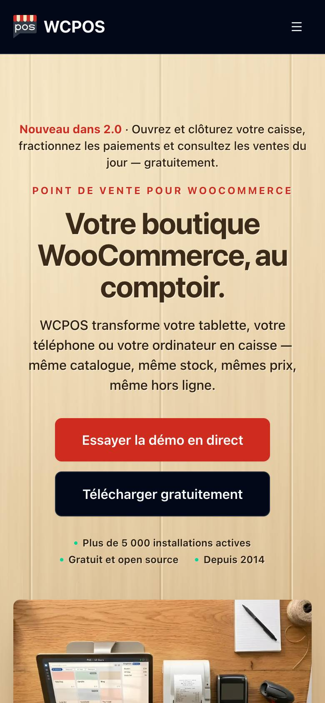 | 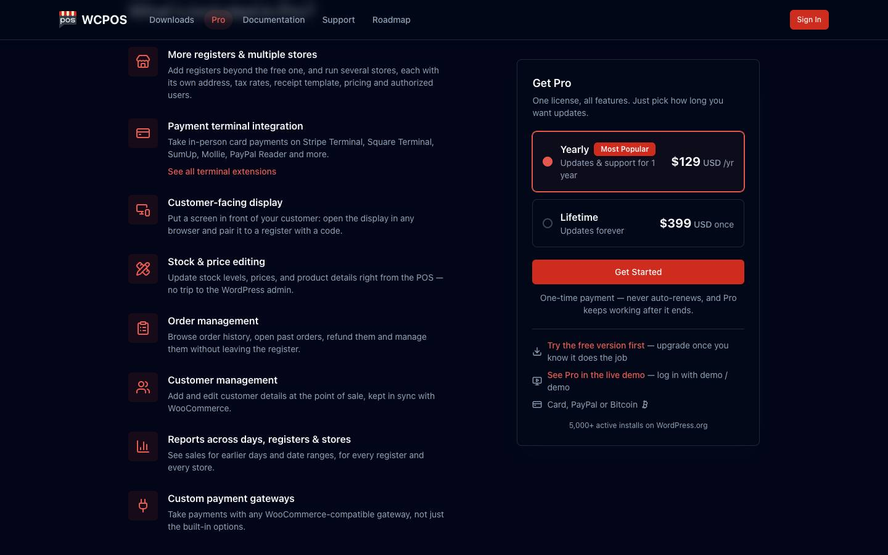 |

## Deferred

These carry over to round 40 as candidates:

- /compare hub cards: lead with each page's verdict.
- /compare/square on phone: label the short-answer paragraphs and shorten
  the subtitle; shorten the WCPOS Card payments cell.
- /pro: feature descriptions at `text-base`, without `max-w-md`.
- /downloads on phone: the stray "·" separators.
- /downloads requirements line: confirm the WordPress minimum against the
  plugin readme.
- /compare/square: "Choose WCPOS if:" as bullets (designer; rounds 36–38).
- /support: the H1 sits off the type scale; "licence" vs "license".
- /compare prose: "8 terminals" in the table against six in the prose.
- /downloads: the 2.0.0 release note says "till".
- /about-us title "About | WCPOS".
- de `home.subtitle` still says "Ein schneller Point of Sale für
  WooCommerce", the English term #872 removed from the kicker.
- fr home meta description: "Espèces hors ligne ; paiements divisés…" reads
  as a list of fragments.
- For the front desk: whether stores share stock (an ATUM question); whether
  the iOS and Android betas work with the 2.0 plugin; a link from the home
  "New in 2.0" line (scroll-story, owner PR open).
