# wcpos.com hill climb, round 40 (2026-11-19)

This round re-judges the live site after round 39's fixes (#871 to #875,
all live). It then records the fixes chosen from the result.

- Captures: [`2026-11-19-round-40/shots/`](2026-11-19-round-40/shots/) holds
  the fold shots. The full-page shots stay local. Visible text is in `text/`,
  page facts are in `facts.json` and Lighthouse results in `lighthouse.json`.
- Judges: [`2026-11-19-round-40/judges/`](2026-11-19-round-40/judges/). The
  personas and the brief are the same as in round 39. Four Opus 5.5 pool
  one-shots judged as usual. Codex GPT-6 Astra hung on "Reconnecting...
  1/5" for the fourth round running, so the sceptic brief again ran as a
  fifth Opus 5.5 one-shot. The judges were not told what changed.

| Page | Desktop | Phone |
|---|---|---|
| Home | 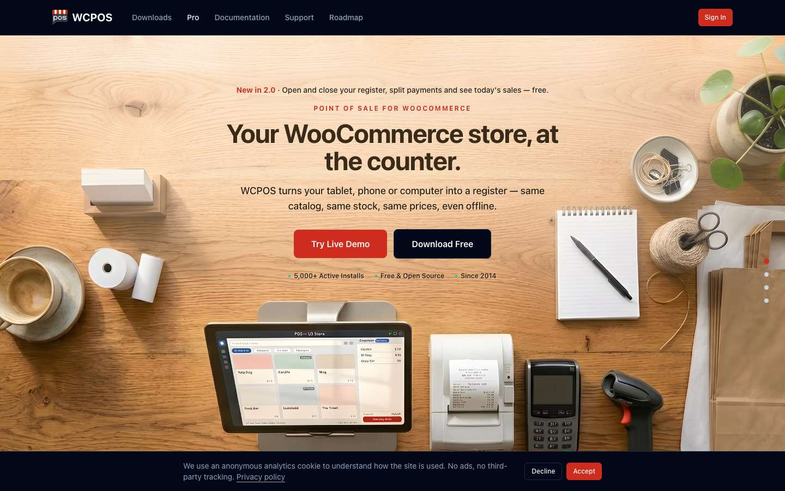 | 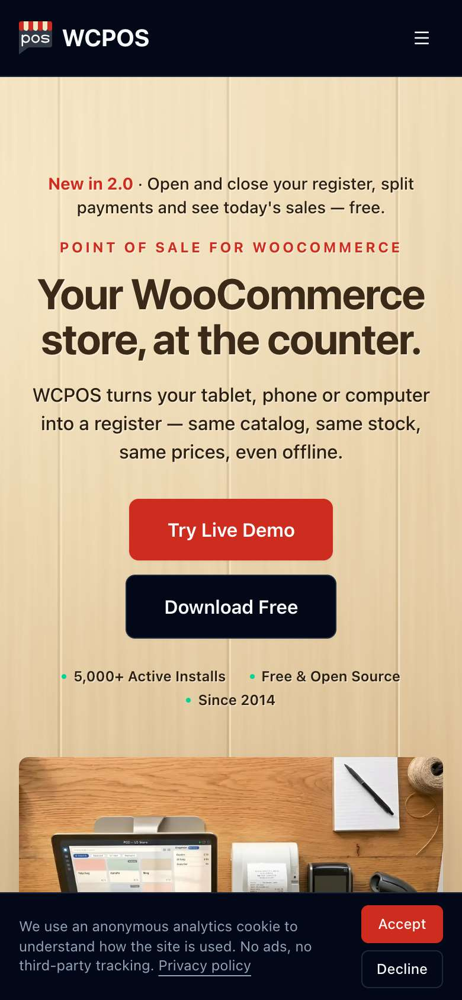 |
| /pro | 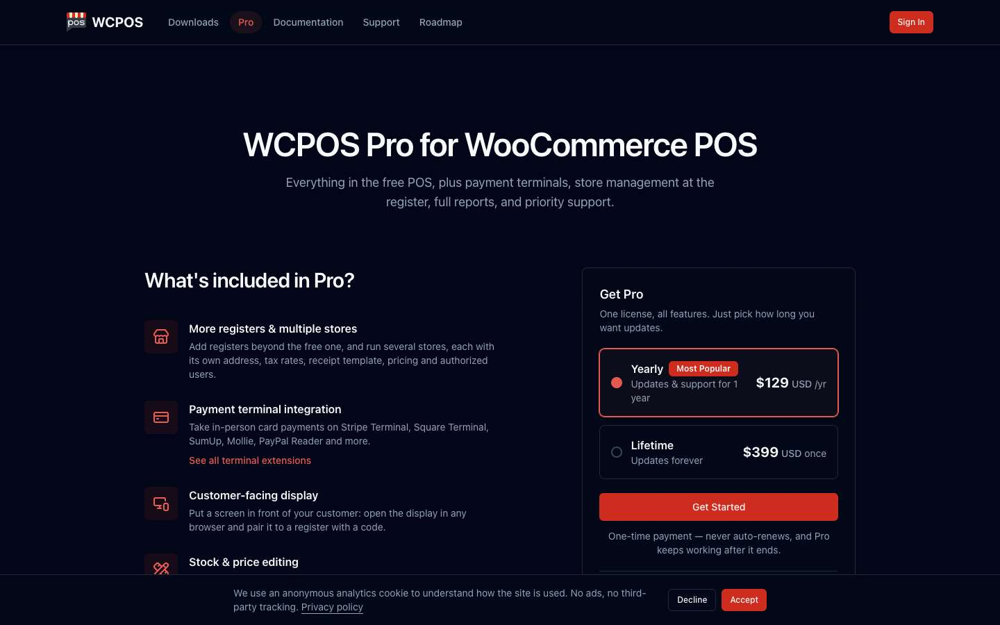 | 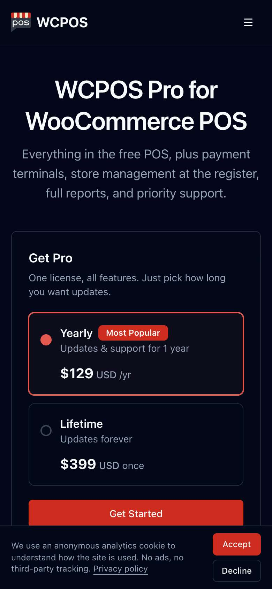 |
| /downloads | 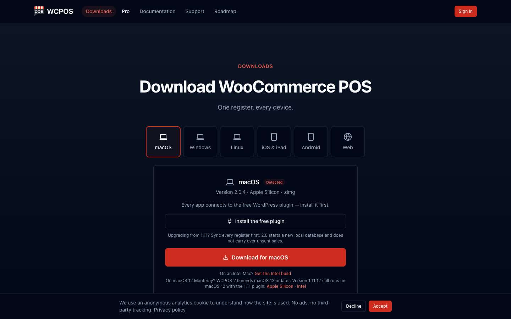 | 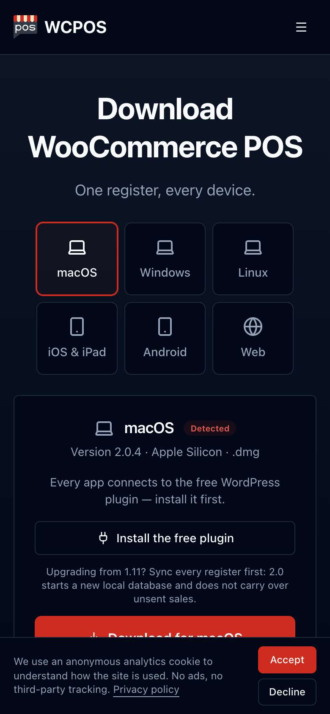 |
| /de | 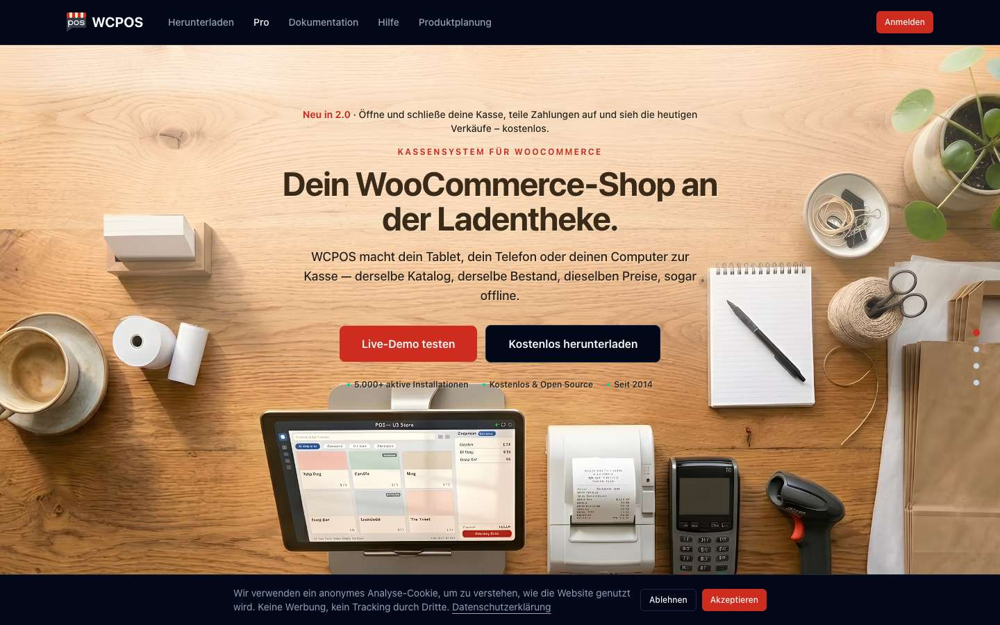 | 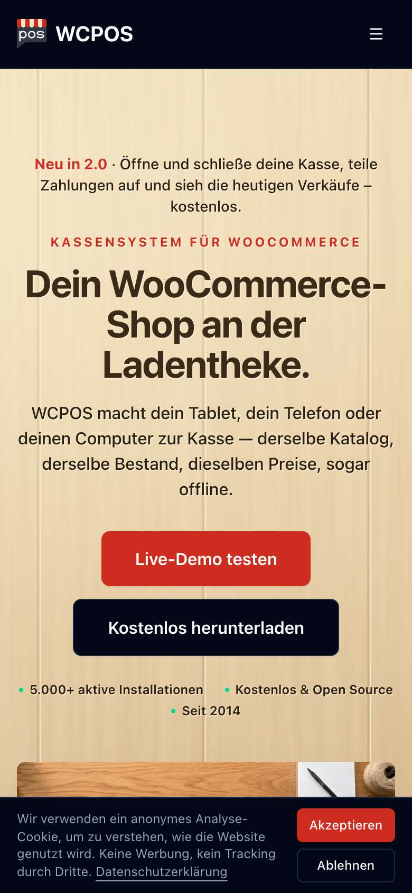 |

## 10-second test

All five judges answered both questions from the home fold: WCPOS is a free,
open-source point of sale that turns a tablet, phone or computer into a
register for a WooCommerce store, selling from the same catalog, stock and
prices, even offline. All five found the why-v2 answer in the "New in 2.0"
line (register open and close, split payments and today's sales, now free).
Three of them say it reads as a caption or a feature list rather than news
(designer, woo-dev, sceptic). It is in the scroll-story, which an open owner
PR touches.

## Scores

| Judge | Marketing | UI | SEO |
|---|---|---|---|
| shop-owner (Opus) | 8 | 8 | 8 |
| woo-dev (Opus) | 8 | 8 | 9 |
| designer (Opus) | 7 | 7 | 8 |
| seo (Opus) | 8 | 8 | 8 |
| sceptic (Opus; Astra down) | 8 | 8 | 9 |
| **Mean** | **7.8** | **7.8** | **8.4** |
| Round 39 | 7.4 | 7.8 | 8.0 |
| **Delta** | **+0.4** | **0** | **+0.4** |

The overall mean is 8.00 (+0.27). Marketing rose on the woo-dev and sceptic
scores. Both had named round 39's "Active Stores" label or its /pro subtitle
repeat, which #875 and #873 fixed. SEO rose on the same two judges. No judge
named a round-39 change as a defect, so nothing is reverted. The woo-dev
judge asked for the /downloads upgrade note to move back under the button,
the reverse of #871. It was not taken, because the note has to be read
before the download.

## Lighthouse (live, light theme)

| Page | Mobile perf | Desktop perf | A11y / BP / SEO | Mobile LCP |
|---|---|---|---|---|
| / | 93 | 100 | 100 | 3.2 s |
| /pro | 100 | 100 | 100 | 1.4 s |
| /compare | 97 | 100 | 100 | 2.6 s |
| /downloads | 94 | 100 | 100 | 3.0 s |
| /de | 92 | 100 | 100 | 3.3 s |

This capture ran on a quiet machine. /downloads, at 69 in round 39's
capture, scored 94.

## Worst defects

**Marketing**

- /compare hub: the cards list the topics each page covers and end "where X
  is genuinely better", not the page's answer (shop-owner, designer and seo;
  the shop-owner's second round).
- /pro: the site never says whether stores share stock, beside the "2 sites"
  FAQ (woo-dev; fourth round). Held: this needs a product fact from the
  owner.
- /pro gateways card: "any WooCommerce-compatible gateway" promises more
  than anyone can test (sceptic).

**UI**

- /compare/square on phone: "The short answer" is one long block (shop-owner;
  second round).
- /downloads: move the upgrade note under the button (woo-dev). Rejected; it
  would reverse #871.
- Home on phone: the two hero buttons stack at different widths, about
  50 px apart in de (designer).
- Home at 1440 px: the H1 breaks after "at", leaving "at" at the end of the
  first line (seo).
- The Compare nav item (sceptic). Held.

**SEO**

- /compare/square meta description lists topics, not the answer
  (shop-owner).
- Home features grid: "Stripe Terminal and SumUp" is not linked to
  /extensions (woo-dev).
- de head term: the home H2 says "Ein POS…" while the meta says
  "WooCommerce-Kasse" (designer).
- /about-us `<title>` is "About | WCPOS" (seo).
- /pro H1 (sceptic). Held.

## Fixes this round

Four defects were fixed: three judged worst defects, plus the sceptic's
gateways overclaim, taken as a correctness fix. Holds were skipped. Each fix
was a written spec, implemented by an Opus 5.5 pool one-shot (route: opus).
This machine reviewed each full diff, byte-checked the message files against
base, and reran the acceptance commands and mutations.

| Track | Defect | PR | Merge |
|---|---|---|---|
| UI | Hero buttons at different widths on phone; H1 orphan "at" | [#877](https://github.com/wcpos/wcpos-com/pull/877) | a09e19c |
| SEO | /about-us title "About" | [#878](https://github.com/wcpos/wcpos-com/pull/878) | 7bc20a7 |
| Marketing | /compare hub cards list topics, not verdicts | [#879](https://github.com/wcpos/wcpos-com/pull/879) | 20b826b |
| Marketing | /pro "any WooCommerce-compatible gateway" | [#880](https://github.com/wcpos/wcpos-com/pull/880) | c958479 |

- **#877:**
  - `story-copy-blocks.tsx` (`CopyAct1`): below `sm` the CTA row is a
    column and both buttons are full width up to `max-w-xs`; from `sm` they
    sit in a row sized to content, as before. The H1 gets `text-balance`.
    The owner's open scroll-story PRs do not touch this file.
  - Mutations, each failing both tone cases:
    - the `flex-wrap` row restored;
    - `text-balance` dropped.
- **#878:**
  - `about.meta.title` in all ten locales. en: "About Us: An Independent
    WooCommerce POS Since 2014". Latin-script titles are at most 62
    characters before " | WCPOS"; ja, ko and zh at most 32.
  - Mutations, each failing its test:
    - the old en "About" restored;
    - the old de restored.
- **#879:**
  - The seven `compare.hub.*Card.description` strings, in all ten locales,
    are each one verdict sentence taken from that page's own short answer.
    The WooCommerce card's cash-offline clause uses the shipped home
    wording from #874. No new numbers.
  - Mutations, each failing its test:
    - the old en squareCard restored;
    - the old de viteposCard restored.
- **#880:**
  - `pro.features.gateways.description` in all ten locales now says what
    the comparison pages say. en: "Turn on your store's other WooCommerce
    payment gateways at the register, not just the built-in options."
  - Mutations, each failing its test:
    - the old en restored;
    - the old fr restored.

## After (live, 2026-11-20)

The checks were run in headless Chromium against wcpos.com after the c958479
deploy, each page in a fresh browser context.

- Home at 390 px: "Try Live Demo" and "Download Free" are both 320 px wide,
  as are "Live-Demo testen" and "Kostenlos herunterladen" on /de. No page
  overflows horizontally.
- Home at 1440 px: the H1 is "Your WooCommerce" / "store, at the counter."
  with `text-wrap: balance`, so the first line no longer ends "at".
- /compare and /de/compare at 390 px: no card keeps the old tail, and the
  Square card leads with its verdict.
- `<title>` on /about-us: "About Us: An Independent WooCommerce POS Since
  2014 | WCPOS". /de/about-us and /ja/about-us carry their locale titles.
- /pro and /fr/pro: the gateways card has the new copy, and no "any
  gateway" claim is left.

| Home /de, phone | /compare, phone | Home, desktop |
|---|---|---|
| 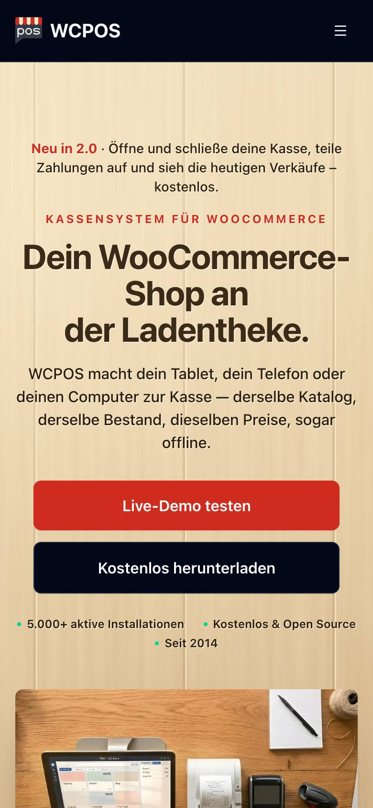 | 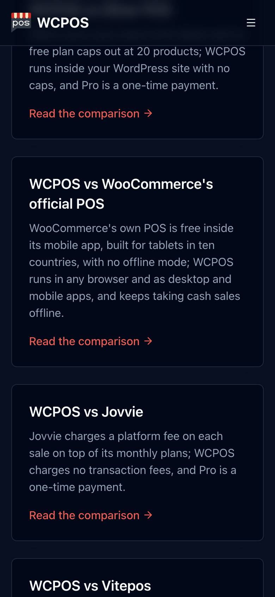 | 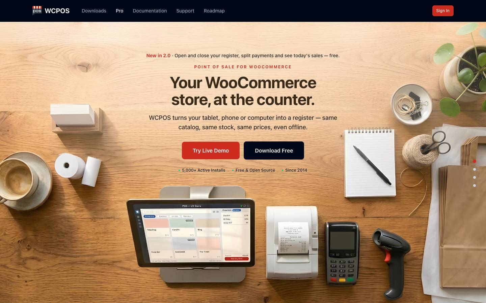 |

## Deferred

These carry over to round 41 as candidates:

- /compare/square on phone: label the short-answer paragraphs; shorten the
  subtitle and the WCPOS Card payments cell.
- /compare/square meta description: lead with the answer.
- Home features grid: link "Stripe Terminal and SumUp" to /extensions.
- de head term: align the home H2 "Ein POS…" with the meta's
  "WooCommerce-Kasse"; de `home.subtitle` still says "Point of Sale".
- /compare/square: the terminals list (8 against six in the prose) and its
  dates; "Choose WCPOS if:" reads as one run-on.
- /pro: feature descriptions at `text-base`, without `max-w-md`.
- /downloads on phone: the stray "·" separators; "updating in real time".
- /downloads requirements line: confirm the WordPress minimum against the
  plugin readme.
- /support: the H1 sits off the type scale; only Organization JSON-LD;
  "licence" vs "license".
- The nav "Pro" item drawn in white.
- `metadata.siteDescription`, the fallback description.
- /downloads: the 2.0.0 release note says "till".
- fr home meta description reads as a list of fragments.
- For the front desk: whether stores share stock (an ATUM question); whether
  the iOS and Android betas work with the 2.0 plugin; a link from the home
  "New in 2.0" line, which three judges call a caption (scroll-story, owner
  PR open).
