# wcpos.com hill climb, round 41 (2026-11-20)

This round re-judges the live site after round 40's fixes (#877 to #880,
all live). It then records the fixes chosen from the result.

- Captures: [`2026-11-20-round-41/shots/`](2026-11-20-round-41/shots/) holds
  the fold shots. The full-page shots stay local. Visible text is in `text/`,
  page facts are in `facts.json` and Lighthouse results in `lighthouse.json`.
- Judges: [`2026-11-20-round-41/judges/`](2026-11-20-round-41/judges/). The
  personas and the brief are the same as in round 40. Four Opus 5.5 pool
  one-shots judged as usual. Codex GPT-6 Astra hung on "Reconnecting...
  1/5" for the fifth round running, so the sceptic brief again ran as a
  fifth Opus 5.5 one-shot. The
  judges were not told what changed.

| Page | Desktop | Phone |
|---|---|---|
| Home | 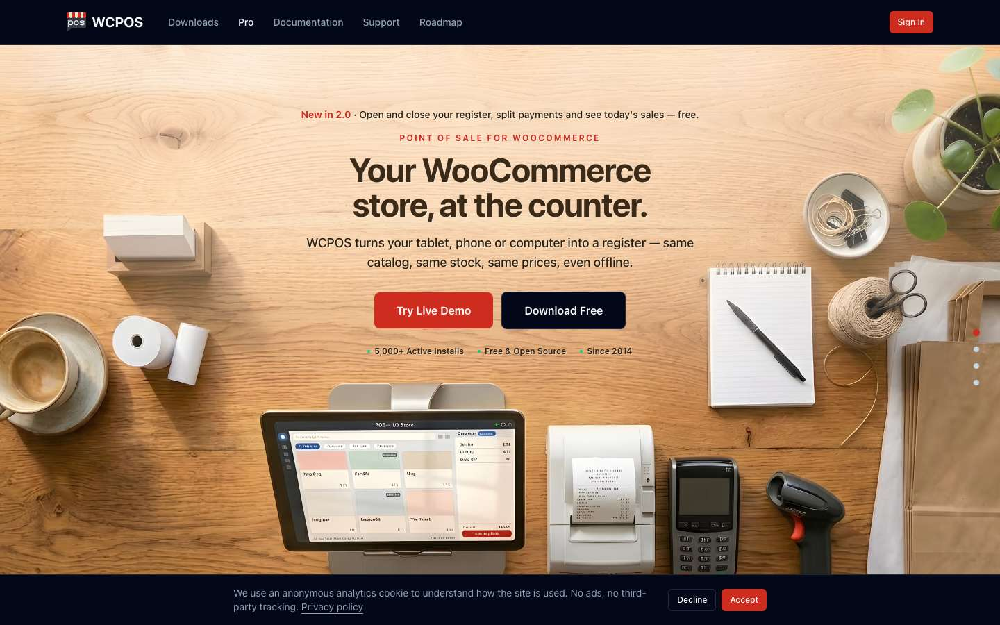 | 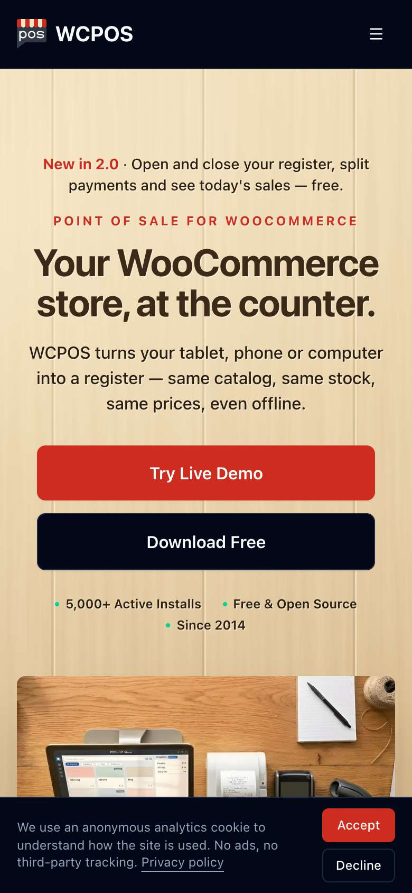 |
| /compare/square | 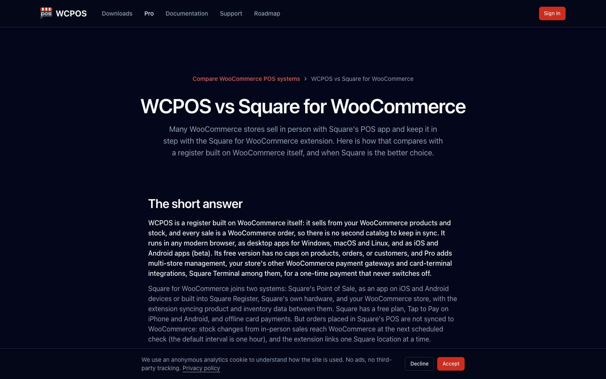 | 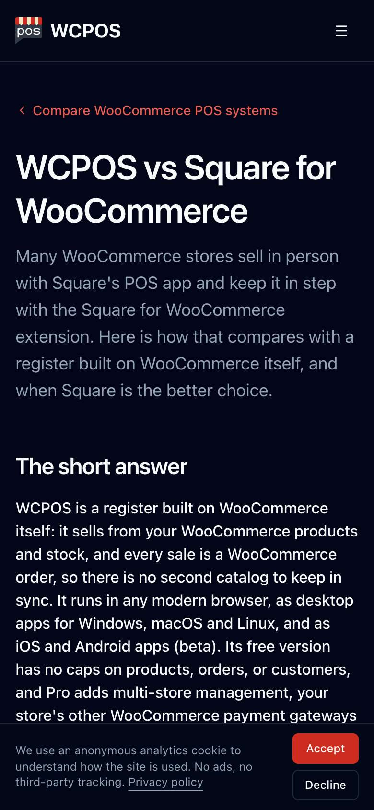 |
| /downloads | 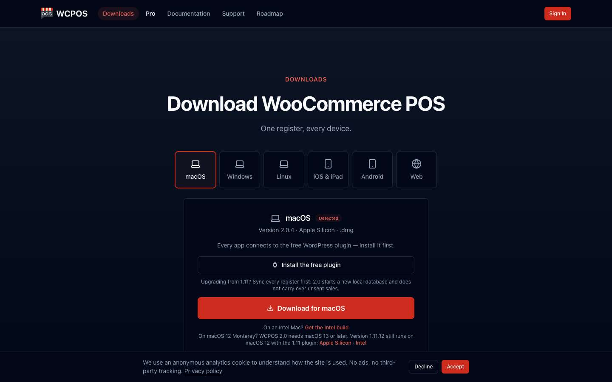 | 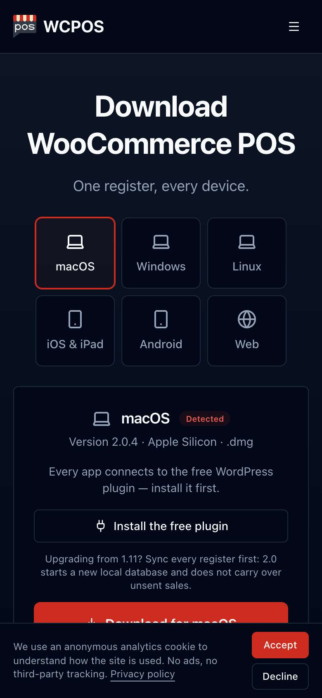 |
| /de | 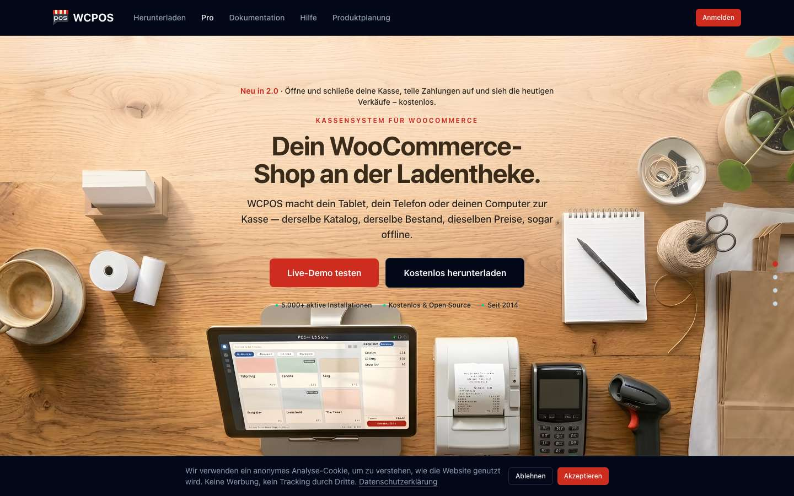 | 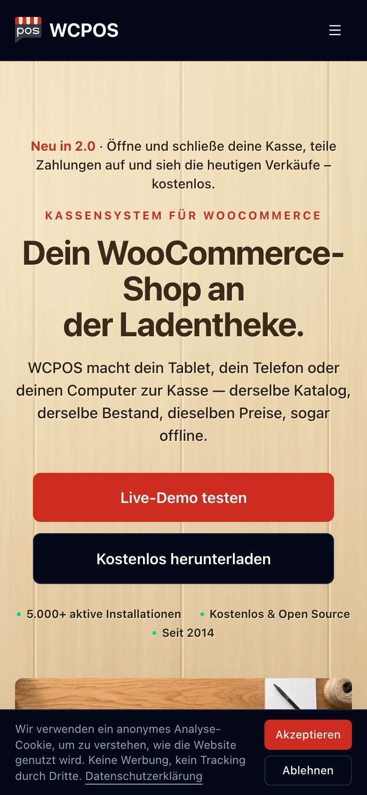 |

## 10-second test

All five judges answered both questions from the home fold: WCPOS is a free,
open-source point of sale that turns a tablet, phone or computer into a
register for a WooCommerce store, selling from the same catalog, stock and
prices, even offline. All five found the why-v2 answer in the "New in 2.0"
line (register open and close, split payments and today's sales, now free).
Four of them say it reads as a caption rather than news (shop-owner,
woo-dev, designer, sceptic), one more than in round 40. It is in the
scroll-story, which an open owner PR touches.

## Scores

| Judge | Marketing | UI | SEO |
|---|---|---|---|
| shop-owner (Opus) | 8 | 8 | 9 |
| woo-dev (Opus) | 8 | 8 | 9 |
| designer (Opus) | 8 | 7 | 8 |
| seo (Opus) | 8 | 8 | 8 |
| sceptic (Opus; Astra down) | 8 | 8 | 9 |
| **Mean** | **8.0** | **7.8** | **8.6** |
| Round 40 | 7.8 | 7.8 | 8.4 |
| **Delta** | **+0.2** | **0** | **+0.2** |

The overall mean is 8.13 (+0.13). Marketing rose on the designer, whose
round-40 worst defect was the /compare hub cards (#879). SEO rose on the
shop-owner, whose round-40 pick was the /about-us title (#878). No judge
named a round-40 change as a defect, so nothing is reverted. The designer
asks whether #877's `text-balance` causes the de phone H1 break "Shop an /
der Ladentheke". The sceptic names the same break. #877 balances the H1 at
every width, so this is a candidate for round 42 (`sm:text-balance`), not a
revert: the mean rose and the en fixes it made are live.

## Lighthouse (live, light theme)

| Page | Mobile perf | Desktop perf | A11y / BP / SEO | Mobile LCP |
|---|---|---|---|---|
| / | 93 | 100 | 100 | 3.2 s |
| /pro | 100 | 100 | 100 | 1.4 s |
| /compare | 97 | 100 | 100 | 2.6 s |
| /downloads | 99 | 100 | 100 | 1.8 s |
| /de | 91 | 96 | 100 | 3.3 s |

## Worst defects

**Marketing**

- /compare/square: "The short answer" gives no verdict; the verdict is
  about 15 phone screens down (shop-owner).
- /compare: "Choose WCPOS if:" reads as one run-on and should be bullets,
  on all seven pages (designer).
- /compare/square and /compare/woocommerce-pos: the "Countries" row sets
  WCPOS "No country restriction" against Square's eight card countries,
  although each Pro terminal integration works only where its provider
  operates (sceptic). Not taken: the fix is a new statement about where Pro
  terminals work, which needs the owner's word.
- No HPOS mention (woo-dev). Not taken: it would be a new product claim.
- /downloads step 3 repeats the Pro list from the card above (seo).

**UI**

- /support: the H1 is off the type scale (`text-3xl md:text-4xl`) and
  breaks "help / & support" on a phone (designer).
- /downloads on phone: the "·" separators dangle at line ends in step 2
  (woo-dev and sceptic; deferred since round 38).
- /support: the chips and the Ask button look disabled until Turnstile
  passes (shop-owner).
- /pro buy box (seo). Held.

**SEO**

- /compare/square meta description lists topics, not the answer (woo-dev
  and sceptic; the shop-owner in round 40).
- Sitemap lastmod drift: /compare still said 2026-11-18 and /about-us
  2026-10-06 after #879 and #878 (seo).
- de head term split: the home H2 "Ein POS…", the meta "WooCommerce-Kasse"
  and the /de/pro title "Kasse für WooCommerce" (designer).
- /compare/square: an "As verified on" date line (shop-owner). Not taken: it
  would claim a check.

## Fixes this round

Five defects were fixed: two marketing/SEO, two UI and the sitemap drift,
which was done last so its dates cover this round's merges. Holds and new
claims were skipped. Each fix was a written spec. Codex was out of quota
(exit 5 on all four jobs), so each went unchanged to an Opus 5.5 pool
one-shot. This machine reviewed each full diff, checked that the reused
verdict keys resolve in all ten locales, and reran the acceptance commands
and both mutations per spec.

| Track | Defect | PR | Merge |
|---|---|---|---|
| Marketing | /compare/<x> short answer has no verdict | [#882](https://github.com/wcpos/wcpos-com/pull/882) | e49efa0 |
| UI | /support H1 off the type scale | [#883](https://github.com/wcpos/wcpos-com/pull/883) | 636dfea |
| SEO | /compare/square meta lists topics | [#884](https://github.com/wcpos/wcpos-com/pull/884) | 178ec78 |
| UI | /downloads dangling "·" on phone | [#885](https://github.com/wcpos/wcpos-com/pull/885) | c8f3364 |
| SEO | Sitemap lastmod drift | [#886](https://github.com/wcpos/wcpos-com/pull/886) | db2a9b1 |

- **#882:**
  - On all seven /compare/<x> pages, the short answer opens with that
    page's hub verdict (`compare.hub.<card>.description`, shipped in #879)
    in `text-lg font-semibold`. The WCPOS paragraph drops `font-medium`.
    No message changes.
  - Mutations, each failing its page test:
    - the square verdict line removed;
    - foosales given the yith verdict.
- **#883:**
  - Both /support H1s use `text-balance text-4xl font-bold leading-tight
    tracking-tight md:text-5xl`; the chat-hero subtitle is `text-lg`.
  - Mutations, each failing its test:
    - `text-3xl md:text-4xl` restored on the chat h1;
    - `text-balance` dropped from the order-support h1.
- **#884:**
  - `compare.square.metadata.description` in all ten locales, worded from
    each locale's own `faq.orders.answer`. en: "Square for WooCommerce syncs
    products and stock, but sales in Square's POS never become WooCommerce
    orders. Every WCPOS sale does. By the maker of WCPOS." (153
    characters.) The ko string fits 100 characters only in a clipped
    headline style; a native read is welcome.
  - Mutations, each failing its test:
    - the old en restored;
    - the old nl restored.
- **#885:**
  - /downloads step 2: below `sm` the desktop and web link rows stack one
    per line and the "·" separators are hidden (`hidden sm:inline`,
    `aria-hidden`); from `sm` up the inline row is unchanged.
  - Mutations, each failing the test:
    - `flex flex-wrap` restored on the desktop row;
    - `hidden sm:inline` dropped from the web separator.
- **#886:**
  - `CONTENT_UPDATED_AT`: /compare and /about-us 2026-11-19; the seven
    /compare/<x> pages and /support 2026-11-20.
  - Mutations, each failing the dates test:
    - /about-us back to 2026-10-06;
    - /compare/square back to 2026-11-19.

From now on, a spec that changes a page's copy also bumps that route's
sitemap date.

## After (live, 2026-11-20)

The checks were run in headless Chromium against wcpos.com after the db2a9b1
deploy, each page in a fresh browser context.

- /compare/square, /de/compare/square and /compare/foosales at 390 px: the
  first paragraph under the short-answer heading is the verdict, at 18 px
  and weight 600.
- `<meta name="description">` on /compare/square, /de/compare/square and
  /ko/compare/square carries the new strings (153, 158 and 100
  characters).
- /support: the H1 is 36 px at 390 px and 48 px at 1440 px, with
  `text-wrap: balance`, as "WooCommerce" / "POS help & support"; "&
  support" no longer stands alone.
- /downloads and /de/downloads at 390 px: none of the four separators is
  visible. At 1440 px all four are.
- sitemap.xml: /compare and /about-us 2026-11-19; /compare/square and
  /support 2026-11-20.
- No checked page overflows horizontally.

| /compare/square, phone | /support, phone | /downloads, phone |
|---|---|---|
| 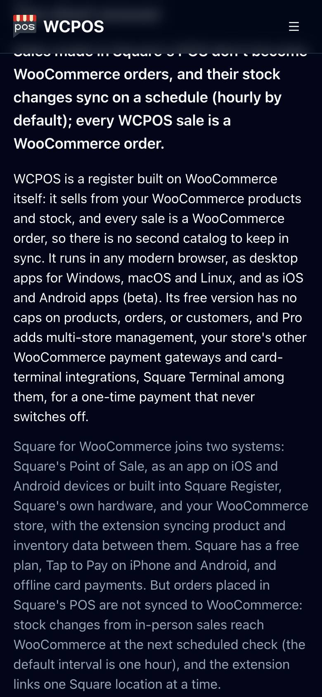 | 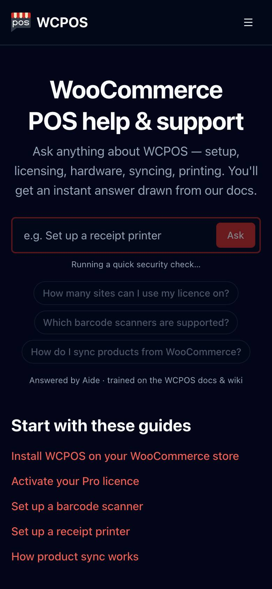 | 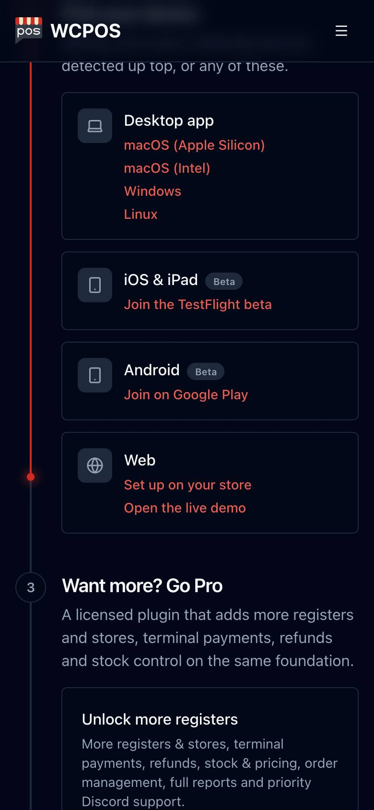 |

## Deferred

These carry over to round 42 as candidates:

- /compare: "Choose WCPOS if:" as bullets on all seven pages.
- de and nl home on phone: the H1 breaks "Shop an / der Ladentheke" with a
  short middle line; try `sm:text-balance`. de also widows "kostenlos.".
- de head term: align "Ein POS…", "WooCommerce-Kasse" and "Kasse für
  WooCommerce".
- /support: move the Turnstile check under the input so the chips do not
  look disabled.
- /downloads step 3 repeats the Pro list from the card above.
- /compare/square: the terminals list (eight in the table, six in the
  prose).
- /downloads "about two minutes" has no source.
- nl home H1 orphan "aan".
- `metadata.siteDescription`, the fallback description.
- For the front desk: the /compare "Countries" row (whether to say that each
  Pro terminal integration works where its provider operates); an HPOS
  compatibility line; whether stores share stock; a link from the home "New
  in 2.0" line, which four judges call a caption (scroll-story, owner PR
  open).
