# wcpos.com hill climb, round 42 (2026-11-20)

This round re-judges the live site after round 41's fixes (#882 to #886,
all live). It then records the fixes chosen from the result.

- Captures: [`2026-11-20-round-42/shots/`](2026-11-20-round-42/shots/) holds
  the fold shots. The full-page shots stay local. Visible text is in `text/`,
  page facts are in `facts.json` and Lighthouse results in `lighthouse.json`.
- Judges: [`2026-11-20-round-42/judges/`](2026-11-20-round-42/judges/). The
  personas and the brief are the same as in round 41. The brief adds two
  items to the do-not-pick list: the /compare "Countries" row and an HPOS
  compatibility line, because both wait on a product statement from the
  owner. Four Opus 5.5 pool one-shots judged as usual. Codex GPT-6 Astra
  hung on "Reconnecting... 1/5" again, so the sceptic brief ran as a fifth
  Opus 5.5 one-shot. The judges were not told what changed.

| Page | Desktop | Phone |
|---|---|---|
| Home | 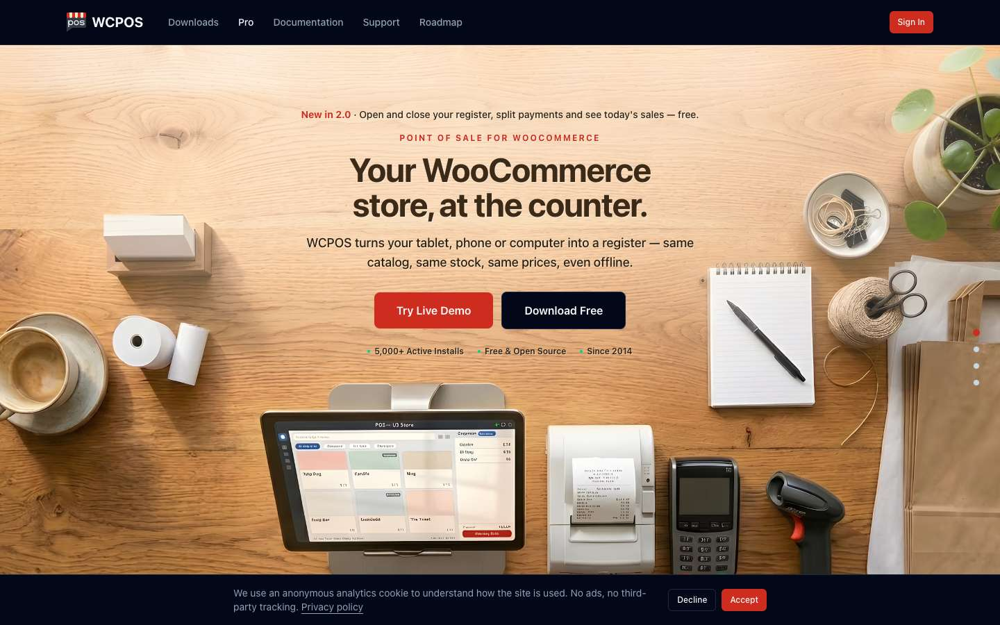 | 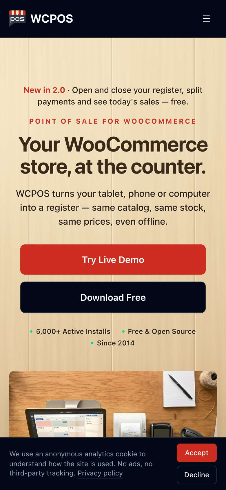 |
| /compare/square | 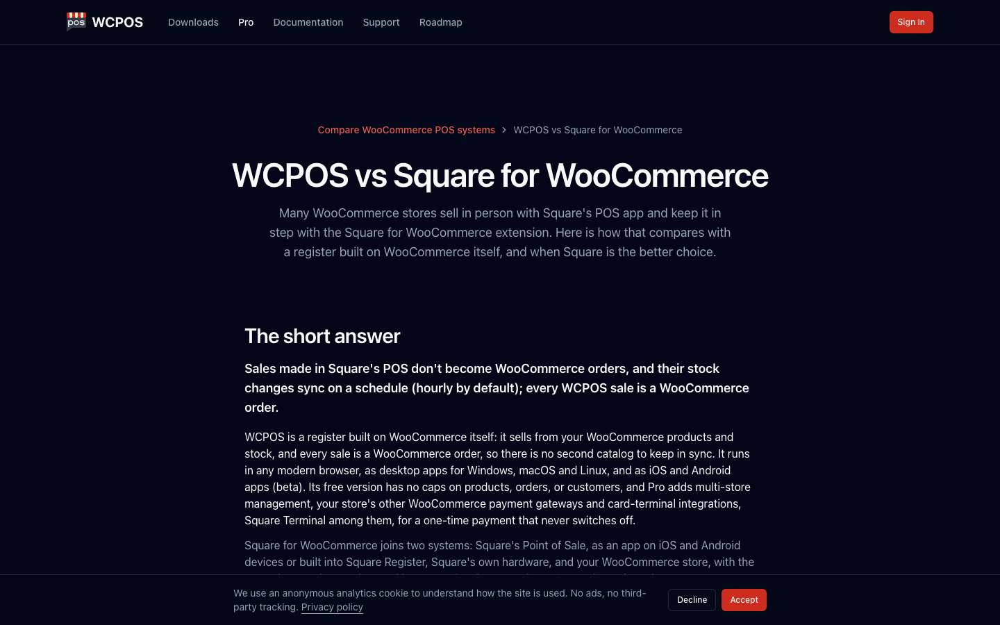 | 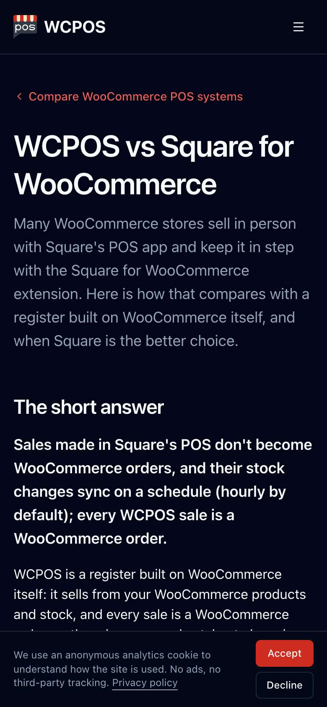 |
| /downloads | 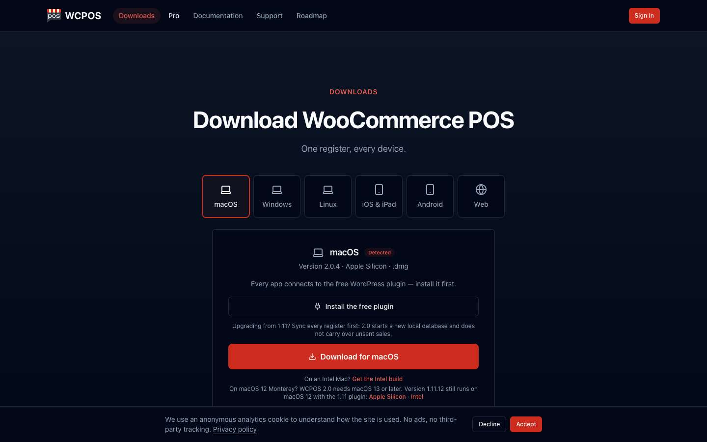 | 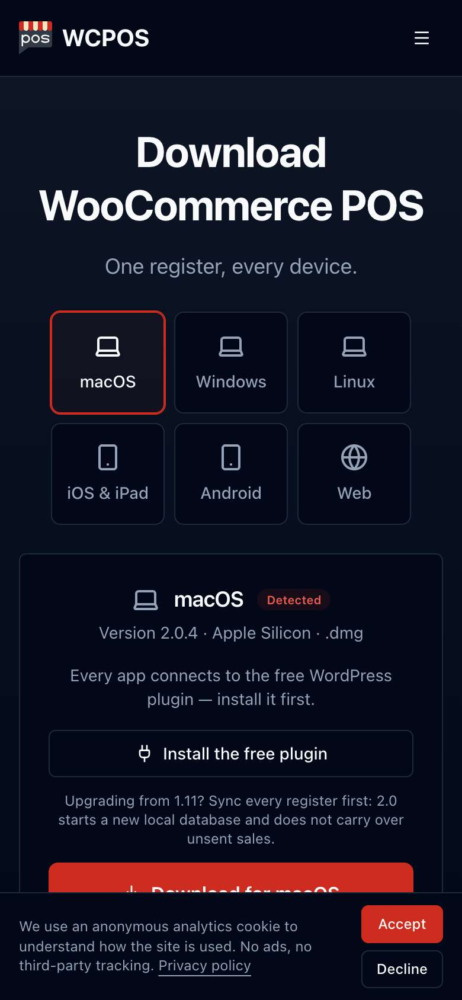 |
| /de | 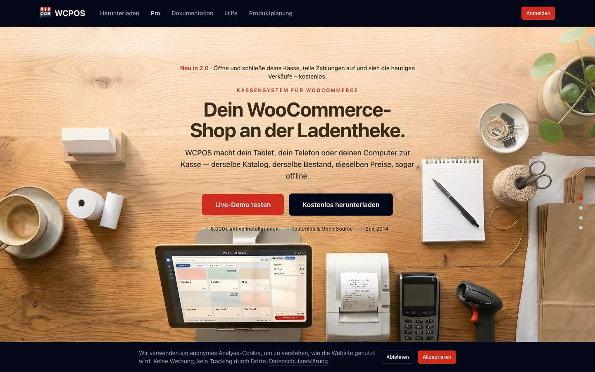 | 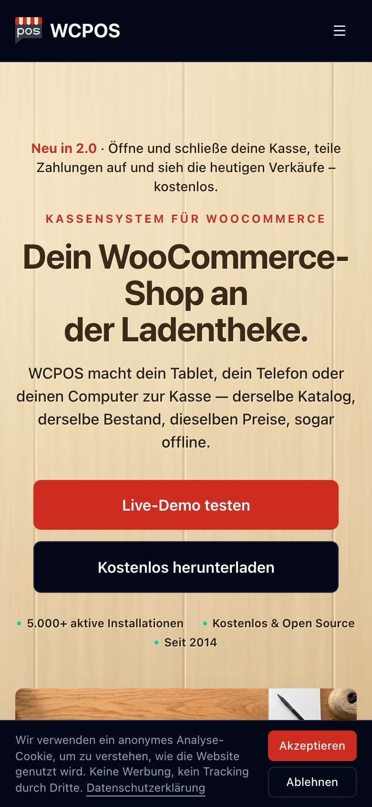 |

## 10-second test

All five judges answered both questions from the home fold. WCPOS is a free,
open-source point of sale that turns a tablet, phone or computer into a
register for a WooCommerce store. It sells from the same catalog, stock and
prices, even offline. All five found the why-v2 answer in the "New in 2.0"
line: register open and close, split payments and today's sales, now free.
Three judges say it still reads as a caption rather than news: shop-owner,
woo-dev and designer. The sceptic says it lists features but gives no
reason to switch. The line is in the scroll-story, which an open owner PR
touches.

## Scores

| Judge | Marketing | UI | SEO |
|---|---|---|---|
| shop-owner (Opus) | 8 | 8 | 9 |
| woo-dev (Opus) | 8 | 8 | 9 |
| designer (Opus) | 8 | 7 | 8 |
| seo (Opus) | 8 | 8 | 8 |
| sceptic (Opus; Astra down) | 8 | 8 | 9 |
| **Mean** | **8.0** | **7.8** | **8.6** |
| Round 41 | 8.0 | 7.8 | 8.6 |
| **Delta** | **0** | **0** | **0** |

The overall mean is 8.13 (0). Every judge gave the same scores as in
round 41. No judge named a round-41 change as a defect, so nothing is
reverted.

All five judges named the same UI defect: the de and nl phone H1 breaks
"Shop an / der Ladentheke". Round 41 traced it to #877's `text-balance`.

## Lighthouse (live, light theme)

| Page | Mobile perf | Desktop perf | A11y / BP / SEO | Mobile LCP |
|---|---|---|---|---|
| / | 93 | 100 | 100 | 3.2 s |
| /pro | 100 | 100 | 100 | 1.8 s |
| /compare | 96 | 100 | 100 | 2.6 s |
| /downloads | 94 | 100 | 100 | 3.0 s |
| /de | 92 | 100 | 100 | 3.3 s |

/downloads mobile dropped from 99 (1.8 s LCP) in round 41 to 94 (3.0 s). The
sceptic names it and suspects run-to-run noise; #885 changed only classes
on that page. Watch it next round before acting.

## Worst defects

**Marketing**

- /compare/square: the short answer argues only WCPOS's side (shop-owner).
  Not taken: the verdict line comes from the hub card. A Square-side line
  would be new comparative copy, which the front desk should see first.
- /compare: "Choose WCPOS if:" as bullets on all seven pages (designer).
  Deferred: 14 message bodies in 10 locales is too large for one spec.
- /downloads step 3 repeats the Pro list from the card below it (seo; also
  round 41). Fixed in #890.
- /pro: the stores card links nowhere useful (woo-dev). Held.
- Home: the offline "Keep selling" wording (sceptic). Held.

**UI**

- de and nl home on phone: the H1 breaks "Shop an / der Ladentheke" with a
  short middle line. Named by all five judges. Fixed in #889.
- /support: the Turnstile widget renders last, about 150 px below the input
  (designer). Deferred.

**SEO**

- /changelog: the title is a bare "Changelog | WCPOS" and the H1
  "Changelog" in every locale (seo). Fixed in #891.
- de and nl /pro titles say "Kasse"/"kassa" while the H1 says
  "Kassensystem"/"Kassasysteem" (designer and sceptic). Fixed in #888.
- /pro en H1 (shop-owner). Held.
- /extensions: the five terminal cards share one generic sentence
  (woo-dev). Not taken: the catalog is generated from another repo.

## Fixes this round

Four defects were fixed: one marketing, one UI and two SEO. Each fix was a
written spec. Codex was out of quota (exit 5 on all four jobs), so each went
unchanged to an Opus 5.5 pool one-shot. This machine reviewed each full
diff, ran both mutations per spec, and ran the full unit suite for each
branch.

| Track | Defect | PR | Merge |
|---|---|---|---|
| UI | de and nl phone H1 break | [#889](https://github.com/wcpos/wcpos-com/pull/889) | c07c538 |
| Marketing | /downloads step 3 repeats the Pro list | [#890](https://github.com/wcpos/wcpos-com/pull/890) | 23005d5 |
| SEO | /changelog generic title and H1 | [#891](https://github.com/wcpos/wcpos-com/pull/891) | fcecaee |
| SEO | de and nl /pro title head term | [#888](https://github.com/wcpos/wcpos-com/pull/888) | 4d8be84 |

- **#889:**
  - The home H1 class `text-balance` becomes `sm:text-balance`, so below
    640 px the heading wraps normally.
  - Mutations, each failing both tone tests:
    - unprefixed `text-balance` restored;
    - the balance class removed.
- **#890:**
  - The paragraph under "Want more? Go Pro" is removed, and the key
    `downloads.page.steps.pro.body` is deleted in all ten locales.
  - Mutations, each failing its test:
    - the paragraph restored with the old en body;
    - only the en key put back.
- **#891:**
  - `changelog.meta.title`, `meta.description`, `page.title` and
    `page.description` in all ten locales carry the locale's head term.
    The en title is "WooCommerce POS Changelog & Release Notes" and the H1
    "WooCommerce POS Changelog".
  - The seven non-en Latin titles drop "& Release Notes" to fit 62
    characters.
  - Mutations, each failing its test:
    - the en H1 back to "Changelog";
    - the old de title restored.
- **#888:**
  - de /pro is "Pro-Funktionen & Preise – WooCommerce-Kassensystem" and nl
    /pro is "Pro-functies & prijs – Kassasysteem voor WooCommerce". The
    /pro sitemap date is 2026-11-20.
  - Mutations:
    - the de title restored to the first head's value fails the head-term
      test and the existing 60-character test;
    - the base nl title restored fails the head-term test.
  - The first head failed CI. My spec allowed 62 characters before
    " | WCPOS", but an existing test caps the rendered /pro and /downloads
    titles at 60. Its acceptance paths left that test out. A second
    one-shot shortened the /pro titles. No head-term /downloads title fits
    60 characters with the verb, Mac and Windows, so those stay as they
    were.

From now on, every review runs the full unit suite, not only the spec's
acceptance paths.

## After (live, 2026-11-20)

The checks were run in headless Chromium against wcpos.com after the
4d8be84 deploy, each page in a fresh browser context.

- Home H1 on phone:
  - /de at 390 px: "Dein WooCommerce- / Shop an der / Ladentheke.", the
    same break as before #877;
  - /nl at 390 px: "Je WooCommerce- / winkel, aan de / toonbank.";
  - computed `text-wrap` is `wrap`.
- Home H1 at 1440 px: still `balance`, with lines "Your WooCommerce / store,
  at the counter." and "Dein WooCommerce-Shop / an der Ladentheke.".
- `<title>`:
  - /de/pro "Pro-Funktionen & Preise – WooCommerce-Kassensystem | WCPOS"
    (58 characters);
  - /nl/pro "Pro-functies & prijs – Kassasysteem voor WooCommerce | WCPOS"
    (60 characters);
  - /de/downloads and /nl/downloads unchanged.
- /changelog:
  - title "WooCommerce POS Changelog & Release Notes | WCPOS", H1
    "WooCommerce POS Changelog";
  - /de/changelog: title "WooCommerce-Kassensystem: Änderungsprotokoll |
    WCPOS", H1 "Änderungsprotokoll des WooCommerce-Kassensystems" (two
    lines at 390 px);
  - /ja/changelog: title "WooCommerce用POSの変更履歴とリリースノート |
    WCPOS".
- /downloads and /de/downloads at 390 px: the step-3 heading is followed
  directly by the card, and the old body text is gone.
- sitemap.xml: /pro is 2026-11-20.
- No checked page overflows horizontally.

| /de, phone | /nl, phone | /downloads step 3, phone |
|---|---|---|
| 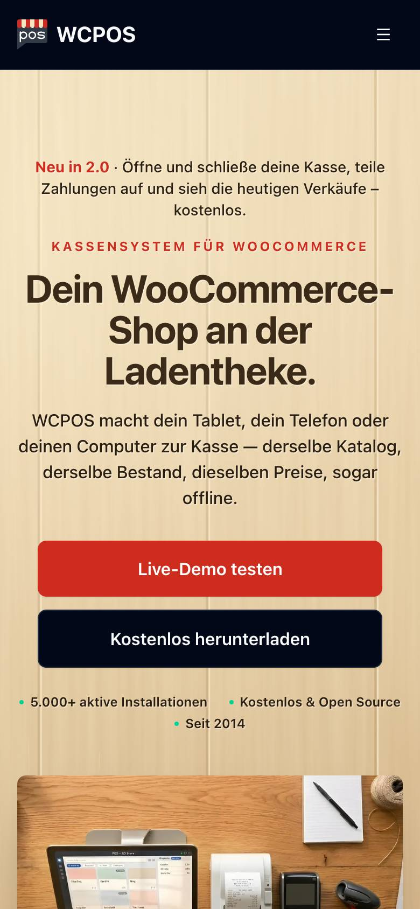 | 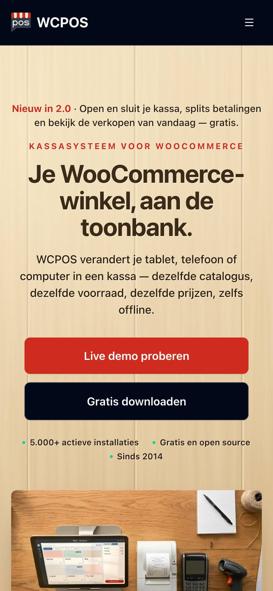 | 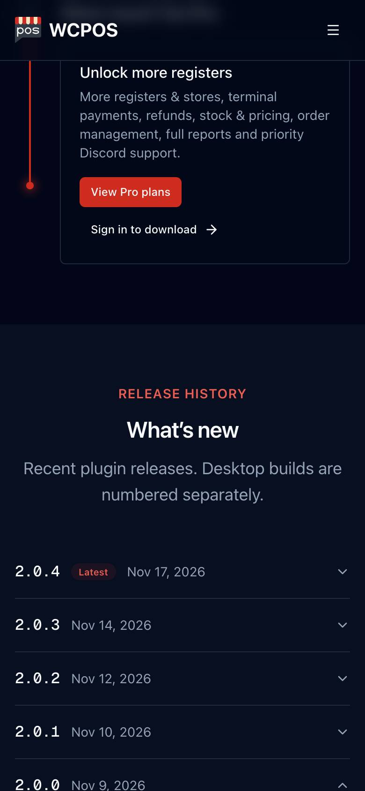 |

## Deferred

These carry over to round 43 as candidates:

- /compare: "Choose WCPOS if:" as bullets on all seven pages, which would
  need a structural change (an array per page).
- /support: move the Turnstile check under the input.
- /compare/square: the terminals list (eight in the table, six in the
  prose) and the 2026-10-06 date line.
- /support desktop H1: keep "WooCommerce POS" together.
- /roadmap generic title; `metadata.siteDescription`; the /downloads anchor
  "Full history on GitHub".
- /downloads "about two minutes" has no source; de home "kostenlos." widow.
- /downloads mobile LCP (3.0 s in this round's run).
- For the front desk:
  - the /compare "Countries" row and an HPOS line, both blocked on a
    product statement;
  - whether stores share stock and where the /pro stores card links;
  - a Square-side line in the /compare/square short answer;
  - "free" conceded to Square (price wording);
  - the /extensions terminal-card wording, which another repo owns.
