# wcpos.com hill climb, round 43 (2026-11-20)

This round re-judges the live site after round 42's fixes (#888 to #891,
all live). It then records the fixes chosen from the result.

- Captures: [`2026-11-20-round-43/shots/`](2026-11-20-round-43/shots/) holds
  the fold shots. The full-page shots stay local. Visible text is in `text/`,
  page facts are in `facts.json` and Lighthouse results in `lighthouse.json`.
- Judges: [`2026-11-20-round-43/judges/`](2026-11-20-round-43/judges/). The
  personas, the brief and the do-not-pick list are the same as in round 42,
  with one change: the judges may no longer fetch any web page, wcpos.com
  included, and judge only from the captures and the source. Four Opus 5.5
  pool one-shots judged as usual. Codex GPT-6 Astra hung on "Reconnecting...
  1/5" for a third round (exit 124 after 570 s), so the sceptic brief ran as
  a fifth Opus 5.5 one-shot. The judges were not told what changed.

| Page | Desktop | Phone |
|---|---|---|
| Home | 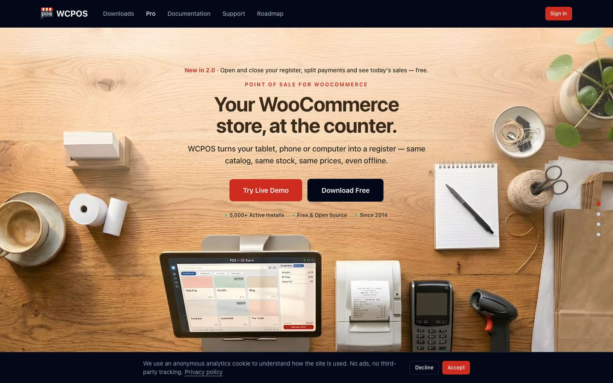 | 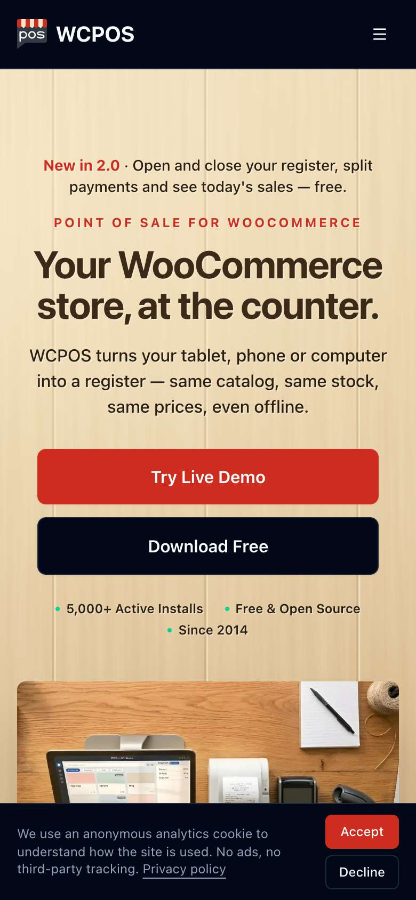 |
| /compare/square | 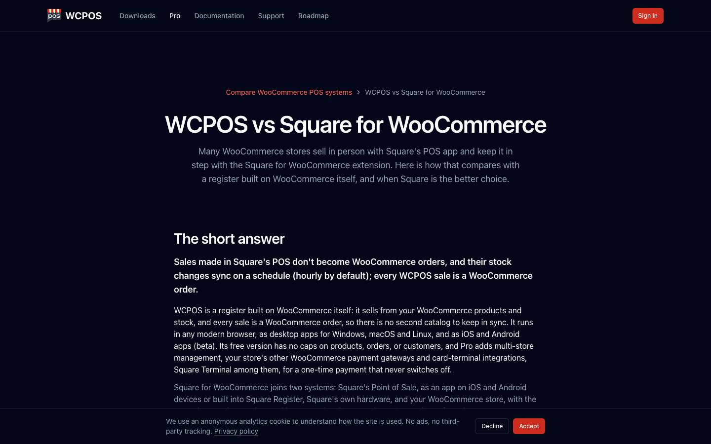 | 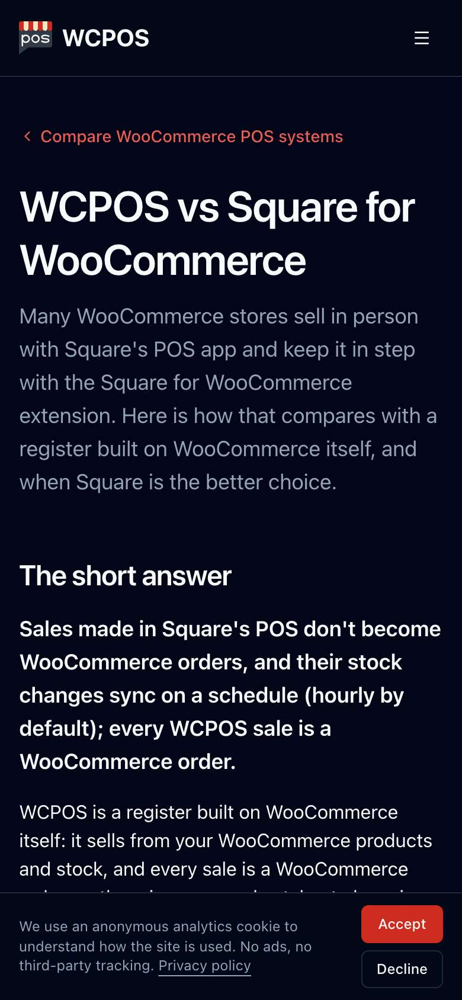 |
| /support | 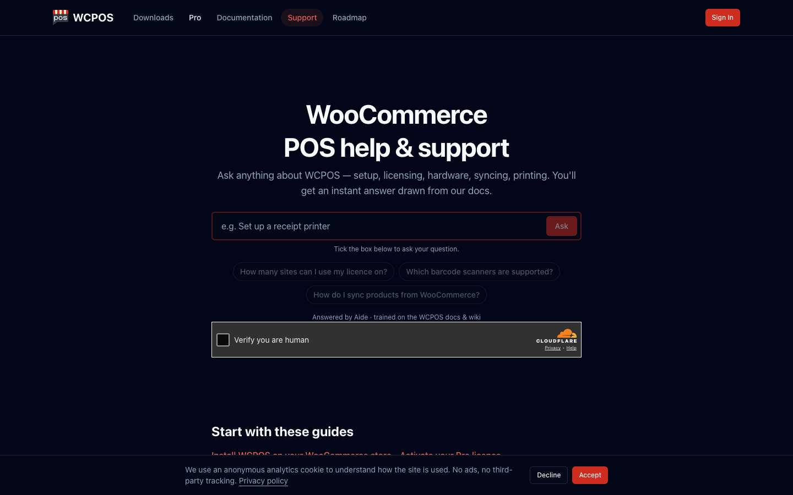 | 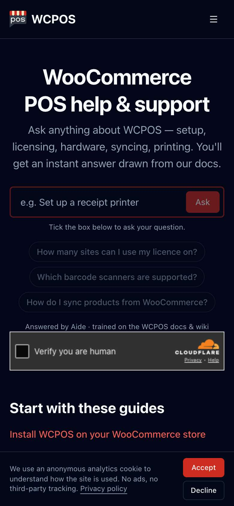 |
| /de | 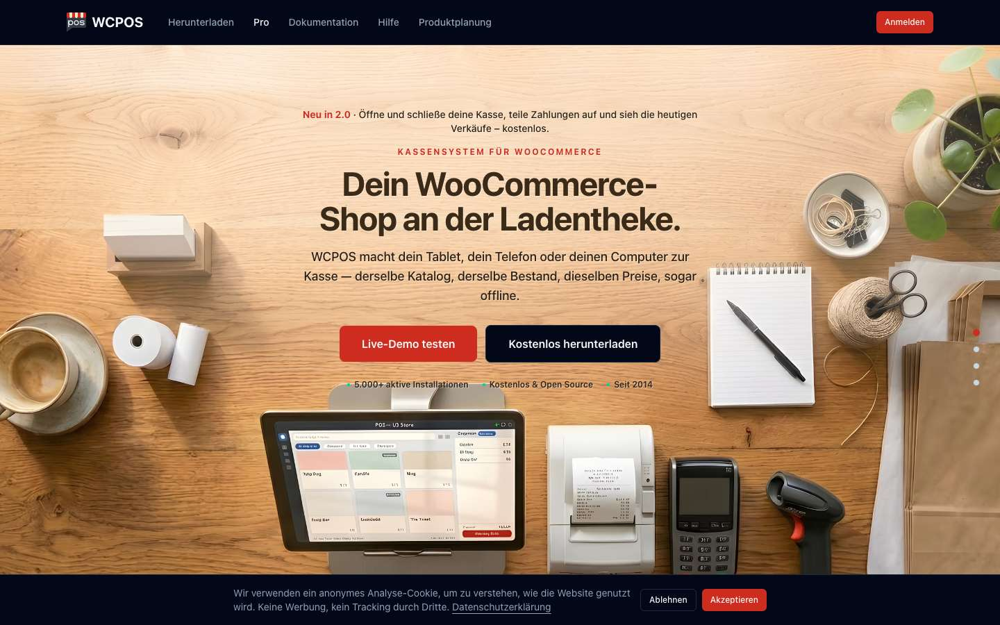 | 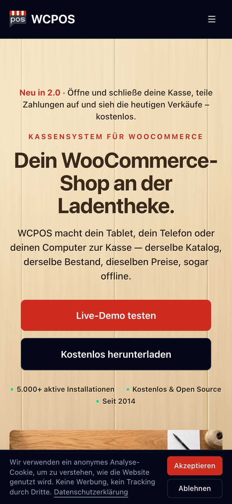 |

## 10-second test

All five judges answered both questions from the home fold. WCPOS is a free,
open-source point of sale that turns a tablet, phone or computer into a
register for a WooCommerce store, selling from the same catalog, stock and
prices, even offline. All five found the why-v2 answer in the "New in 2.0"
line: register open and close, split payments and today's sales, now free.
The designer and the sceptic again say it reads as a caption rather than a
reason to switch. The line is in the scroll-story, which an open owner PR
touches.

## Scores

| Judge | Marketing | UI | SEO |
|---|---|---|---|
| shop-owner (Opus) | 8 | 8 | 9 |
| woo-dev (Opus) | 8 | 8 | 8 |
| designer (Opus) | 8 | 7 | 8 |
| seo (Opus) | 8 | 8 | 8 |
| sceptic (Opus; Astra down) | 8 | 8 | 9 |
| **Mean** | **8.0** | **7.8** | **8.4** |
| Round 42 | 8.0 | 7.8 | 8.6 |
| **Delta** | **0** | **0** | **−0.2** |

The overall mean is 8.07 (−0.07). Four judges gave the same scores as in
round 42. The woo-dev judge moved SEO from 9 to 8 for the de and nl home
meta descriptions (160 and 159 characters), which round 42 did not change.
No judge named a round-42 change as a defect, so nothing is reverted.

## Lighthouse (live, light theme)

| Page | Mobile perf | Desktop perf | A11y / BP / SEO | Mobile LCP |
|---|---|---|---|---|
| / | 93 | 100 | 100 | 3.2 s |
| /pro | 100 | 100 | 100 | 1.7 s |
| /compare | 100 | 100 | 100 | 1.8 s |
| /downloads | 94 | 100 | 100 | 3.0 s |
| /de | 92 | 100 | 100 | 3.3 s |

/compare mobile rose from 96 (2.6 s) to 100 (1.8 s) with no change to that
page. /downloads mobile is 94 and 3.0 s again. The designer and the sceptic
named it as the worst SEO defect and suspected that `DownloadsHero` swaps the
whole card at hydration. A separate live Lighthouse mobile run of /downloads
(same runner as `lighthouse.mjs`) does not support that: it scored 98 with a
2.3 s LCP, and the LCP element was the server-rendered H1 "Download
WooCommerce POS", not the hero card. The breakdown was 107 ms to first byte
and 212 ms render delay. So the 2.3 s to 3.0 s spread is run-to-run variance
in the simulated LCP, and no fix was taken.

## Worst defects

**Marketing**

- /compare/square: the table names eight Pro terminals plus Vipps MobilePay,
  but the "How do card payments work?" prose names five plus "and Vipps
  MobilePay". It drops Mercado Pago, PayArc and Windcave and calls Vipps a
  card terminal (designer, seo and sceptic; the shop-owner as a runner-up).
  Fixed for /compare/square and /compare/woocommerce in #893.
- /compare/square: "Choose WCPOS if:" is one 60-word sentence (shop-owner).
  Deferred, as in round 42: bullets on all seven pages need an array per page.
- /pro: the stores card does not say the stores live in one WooCommerce site
  (woo-dev). Held: it sits with the front desk's /pro stores-card question.

**UI**

- /support: the Turnstile box renders last, under the example chips and the
  "Answered by Aide" line, while the hint above says "Tick the box below"
  (designer, seo and sceptic; deferred in round 42). Fixed in #894.
- /compare/<x> desktop: in the "Choose WCPOS if:" card the "Download Free"
  button ends past the card's right border, since the buttons go side by
  side from 640 px but the cards are only about 310 px wide inside
  `max-w-3xl` (shop-owner; checked in the capture). Fixed in #895.
- /support desktop H1 splits "WooCommerce / POS" (woo-dev; designer as a
  runner-up). Deferred.

**SEO**

- /roadmap: the title "Roadmap | WCPOS", a description with no head term and
  the H1 "The release train"; de "Produktplanung", nl "Routekaart" (seo).
  Fixed in #896.
- /downloads mobile LCP (designer and sceptic). Not taken; see Lighthouse.
- /compare/square title has no standalone "POS" (shop-owner). Deferred.
- de and nl home meta descriptions run to 160 and 159 characters (woo-dev).
  Deferred.

## Fixes this round

This round fixed four defects: one marketing, two UI and one SEO. Each fix
started as a written spec. Codex was out of quota (exit 5 on all four jobs,
"exhausted until 10:13 CET"), so each spec went unchanged to an Opus 5.5
pool one-shot. For each branch, this machine read the full diff, ran both
mutations and ran the full unit suite.

| Track | Defect | PR | Merge |
|---|---|---|---|
| Marketing | Compare prose drops three terminals | [#893](https://github.com/wcpos/wcpos-com/pull/893) | a8ca5ed |
| UI | /support Turnstile box renders last | [#894](https://github.com/wcpos/wcpos-com/pull/894) | 899365a |
| UI | Choose-card buttons overflow the card | [#895](https://github.com/wcpos/wcpos-com/pull/895) | becba83 |
| SEO | /roadmap generic title and H1 | [#896](https://github.com/wcpos/wcpos-com/pull/896) | 575899e |

- **#893:**
  - In all ten locales, `compare.square.payments.wcpos` and
    `compare.woocommerce.payments.wcpos` now list Stripe Terminal, SumUp,
    PayPal Reader (Zettle), Square Terminal, Mollie Terminal, Mercado Pago,
    PayArc and Windcave, "plus Vipps MobilePay by QR code or push". That is
    the glance cell's own phrase.
  - Mutations, each failing its locale test:
    - the base en square value restored;
    - the base de woocommerce value restored.
- **#894:**
  - `{turnstile.widget}` now renders right after the status line ("Tick the
    box below…") in an always-mounted wrapper.
  - The wrapper gets `mt-3 flex justify-center` only while a challenge is
    showing. The widget is interaction-only, so visitors who never get a
    challenge see no new space.
  - Mutations, each failing the order test:
    - the wrapper moved back to the end;
    - the wrapper moved after the chips.
- **#895:**
  - The choose-actions row is now
    `mt-5 flex flex-col gap-3 sm:flex-row sm:flex-wrap`, so the second
    button drops to its own line when the two don't fit.
  - Mutations, each failing the class test:
    - `sm:flex-wrap` removed;
    - the row set to `mt-5 flex flex-wrap gap-3`.
- **#896:**
  - In all ten locales, `roadmap.meta.title`, `meta.description` and
    `page.title` carry the locale's changelog head term. The old H1 moves to
    the eyebrow.
  - The en title is "WooCommerce POS Roadmap: What's Next" and the H1 is
    "WooCommerce POS Roadmap".
  - nl, fr, es, it and pt drop "What's Next" to stay within 52 characters
    before " | WCPOS".
  - Mutations:
    - the en H1 back to "The release train" fails the en and head-term
      tests;
    - the old de title restored fails the head-term and old-title tests.

## After (live, 2026-11-20)

The checks ran in headless Chromium against wcpos.com after the becba83
deploy, with each page in a fresh browser context. Every value was read from
the rendered page; no page was fetched outside the browser.

- /compare/square, /compare/woocommerce-pos and /de/compare/square at
  1440 px: the card-payments prose names Mercado Pago, PayArc and Windcave,
  and the Vipps phrase reads "Vipps MobilePay by QR code or push" (de "per
  QR-Code oder Push"). The old list ending "Mollie Terminal, and Vipps
  MobilePay," is gone.
- Choose card at 1440 px, on the same three pages and /nl/compare/yith-pos:
  - the row is `flex-wrap: wrap` and the two buttons sit on two lines;
  - the rightmost button edge is 541 to 604 px, inside the card's content
    edge at 684 px.
- /support at 1440 and 390 px:
  - `support-turnstile` comes after the form and before the first example
    chip;
  - with no challenge it is 0 px high and has no class, so the status line
    is followed directly by the chips.
- /roadmap:
  - title "WooCommerce POS Roadmap: What's Next | WCPOS", H1 "WooCommerce POS
    Roadmap", eyebrow "The release train";
  - /de "WooCommerce-Kassensystem: Roadmap und Ausblick | WCPOS" (54
    characters), H1 "Roadmap des WooCommerce-Kassensystems";
  - /nl "Kassasysteem voor WooCommerce: roadmap | WCPOS";
  - /ja "WooCommerce用POSのロードマップ：今後の予定 | WCPOS".
  - The new descriptions are live in all four.
- No checked page overflows horizontally.

| /de/compare/square choose card | /support, phone | /roadmap, phone | /de/roadmap, phone |
|---|---|---|---|
| 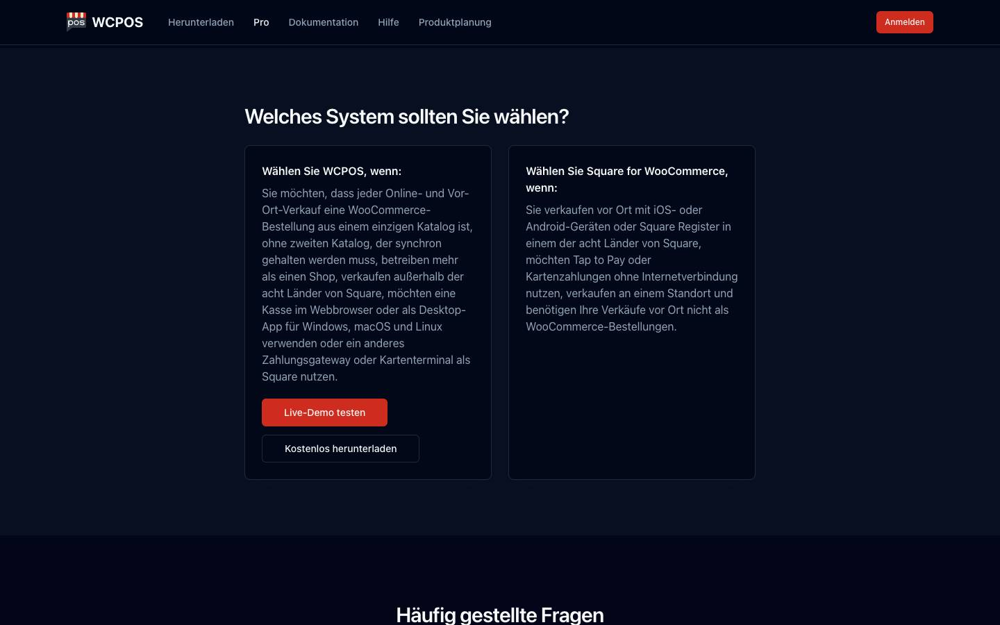 | 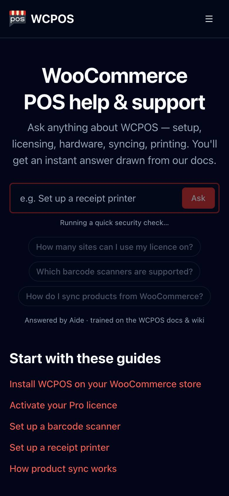 | 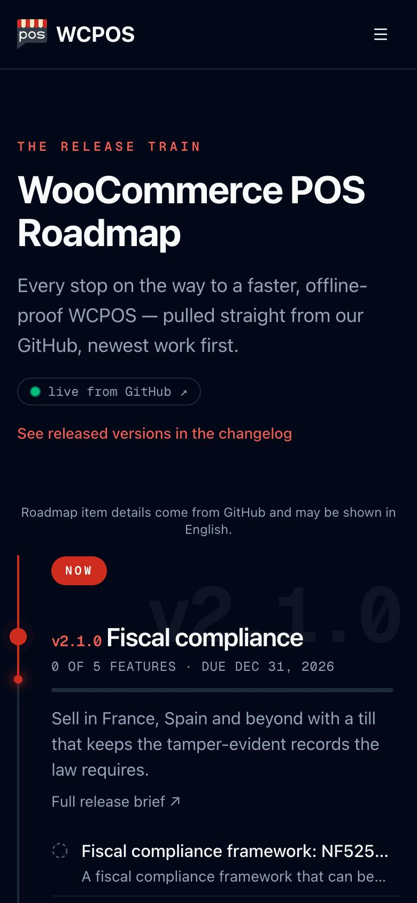 | 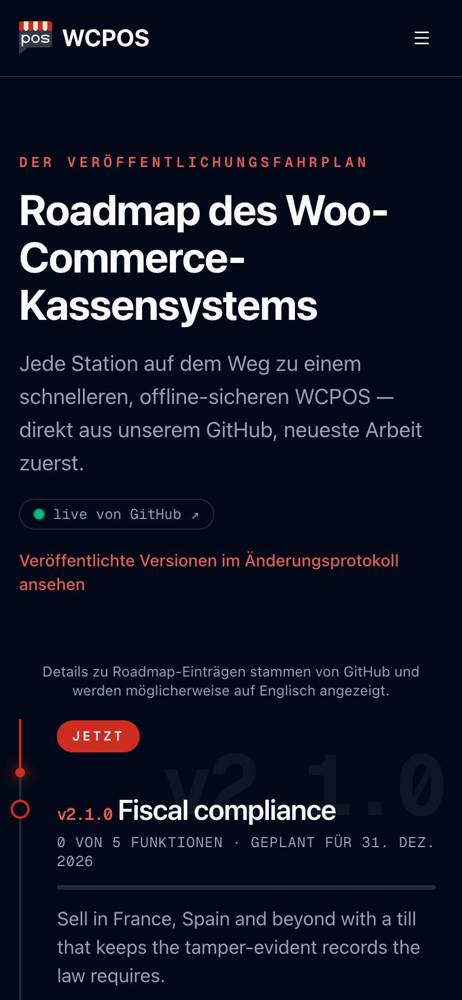 |

## Deferred

These carry over to round 44 as candidates:

- The same five-terminal list in the other comparison pages' prose, FAQ
  answers and choose bodies (`compare.oliver.claims.payments.response`,
  `compare.woocommerce.faq.tapToPay.answer`, the jovvie, vitepos and yith
  choose bodies, and the jovvie, foosales, vitepos and yith FAQ answers).
- /compare: "Choose WCPOS if:" as bullets on all seven pages.
- /support desktop H1: keep "WooCommerce POS" together.
- /compare/square title without a standalone "POS"; de and nl home meta
  description length; `metadata.siteDescription`; the /downloads anchor
  "Free · Desktop" for the release history.
- "As verified on 2026-10-06" intros on /compare/square and
  /compare/woocommerce beside "checked again 2026-11-18" (sceptic).
- "licence" on /support against "license" on /pro and checkout (woo-dev).
- Home device row omits Linux, which /downloads and the footer list (sceptic).
- /downloads "about two minutes" has no source; de home "kostenlos." widow.
- The de header nav still labels /roadmap "Produktplanung" and nl
  "Routekaart", while the page now says "Roadmap". The nav keys were out of
  scope for #896.
- For the front desk:
  - the /compare "Countries" row and an HPOS line, both blocked on a
    product statement;
  - whether stores share stock, where the /pro stores card links, and
    whether the card should say the stores live in one WooCommerce site;
  - a Square-side line in the /compare/square short answer;
  - "free" conceded to Square (price wording);
  - the /extensions terminal-card wording, which another repo owns.
